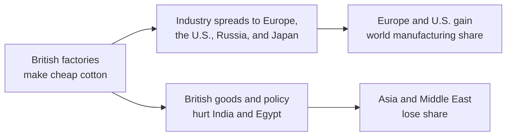

# AP World History: Modern — Topic 5.4 Summary: Industrialization Spreads (c. 1750–1900)

> Source: Summary of AP_WH_5.4_Notes_EN.md

**Unit 5: Revolutions (c. 1750–c. 1900)**

---

## In One Sentence

Factory production spread from Britain to other parts of Europe, the United States, Russia, and Japan, while India and the Middle East kept making goods but lost much of their **share of world manufacturing**.

## The Big Picture

Factories that made cotton cloth replaced Britain's **cottage industry** (work done by hand at home). Cheap British cotton then pushed Indian and Middle Eastern goods out of world markets. Industry spread to countries that had **capital** (money to invest), natural resources, and water transport. India and Egypt still made goods, but British policy and European competition weakened their industries.

## Key Points

### 1. Industry Spreads in Europe (LO-E)

- **Belgium** industrialized first on the continent, with coal, iron, and British skills.
- **France** was slowed by small city populations (few factory workers) and by the **French Revolution** and its wars, which used up money and attention.
- **Germany** was split into many small states. After **unification in 1871**, it quickly became a leading **steel and coal** producer.

### 2. The United States, Russia, and Japan (LO-E)

- The **U.S.** began industrializing in the 1800s and was a leading industrial force by 1900. Its key strength was **human capital**: many immigrants from Europe and East Asia, plus workers from rural America.
- **Russia** focused on **railroads**, such as the **Trans-Siberian Railroad** to the Pacific. Heavy industry grew mostly in the 1890s, but Russia stayed mostly a **farming** economy.
- **Japan** was the first Asian country to industrialize. It used **defensive modernization**: it adopted Western technology and institutions to protect its own culture (see 5.6).

### 3. India Loses Industry (LO-E)

- **Shipbuilding** declined under British control. Britain disbanded the Indian Navy by 1863, when the Royal Navy fully controlled the Indian Ocean.
- Under **Company rule** (British East India Company, 1757–1858), high British **tariffs** (taxes on trade) weakened Indian **mining and metalworking**. After the **Rebellion of 1857**, British laws such as the Arms Act of 1878 limited them further.
- **Textiles:** Bombay had more than 80 mills. British mill owners in Lancashire pushed for a 5% tax on Bombay cloth, which cut Indian profits.

### 4. Egypt and the Global Shift (LO-E)

- In the 1700s, **Egypt** sold carpets, silks, and other textiles to Europe.
- By the mid-1800s, huge European textile output took Egypt's **export market** and much of its **home market**.
- Asia and the Middle East **kept manufacturing**, but their **share** of world manufacturing **fell**, while Europe's and the U.S.'s share rose.

## Must-Know Terms & People

| Term | What it is | Why it matters |
|---|---|---|
| Global share of manufacturing | A region's part of all goods made in the world | Shows the shift from Asia to Europe and the U.S. |
| Deindustrialization | The decline of a region's manufacturing | Describes what happened in India and Egypt |
| Human capital | The workforce and its skills | Immigrant labor drove U.S. industry |
| Defensive modernization | Adopting Western ways to protect one's own culture | Explains how Japan industrialized |
| Trans-Siberian Railroad | Russian railroad from Moscow to the Pacific | Russia built industry around railroads |
| Sergei Witte | Russian official of the 1890s | Led Russia's state-funded industrial drive |
| Company rule | British East India Company control of parts of India, 1757–1858 | Its policies weakened Indian industry |
| Tariff | A tax on imported or exported goods | British tariffs hurt Indian mining and metalworking |

## Key Dates

| Year | Event |
|---|---|
| 1757 | Company rule begins in India |
| 1789–1799 | French Revolution slows French industry |
| 1857 | Rebellion of 1857 against Company rule |
| 1863 | Indian Navy disbanded |
| 1871 | Germany unifies and grows fast in steel and coal |
| 1878 | Arms Act of 1878 in India |

## How the Exam Asks About It

- **Legitimacy & consolidation:** Governments used industry to build strength. Japan adopted Western ways to protect its own culture, and Russia's government funded industry under Sergei Witte.
- **Continuity, innovation, diversity:** Continuity: India and Egypt kept making goods. Innovation: factory production spread beyond Britain. Diversity: each country industrialized in its own way and at its own time.
- **Likely comparison:** Germany vs. Russia. Both industrialized after Britain and built heavy industry. But Germany became a leading steel and coal producer, while Russia stayed mostly agricultural.
- **Common trap:** Students say Asia stopped making goods. The fix: Asia and the Middle East **kept manufacturing**; what fell was their **share** of world output.

## Check Yourself

1. Why did Germany industrialize later than Britain?

▶ Answer
Germany was split into many small states. After unification in 1871, it quickly became a leading producer of steel and coal.

2. What is defensive modernization, and which country used it?

▶ Answer
It means adopting Western technology and institutions to protect one's own culture. Japan used it and became the first Asian country to industrialize.

3. Give two ways Britain weakened manufacturing in India.

▶ Answer
High British tariffs under Company rule weakened Indian mining and metalworking. British mill owners also pushed for a 5% tax on Bombay textiles.

