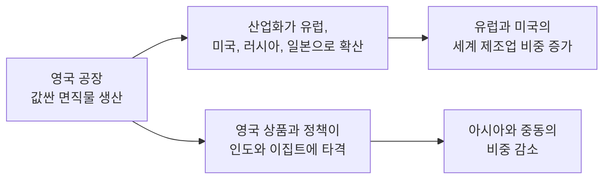

# AP 세계사: 모던 — 토픽 5.4 요약: 산업화의 확산 (Industrialization Spreads)

> 출처: AP_WH_5.4_Notes_KR.md 요약

**Unit 5: 혁명의 시대 (Revolutions, c. 1750–c. 1900)**

---

## 한 문장 요약

공장식 생산은 영국에서 유럽의 다른 지역, 미국, 러시아, 일본으로 퍼졌고, 인도와 중동은 계속 물건을 만들었지만 **세계 제조업 비중** (Global share of manufacturing)의 상당 부분을 잃었다.

## 큰 그림

면직물을 만드는 공장이 영국의 **가내 공업 (Cottage industry)**(집에서 손으로 하던 일)을 대체했다. 그 뒤 값싼 영국 면직물이 인도와 중동의 상품을 세계 시장에서 밀어냈다. 산업화는 **자본 (Capital)**(투자할 돈), 천연자원, 수상 운송을 갖춘 나라로 퍼졌다. 인도와 이집트는 여전히 물건을 만들었지만, 영국의 정책과 유럽과의 경쟁이 그 산업을 약화시켰다.

## 핵심 정리

### 1. 유럽으로 퍼진 산업화 (LO-E)

- **벨기에** (Belgium)는 석탄, 철, 영국 기술을 바탕으로 유럽 대륙에서 가장 먼저 산업화했다.
- **프랑스** (France)는 도시 인구가 적어 공장 노동자가 부족했고, **프랑스 혁명** (French Revolution)과 그 뒤의 전쟁이 돈과 관심을 빼앗아 산업화가 늦어졌다.
- **독일** (Germany)은 여러 작은 국가로 나뉘어 있었다. **1871년 통일** 뒤에는 빠르게 **철강과 석탄**의 주요 생산국이 되었다.

### 2. 미국, 러시아, 일본 (LO-E)

- **미국** (United States)은 1800년대에 산업화를 시작했고, 1900년에는 세계적인 공업 강국이었다. 핵심 강점은 **인적 자본** (Human capital)이었다. 유럽과 동아시아에서 온 많은 이민자와 미국 농촌 출신 노동자가 있었다.
- **러시아** (Russia)는 **시베리아 횡단 철도** (Trans-Siberian Railroad)처럼 태평양까지 가는 **철도**에 집중했다. 중공업은 주로 1890년대에 성장했지만, 러시아는 여전히 대부분 **농업** 경제였다.
- **일본** (Japan)은 아시아에서 가장 먼저 산업화했다. 일본은 **방어적 근대화** (Defensive modernization)를 택했다. 자국 문화를 지키기 위해 서구의 기술과 제도를 받아들인 것이다 (5.6 참고).

### 3. 산업을 잃은 인도 (LO-E)

- **조선업** (Shipbuilding)은 영국의 관리 아래 쇠퇴했다. 영국은 영국 해군 (Royal Navy)이 인도양을 완전히 장악한 1863년까지 인도 해군 (Indian Navy)을 해체했다.
- **회사 통치 (Company rule)**(영국 동인도 회사, 1757–1858) 아래에서 높은 영국 **관세 (Tariff)**(무역에 매기는 세금)가 인도의 **광업과 금속 가공**을 약화시켰다. **1857년 봉기 (Rebellion of 1857)** 뒤에는 1878년 무기법 (Arms Act of 1878) 같은 영국 법이 이를 더 제한했다.
- **섬유:** 봄베이 (Bombay)에는 80개가 넘는 공장이 있었다. 랭커셔 (Lancashire)의 영국 공장주들은 봄베이 면직물에 5% 세금을 물리도록 압력을 넣었고, 이 세금이 인도 공장의 이익을 줄였다.

### 4. 이집트와 세계적 변화 (LO-E)

- 1700년대 **이집트** (Egypt)는 카펫, 비단 등의 섬유를 유럽에 팔았다.
- 1800년대 중반에는 유럽의 섬유 생산이 크게 늘어, 이집트는 **수출 시장**과 **국내 시장**의 상당 부분을 잃었다.
- 아시아와 중동은 **제조업을 계속했지만**, 세계 제조업에서 차지하는 **비중**은 **줄었고**, 유럽과 미국의 비중은 늘었다.

## 꼭 알아야 할 용어·인물

| 용어 | 무엇인가 | 왜 중요한가 |
|---|---|---|
| 세계 제조업 비중 (Global share of manufacturing) | 세계에서 만든 모든 상품 가운데 한 지역이 차지하는 몫 | 아시아에서 유럽과 미국으로 옮겨 간 변화를 보여 준다 |
| 탈산업화 (Deindustrialization) | 한 지역 제조업의 쇠퇴 | 인도와 이집트에서 일어난 일을 설명한다 |
| 인적 자본 (Human capital) | 노동력과 그 기술 | 이민 노동력이 미국 산업을 이끌었다 |
| 방어적 근대화 (Defensive modernization) | 자국 문화를 지키기 위해 서구 방식을 받아들이는 것 | 일본이 산업화한 방식을 설명한다 |
| 시베리아 횡단 철도 (Trans-Siberian Railroad) | 모스크바에서 태평양까지 이어진 러시아 철도 | 러시아는 철도를 중심으로 산업을 키웠다 |
| 세르게이 비테 (Sergei Witte) | 1890년대 러시아의 관리 | 국가 자금에 기댄 러시아 산업화를 이끌었다 |
| 회사 통치 (Company rule) | 영국 동인도 회사의 인도 일부 지배, 1757–1858 | 그 정책이 인도 산업을 약화시켰다 |
| 관세 (Tariff) | 수입품이나 수출품에 매기는 세금 | 영국 관세가 인도의 광업과 금속 가공에 타격을 주었다 |

## 주요 연도

| 연도 | 사건 |
|---|---|
| 1757 | 인도에서 회사 통치 (Company rule) 시작 |
| 1789–1799 | 프랑스 혁명 (French Revolution)으로 프랑스 산업화 지연 |
| 1857 | 회사 통치에 맞선 1857년 봉기 (Rebellion of 1857) |
| 1863 | 인도 해군 (Indian Navy) 해체 |
| 1871 | 독일 통일, 철강과 석탄 생산 급성장 |
| 1878 | 인도에서 1878년 무기법 (Arms Act of 1878) 시행 |

## 시험에서는 이렇게 묻는다

- **정당화와 공고화:** 정부는 산업을 이용해 힘을 키웠다. 일본은 자국 문화를 지키기 위해 서구 방식을 받아들였고, 러시아 정부는 세르게이 비테 (Sergei Witte) 아래에서 산업에 자금을 댔다.
- **연속성·혁신·다양성:** 연속성: 인도와 이집트는 계속 물건을 만들었다. 혁신: 공장식 생산이 영국 밖으로 퍼졌다. 다양성: 나라마다 서로 다른 방식과 시기에 산업화했다.
- **자주 나오는 비교:** 독일 대 러시아. 두 나라 모두 영국보다 늦게 산업화했고 중공업을 키웠다. 그러나 독일은 철강과 석탄의 주요 생산국이 되었고, 러시아는 여전히 대부분 농업 중심이었다.
- **자주 하는 실수:** 아시아가 물건 만들기를 멈췄다고 쓰는 경우가 많다. 바로잡기: 아시아와 중동은 **제조업을 계속했다.** 줄어든 것은 세계 생산에서 차지하는 **비중**이다.

## 스스로 확인하기

1. 독일은 왜 영국보다 늦게 산업화했는가?

▶ 정답
독일은 여러 작은 국가로 나뉘어 있었다. 1871년 통일 뒤에는 빠르게 철강과 석탄의 주요 생산국이 되었다.

2. 방어적 근대화란 무엇이며, 어느 나라가 택했는가?

▶ 정답
자국 문화를 지키기 위해 서구의 기술과 제도를 받아들이는 것이다. 일본이 이 방식을 택했고, 아시아에서 가장 먼저 산업화했다.

3. 영국이 인도의 제조업을 약화시킨 방법 두 가지를 들라.

▶ 정답
회사 통치 아래 높은 영국 관세가 인도의 광업과 금속 가공을 약화시켰다. 또 영국 공장주들은 봄베이 섬유에 5% 세금을 물리도록 압력을 넣었다.

