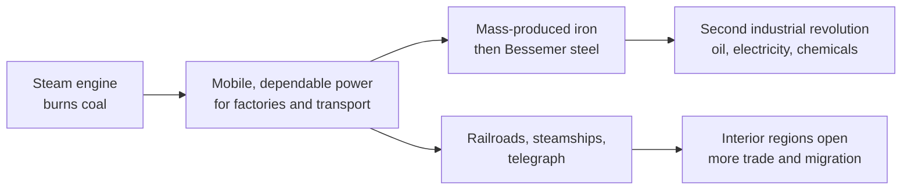

# AP World History: Modern — Topic 5.5 Summary: Technology of the Industrial Age (c. 1750–1900)

> Source: Summary of AP_WH_5.5_Notes_EN.md

**Unit 5: Revolutions (c. 1750–c. 1900)**

---

## In One Sentence

New machines let people use the energy in **fossil fuels** (coal, then oil), which powered factories, railroads, and steamships, and later new methods in steel, chemicals, and electricity opened up the whole world to trade and migration.

## The Big Picture

The first factories ran on water from streams, so they had to sit next to rivers. The **steam engine** used **coal** instead, so power could be made anywhere and switched on or off. Coal also made iron and later **steel** cheap to mass-produce. In the late 1800s a **second industrial revolution** brought steel, chemicals, oil, electricity, and precision machinery. Railroads, steamships, and the telegraph tied the world together and opened up inland regions.

## Key Points

### 1. Coal and Steam Power (LO-F)

- Coal was a **mobile** power source. Water and wind were tied to one place or could not be turned on when needed.
- **James Watt's steam engine** cheaply turned coal into steam power for textile machines. Within about 50 years, steam also powered trains.
- **Steamships** did not need wind, and over time they **replaced sailing ships**. They refueled at **coaling stations** (coal ports), such as Cape Colony in South Africa.

### 2. Iron and Steel (LO-F)

- **Coke**, a refined form of coal, made much larger iron furnaces possible.
- **Cast iron** was strong but brittle (it broke easily). In 1794 **Henry Cort** patented a process for **wrought iron**, which was easier to shape.
- **Steel** is a mix of iron and carbon. The **Bessemer Process** (1856) blew air through melted metal to remove impurities, so steel could be **mass-produced**. Steel became the **backbone** of industrial society.

### 3. The Second Industrial Revolution (LO-F)

- It happened in the **late 1800s and early 1900s**, led by the **United States, Great Britain, and Germany**.
- **Oil** (petroleum) is a fossil fuel. At first its main product was **kerosene** for lamps and heaters. **Gasoline** became more important when cars spread in the early 1900s.
- The **internal combustion engine** (an engine that burns fuel inside it) led to **automobiles and airplanes**. Karl Benz built an automobile in 1886.
- **Electricity** needed good generators. Electric street lighting and streetcars spread in the 1890s.

### 4. Faster Communication (LO-F)

- The **telegraph** sent messages over wires **immediately**.
- **Alexander Graham Bell** patented the **telephone** in 1876, and **Thomas Edison** improved it. Edison also made a practical light bulb in 1879.
- **Guglielmo Marconi** sent a **radio** signal across the Atlantic in 1901. Radio later became mass media.

### 5. Connecting the World (LO-F)

- Before, trade and migration centered on **coasts**. **Railroads, steamships, and the telegraph** opened **interior regions** (inland areas), so **trade and migration grew**.
- The U.S. **Transcontinental Railroad** (1869) linked the Atlantic and Pacific. Like canals, railroads got large **subsidies** (public money).
- Industrial states (Britain, Germany, the U.S.) needed more resources, so they set up **colonies** to protect their access to resources and markets.

## Must-Know Terms & People

| Term | What it is | Why it matters |
|---|---|---|
| Steam engine | Engine that uses coal-made steam to run machines | Made power mobile and dependable |
| Fossil fuels | Coal and oil, energy stored in the ground | Greatly increased the energy people could use |
| Coke | Refined coal used in large iron furnaces | Made mass production of iron possible |
| Bessemer Process | Blowing air through melted metal to make steel (1856) | Made steel cheap and common |
| Second industrial revolution | Late-1800s wave in steel, chemicals, machinery, electricity | Led by the U.S., Britain, and Germany |
| Internal combustion engine | Engine that burns fuel inside it | Led to cars and airplanes |
| Electrification | Spread of electric power for light and transport | Brought street lighting and streetcars |
| Telegraph | Device that sent messages over wires at once | Allowed fast communication across distances |
| Transcontinental Railroad | U.S. railroad linking the Atlantic and Pacific (1869) | Helped make the U.S. an industrial nation |

## Key Dates

| Year | Event |
|---|---|
| 1794 | Henry Cort patents a wrought iron process |
| 1856 | Bessemer Process for mass-producing steel |
| 1869 | U.S. Transcontinental Railroad completed |
| 1876 | Bell patents the telephone |
| 1886 | Karl Benz's automobile |
| 1901 | Marconi sends a radio signal across the Atlantic |

## How the Exam Asks About It

- **Legitimacy & consolidation:** Governments helped industry grow. They paid large subsidies for railroads, and industrial states took colonies to secure resources and markets.
- **Continuity, innovation, diversity:** Continuity: like canals before them, railroads were built with public money. Innovation: the Bessemer Process and electricity. Diversity: energy sources each had their own uses, from coal and steam to oil and electricity.
- **Likely comparison:** First vs. second industrial revolution. Both used fossil fuels to raise production. But the first was led by Britain with textiles, steam, and iron, while the second was led by the U.S., Britain, and Germany with steel, chemicals, oil, and electricity.
- **Common trap:** Students think new transport only helped coastal cities. The fix: railroads, steamships, and the telegraph opened **interior regions**, which increased trade and migration.

## Check Yourself

1. Why was coal a better power source than water or wind?

▶ Answer
Coal was mobile and dependable. Steam engines could be built anywhere and switched on or off, while water power was tied to rivers and wind could not be turned on when needed.

2. What did the Bessemer Process do, and why did it matter?

▶ Answer
It blew air through melted metal to remove impurities. This made it possible to mass-produce steel, which became the backbone of industrial society.

3. How did railroads, steamships, and the telegraph change trade and migration?

▶ Answer
They opened interior regions that had been hard to reach, not just coasts. This increased trade and migration around the world.

