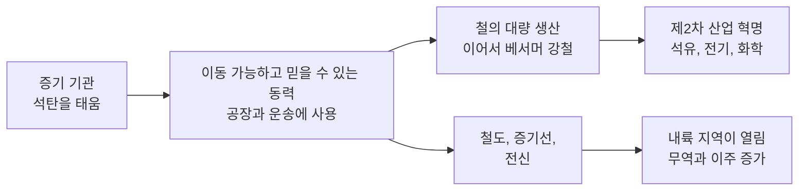

# AP 세계사: 모던 — 토픽 5.5 요약: 산업 시대의 기술 (Technology of the Industrial Age)

> 출처: AP_WH_5.5_Notes_KR.md 요약

**Unit 5: 혁명의 시대 (Revolutions, c. 1750–c. 1900)**

---

## 한 문장 요약

새 기계 덕분에 사람들은 **화석 연료 (Fossil fuels)**(석탄, 이어서 석유)의 에너지를 쓸 수 있게 되었고, 이 에너지가 공장, 철도, 증기선을 움직였으며, 뒤이어 강철, 화학, 전기의 새 방법이 온 세계를 무역과 이주에 열어 주었다.

## 큰 그림

초기 공장은 개울물로 돌아갔기 때문에 강 옆에 있어야 했다. **증기 기관** (Steam engine)은 대신 **석탄** (Coal)을 써서, 어디서나 동력을 만들고 켜고 끌 수 있었다. 석탄은 철과 뒤이어 **강철** (Steel)도 값싸게 대량 생산하게 해 주었다. 1800년대 후반 **제2차 산업 혁명** (Second industrial revolution)은 강철, 화학, 석유, 전기, 정밀 기계를 가져왔다. 철도, 증기선, 전신은 세계를 하나로 묶고 내륙 지역을 열었다.

## 핵심 정리

### 1. 석탄과 증기 동력 (LO-F)

- 석탄은 **이동 가능한** 동력원이었다. 물과 바람은 한곳에 묶여 있거나 필요할 때 켤 수 없었다.
- **제임스 와트 (James Watt)의 증기 기관**은 석탄을 값싸게 증기 동력으로 바꾸어 섬유 기계를 돌렸다. 약 50년 안에 증기는 기차도 움직였다.
- **증기선** (Steamship)은 바람이 필요 없었고, 시간이 지나며 **범선을 대체했다.** 증기선은 남아프리카의 케이프 식민지 (Cape Colony) 같은 **석탄 보급소 (Coaling station)**(석탄을 싣는 항구)에서 연료를 채웠다.

### 2. 철과 강철 (LO-F)

- 석탄을 정제한 **코크스 (Coke)** 덕분에 훨씬 큰 용광로를 쓸 수 있었다.
- **주철** (Cast iron)은 단단하지만 잘 부서졌다. 1794년 **헨리 코트** (Henry Cort)가 모양을 만들기 쉬운 **연철 (Wrought iron)** 제조법의 특허를 받았다.
- **강철**은 철과 탄소의 합금이다. **베서머 공법** (Bessemer Process, 1856)은 녹은 금속에 공기를 불어 넣어 불순물을 없앴고, 그래서 강철을 **대량 생산**할 수 있었다. 강철은 산업 사회의 **뼈대**가 되었다.

### 3. 제2차 산업 혁명 (LO-F)

- 제2차 산업 혁명은 **1800년대 후반과 1900년대 초**에 일어났고, **미국, 영국, 독일**이 이끌었다.
- **석유** (Petroleum)는 화석 연료다. 처음에는 등불과 난방용 **등유** (Kerosene)가 주요 제품이었다. 1900년대 초 자동차가 퍼지면서 **휘발유** (Gasoline)가 더 중요해졌다.
- **내연 기관 (Internal combustion engine)**(내부에서 연료를 태우는 기관)은 **자동차와 비행기**로 이어졌다. 카를 벤츠 (Karl Benz)는 1886년 자동차를 만들었다.
- **전기**에는 좋은 발전기가 필요했다. 1890년대에 전기 가로등과 전차가 퍼졌다.

### 4. 더 빨라진 통신 (LO-F)

- **전신** (Telegraph)은 전선을 통해 메시지를 **즉시** 보냈다.
- **알렉산더 그레이엄 벨** (Alexander Graham Bell)이 1876년 **전화**의 특허를 받았고, **토머스 에디슨** (Thomas Edison)이 이를 개량했다. 에디슨은 1879년 실용적인 전구도 만들었다.
- **굴리엘모 마르코니** (Guglielmo Marconi)는 1901년 대서양 너머로 **무선** 신호를 보냈다. 라디오는 뒤에 대중 매체가 되었다.

### 5. 세계를 잇다 (LO-F)

- 이전의 무역과 이주는 **해안** 중심이었다. **철도, 증기선, 전신**이 **내륙 지역**을 열어 **무역과 이주가 늘었다.**
- 미국 **대륙 횡단 철도** (Transcontinental Railroad, 1869)는 대서양과 태평양을 연결했다. 운하처럼 철도도 막대한 **보조금 (Subsidy)**(공공 자금)을 받았다.
- 공업국(영국, 독일, 미국)은 더 많은 자원이 필요해졌고, 자원과 시장에 대한 접근을 지키려고 **식민지**를 세웠다.

## 꼭 알아야 할 용어·인물

| 용어 | 무엇인가 | 왜 중요한가 |
|---|---|---|
| 증기 기관 (Steam engine) | 석탄으로 만든 증기로 기계를 움직이는 기관 | 동력을 이동 가능하고 믿을 수 있게 만들었다 |
| 화석 연료 (Fossil fuels) | 땅속에 저장된 에너지인 석탄과 석유 | 사람들이 쓸 수 있는 에너지를 크게 늘렸다 |
| 코크스 (Coke) | 큰 용광로에 쓰인 정제된 석탄 | 철의 대량 생산을 가능하게 했다 |
| 베서머 공법 (Bessemer Process) | 녹은 금속에 공기를 불어 넣어 강철을 만드는 방법 (1856) | 강철을 값싸고 흔하게 만들었다 |
| 제2차 산업 혁명 (Second industrial revolution) | 1800년대 후반 강철, 화학, 기계, 전기의 혁신 물결 | 미국, 영국, 독일이 이끌었다 |
| 내연 기관 (Internal combustion engine) | 내부에서 연료를 태우는 기관 | 자동차와 비행기로 이어졌다 |
| 전기화 (Electrification) | 조명과 교통을 위한 전력의 보급 | 가로등과 전차를 가져왔다 |
| 전신 (Telegraph) | 전선으로 메시지를 즉시 보낸 장치 | 먼 거리의 빠른 통신을 가능하게 했다 |
| 대륙 횡단 철도 (Transcontinental Railroad) | 대서양과 태평양을 잇는 미국 철도 (1869) | 미국이 공업국이 되는 데 도움을 주었다 |

## 주요 연도

| 연도 | 사건 |
|---|---|
| 1794 | 헨리 코트 (Henry Cort)가 연철 제조법 특허를 받음 |
| 1856 | 강철을 대량 생산하는 베서머 공법 (Bessemer Process) |
| 1869 | 미국 대륙 횡단 철도 (Transcontinental Railroad) 완성 |
| 1876 | 벨 (Bell)이 전화 특허를 받음 |
| 1886 | 카를 벤츠 (Karl Benz)의 자동차 |
| 1901 | 마르코니 (Marconi)가 대서양 너머로 무선 신호를 보냄 |

## 시험에서는 이렇게 묻는다

- **정당화와 공고화:** 정부는 산업 성장을 도왔다. 정부는 철도에 막대한 보조금을 주었고, 공업국은 자원과 시장을 확보하려고 식민지를 차지했다.
- **연속성·혁신·다양성:** 연속성: 그 전의 운하처럼 철도도 공공 자금으로 건설되었다. 혁신: 베서머 공법과 전기. 다양성: 석탄과 증기에서 석유와 전기까지, 에너지원마다 쓰임새가 달랐다.
- **자주 나오는 비교:** 제1차 산업 혁명 대 제2차 산업 혁명. 둘 다 화석 연료로 생산을 늘렸다. 그러나 제1차는 영국이 섬유, 증기, 철로 이끌었고, 제2차는 미국, 영국, 독일이 강철, 화학, 석유, 전기로 이끌었다.
- **자주 하는 실수:** 새 운송 수단이 해안 도시만 도왔다고 생각하는 경우가 많다. 바로잡기: 철도, 증기선, 전신은 **내륙 지역**을 열어 무역과 이주를 늘렸다.

## 스스로 확인하기

1. 석탄은 왜 물이나 바람보다 나은 동력원이었는가?

▶ 정답
석탄은 이동 가능하고 믿을 수 있었다. 증기 기관은 어디에나 지을 수 있고 켜고 끌 수 있었지만, 수력은 강에 묶여 있었고 바람은 필요할 때 켤 수 없었다.

2. 베서머 공법은 무엇을 했으며, 왜 중요했는가?

▶ 정답
녹은 금속에 공기를 불어 넣어 불순물을 없앴다. 이 덕분에 강철을 대량 생산할 수 있었고, 강철은 산업 사회의 뼈대가 되었다.

3. 철도, 증기선, 전신은 무역과 이주를 어떻게 바꾸었는가?

▶ 정답
해안뿐 아니라 닿기 어려웠던 내륙 지역을 열었다. 그 결과 세계의 무역과 이주가 늘었다.

