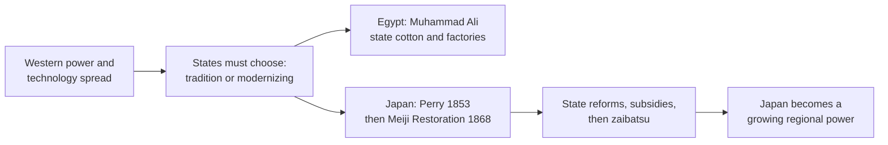

# AP World History: Modern — Topic 5.6 Summary: Industrialization: Government's Role (c. 1750–1900)

> Source: Summary of AP_WH_5.6_Notes_EN.md

**Unit 5: Revolutions (c. 1750–c. 1900)**

---

## In One Sentence

Facing Western power, some governments led industry themselves: **Muhammad Ali** built state factories in Egypt, and **Meiji Japan** adopted selected Western ways to stay independent and became a growing power, while China and the Ottoman Empire struggled.

## The Big Picture

As Western power and technology spread, every country had to choose between **keeping tradition** and **modernizing**. Some states used **state-sponsored industrialization**: the government planned, paid for, and built industry. In Egypt, Muhammad Ali took control of land and cotton, built state factories, and created a modern army. In Japan, U.S. warships forced the country open, and reformers then rebuilt the state along Western lines in less than half a century. China's weak government could not lead industrialization in the same way.

## Key Points

### 1. Muhammad Ali's Egypt (LO-G)

- **Muhammad Ali**, an Albanian Ottoman officer, was chosen as **governor** by local leaders (1805), and the sultan had to agree. He acted **somewhat independently** of the sultan.
- He built a **European-model army** and navy, opened new schools, and sent officers to study in France.
- Taxes were so high that peasants gave their land to the **state**. The state then **controlled cotton** and earned money by exporting it.
- The profits paid for **textile factories** to compete with Britain and France, **arms factories** in Cairo, and **shipyards** in Alexandria.
- Over time, Egypt's factories struggled against British competition. Later debts led to **British occupation in 1882**.

### 2. Japan Is Forced Open (LO-G)

- From 1600 to 1854, Japan had **very little contact** with the outside world.
- In 1853, U.S. **Commodore Matthew Perry** sailed into Edo (Tokyo) Bay and asked for trade. In 1854 he came back with more warships, and **Japan gave in**.
- Leaders had seen Britain defeat China in a war to force opium imports, and they **feared the same fate**. Reformers overthrew the **shogun** (military ruler) and gave power back to the emperor in 1868. This was the **Meiji Restoration**.

### 3. Meiji Reforms (LO-G)

- Japan sent missions to Europe and the U.S. and **chose the Western institutions** it admired.
- It became a **constitutional monarchy** (a monarchy limited by a constitution) on the Prussian model. The **Meiji Constitution** came in 1889.
- It built a Prussian-style army, a new navy, and **conscription** (required military service). It also set up new schools with technical training.
- It built **railroads** and roads and gave **subsidies** (government money) to industries such as silk, tea, weapons, and shipbuilding. A **high tax on farming** paid for the reforms.

### 4. Private Investment and Japan's Rise (LO-G)

- Private investment, including from overseas, also mattered.
- Once new industries did well, they were often sold to **zaibatsu**, powerful family business groups.
- Japan also copied industry's problems: **female mill workers** were abused and exploited, as in Britain earlier.
- Japan defeated **China (1895)** and **Russia (1905)** and became a growing regional power.

### 5. Weaker Responses: the Ottomans and China (LO-G)

- The **Ottoman Empire** was called **"the sick man of Europe."** Corruption weakened it, and nationalism among its many peoples caused unrest.
- The **Tanzimat** reforms (1839–1876) tried to modernize Ottoman law, the military, and schools (see 5.8).
- **China** resisted European influence and goods. Its weakened government could not drive industrialization (see 6.5).

## Must-Know Terms & People

| Term | What it is | Why it matters |
|---|---|---|
| State-sponsored industrialization | Government plans, pays for, and builds industry | The main strategy of this topic |
| Muhammad Ali | Governor of Egypt from 1805 | Built state cotton control and state factories |
| Matthew Perry | U.S. commodore who came to Japan in 1853 | Forced Japan to open to trade |
| Shogun | Military ruler who held real power in Japan before 1868 | Overthrown in the Meiji Restoration |
| Meiji Restoration | 1868 return of power to Japan's emperor | Began Japan's rapid modernization |
| Constitutional monarchy | Monarchy limited by a constitution | Japan's new government on the Prussian model |
| Subsidy | Government money that supports an industry | Meiji Japan funded silk, weapons, and ships |
| Zaibatsu | Powerful Japanese family business groups | Took over industries the state had started |
| "Sick man of Europe" | Nickname for the declining Ottoman Empire | Shows a state that could not keep up |

## Key Dates

| Year | Event |
|---|---|
| 1805 | Muhammad Ali becomes governor of Egypt |
| 1853 | Perry's ships arrive in Edo Bay |
| 1868 | Meiji Restoration |
| 1882 | Britain occupies Egypt |
| 1889 | Meiji Constitution adopted |
| 1895 | Japan defeats China |
| 1905 | Japan defeats Russia |

## How the Exam Asks About It

- **Legitimacy & consolidation:** Meiji reformers ruled in the name of the restored emperor and built a strong army and a bureaucracy in Tokyo. Muhammad Ali was chosen by local leaders, so the sultan had to accept him, and he built his own European-model army.
- **Continuity, innovation, diversity:** Continuity: Japan kept its emperor and traditional culture. Innovation: state-built factories in Egypt. Diversity: Egypt, Japan, the Ottomans, and China each answered Western power differently.
- **Likely comparison:** Egypt vs. Japan. Both governments taxed farmers heavily to pay for state-led industry and a European-style army. But Japan became a growing regional power, while Egypt's factories struggled and Britain occupied Egypt in 1882.
- **Common trap:** Students say Japan simply gave up its traditions to copy the West. The fix: reformers chose **some** Western technology and methods to **protect** Japan's traditional culture and independence.

## Check Yourself

1. How did Muhammad Ali's state make money from farming?

▶ Answer
He taxed peasants so heavily that they gave their land to the state. The state then controlled cotton and other crops and made large profits by exporting them.

2. What caused the Meiji Restoration?

▶ Answer
Perry's U.S. warships forced Japan to open to trade in 1853–1854. Leaders feared Japan would be humiliated like China, so reformers overthrew the shogun and restored the emperor in 1868.

3. Name two Meiji reforms that helped Japan industrialize.

▶ Answer
The government built railroads and roads. It also gave subsidies to key industries such as silk, weapons, and shipbuilding.

