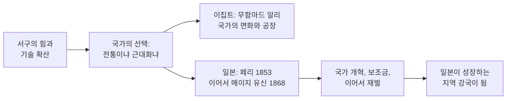

# AP 세계사: 모던 — 토픽 5.6 요약: 산업화와 정부의 역할 (Industrialization: Government's Role)

> 출처: AP_WH_5.6_Notes_KR.md 요약

**Unit 5: 혁명의 시대 (Revolutions, c. 1750–c. 1900)**

---

## 한 문장 요약

서구의 힘에 맞서 일부 정부는 직접 산업을 이끌었다. **무함마드 알리** (Muhammad Ali)는 이집트에 국영 공장을 세웠고, **메이지 일본** (Meiji Japan)은 독립을 지키려고 서구 방식을 골라 받아들여 성장하는 강국이 되었지만, 중국과 오스만 제국 (Ottoman Empire)은 어려움을 겪었다.

## 큰 그림

서구의 힘과 기술이 퍼지면서 모든 나라는 **전통을 지킬지**, **근대화할지** 골라야 했다. 일부 국가는 정부가 산업을 계획하고 자금을 대고 건설하는 **국가 주도 산업화** (State-sponsored industrialization)를 택했다. 이집트에서 무함마드 알리는 토지와 면화를 장악하고, 국영 공장을 세우고, 근대식 군대를 만들었다. 일본에서는 미국 군함이 나라의 문을 강제로 열었고, 이후 개혁가들이 반세기도 안 되어 나라를 서구식으로 다시 세웠다. 중국의 약한 정부는 같은 방식으로 산업화를 이끌 수 없었다.

## 핵심 정리

### 1. 무함마드 알리의 이집트 (LO-G)

- 알바니아 출신 오스만 장교 **무함마드 알리**는 지역 지도자들에 의해 **총독**으로 뽑혔고(1805), 술탄 (Sultan)은 동의할 수밖에 없었다. 그는 술탄으로부터 **어느 정도 독자적으로** 행동했다.
- 그는 **유럽식 군대**와 해군을 만들고, 새 학교를 열고, 장교들을 프랑스로 유학 보냈다.
- 세금이 너무 높아 농민들은 땅을 **국가**에 넘겼다. 국가는 **면화를 통제**하고 수출해 돈을 벌었다.
- 그 이익으로 영국·프랑스와 경쟁할 **섬유 공장**, 카이로의 **무기 공장**, 알렉산드리아의 **조선소**를 세웠다.
- 시간이 지나며 이집트 공장들은 영국과의 경쟁에서 고전했다. 이후 부채 때문에 **1882년 영국에 점령**되었다.

### 2. 문을 연 일본 (LO-G)

- 1600년부터 1854년까지 일본은 바깥 세계와 **거의 접촉하지 않았다.**
- 1853년 미국의 **매슈 페리 (Matthew Perry) 제독**이 에도(도쿄)만에 들어와 무역을 요구했다. 1854년 그는 더 많은 군함을 이끌고 돌아왔고, **일본은 굴복했다.**
- 일본 지도자들은 영국이 아편 수입을 강요하려고 전쟁을 벌여 중국을 굴복시키는 것을 보았고, **같은 운명을 두려워했다.** 개혁가들은 **쇼군 (Shogun)**(군사 통치자)을 무너뜨리고 1868년 천황에게 권력을 돌려주었다. 이것이 **메이지 유신** (Meiji Restoration)이다.

### 3. 메이지 정부의 개혁 (LO-G)

- 일본은 유럽과 미국에 사절단을 보내 좋다고 판단한 **서구 제도를 골라** 받아들였다.
- 일본은 프로이센을 본뜬 **입헌 군주제 (Constitutional monarchy)**(헌법으로 제한되는 군주제)가 되었다. **메이지 헌법** (Meiji Constitution)은 1889년에 채택되었다.
- 프로이센식 군대, 새 해군, **징병제 (Conscription)**(의무 병역)를 도입했다. 또 기술 교육을 하는 새 학교를 세웠다.
- **철도**와 도로를 건설하고, 비단, 차, 무기, 조선 같은 산업에 **보조금 (Subsidy)**(정부가 주는 돈)을 주었다. **높은 농업세**가 개혁 자금이 되었다.

### 4. 민간 투자와 일본의 부상 (LO-G)

- 해외를 포함한 민간 투자도 중요했다.
- 새 산업이 잘되면 강력한 가족 기업 집단인 **재벌** (Zaibatsu)에 매각되는 경우가 많았다.
- 일본은 산업 사회의 문제도 들여왔다. 영국에서 먼저 그랬듯이 **여성 방적 공장 노동자**가 학대와 착취를 당했다.
- 일본은 **청** (China, 1895)과 **러시아** (Russia, 1905)를 이기고 성장하는 지역 강국이 되었다.

### 5. 약했던 대응: 오스만 제국과 중국 (LO-G)

- **오스만 제국**은 '**유럽의 병자** (the sick man of Europe)'라고 불렸다. 부패가 제국을 약화시켰고, 여러 민족의 민족주의가 소요를 일으켰다.
- **탄지마트 (Tanzimat)** 개혁(1839–1876)은 오스만의 법, 군사, 교육을 근대화하려고 했다 (5.8 참고).
- **중국**은 유럽의 영향과 상품에 저항했다. 약해진 정부는 산업화를 이끌 수 없었다 (6.5 참고).

## 꼭 알아야 할 용어·인물

| 용어 | 무엇인가 | 왜 중요한가 |
|---|---|---|
| 국가 주도 산업화 (State-sponsored industrialization) | 정부가 산업을 계획하고 자금을 대고 건설하는 것 | 이 토픽의 핵심 전략이다 |
| 무함마드 알리 (Muhammad Ali) | 1805년부터 이집트 총독 | 국가의 면화 통제와 국영 공장을 만들었다 |
| 매슈 페리 (Matthew Perry) | 1853년 일본에 온 미국 제독 | 일본이 무역에 문을 열게 했다 |
| 쇼군 (Shogun) | 1868년 이전 일본의 실권을 쥔 군사 통치자 | 메이지 유신으로 무너졌다 |
| 메이지 유신 (Meiji Restoration) | 1868년 일본 천황에게 권력이 돌아간 사건 | 일본의 빠른 근대화를 시작했다 |
| 입헌 군주제 (Constitutional monarchy) | 헌법으로 제한되는 군주제 | 프로이센을 본뜬 일본의 새 정부 형태였다 |
| 보조금 (Subsidy) | 산업을 지원하기 위해 정부가 주는 돈 | 메이지 일본은 비단, 무기, 배에 자금을 댔다 |
| 재벌 (Zaibatsu) | 강력한 일본의 가족 기업 집단 | 국가가 시작한 산업을 넘겨받았다 |
| '유럽의 병자' ("Sick man of Europe") | 쇠퇴하는 오스만 제국의 별명 | 따라가지 못한 국가를 보여 준다 |

## 주요 연도

| 연도 | 사건 |
|---|---|
| 1805 | 무함마드 알리 (Muhammad Ali)가 이집트 총독이 됨 |
| 1853 | 페리 (Perry)의 함대가 에도만에 도착 |
| 1868 | 메이지 유신 (Meiji Restoration) |
| 1882 | 영국이 이집트를 점령 |
| 1889 | 메이지 헌법 (Meiji Constitution) 채택 |
| 1895 | 일본이 청 (China)을 이김 |
| 1905 | 일본이 러시아 (Russia)를 이김 |

## 시험에서는 이렇게 묻는다

- **정당화와 공고화:** 메이지 개혁가들은 되돌아온 천황의 이름으로 통치했고, 강한 군대와 도쿄 중심의 관료제를 만들었다. 무함마드 알리는 지역 지도자들에게 뽑혀 술탄도 그를 받아들일 수밖에 없었고, 그는 자신의 유럽식 군대를 만들었다.
- **연속성·혁신·다양성:** 연속성: 일본은 천황과 전통문화를 지켰다. 혁신: 이집트의 국영 공장. 다양성: 이집트, 일본, 오스만 제국, 중국은 서구의 힘에 저마다 다르게 대응했다.
- **자주 나오는 비교:** 이집트 대 일본. 두 정부 모두 농민에게 무거운 세금을 매겨 국가 주도 산업과 유럽식 군대의 자금을 마련했다. 그러나 일본은 성장하는 지역 강국이 되었고, 이집트의 공장은 고전했으며 1882년 영국이 이집트를 점령했다.
- **자주 하는 실수:** 일본이 서구를 따라 하려고 전통을 그냥 버렸다고 쓰는 경우가 많다. 바로잡기: 개혁가들은 일본의 전통문화와 독립을 **지키기 위해** 서구의 기술과 방식을 **골라서** 받아들였다.

## 스스로 확인하기

1. 무함마드 알리의 국가는 농업에서 어떻게 돈을 벌었는가?

▶ 정답
농민에게 세금을 너무 무겁게 매겨 농민들이 땅을 국가에 넘기게 했다. 국가는 면화와 다른 작물을 통제하고 수출해 큰 이익을 얻었다.

2. 메이지 유신은 왜 일어났는가?

▶ 정답
1853–1854년 페리의 미국 군함이 일본에 무역 개방을 강요했다. 지도자들은 일본이 중국처럼 굴욕을 당할까 두려워했고, 개혁가들이 쇼군을 무너뜨리고 1868년 천황에게 권력을 돌려주었다.

3. 일본의 산업화를 도운 메이지 개혁 두 가지를 들라.

▶ 정답
정부는 철도와 도로를 건설했다. 또 비단, 무기, 조선 같은 핵심 산업에 보조금을 주었다.

