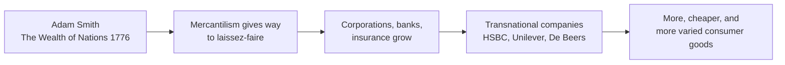

# AP World History: Modern — Topic 5.7 Summary: Economic Developments and Innovations (c. 1750–1900)

> Source: Summary of AP_WH_5.7_Notes_EN.md

**Unit 5: Revolutions (c. 1750–c. 1900)**

---

## In One Sentence

**Adam Smith's** ideas helped countries move from **mercantilism** to **laissez-faire** free trade, while new institutions such as **corporations**, banks, and **transnational companies** organized business on a huge scale and made consumer goods cheaper and more varied.

## The Big Picture

In 1776 Adam Smith wrote *The Wealth of Nations*, a founding text of **capitalism** (an economy based on private ownership and private business). Countries began to replace **mercantilism** (protecting home industry with high tariffs) with **laissez-faire** (keeping government out of business). New kinds of business, such as corporations and companies that worked across borders, grew very large. As trade grew, consumer goods became easier to get, cheaper, and more varied, and a culture of **consumerism** and leisure developed.

## Key Points

### 1. From Mercantilism to Laissez-Faire (LO-H)

- **Adam Smith** argued that people naturally like to trade and bargain. His ideas supported **capitalism** and **private business**.
- **Laissez-faire** is French for "leave alone." It meant **little government control** of business and **lower tariffs** (taxes on trade).
- Britain moved toward **free trade** by repealing the **Corn Laws** in 1846.

### 2. Corporations, Banks, and Insurance (LO-H)

- A **corporation** is a business that a government allows to exist as a legal body. **Stockholders** own it by buying shares, often on a **stock market**.
- With **limited liability**, stockholders could lose only what they paid for their stock. Sharing risk made investing **safer and more attractive**.
- **Banks** grew because business owners needed safe deposits and loans. **Marine insurance** (shipping insurance), such as Lloyd's of London, reduced risk.

### 3. Big Business Across Borders (LO-H)

- A **monopoly** is control of a business with all competition removed. **John D. Rockefeller** built a monopoly in U.S. oil.
- **Transnational companies** worked across national borders. **HSBC**, a British-owned bank, opened in Hong Kong in 1865. **Unilever**, a British-Dutch soap maker, used palm oil from British West Africa and the Belgian Congo.
- **Cecil Rhodes**, founder of De Beers Diamonds, backed a Cape Town-to-Cairo railroad. Most African railway workers were paid **far less** than Europeans.

### 4. Consumer Culture and Leisure (LO-H)

- Consumer goods became more **available, affordable, and varied**. **Some** people's living standards rose.
- Producers **advertised** heavily, especially to the middle class, who had **disposable income** (money to spend on non-essentials).
- Leisure grew: biking, soccer, baseball, music halls, and public parks. But sports often followed **class lines**.

## Must-Know Terms & People

| Term | What it is | Why it matters |
|---|---|---|
| Adam Smith | Author of *The Wealth of Nations* (1776) | His ideas became a base for capitalism |
| Mercantilism | System of economic protection with high tariffs | The old system that free trade replaced |
| Laissez-faire | "Leave alone"; little government role in business | The new idea behind free trade |
| Corporation | Government-chartered business owned by stockholders | Let many people share risk in big projects |
| Limited liability | Stockholders lose at most what they paid for stock | Made investment safer |
| Monopoly | Control of a business with no competition | Shows the huge power of big business |
| Transnational company | Company that works across national borders | HSBC and Unilever are key examples |
| Consumerism | Culture centered on buying goods | Grew as goods became cheaper and more varied |

## Key Dates

| Year | Event |
|---|---|
| 1776 | Adam Smith publishes *The Wealth of Nations* |
| 1846 | Britain repeals the Corn Laws |
| 1865 | HSBC opens in Hong Kong |
| 1880s | The safety bicycle replaces the penny-farthing |
| Late 1800s | Biking, boating, music halls, and parks become popular |

## How the Exam Asks About It

- **Legitimacy & consolidation:** Big business gained power. Corporations came to dominate banking, factories, and services and gained great economic and political power, while governments under laissez-faire stepped back from trade.
- **Continuity, innovation, diversity:** Continuity: class lines stayed, even in sports. Innovation: the corporation with limited liability. Diversity: businesses could be owned by one person, by partners, or by stockholders.
- **Likely comparison:** HSBC vs. Unilever. Both were British-linked transnational companies that worked across borders. But HSBC was a bank that financed trade and investment from Hong Kong, while Unilever made soap with palm oil from Africa.
- **Common trap:** Students say industrial capitalism made everyone richer. The fix: living standards rose for **some** people, but colonial workers, such as African railway workers, were paid very little.

## Check Yourself

1. How did trade policy change after Adam Smith?

▶ Answer
Countries began to replace mercantilism, which protected home industry, with laissez-faire. Governments stepped back from business and lowered tariffs to encourage trade.

2. Why did corporations make investing safer?

▶ Answer
Many stockholders shared the risk instead of one owner. With limited liability, they could lose only what they had paid for their stock.

3. Name two transnational companies and what each did.

▶ Answer
HSBC was a British-owned bank in Hong Kong that handled finance and global banking. Unilever was a British-Dutch company that made soap using palm oil from British West Africa and the Belgian Congo.

