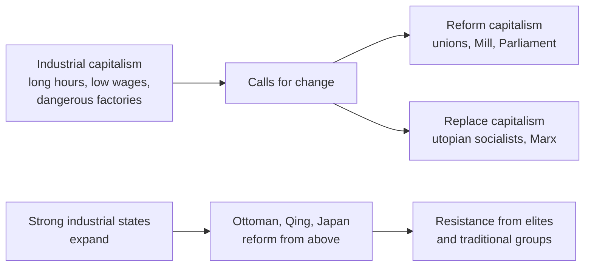

# AP World History: Modern — Topic 5.8 Summary: Reactions to the Industrial Economy (c. 1750–1900)

> Source: Summary of AP_WH_5.8_Notes_EN.md

**Unit 5: Revolutions (c. 1750–c. 1900)**

---

## In One Sentence

Hard factory work, low pay, and long hours led people to **call for change**: workers formed **unions** and won reforms, thinkers such as **Mill** wanted to fix capitalism while **Marx** wanted to replace it, and the **Ottoman Empire, China, and Japan** reformed to keep up with industrial states but met **resistance** at home.

## The Big Picture

Industrial capitalism made some people rich, but many workers lived in poor and dangerous conditions. People answered in two main ways: some wanted to **reform** capitalism with unions and new laws, and others, such as Karl Marx, wanted to **replace** it with socialism. At the same time, the Ottoman Empire, Qing China, and Japan saw how strong the industrial states had become, so their governments changed their armies, schools, and laws. In all three, some officials and traditional groups **fought against** these reforms.

## Key Points

### 1. Why Workers Called for Change
- In the 1800s, factory work was **dangerous** and dirty, wages were **low**, and hours were **long**.
- The **Sadler Report**, a study made for the British Parliament, showed these conditions and built support for reform.
- A **labor union** is a group of workers that bargains with employers and puts the agreements into contracts.
- Unions fought for, and over time won, **minimum wage** laws, limits on hours, overtime pay, and the five-day work week.

### 2. Reform in Britain: Votes and Children
- The **reform bills** of 1832, 1867, and 1884 lowered the property rules for voting, so more men could vote, and cities got more seats in Parliament.
- All men got the vote in **1918**. British women won **equal suffrage** (voting rights) in 1928.
- The **Factory Act** (1833) and the Ten Hours Act (1847) limited work by children and women.
- Laws also kept children under 10 out of coal mines and made **school** mandatory for children aged 5 to 10. Children's role in city life changed for good.

### 3. New Ideas: Fix Capitalism or Replace It?
- **John Stuart Mill** said laissez-faire (hands-off) capitalism was inhumane. He supported legal unions, limits on child labor, and safe factories.
- Mill's **utilitarianism** means seeking "the greatest good for the greatest number." Utilitarians wanted slow reform, not an end to capitalism.
- **Utopian socialists** built model communities as alternatives to capitalism (see 5.1).
- **Karl Marx** called his ideas **scientific socialism**. He scorned the utopian socialists for running away from problems.
- In the **Communist Manifesto** (1848, with Friedrich Engels), Marx said the **bourgeoisie** (owners) exploited the **proletariat** (workers). Workers should unite and take the **means of production**. Socialism would replace capitalism, and then **communism** would end all classes.

### 4. The Ottoman Empire: Reform and Resistance
- Sultan **Mahmud II** abolished the **Janissaries**, the old army corps, in 1826 and built a European-trained artillery unit.
- Taxes now went to the **central government**, which paid the army directly and won its loyalty.
- The **Tanzimat** ("reorganization," 1839–1876) fought corruption, opened **secular** (non-religious) schools, and wrote new law codes. This ended the ulama's (Muslim scholars') control of education.
- The **Hatt-i Humayun** (1856) promised equal rights to all men regardless of religion. Balkan Christians feared losing self-rule, and many Muslims objected to the break with tradition.
- Sultan **Abdulhamid** accepted a constitution in 1876 but kept tight control. He **exiled** the reformist Young Turks, and the Hamidian massacres (1894–1896) killed 100,000–250,000 Armenians.

### 5. Qing China: Self-Strengthening and Its Limits
- In the **Self-Strengthening Movement**, the Qing improved weapons and trained workers for shipyards and arsenals, with French and British advisors.
- The plan was to **add** modern technology to Chinese tradition, not to change the system.
- After China lost the Sino-Japanese War (1894–1895), **Kang Youwei** convinced Emperor Guangxu to start the **Hundred Days of Reform** (1898).
- **Empress Dowager Cixi** staged a coup, jailed the emperor, and canceled the reforms. She also kept railroads and telegraphs out of the interior.
- Her **conservatism** kept China from meeting modern demands.

### 6. Japan: Samurai Resistance
- Japan ended the **samurai class**: samurai got a final payment and could no longer carry swords.
- Some former samurai became **genro** (elder statesmen) in the government.
- Others, especially from **Satsuma and Choshu**, resisted to keep their traditional dress, hair, and local power.
- The samurai became the main **victims** of modernization, even though some of them had supported the Meiji Restoration.

## Must-Know Terms & People

| Term | What it is | Why it matters |
|---|---|---|
| Labor union | A workers' group that bargains with employers for contracts | Won better pay, shorter hours, and safer work |
| Suffrage | The right to vote | Britain's reform bills slowly gave it to more people |
| Utilitarianism | Mill's idea of "the greatest good for the greatest number" | The main case for reforming capitalism, not ending it |
| Karl Marx | Author of the Communist Manifesto (1848) with Engels | Called for workers to replace capitalism |
| Proletariat and bourgeoisie | Workers, and the owners of factories and machines | Marx's two classes in conflict |
| Communism | Marx's final stage, with no social classes | The goal that would follow socialism |
| Janissaries | The old Ottoman army corps, abolished in 1826 | Shows Mahmud II rebuilding the military |
| Tanzimat | Ottoman "reorganization" reforms, 1839–1876 | Secular schools and new law codes |
| Hatt-i Humayun | 1856 Ottoman edict of equality for all religions | Reform that groups resisted |
| Self-Strengthening Movement | Qing plan to add Western technology to tradition | China's limited reform |
| Hundred Days of Reform | Emperor Guangxu's reforms of 1898 | Ended by Cixi's coup |
| Empress Dowager Cixi | The most powerful figure in late Qing China | Elite resistance to reform |

## Key Dates

| Year | Event |
|---|---|
| 1826 | Mahmud II abolishes the Janissaries |
| 1832 | First British reform bill |
| 1839 | Ottoman Tanzimat begins |
| 1848 | Marx and Engels publish the Communist Manifesto |
| 1856 | Hatt-i Humayun edict |
| 1868 | Meiji Restoration in Japan |
| 1894–1895 | Sino-Japanese War |
| 1898 | Hundred Days of Reform and Cixi's coup |

## How the Exam Asks About It

- **Legitimacy & consolidation:** Mahmud II made the army loyal to the sultan by abolishing the Janissaries and paying soldiers from central taxes. Cixi held on to power with a coup against the reforming emperor, and Abdulhamid kept tight control and exiled the reformist Young Turks.
- **Continuity, innovation, diversity:** continuity is China keeping its traditions while adding new technology; innovation is Marx's scientific socialism; diversity is the many answers to industry, from unions and new laws to revolution and state-led reform.
- **Likely comparison:** **Ottoman Empire vs. Qing China.** Both reformed their armies and economies because industrial states were expanding, and both met resistance from elites. The Ottoman reforms started earlier and had lasting effects on the army and education, whereas in China Cixi canceled the Hundred Days of Reform.
- **Common trap:** putting Marx and the utopian socialists in the same group. Both wanted to replace capitalism, but Marx scorned the utopians. Also keep Mill separate: he wanted to fix capitalism, not end it.

## Check Yourself

1. What did labor unions fight for, and what did they win over time?

▶ Answer
They fought for better pay, shorter hours, and safer work. Over time they won minimum wage laws, limits on hours, overtime pay, and the five-day work week.

2. How did John Stuart Mill and Karl Marx differ in their answer to industrial capitalism?

▶ Answer
Mill wanted to reform capitalism with legal unions, limits on child labor, and safe factories. Marx wanted workers to take the means of production so that socialism, and then communism, would replace capitalism.

3. Why did the Hundred Days of Reform fail?

▶ Answer
Empress Dowager Cixi, the most powerful figure in China, staged a coup, jailed Emperor Guangxu, and canceled the reforms.

