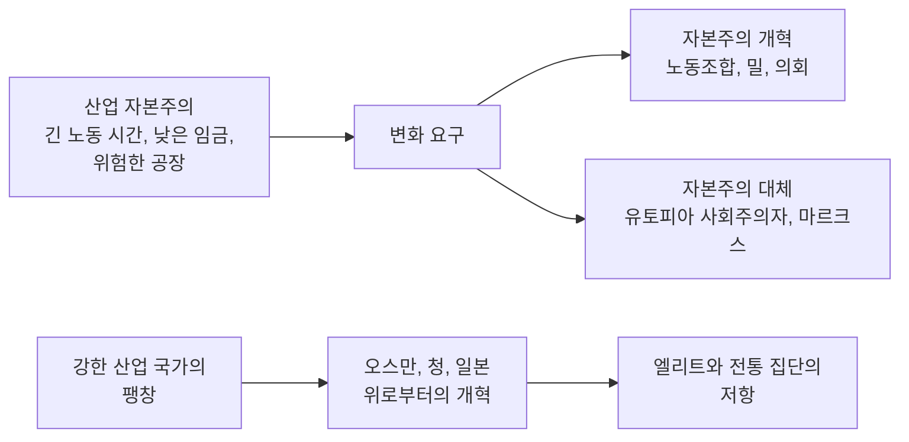

# AP 세계사: 모던 — 토픽 5.8 요약: 산업 경제에 대한 반응 (Reactions to the Industrial Economy)

> 출처: AP_WH_5.8_Notes_KR.md 요약

**Unit 5: 혁명의 시대 (Revolutions, c. 1750–c. 1900)**

---

## 한 문장 요약

힘든 공장 노동, 낮은 임금, 긴 노동 시간 때문에 사람들은 **변화를 요구**했다. 노동자는 **노동조합** (Labor union)을 만들어 개혁을 얻어 냈고, **밀 (Mill)** 같은 사상가는 자본주의를 고치려 했지만 **마르크스** (Marx)는 자본주의를 대체하려 했으며, **오스만 제국, 중국, 일본**은 산업 국가를 따라잡으려 개혁했지만 국내의 **저항**에 부딪혔다.

## 큰 그림

산업 자본주의 (Industrial capitalism)는 일부 사람을 부유하게 했지만, 많은 노동자는 가난하고 위험한 환경에서 살았다. 사람들은 크게 두 가지 방식으로 대응했는데, 일부는 노동조합과 새 법으로 자본주의를 **개혁**하려 했고, 카를 마르크스 (Karl Marx) 같은 다른 이들은 자본주의를 사회주의 (Socialism)로 **대체**하려 했다. 같은 시기에 오스만 제국 (Ottoman Empire), 청 (Qing China), 일본 (Japan)은 산업 국가가 얼마나 강해졌는지 보고 군대, 학교, 법을 바꾸었다. 세 나라 모두에서 일부 관리와 전통 집단이 이러한 개혁에 **맞섰다**.

## 핵심 정리

### 1. 노동자가 변화를 요구한 이유
- 1800년대의 공장 노동은 **위험**하고 비위생적이었으며, 임금은 **낮고** 노동 시간은 **길었다**.
- 영국 의회를 위해 작성된 조사인 **새들러 보고서** (Sadler Report)가 이런 실태를 드러내 개혁에 대한 지지를 모았다.
- **노동조합** (Labor union)은 고용주와 교섭하고 그 합의를 계약으로 남기는 노동자 조직이다.
- 노동조합은 싸움을 이어 가 결국 **최저 임금** (Minimum wage)법, 노동 시간 제한, 초과 근무 수당, 주 5일 근무를 얻어 냈다.

### 2. 영국의 개혁: 투표권과 아동
- 1832·1867·1884년의 **선거법 개정** (Reform bills)은 투표에 필요한 재산 자격을 낮추어 더 많은 남성이 투표할 수 있게 했고, 도시의 의석을 늘렸다.
- 1918년 모든 남성이 투표권을 얻었다. 영국 여성은 1928년에 **동등한 참정권 (Equal suffrage)**, 즉 투표권을 얻었다.
- **공장법** (Factory Act, 1833)과 10시간 노동법 (Ten Hours Act, 1847)은 아동과 여성의 노동을 제한했다.
- 법은 또 10세 미만 아동이 탄광에서 일하지 못하게 했고, 5–10세 아동의 **학교** 교육을 의무로 만들었다. 도시 생활에서 아동의 역할이 영구적으로 바뀌었다.

### 3. 새로운 사상: 자본주의를 고칠까, 대체할까?
- **존 스튜어트 밀** (John Stuart Mill)은 자유방임 (Laissez-faire, 간섭하지 않는) 자본주의가 비인간적이라고 했다. 그는 노동조합 합법화, 아동 노동 제한, 안전한 공장을 지지했다.
- 밀의 **공리주의** (Utilitarianism)는 '최대 다수의 최대 행복'을 추구하는 사상이다. 공리주의자는 자본주의를 끝내기보다 천천히 개혁하려 했다.
- **유토피아 사회주의자** (Utopian socialists)는 자본주의의 대안으로 모범 공동체를 세웠다 (5.1 참고).
- **카를 마르크스** (Karl Marx)는 자신의 사상을 **과학적 사회주의** (Scientific socialism)라고 불렀다. 그는 유토피아 사회주의자들이 문제에서 도망친다고 경멸했다.
- 마르크스는 『**공산당 선언** (Communist Manifesto)』(1848, 프리드리히 엥겔스 (Friedrich Engels)와 공저)에서 **부르주아** (Bourgeoisie, 소유자)가 **프롤레타리아** (Proletariat, 노동자)를 착취한다고 했다. 노동자는 단결해 **생산 수단** (Means of production)을 차지해야 한다. 사회주의가 자본주의를 대체하고, 이어 **공산주의** (Communism)가 모든 계급을 없앤다고 보았다.

### 4. 오스만 제국: 개혁과 저항
- 술탄 **마흐무트 2세** (Mahmud II)는 1826년 옛 군단인 **예니체리** (Janissaries)를 폐지하고 유럽식 훈련을 받은 포병대를 만들었다.
- 이제 세금이 **중앙 정부**로 갔고, 정부는 군대에 직접 급여를 주어 충성을 얻었다.
- **탄지마트** (Tanzimat, '재편', 1839–1876)는 부패를 척결하고, **세속 (Secular, 종교와 무관한)** 학교를 열고, 새 법전을 만들었다. 이로써 울라마 (Ulama, 무슬림 학자)의 교육 독점이 끝났다.
- **하트이 휘마윤** (Hatt-i Humayun, 1856)은 종교와 관계없이 모든 남성에게 동등한 권리를 약속했다. 발칸의 기독교도는 자치를 잃을까 두려워했고, 많은 무슬림은 전통과 어긋난다며 반대했다.
- 술탄 **압뒬하미트** (Abdulhamid)는 1876년 헌법을 받아들였지만 강력한 통제를 유지했다. 그는 개혁파 청년 튀르크당 (Young Turks)을 **추방**했고, 하미디예 학살 (Hamidian massacres, 1894–1896)로 아르메니아인 10만–25만 명이 죽었다.

### 5. 청: 양무운동과 그 한계
- **양무운동** (Self-Strengthening Movement)에서 청은 프랑스·영국 고문의 도움으로 무기를 개선하고 조선소와 무기 공장의 장인을 훈련했다.
- 목표는 체제를 바꾸는 것이 아니라 근대 기술을 중국 전통에 **덧붙이는** 것이었다.
- 청일 전쟁 (Sino-Japanese War, 1894–1895)에서 패한 뒤, **캉유웨이** (Kang Youwei)가 광서제 (Emperor Guangxu)를 설득해 **무술변법** (Hundred Days of Reform, 1898)을 시작하게 했다.
- **서태후** (Empress Dowager Cixi)는 정변을 일으켜 황제를 가두고 개혁을 취소했다. 그녀는 철도와 전신이 내륙으로 들어오는 것도 막았다.
- 그녀의 **보수성** 때문에 중국은 근대의 요구에 대응하지 못했다.

### 6. 일본: 사무라이의 저항
- 일본은 **사무라이 신분** (Samurai class)을 없앴다. 사무라이는 마지막 일시금을 받았고 더 이상 칼을 찰 수 없었다.
- 일부 옛 사무라이는 정부에서 **겐로** (Genro, 원로 정치가)가 되었다.
- 다른 이들, 특히 **사쓰마와 조슈 (Satsuma and Choshu)** 출신은 전통 복장과 머리 모양, 지방의 권력을 지키려고 저항했다.
- 사무라이는 근대화의 가장 큰 **피해자**가 되었다. 그중 일부는 메이지 유신 (Meiji Restoration)을 지지했던 사람들이었다.

## 꼭 알아야 할 용어·인물

| 용어 | 무엇인가 | 왜 중요한가 |
|---|---|---|
| 노동조합 (Labor union) | 고용주와 교섭해 계약을 맺는 노동자 조직 | 더 나은 임금, 더 짧은 노동 시간, 더 안전한 일터를 얻어 냈다 |
| 참정권 (Suffrage) | 투표할 권리 | 영국의 선거법 개정이 점차 더 많은 사람에게 주었다 |
| 공리주의 (Utilitarianism) | '최대 다수의 최대 행복'이라는 밀의 사상 | 자본주의를 끝내지 않고 개혁하자는 대표적 주장 |
| 카를 마르크스 (Karl Marx) | 엥겔스와 함께 『공산당 선언』(1848)을 쓴 사상가 | 노동자가 자본주의를 대체해야 한다고 주장했다 |
| 프롤레타리아와 부르주아 (Proletariat and bourgeoisie) | 노동자, 그리고 공장과 기계의 소유자 | 마르크스가 말한 서로 대립하는 두 계급 |
| 공산주의 (Communism) | 사회 계급이 없는 마르크스의 마지막 단계 | 사회주의 다음에 올 목표 |
| 예니체리 (Janissaries) | 1826년에 폐지된 옛 오스만 군단 | 마흐무트 2세의 군대 재건을 보여 준다 |
| 탄지마트 (Tanzimat) | 1839–1876년 오스만의 '재편' 개혁 | 세속 학교와 새 법전 |
| 하트이 휘마윤 (Hatt-i Humayun) | 모든 종교의 평등을 선언한 1856년 오스만 칙령 | 여러 집단이 저항한 개혁 |
| 양무운동 (Self-Strengthening Movement) | 서구 기술을 전통에 덧붙이려 한 청의 계획 | 중국의 제한적 개혁 |
| 무술변법 (Hundred Days of Reform) | 1898년 광서제 (Emperor Guangxu)의 개혁 | 서태후의 정변으로 끝났다 |
| 서태후 (Empress Dowager Cixi) | 청 말기의 가장 강력한 인물 | 개혁에 대한 엘리트의 저항 |

## 주요 연도

| 연도 | 사건 |
|---|---|
| 1826 | 마흐무트 2세 (Mahmud II)가 예니체리 폐지 |
| 1832 | 영국의 제1차 선거법 개정 |
| 1839 | 오스만 탄지마트 (Tanzimat) 시작 |
| 1848 | 마르크스와 엥겔스가 『공산당 선언』 출간 |
| 1856 | 하트이 휘마윤 (Hatt-i Humayun) 칙령 |
| 1868 | 일본의 메이지 유신 (Meiji Restoration) |
| 1894–1895 | 청일 전쟁 (Sino-Japanese War) |
| 1898 | 무술변법과 서태후의 정변 |

## 시험에서는 이렇게 묻는다

- **정당화와 공고화:** 마흐무트 2세는 예니체리를 폐지하고 중앙의 세금으로 병사에게 급여를 주어 군대가 술탄에게 충성하게 했다. 서태후는 개혁하는 황제에 맞선 정변으로 권력을 지켰고, 압뒬하미트는 강력한 통제를 유지하며 개혁파 청년 튀르크당을 추방했다.
- **연속성·혁신·다양성:** 연속성은 중국이 새 기술을 덧붙이면서도 전통을 지킨 것이다. 혁신은 마르크스의 과학적 사회주의이다. 다양성은 노동조합과 새 법부터 혁명, 국가 주도 개혁까지 산업화에 대한 대응이 여러 가지였다는 것이다.
- **자주 나오는 비교:** **오스만 제국 대 청.** 둘 다 산업 국가의 팽창 때문에 군대와 경제를 개혁했고, 둘 다 엘리트의 저항에 부딪혔다. 오스만의 개혁은 더 일찍 시작되었고 군대와 교육에 오래 남는 영향을 주었지만, 반면 중국에서는 서태후가 무술변법을 취소했다.
- **자주 하는 실수:** 마르크스와 유토피아 사회주의자를 같은 무리로 묶는 것이다. 둘 다 자본주의를 대체하려 했지만, 마르크스는 유토피아 사회주의자를 경멸했다. 밀도 따로 구분해야 한다. 그는 자본주의를 끝내려 한 것이 아니라 고치려 했다.

## 스스로 확인하기

1. 노동조합은 무엇을 위해 싸웠고, 시간이 지나면서 무엇을 얻었는가?

▶ 정답
더 나은 임금, 더 짧은 노동 시간, 더 안전한 일터를 위해 싸웠다. 시간이 지나면서 최저 임금법, 노동 시간 제한, 초과 근무 수당, 주 5일 근무를 얻어 냈다.

2. 존 스튜어트 밀과 카를 마르크스는 산업 자본주의에 대한 답이 어떻게 달랐는가?

▶ 정답
밀은 노동조합 합법화, 아동 노동 제한, 안전한 공장으로 자본주의를 개혁하려 했다. 마르크스는 노동자가 생산 수단을 차지해 사회주의, 그리고 이어 공산주의가 자본주의를 대체하기를 바랐다.

3. 무술변법은 왜 실패했는가?

▶ 정답
중국에서 가장 강력한 인물이던 서태후가 정변을 일으켜 광서제를 가두고 개혁을 취소했기 때문이다.

