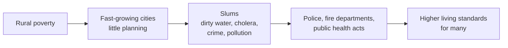

# AP World History: Modern — Topic 5.9 Summary: Society and the Industrial Age (c. 1750–1900)

> Source: Summary of AP_WH_5.9_Notes_EN.md

**Unit 5: Revolutions (c. 1750–c. 1900)**

---

## In One Sentence

Industrialization built a **new class ladder** (industrialists, a middle class, and a working class), split women's lives **by class**, and first made city life **worse** through slums, disease, and pollution before reforms **raised living standards** for many.

## The Big Picture

Factories pulled people from farms into cities that grew fast with little planning, so poor families crowded into slums full of disease, crime, and dirty water. A new social order formed, with **captains of industry** at the top, a **middle class** of managers and professionals in the middle, and the **working class** at the bottom. Working-class women and children took paid jobs, while middle-class women were kept to the home. Over time, reforms and cheaper goods made life better for many people.

## Key Points

### 1. Cities: Fast Growth, Big Problems
- In the first half of the 1800s, cities grew **fast** with little government planning. Working families crowded into **tenements** (cheap, badly built apartment buildings) in **slums** with polluted water and open sewers.
- Cholera, fire, and crime spread. Factories burned **coal**, and **smog** (smoke plus fog) caused deadly breathing problems in the late 1800s. Factory waste in rivers spread disease.
- Over time cities created **police and fire departments**, and **public health acts** improved sewers, clean water, trash removal, and building rules. **Mass production** made goods cheaper, and living standards rose for many.

### 2. A New Class Ladder
- **Top:** industrialists and owners of big companies, called **captains of industry**. They overshadowed the old **landed aristocracy** (nobles whose wealth came from land).
- **Middle:** the **middle class** of factory and office managers, small business owners, and professionals. They were educated **white-collar** (office) workers.
- **Bottom:** the **working class** in factories and mines. Each worker did one repeated task, so managers saw workers as **replaceable**, and wages stayed low.

### 3. Work Leaves the Home
- Before factories, families worked **together** at home or in the fields and set their own schedules.
- In factories, the **factory whistle** set the day. People often worked **14 hours a day, six days a week**, and injuries were common.
- Low wages pushed families to send **children** to work. Children as young as five worked in textile mills, and coal mines were even more dangerous.

### 4. Women's Lives Split by Class
- **Working-class women** worked in textile factories and, until Britain banned it in the 1840s, in coal mines. Owners paid them about **half** of men's wages.
- **Middle-class women** did not work in factories but were limited to the home. A stay-at-home wife was a **status symbol** for her husband.
- The **cult of domesticity** praised the ideal homemaker as pious, obedient, pure, and home-centered. In 1848, 300 people met at **Seneca Falls** to call for women's equality.

## Must-Know Terms & People

| Term | What it is | Why it matters |
|---|---|---|
| Tenement | A crowded, badly built apartment building for working families | Shows the housing problems of fast city growth |
| Public health acts | Laws that improved sewers, water, and building rules | How cities fixed their worst problems |
| Working class | Laborers in factories and mines | The new bottom of the class ladder |
| Middle class | Managers, small business owners, and professionals | A new educated class with growing access to goods |
| Captains of industry | Industrialists and owners of big companies | The new top class, above the landed aristocracy |
| Child labor | Children working in mills and mines | Working-class families needed the extra income |
| Cult of domesticity | The ideal of women as pious, pure homemakers | Limited middle-class women to the home |
| Smog | Smoke and fog from coal-burning factories | An example of industrial pollution |

## Key Dates

| Year | Event |
|---|---|
| First half of 1800s | Cities grow fast with little planning |
| 1839 | Charles Dickens publishes Oliver Twist |
| 1840s | Britain bans women from working in coal mines |
| 1848 | Seneca Falls meeting calls for women's equality |
| Late 1800s | Advertising spreads the cult of domesticity |

## How the Exam Asks About It

- **Legitimacy & consolidation:** this topic has no rulers, so the closest theme is **social status**. Captains of industry gained status through wealth and overshadowed the landed aristocracy, and a stay-at-home wife showed a middle-class family's status.
- **Continuity, innovation, diversity:** continuity is that society still had a class ladder with a wealthy group at the top; innovation is the new middle and working classes; diversity is how women's lives differed by class.
- **Likely comparison:** **working-class vs. middle-class women.** Both were shaped by the cult of domesticity. Working-class women held paid jobs and also did the housework and childcare, whereas middle-class women were kept out of paid work and limited to the home.
- **Common trap:** saying that industrialization made life **only** worse. Early cities had slums and disease, but over time reforms and cheaper goods raised living standards for many. Describe both the problems and the improvements.

## Check Yourself

1. Name the three classes of the new industrial class ladder and who belonged to each.

▶ Answer
The top was captains of industry (industrialists and big company owners). The middle class was managers, small business owners, and professionals. The working class was factory and mine laborers.

2. Why did working-class children take jobs in mills and mines?

▶ Answer
Wages were low, so families needed the extra income. Children's small size also let them fix machines and fit into tight spaces.

3. Name two problems of fast-growing industrial cities and one way cities fixed them.

▶ Answer
Crowded slums and diseases such as cholera were two problems. Public health acts improved sewers and clean water.

