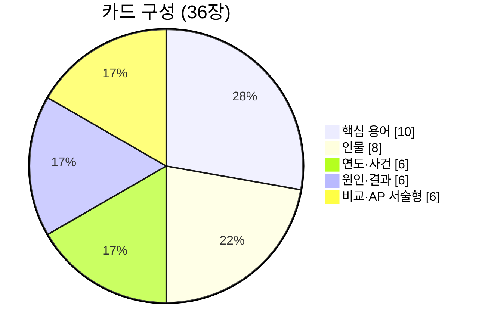

# AP 세계사: 모던 — 토픽 6.1 1750–1900년 제국주의의 정당화 논리 (Rationales for Imperialism from 1750 to 1900) · 플래시카드

> 출처: CED 기준 · 교재 반영 전

---

## 1. 핵심 용어

- [ ] **"신제국주의 (New Imperialism)"란 무엇이었는가?**

▶ 정답
약 1870년부터 1914년까지 산업 열강(유럽 국가들, 미국, 일본)이 아프리카, 아시아, 태평양으로 빠르고 경쟁적으로 팽창한 것이다. 산업의 필요와 민족주의 경쟁이 이를 이끌었고, 사회 진화론과 문명화 사명 같은 이념이 이를 정당화했다.

- [ ] **사회 진화론 (Social Darwinism)이란 무엇인가?**

▶ 정답
"적자생존 (Survival of the fittest)"이라는 생각을 인간 사회, 민족, 인종에 적용한 사상이다. 강한 민족이 약한 민족을 정복하는 것은 자연스러운 일이라고 주장했다. 그래서 제국주의적 정복이 자연스럽고 심지어 이로운 일처럼 제시되었다.

- [ ] **과학적 인종주의 (Scientific racism)란 무엇이었는가?**

▶ 정답
두개골 측정 같은 거짓 "과학"으로 인류의 인종을 고정된 위계로 서열화하고 유럽인을 맨 위에 둔 사상이다. 식민지 사람들은 스스로를 다스릴 수 없다는 주장에 쓰였다.

- [ ] **민족주의 (Nationalism)는 어떻게 제국의 정당화 논리가 되었는가?**

▶ 정답
1800년대 후반 많은 사람은 강대국이라면 식민지를 가져야 한다고 믿었다. 제국은 국가 위신의 척도이자 경쟁국과의 경쟁이 되었다. 그래서 버는 것보다 비용이 더 드는 땅도 식민지로 차지했다.

- [ ] **문명화 사명 (Civilizing mission)이란 무엇이었는가?**

▶ 정답
제국 열강에게 자신들이 뒤처졌다고 본 민족에게 "문명"(종교, 법, 교육, 과학, 관습)을 전할 의무가 있다는 믿음이다. 노예 무역 종식, 서양의 법, 서양식 학교가 통치의 이유로 제시되었다.

- [ ] **미시옹 시빌리자트리스 (Mission civilisatrice)란 무엇이었는가?**

▶ 정답
프랑스식 문명화 사명이다. 제3공화국은 자국 제국이 프랑스 혁명의 이상과 프랑스어·프랑스 문화를 퍼뜨린다고 주장했다. 장기 목표는 식민지 엘리트를 프랑스 문화에 동화 (Assimilation)시키는 것이었다.

- [ ] **제국주의에서 온정주의 (Paternalism)란 무엇인가?**

▶ 정답
식민지 사람들을 보호자가 필요한 어린아이처럼 대하는 태도이다. 키플링은 그들을 "반은 악마, 반은 어린아이"라고 불렀다. 온정주의는 식민지 사람들이 스스로를 다스릴 권리를 부정했다.

- [ ] **명백한 운명 (Manifest Destiny)이란 무엇이었는가?**

▶ 정답
1845년 존 L. 오설리번 (John L. O'Sullivan)이 이름 붙인 믿음으로, 미국인에게는 북아메리카 대륙 전체로 퍼져 나갈 신이 준 운명이 있다는 것이다. 처음에는 서부 팽창을 정당화했고, 1898년에는 해외 팽창으로 확대되었다.

- [ ] **제국의 "수단 (Means)"은 무엇이었으며, 정당화 논리와 어떻게 다른가?**

▶ 정답
수단은 정복을 가능하게 하고 비용을 낮춘 산업 기술이다. 증기선 (Steamship), 맥심 기관총 (Maxim gun, 1884), 말라리아를 막는 키니네 (Quinine)가 그 예이다. 정당화 논리는 정복을 옳은 일처럼 보이게 한 사상이다. 사회 진화론, 민족주의, 문명화 사명, 종교적 개종이 그 예이다.

- [ ] **반제국주의 연맹 (Anti-Imperialist League)이란 무엇이었는가?**

▶ 정답
1898년 필리핀 병합에 반대하려고 결성된 미국 단체이다. 마크 트웨인 (Mark Twain)을 비롯한 회원들은 동의 없이 사람을 다스리는 것이 독립 선언서에 어긋난다고 주장했다.

## 2. 인물

- [ ] **찰스 다윈 (Charles Darwin): 『종의 기원 (On the Origin of Species)』(1859)은 무엇을 주장했으며, 사회 진화론과 어떤 관계인가?**

▶ 정답
식물과 동물의 종이 자연 선택 (Natural selection)을 통해 변한다는 것을 설명했다. 이 책은 생물학 저서였고, 민족 간 경쟁에 관한 이론이 아니었다. 다른 사람들, 특히 허버트 스펜서가 그 생각을 사회와 인종에 적용해 사회 진화론을 만들었다.

- [ ] **허버트 스펜서 (Herbert Spencer)**

▶ 정답
"적자생존"이라는 말을 만들고(1864) 진화 사상을 인간 사회에 적용한 영국의 사상가이다. 그의 생각은 사회 진화론의 바탕이 되었다.

- [ ] **아르튀르 드 고비노 (Arthur de Gobineau)**

▶ 정답
『인종 불평등론 (Essay on the Inequality of the Human Races)』(1853–55)에서 인종은 본래 불평등하며 "백인" 또는 "아리아인" 인종이 우월하다고 주장한 프랑스 작가이다. 그의 책은 다윈보다 먼저 나왔다. 이는 인종 이념이 진화론에 의존하지 않았음을 보여 준다.

- [ ] **토머스 매콜리 (Thomas Macaulay)**

▶ 정답
「인도 교육에 관한 의견서 (Minute on Indian Education)」(1835)에서 서양 학문이 더 우월하며 인도의 국가 지원 교육은 영어로 해야 한다고 주장한 영국 관리이다. 그는 취향, 의견, 도덕, 지성에서 영국인인 인도인 계층을 원했다.

- [ ] **쥘 페리 (Jules Ferry)**

▶ 정답
두 차례 프랑스 총리를 지낸 정치가이다. 하원 (Chamber of Deputies) 연설(1885년 7월 28일)에서 시장, 해군 기지, 국가의 위대함을 위해 식민지가 필요하다고 옹호했고, "우월한 인종"에게는 "열등한 인종"을 문명화할 의무가 있다고 말했다. 프로이센-프랑스 전쟁 (Franco-Prussian War)에서 프랑스가 진 뒤의 연설이었다.

- [ ] **베른하르트 폰 뷜로 (Bernhard von Bülow)**

▶ 정답
1897년 제국 의회 (Reichstag)에서 독일은 "우리 자신의 햇볕 드는 자리 (A place in the sun)"를 요구한다고 말한 독일 외무 장관(나중에 총리)이다. 이 말은 경쟁국과 대등한 식민지를 원한 새 강대국의 민족주의를 보여 준다.

- [ ] **러디어드 키플링 (Rudyard Kipling)**

▶ 정답
시 「백인의 짐 (The White Man's Burden)」(1899)에서 미국에게 필리핀을 차지해 다스리라고 촉구한 영국 작가이다. 이 시는 식민 통치를 무겁고 이타적인 의무로 묘사했으며, 문명화 사명과 온정주의를 대표하는 표현이다.

- [ ] **데이비드 리빙스턴 (David Livingstone, 1813–1873)**

▶ 정답
남아프리카와 중앙아프리카를 탐험한 스코틀랜드 선교사이다. 그는 "기독교, 상업, 문명 (Christianity, commerce, and civilization)"이 동아프리카 노예 무역을 끝낼 것이라고 주장했다. 그의 명성은 더 많은 유럽인을 아프리카로 끌어들였다.

## 3. 연도·사건

- [ ] **1757**

▶ 정답
플라시 전투 (Battle of Plassey). 영국 동인도 회사 (British East India Company)가 벵골의 실질적인 지배자가 되었다. 영국의 인도 지배, 그리고 영국이 인도를 "개량"해야 한다는 후대 주장의 출발점이다.

- [ ] **1813**

▶ 정답
특허장법 (Charter Act)으로 영국령 인도가 기독교 선교사에게 개방된다. 찰스 그랜트 (Charles Grant)와 윌리엄 윌버포스 (William Wilberforce) 같은 복음주의자 (Evangelicals)의 승리였다.

- [ ] **1817**

▶ 정답
제임스 밀 (James Mill)이 『영국령 인도사 (The History of British India)』를 펴낸다. 인도 문명은 뒤처졌으며 합리적인 영국의 법과 정부가 진보를 가져올 것이라고 한 공리주의 (Utilitarian) 저작이다.

- [ ] **1858**

▶ 정답
프랑스가 가톨릭 선교사 박해를 이유로 에스파냐와 함께 베트남의 다낭 (Da Nang)을 공격하고, 인도차이나 정복이 시작된다. 같은 해 톈진 조약 (Treaty of Tianjin)이 중국 내륙을 선교사에게 개방한다.

- [ ] **1897**

▶ 정답
뷜로가 독일을 위한 "햇볕 드는 자리"를 요구한다. 독일은 산둥 (Shandong)에서 독일 선교사 두 명이 살해된 일을 구실로 중국의 자오저우만 (Jiaozhou Bay)을 차지한다.

- [ ] **1898**

▶ 정답
미국이 하와이를 병합하고, 에스파냐와의 전쟁 뒤 필리핀, 괌, 푸에르토리코를 차지한다. 이에 반대해 반제국주의 연맹이 결성된다.

## 4. 원인·결과

- [ ] **원인 → 결과: 산업 혁명 (Industrial Revolution)은 제국주의에 어떻게 기여했는가?**

▶ 정답
공장은 원료(면화, 고무, 팜유, 광물)가 필요했고, 생산자는 시장이 필요했으며, 증기선은 석탄 보급항 (Coaling station)이 필요했다. 산업 기술(증기선, 맥심 기관총, 키니네)은 정복 비용도 낮추었다.

- [ ] **원인 → 결과: 독일과 이탈리아의 통일은 제국주의에 어떤 영향을 주었는가?**

▶ 정답
새 강대국은 지위를 증명하려고 식민지를 원했고, 영국과 프랑스 같은 기존 강대국은 앞선 자리를 지키려고 더 치열하게 경쟁했다. 민족주의 경쟁은 아프리카 분할 (Scramble for Africa)처럼 제국주의를 경주로 바꾸는 데 한몫했다.

- [ ] **원인 → 결과: 프로이센-프랑스 전쟁(1870–71)의 패배는 프랑스 제국주의를 어떻게 바꾸었는가?**

▶ 정답
전쟁에 지고 알자스-로렌 (Alsace-Lorraine)을 잃으면서 민족의 자존심이 상했다. 쥘 페리 같은 지도자들은 아프리카와 인도차이나의 식민지가 프랑스의 위대함을 되살릴 것이라고 주장했다.

- [ ] **원인 → 결과: 선교사에 대한 공격은 어떻게 제국의 개입으로 이어졌는가?**

▶ 정답
각국 정부는 이를 무력 사용의 구실로 삼았다. 프랑스는 베트남 군주들이 가톨릭 선교사를 박해하자 1858년 다낭을 공격했고, 독일은 산둥에서 독일 선교사 두 명이 살해되자 1897년 자오저우만을 차지했다.

- [ ] **원인 → 결과: 콩고에 대한 레오폴드 2세 (Leopold II)의 인도주의적 주장은 실제로 무엇을 감추었는가?**

▶ 정답
그는 콩고 자유국 (Congo Free State, 1885)을 반노예제 인도주의 사업으로 내세웠다. 하지만 그의 대리인들은 콩고 사람들에게 잔혹한 조건에서 고무를 모으도록 강요했다. 이는 문명화 사명이 경제적 동기를 감출 수 있었음을 보여 준다(6.5 참고).

- [ ] **원인 → 결과: 제국주의는 계몽사상의 이상과 어떻게 충돌했으며, 유럽인은 이 충돌을 어떻게 설명했는가?**

▶ 정답
계몽사상은 자연권, 평등, 동의에 의한 통치를 내세웠지만, 제국주의는 식민지 사람들에게 이것들을 부정했다. 인종 이념과 온정주의는 식민지 사람들이 권리를 누릴 "준비가 되지 않았다"고 주장해 이 모순을 해소했다. 존 스튜어트 밀 (John Stuart Mill)조차 "야만인"에게는 전제 정치가 정당하다고 말했다.

## 5. 비교·AP 서술형

- [ ] **비교: 사회 진화론과 문명화 사명은 어떻게 비슷하고 어떻게 달랐는가?**

▶ 정답
비슷한 점: 둘 다 유럽인을 맨 위에 두는 위계로 민족을 서열화했고, 둘 다 식민지 사람들의 자치를 부정했다. 다른 점: 사회 진화론은 정복을 "부적합한" 쪽이 지는 자연의 투쟁으로 보았다. 반면 문명화 사명은 통치를 식민지 사람들이 언젠가 "문명화"될 수 있도록 개량하는 의무로 제시했다.

- [ ] **비교: 독일과 일본은 제국을 정당화하는 데 민족주의를 어떻게 사용했는가?**

▶ 정답
비슷한 점: 둘 다 새로 통일되었거나 새로 근대화한 강대국(독일 1871년, 일본 1868년 이후)으로, 식민지를 강대국 지위의 증거로 보았다. 다른 점: 독일은 영국·프랑스와 대등한 "햇볕 드는 자리"를 요구했다. 반면 일본은 1895년 타이완 (Taiwan)을 차지한 뒤, 제국을 서양과 대등하다는 증거이자 스스로 식민지가 되지 않는 방법으로 내세웠다.

- [ ] **연속성과 변화: 1750–1850년과 1870–1900년 사이에 제국의 정당화 논리는 어떻게 변했는가?**

▶ 정답
연속성: 통치는 내내 피지배자에게 이로운 것("개량", 기독교, 노예제 종식)으로 제시되었다. 변화: 초기 주장(복음주의자, 제임스 밀, 매콜리)은 인도인이 교육과 종교로 개혁될 수 있다고 보았다. 반면 후기의 사회 진화론과 과학적 인종주의는 인종 차이를 고정되고 자연스러운 것으로 다루었다.

- [ ] **AP 단답형: 사회 진화론이 제국주의를 정당화하는 데 어떻게 사용되었는지 설명하라.**

▶ 정답

**주장:** 사회 진화론은 제국주의적 정복을 자연스럽고 피할 수 없는 일처럼 보이게 했다. 
**근거:** 허버트 스펜서는 "적자생존"(1864)을 인간 사회에 적용했고, 고비노 같은 사상가는 인종을 위계로 서열화했다. 세실 로즈 (Cecil Rhodes)는 영국인을 "세계에서 가장 뛰어난 인종"이라고 불렀다. 
**설명:** 민족과 인종이 "가장 적합한" 쪽이 이기는 투쟁 속에 있다면, 약한 민족을 정복하는 것은 도덕적 잘못이 아니라 자연법칙이 된다. 또 그들은 스스로를 다스릴 수 없다고 여겨졌기 때문에, 동의 없이 그들을 다스리는 것도 정당해 보였다.

- [ ] **AP 단답형: 선교사가 제국 통치를 뒷받침한 방식 하나와 복잡하게 만든 방식 하나를 설명하라.**

▶ 정답

**주장:** 선교사는 제국 통치를 강화하기도 하고 복잡하게 만들기도 했다. 
**근거:** 뒷받침: 런던 선교회 (London Missionary Society, 1795) 같은 단체는 대중에게 제국을 지지할 도덕적 이유를 주었고, 선교사에 대한 공격은 프랑스(베트남, 1858)와 독일(자오저우만, 1897)에게 개입의 구실을 주었다. 복잡하게 만듦: 선교 학교는 서양식 교육을 받은 아프리카인과 아시아인을 길러 냈고, 이들이 나중에 민족주의 운동을 이끌었다. 또 일부 선교사는 정착민이 토착민을 학대한다고 비판했다. 
**설명:** 선교사는 유럽의 가치를 퍼뜨린다는 목표를 공유했지만, 그들 자신의 목적은 정치가 아니라 종교였다. 그래서 그들의 학교와 비판이 때로는 식민 통치를 약화하는 반대 세력을 낳았다.

- [ ] **AP 장문 에세이 논지: 1750년부터 1900년까지 경제적 동기보다 이념이 제국주의를 이끈 정도를 평가하라.**

▶ 정답

**주장:** 산업화가 만든 경제적 동기가 제국주의의 주된 원동력이었다. 사회 진화론, 민족주의, 문명화 사명, 종교적 개종 같은 이념은 주로 팽창을 정당화하고 대중의 지지를 얻는 역할을 했다. 
**근거:** 공장은 원료, 시장, 석탄 보급항이 필요했고, 쥘 페리는 "문명화"할 의무와 함께 시장을 꼽았다. 레오폴드 2세의 인도주의적 주장은 콩고의 강제 고무 채취를 감추었다. 그러나 민족주의는 독일("햇볕 드는 자리", 1897)과 일본(타이완, 1895) 같은 나라가 위신을 위해 식민지를 차지하도록 밀어붙이기도 했고, 선교사가 상인보다 먼저 도착하는 경우도 있었다. 
**설명:** 이념은 흔히 경제적 이익을 뒤따르며 그것을 변명했다. 따라서 이념은 제국이 왜 시작되었는지보다 어떻게 정당화되었는지를 더 잘 설명한다. 하지만 민족주의 경쟁은 식민지가 이익을 내지 못할 때에도 이념이 팽창을 이끌 수 있었음을 보여 준다.

