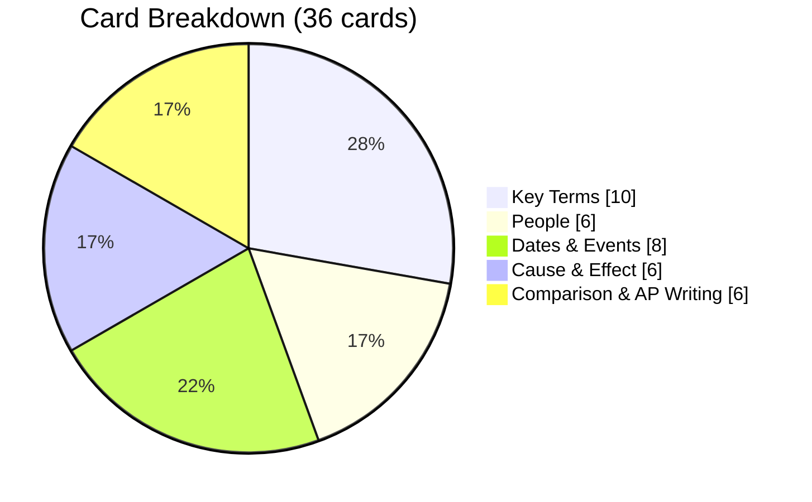

# AP World History: Modern — Topic 6.2 State Expansion from 1750 to 1900 · Flashcards

> Source: Based on the College Board CED · Textbook not yet incorporated

---

## 1. Key Terms

- [ ] **What is a non-state entity in colonial history, and why does it matter for this topic?**

▶ Answer
A company or private ruler, not a government, that controls a colony. Examples: the British East India Company, the Dutch East India Company (VOC), and King Leopold II's Congo Free State. A key change of 1750–1900 was states taking these colonies over directly.

- [ ] **What was the British Raj?**

▶ Answer
Direct British Crown rule of India from 1858 to 1947. It began when the Government of India Act (1858) ended East India Company rule after the 1857 rebellion. A viceroy governed for the Crown, and Queen Victoria became Empress of India in 1876.

- [ ] **What was the Cultivation System?**

▶ Answer
A Dutch state policy on Java from 1830. Villages had to set aside part of their land (often about one-fifth) or labor to grow export crops such as coffee, sugar, and indigo for the government. It made large profits for the Netherlands but caused hunger in some regions, and it was phased out after about 1870.

- [ ] **What was the Congo Free State?**

▶ Answer
King Leopold II's personal colony (1885–1908), recognized at the Berlin Conference. It was not a Belgian colony. Leopold's agents and the Force Publique forced Congolese people to collect rubber under quotas, using hostage-taking and mutilation. Belgium annexed it in 1908.

- [ ] **What was the Berlin Conference, and what was "effective occupation"?**

▶ Answer
A meeting of European powers in 1884–1885, called by Otto von Bismarck, that set rules for claiming African land; no Africans were invited. "Effective occupation" meant a power had to actually control a territory and notify the others before its claim counted, which sped up the conquest of the interior.

- [ ] **What was the Scramble for Africa?**

▶ Answer
The rapid European partition of Africa, mostly from 1880 to 1914. European control rose from about 10 percent of Africa in 1870 to about 90 percent by 1914. Only Ethiopia and Liberia stayed independent.

- [ ] **What is the difference between direct rule and indirect rule?**

▶ Answer
Direct rule replaced local rulers with European officials and laws (for example, French West Africa). Indirect rule kept local rulers in place but controlled them through European advisers (for example, Lugard's rule through the emirs of Northern Nigeria, and the princely states of India).

- [ ] **What is a settler colony?**

▶ Answer
A colony where large numbers of Europeans settled permanently, took the land, and pushed aside indigenous peoples. Examples: New Zealand (the CED example), Australia, the Cape Colony in South Africa, and French Algeria. They grew mostly in temperate regions suited to European farming.

- [ ] **What was the Treaty of Waitangi?**

▶ Answer
The 1840 treaty between the British Crown and more than 500 Māori chiefs in New Zealand. The English text gave Britain sovereignty, but the Māori text used a word closer to governance and promised chiefs authority over their lands. Disputes over land led to the New Zealand Wars (1845–1872).

- [ ] **What was Manifest Destiny?**

▶ Answer
The belief, named in 1845, that the United States was destined to spread across North America. It was used to justify the Mexican–American War (1846–1848) and the removal of Native American nations.

## 2. People

- [ ] **Who was King Leopold II?**

▶ Answer
The king of Belgium who used the explorer Henry Morton Stanley to sign treaties with Congo chiefs and won recognition of the Congo Free State as his personal possession (1885). After his rubber regime's atrocities were exposed, the Belgian government took the Congo from him in 1908.

- [ ] **Who was Otto von Bismarck, and what was his role in Africa?**

▶ Answer
The chancellor of Germany who called the Berlin Conference (1884–1885). The conference used diplomacy to set the rules for dividing Africa among European powers.

- [ ] **Who was Menelik II?**

▶ Answer
The emperor of Ethiopia who bought modern rifles and artillery and defeated Italy at the Battle of Adwa (1896). Ethiopia was one of only two African states (with Liberia) still independent in 1914.

- [ ] **Who was Frederick Lugard?**

▶ Answer
A British colonial official who governed Northern Nigeria from 1900 through the existing Muslim emirs. His approach became the best-known model of indirect rule.

- [ ] **Who was Andrew Jackson, and how is he connected to US expansion?**

▶ Answer
The US president who signed the Indian Removal Act (1830). It forced the Cherokee and other Native nations west of the Mississippi, which led to the Trail of Tears (1838–1839).

- [ ] **Who was Stamford Raffles?**

▶ Answer
A British East India Company official who founded Singapore in 1819 and earlier governed Java during the brief British occupation (1811–1816). Singapore became the key British port in Southeast Asia.

## 3. Dates & Events

- [ ] **1799**

▶ Answer
The bankrupt Dutch East India Company (VOC) is dissolved. The Dutch government takes over its territories in 1800.

- [ ] **1830**

▶ Answer
Three expansions begin in one year: France invades Algeria (a settler colony), the US passes the Indian Removal Act, and the Dutch state starts the Cultivation System on Java.

- [ ] **1840**

▶ Answer
The Treaty of Waitangi between the British Crown and Māori chiefs. It opened New Zealand to large-scale British settlement.

- [ ] **1858**

▶ Answer
The Government of India Act ends East India Company rule. The British Crown rules India directly (the British Raj). In the same year France begins its conquest of Cochinchina in Vietnam.

- [ ] **1884–1885**

▶ Answer
The Berlin Conference sets rules for claiming Africa, including "effective occupation," and recognizes Leopold II's Congo Free State.

- [ ] **1895**

▶ Answer
Japan gains Taiwan after the First Sino–Japanese War, showing that an Asian state could also become an industrial imperial power. The same year France forms French West Africa.

- [ ] **1898**

▶ Answer
The US annexes Hawaii and wins the Spanish–American War, taking the Philippines, Guam, and Puerto Rico from Spain. In Sudan, the British win the Battle of Omdurman with machine guns.

- [ ] **1908**

▶ Answer
The Belgian government annexes the Congo Free State from Leopold II, creating the Belgian Congo.

## 4. Cause & Effect

- [ ] **Cause → Effect: How did the technology gap affect state expansion?**

▶ Answer
Steamships carried troops up rivers, quinine protected Europeans against malaria, the telegraph linked colonies to home governments, and the Maxim gun let small forces defeat large armies (for example, Omdurman in 1898). Europeans could move from coastal posts into the interior and rule directly.

- [ ] **Cause → Effect: What did the 1857 rebellion in India lead to?**

▶ Answer
The British government decided the East India Company could no longer rule India. The Government of India Act (1858) transferred power to the Crown, beginning the British Raj, a shift from company rule to state rule.

- [ ] **Cause → Effect: Why did the Congo pass from Leopold II to the Belgian state?**

▶ Answer
Missionaries, E. D. Morel, and Roger Casement's 1904 report exposed forced labor, hostage-taking, and mutilation in the rubber regime. The international Congo Reform Association campaign pressured Belgium to annex the Congo in 1908.

- [ ] **Cause → Effect: How did the "effective occupation" rule of the Berlin Conference shape Africa?**

▶ Answer
Claims required actual control, so European states rushed to sign treaties with African rulers and send troops inland. Africa was partitioned within about 30 years, and many borders ignored ethnic and political boundaries.

- [ ] **Cause → Effect: How did the Spanish–American War show the decline of Spain?**

▶ Answer
Spain, already weakened by losing most of Latin America in the 1810s–1820s, was defeated by the industrial United States in 1898. It lost Cuba, Puerto Rico, the Philippines, and Guam, and the United States became an imperial power in the Pacific.

- [ ] **Cause → Effect: How did land-based expansion affect indigenous peoples in the US, Russia, and Japan?**

▶ Answer
The US forced Native nations west on the Trail of Tears and later onto reservations; Russia killed or expelled many Circassians from the Caucasus; Japan took Ainu hunting and fishing lands on Hokkaido and pushed them to assimilate. In each case, settlers from the expanding state replaced or outnumbered local peoples.

## 5. Comparison & AP Writing

- [ ] **Compare: How was overseas expansion different from land-based expansion?**

▶ Answer
Overseas expansion (Britain, France, the Netherlands, Belgium) used navies and steamships and usually created separate colonies with few settlers, ruled directly or indirectly. Land-based expansion (the US, Russia, Japan) pushed into neighboring territories, sent many settlers, and absorbed the land into the state. Both used industrial technology and force and took land and labor from indigenous peoples.

- [ ] **Compare: How did settler colonies differ from colonies such as British India or French West Africa?**

▶ Answer
In settler colonies (New Zealand, Australia, Algeria), large numbers of Europeans moved in permanently and took the land itself, displacing indigenous peoples. In India and French West Africa, a small number of European officials ruled a large local population and focused on taxes, labor, and export crops.

- [ ] **Compare: How did the British use of company rule in India compare with Leopold II's rule of the Congo?**

▶ Answer
Similar: both were run by non-state powers for profit, both used local soldiers (sepoys, the Force Publique), and both ended in a transfer to state rule (1858, 1908). Different: the EIC ruled for about a century under growing parliamentary control, while the Congo Free State was one king's personal property for 23 years, and international outrage over atrocities, not a rebellion, ended it.

- [ ] **AP Short Answer: Explain one similarity and one difference between European state expansion in Africa and in Asia from 1750 to 1900.**

▶ Answer

**Claim:** In both Africa and Asia, European states used warfare backed by industrial technology, but expansion in Africa came later and much faster, through a single diplomatic framework. 
**Evidence:** Britain fought the Anglo-Burmese wars (1824–1886) and France built Indochina by war (1858–1887), just as Britain conquered the Asante and the Zulu. However, most of Africa was divided only after the Berlin Conference (1884–1885), with about 90 percent under European rule by 1914, while India had been under company rule since 1757. 
**Reasoning:** Europeans already had long-standing company territories in Asia that states could take over gradually, but in Africa they held mostly coastal posts until quinine, steamships, and the Maxim gun made rapid inland conquest possible, so the powers set rules at Berlin to avoid war among themselves.

- [ ] **AP Short Answer: Explain one reason why some states took direct control of colonies held by non-state entities from 1750 to 1900.**

▶ Answer

**Claim:** States took over colonies when company or private rule failed, through rebellion, bankruptcy, or abuses. 
**Evidence:** After the 1857 rebellion, the Government of India Act (1858) ended British East India Company rule. The Dutch state took over the bankrupt VOC's lands in 1800, and Belgium annexed Leopold II's Congo Free State in 1908 after the rubber atrocities were exposed. 
**Reasoning:** Governments saw colonies as too valuable to lose and too important to national prestige to leave in unreliable private hands, so they replaced company rule with direct state rule to keep control and protect their reputation.

- [ ] **AP Long Essay Thesis: Compare the processes by which two states expanded their power from 1750 to 1900.**

▶ Answer

**Claim:** Both Britain and Russia used military force and industrial technology to expand, but Britain built an overseas empire largely through companies, treaties, and indirect rule, while Russia expanded overland by conquering neighboring peoples and settling the land. 
**Evidence:** Britain moved from East India Company rule to the Raj (1858), used the Royal Niger Company and then indirect rule in Nigeria, and sent settlers to New Zealand and Australia. Russia conquered the Caucasus (to 1864) and Central Asia (Tashkent 1865, Khiva 1873), took the Amur region from China, and sent Cossack and peasant settlers east along the Trans-Siberian Railway. 
**Reasoning:** Britain, a sea power with a large navy and global trade, ruled distant colonies through local rulers and companies to keep costs low, while Russia, a land power bordering weak khanates and a declining Qing China, could absorb nearby lands directly into the state.

