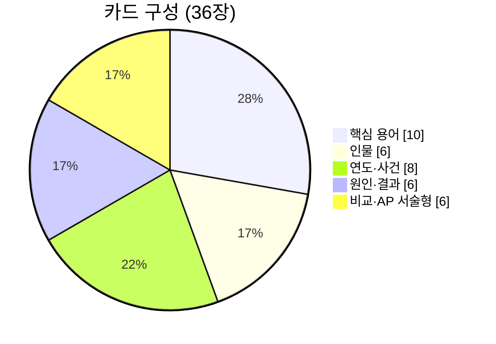

# AP 세계사: 모던 — 토픽 6.2 1750–1900년 국가의 팽창 (State Expansion from 1750 to 1900) · 플래시카드

> 출처: CED 기준 · 교재 반영 전

---

## 1. 핵심 용어

- [ ] **식민지 역사에서 비국가 주체 (Non-state entity)란 무엇이며, 이 토픽에서 왜 중요한가?**

▶ 정답
정부가 아니면서 식민지를 지배하는 회사나 개인 통치자다. 영국 동인도 회사 (British East India Company), 네덜란드 동인도 회사 (VOC), 레오폴드 2세 (Leopold II)의 콩고 자유국이 그 예이다. 1750–1900년의 중요한 변화는 국가가 이런 식민지를 직접 넘겨받은 것이다.

- [ ] **영국령 인도 제국, 라지 (British Raj)란 무엇이었는가?**

▶ 정답
1858년부터 1947년까지 영국 왕실이 인도를 직접 다스린 체제다. 1857년 인도 항쟁 뒤 인도 통치법 (Government of India Act, 1858)이 동인도 회사의 통치를 끝내면서 시작되었다. 총독 (Viceroy)이 왕실을 대신해 다스렸고, 빅토리아 여왕은 1876년 인도 여제가 되었다.

- [ ] **강제 재배 제도 (Cultivation System)란 무엇이었는가?**

▶ 정답
1830년부터 자바에서 시행된 네덜란드 국가의 정책이다. 마을들은 땅의 일부(흔히 약 5분의 1)나 노동력을 내어 정부를 위해 커피, 설탕, 인디고 같은 수출 작물을 길러야 했다. 네덜란드에 큰 이익을 주었지만 일부 지역에 기근을 불러왔고, 1870년 무렵 이후 점차 폐지되었다.

- [ ] **콩고 자유국 (Congo Free State)이란 무엇이었는가?**

▶ 정답
베를린 회의에서 인정받은 레오폴드 2세의 개인 식민지다(1885–1908). 벨기에의 식민지가 아니었다. 레오폴드의 대리인과 공안군 (Force Publique)은 인질 잡기와 신체 절단을 동원해 콩고인들에게 할당량만큼 고무를 모으게 했다. 1908년 벨기에가 이곳을 병합했다.

- [ ] **베를린 회의 (Berlin Conference)란 무엇이며, "실효적 점유 (Effective occupation)"란 무엇이었는가?**

▶ 정답
1884–1885년 오토 폰 비스마르크 (Otto von Bismarck)가 소집한 유럽 열강의 회의로, 아프리카 영토를 주장하는 규칙을 정했다. 아프리카인은 한 명도 초대받지 못했다. "실효적 점유"는 한 나라가 어떤 지역을 실제로 통제하고 다른 열강에 알려야만 그 주장이 인정된다는 뜻이었고, 이 때문에 내륙 정복이 빨라졌다.

- [ ] **아프리카 분할 (Scramble for Africa)이란 무엇이었는가?**

▶ 정답
주로 1880–1914년에 일어난 유럽의 빠른 아프리카 분할이다. 유럽이 지배한 땅은 1870년 아프리카의 약 10퍼센트에서 1914년 약 90퍼센트로 늘었다. 독립을 지킨 나라는 에티오피아와 라이베리아뿐이었다.

- [ ] **직접 통치 (Direct rule)와 간접 통치 (Indirect rule)는 어떻게 다른가?**

▶ 정답
직접 통치는 현지 통치자를 유럽인 관리와 법으로 대체했다(예: 프랑스령 서아프리카). 간접 통치는 현지 통치자를 남겨 두되 유럽인 고문을 통해 통제했다(예: 북나이지리아의 에미르를 통한 루가드의 통치, 인도의 번왕국).

- [ ] **정착 식민지 (Settler colony)란 무엇인가?**

▶ 정답
많은 유럽인이 영구히 정착해 땅을 차지하고 토착민을 밀어낸 식민지다. 뉴질랜드(CED 예시), 오스트레일리아, 남아프리카의 케이프 식민지, 프랑스령 알제리가 그 예이다. 주로 유럽식 농업에 알맞은 온대 지역에서 커졌다.

- [ ] **와이탕이 조약 (Treaty of Waitangi)이란 무엇이었는가?**

▶ 정답
1840년 뉴질랜드에서 영국 왕실과 500명이 넘는 마오리 (Māori) 족장이 맺은 조약이다. 영어본은 영국에게 주권을 넘긴다고 했지만, 마오리어본은 통치에 가까운 단어를 썼고 족장들에게 자기 땅에 대한 권한을 약속했다. 토지 분쟁은 뉴질랜드 전쟁(1845–1872)으로 이어졌다.

- [ ] **명백한 운명 (Manifest Destiny)이란 무엇이었는가?**

▶ 정답
미국이 북아메리카 전체로 퍼져 나갈 운명이라는 믿음으로, 1845년에 이 이름이 붙었다. 멕시코-미국 전쟁(1846–1848)과 아메리카 원주민 부족의 강제 이주를 정당화하는 데 쓰였다.

## 2. 인물

- [ ] **레오폴드 2세 (Leopold II)는 누구인가?**

▶ 정답
탐험가 헨리 모턴 스탠리 (Henry Morton Stanley)를 이용해 콩고 족장들과 조약을 맺고, 콩고 자유국을 자기 개인 소유지로 인정받은(1885) 벨기에 국왕이다. 고무 수탈 체제의 잔학 행위가 폭로된 뒤 1908년 벨기에 정부가 그에게서 콩고를 넘겨받았다.

- [ ] **오토 폰 비스마르크 (Otto von Bismarck)는 누구이며, 아프리카에서 어떤 역할을 했는가?**

▶ 정답
베를린 회의(1884–1885)를 소집한 독일 총리다. 이 회의는 외교로 유럽 열강이 아프리카를 나누는 규칙을 정했다.

- [ ] **메넬리크 2세 (Menelik II)는 누구인가?**

▶ 정답
근대식 소총과 대포를 사들여 아드와 전투(1896)에서 이탈리아를 물리친 에티오피아 황제다. 에티오피아는 1914년까지 독립을 지킨 아프리카의 단 두 나라(라이베리아와 함께) 가운데 하나였다.

- [ ] **프레더릭 루가드 (Frederick Lugard)는 누구인가?**

▶ 정답
1900년부터 기존의 무슬림 에미르 (Emir)를 통해 북나이지리아를 다스린 영국의 식민지 관리다. 그의 방식은 간접 통치의 가장 잘 알려진 모델이 되었다.

- [ ] **앤드루 잭슨 (Andrew Jackson)은 누구이며, 미국의 팽창과 어떤 관련이 있는가?**

▶ 정답
인디언 이주법 (Indian Removal Act, 1830)에 서명한 미국 대통령이다. 이 법은 체로키 (Cherokee)와 다른 원주민 부족을 미시시피강 서쪽으로 쫓아냈고, 눈물의 길 (Trail of Tears, 1838–1839)로 이어졌다.

- [ ] **스탬퍼드 래플스 (Stamford Raffles)는 누구인가?**

▶ 정답
1819년 싱가포르를 세운 영국 동인도 회사의 관리로, 그보다 앞서 영국의 짧은 자바 점령기(1811–1816)에 자바를 다스렸다. 싱가포르는 동남아시아에서 영국의 핵심 항구가 되었다.

## 3. 연도·사건

- [ ] **1799**

▶ 정답
파산한 네덜란드 동인도 회사 (VOC)가 해산된다. 1800년 네덜란드 정부가 그 영토를 넘겨받는다.

- [ ] **1830**

▶ 정답
한 해에 세 가지 팽창이 시작된다. 프랑스가 알제리를 침공하고(정착 식민지), 미국이 인디언 이주법을 통과시키며, 네덜란드 국가가 자바에서 강제 재배 제도를 시작한다.

- [ ] **1840**

▶ 정답
영국 왕실과 마오리 족장들이 와이탕이 조약을 맺는다. 이 조약으로 뉴질랜드에 대규모 영국인 정착의 길이 열렸다.

- [ ] **1858**

▶ 정답
인도 통치법이 동인도 회사의 통치를 끝낸다. 영국 왕실이 인도를 직접 다스린다(라지). 같은 해 프랑스가 베트남 코친차이나 (Cochinchina) 정복을 시작한다.

- [ ] **1884–1885**

▶ 정답
베를린 회의가 "실효적 점유"를 비롯한 아프리카 영유권 주장 규칙을 정하고, 레오폴드 2세의 콩고 자유국을 인정한다.

- [ ] **1895**

▶ 정답
일본이 청일 전쟁 (First Sino–Japanese War) 뒤 타이완을 얻는다. 아시아 국가도 산업화된 제국주의 국가가 될 수 있음을 보여 주었다. 같은 해 프랑스가 프랑스령 서아프리카를 만든다.

- [ ] **1898**

▶ 정답
미국이 하와이를 병합하고 미국-에스파냐 전쟁 (Spanish–American War)에서 이겨 에스파냐에게서 필리핀, 괌, 푸에르토리코를 얻는다. 수단에서는 영국이 기관총으로 옴두르만 전투 (Battle of Omdurman)에서 승리한다.

- [ ] **1908**

▶ 정답
벨기에 정부가 레오폴드 2세에게서 콩고 자유국을 병합해 벨기에령 콩고 (Belgian Congo)를 만든다.

## 4. 원인·결과

- [ ] **원인 → 결과: 기술 격차 (Technology gap)는 국가의 팽창에 어떤 영향을 주었는가?**

▶ 정답
증기선은 강을 따라 군대를 실어 날랐고, 키니네 (Quinine)는 유럽인을 말라리아로부터 보호했으며, 전신은 식민지와 본국 정부를 연결했고, 맥심 기관총 (Maxim gun)은 적은 병력으로 큰 군대를 이기게 했다(예: 1898년 옴두르만). 유럽인은 해안 거점에서 내륙으로 들어가 직접 통치할 수 있게 되었다.

- [ ] **원인 → 결과: 1857년 인도 항쟁은 어떤 결과를 낳았는가?**

▶ 정답
영국 정부는 동인도 회사가 더는 인도를 다스릴 수 없다고 판단했다. 인도 통치법(1858)이 권력을 왕실로 넘기면서 라지가 시작되었다. 회사 통치에서 국가 통치로 바뀐 것이다.

- [ ] **원인 → 결과: 콩고는 왜 레오폴드 2세에게서 벨기에 국가로 넘어갔는가?**

▶ 정답
선교사, E. D. 모렐 (E. D. Morel), 로저 케이스먼트 (Roger Casement)의 1904년 보고서가 고무 수탈 체제의 강제 노동, 인질 잡기, 신체 절단을 폭로했다. 콩고 개혁 협회 (Congo Reform Association)의 국제 운동이 벨기에를 압박해 1908년 콩고를 병합하게 했다.

- [ ] **원인 → 결과: 베를린 회의의 "실효적 점유" 원칙은 아프리카에 어떤 영향을 주었는가?**

▶ 정답
영유권을 주장하려면 실제 통제가 필요했기 때문에, 유럽 국가들은 서둘러 아프리카 통치자와 조약을 맺고 내륙으로 군대를 보냈다. 아프리카는 약 30년 만에 분할되었고, 많은 국경이 민족과 정치 경계를 무시했다.

- [ ] **원인 → 결과: 미국-에스파냐 전쟁은 에스파냐의 쇠퇴를 어떻게 보여 주었는가?**

▶ 정답
1810–1820년대에 라틴 아메리카 대부분을 잃어 이미 약해진 에스파냐는 1898년 산업 강국 미국에게 패했다. 에스파냐는 쿠바, 푸에르토리코, 필리핀, 괌을 잃었고, 미국은 태평양의 제국주의 국가가 되었다.

- [ ] **원인 → 결과: 미국, 러시아, 일본의 육상 팽창은 토착민에게 어떤 영향을 주었는가?**

▶ 정답
미국은 눈물의 길로 원주민 부족을 서쪽으로 쫓아냈고, 나중에는 보호구역에 가두었다. 러시아는 캅카스에서 많은 체르케스인 (Circassians)을 죽이거나 추방했다. 일본은 홋카이도에서 아이누 (Ainu)의 사냥터와 어장을 빼앗고 동화를 강요했다. 모든 경우에 팽창하는 국가의 정착민이 현지 주민을 대체하거나 수에서 앞질렀다.

## 5. 비교·AP 서술형

- [ ] **비교: 해외 팽창은 육상 팽창과 어떻게 달랐는가?**

▶ 정답
해외 팽창(영국, 프랑스, 네덜란드, 벨기에)은 해군과 증기선을 썼고, 대개 정착민이 적은 별도의 식민지를 만들어 직접 또는 간접으로 다스렸다. 육상 팽창(미국, 러시아, 일본)은 인접 지역으로 밀고 들어가 많은 정착민을 보냈고, 그 땅을 국가에 흡수했다. 둘 다 산업 기술과 무력을 썼고, 토착민의 땅과 노동력을 빼앗았다.

- [ ] **비교: 정착 식민지는 영국령 인도나 프랑스령 서아프리카 같은 식민지와 어떻게 달랐는가?**

▶ 정답
정착 식민지(뉴질랜드, 오스트레일리아, 알제리)에는 많은 유럽인이 영구히 이주해 땅 자체를 차지하고 토착민을 몰아냈다. 인도와 프랑스령 서아프리카에서는 적은 수의 유럽인 관리가 많은 현지 주민을 다스리며 세금, 노동력, 수출 작물에 집중했다.

- [ ] **비교: 인도에서 영국 동인도 회사의 통치는 레오폴드 2세의 콩고 통치와 어떻게 비슷하고 달랐는가?**

▶ 정답
공통점: 둘 다 이윤을 위해 비국가 세력이 운영했고, 현지 병사(세포이, 공안군)를 썼으며, 결국 국가 통치로 넘어갔다(1858, 1908). 차이점: 동인도 회사는 의회의 통제가 커지는 가운데 약 한 세기 동안 다스렸지만, 콩고 자유국은 23년 동안 한 국왕의 개인 재산이었고, 반란이 아니라 잔학 행위에 대한 국제적 분노가 그 통치를 끝냈다.

- [ ] **AP 단답형: 1750–1900년 아프리카와 아시아에서 유럽 국가가 팽창한 방식의 공통점 하나와 차이점 하나를 설명하라.**

▶ 정답

**주장:** 아프리카와 아시아 모두에서 유럽 국가는 산업 기술을 바탕으로 한 전쟁을 썼지만, 아프리카의 팽창은 더 늦게, 훨씬 빠르게, 하나의 외교 틀 안에서 일어났다. 
**근거:** 영국이 아샨티와 줄루를 정복했듯이, 아시아에서도 영국은 버마 전쟁(1824–1886)을, 프랑스는 인도차이나 건설 전쟁(1858–1887)을 벌였다. 그러나 아프리카 대부분은 베를린 회의(1884–1885) 뒤에야 분할되어 1914년 약 90퍼센트가 유럽의 지배를 받았고, 인도는 1757년부터 회사의 통치를 받았다. 
**설명:** 아시아에는 국가가 천천히 넘겨받을 수 있는 오래된 회사 영토가 이미 있었다. 반면 아프리카에서 유럽인은 키니네, 증기선, 맥심 기관총이 빠른 내륙 정복을 가능하게 할 때까지 주로 해안 거점만 가지고 있었다. 그래서 열강은 서로 전쟁을 피하려고 베를린에서 규칙을 정했다.

- [ ] **AP 단답형: 1750–1900년 일부 국가가 비국가 주체가 보유하던 식민지를 직접 통치하게 된 이유 하나를 설명하라.**

▶ 정답

**주장:** 국가는 반란, 파산, 학대로 회사나 개인의 통치가 실패했을 때 식민지를 넘겨받았다. 
**근거:** 1857년 인도 항쟁 뒤 인도 통치법(1858)이 영국 동인도 회사의 통치를 끝냈다. 네덜란드 국가는 1800년 파산한 VOC의 영토를 넘겨받았고, 벨기에는 고무 잔학 행위가 폭로된 뒤 1908년 레오폴드 2세의 콩고 자유국을 병합했다. 
**설명:** 정부는 식민지가 잃기에는 너무 귀하고 국가의 위신에도 중요하다고 보았다. 그래서 믿을 수 없는 민간의 손에 맡기지 않고 직접 국가 통치로 바꾸어 통제를 유지하고 평판을 지키려 했다.

- [ ] **AP 논술형 논지: 1750–1900년 두 국가가 권력을 확장한 과정을 비교하라.**

▶ 정답

**주장:** 영국과 러시아는 모두 군사력과 산업 기술로 팽창했지만, 영국은 주로 회사, 조약, 간접 통치를 통해 해외 제국을 세웠고, 러시아는 인접 민족을 정복하고 그 땅에 사람을 정착시키며 육지로 팽창했다. 
**근거:** 영국은 동인도 회사 통치에서 라지(1858)로 넘어갔고, 나이지리아에서는 왕립 니제르 회사 (Royal Niger Company)를 쓴 뒤 간접 통치를 했으며, 뉴질랜드와 오스트레일리아에 정착민을 보냈다. 러시아는 캅카스(1864년까지)와 중앙아시아(타슈켄트 1865, 히바 1873)를 정복하고, 중국에게서 아무르 지역을 얻었으며, 시베리아 횡단 철도 (Trans-Siberian Railway)를 따라 코사크와 농민 정착민을 동쪽으로 보냈다. 
**설명:** 큰 해군과 세계 무역을 가진 해양 강국 영국은 비용을 줄이려고 먼 식민지를 현지 통치자와 회사를 통해 다스렸다. 반면 약한 칸국들과 쇠퇴하는 청나라에 맞닿은 육상 강국 러시아는 가까운 땅을 국가에 직접 흡수할 수 있었다.

