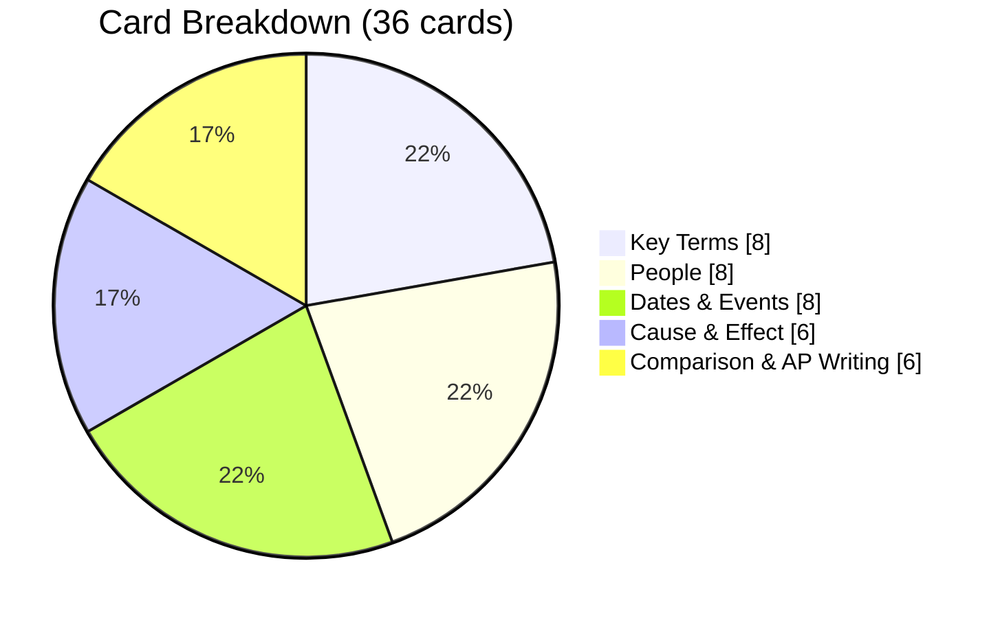

# AP World History: Modern — Topic 6.3 Indigenous Responses to State Expansion from 1750 to 1900 · Flashcards

> Source: Based on the College Board CED · Textbook not yet incorporated

---

## 1. Key Terms

- [ ] **What is the difference between "direct resistance" and "new states on the peripheries"?**

▶ Answer
Direct resistance is open or armed opposition inside an empire (for example, Túpac Amaru II in Peru or the 1857 rebellion in India). New states on the peripheries are states built on the edges of empires, often in reaction to imperial pressure (for example, the Balkan states, the Sokoto Caliphate, the Cherokee Nation, and the Zulu Kingdom).

- [ ] **What were the *mita* and the *reparto de mercancías* in Spanish Peru?**

▶ Answer
The mita was a forced-labor draft that sent indigenous Andeans to work in mines such as Potosí. The reparto forced them to buy goods from Spanish officials (corregidores) at high prices. Both were major grievances behind Túpac Amaru II's rebellion.

- [ ] **What was the Golden Stool?**

▶ Answer
The sacred symbol of the Asante nation's soul. In 1900 the British governor Frederic Hodgson demanded it so he could sit on it, which sparked the Yaa Asantewaa War (War of the Golden Stool). The British never captured it.

- [ ] **What was a sepoy, and what were the "greased cartridges"?**

▶ Answer
A sepoy was an Indian soldier in the British East India Company's army. Cartridges for the new Enfield rifle were said to be greased with cow and pig fat, and soldiers had to bite them open. This offended both Hindus and Muslims and helped spark the 1857 rebellion.

- [ ] **What was the Doctrine of Lapse?**

▶ Answer
An East India Company policy that let the company take over an Indian state when its ruler died without a natural male heir. Together with the annexation of Awadh (1856), it angered Indian princes before 1857.

- [ ] **What was the Mfecane?**

▶ Answer
"The crushing": a period of wars and migrations in southern Africa in the early 1800s, linked to the rise of Shaka's Zulu Kingdom. New states such as the Ndebele and the Sotho kingdom formed in response. Its causes are debated: the older view blamed Shaka, while some historians also point to slave raiding, drought, and settler pressure.

- [ ] **What was the Ghost Dance?**

▶ Answer
A religious movement started in 1889 by Wovoka, a Paiute prophet in Nevada. It taught that a dance, prayer, and peaceful living would bring back dead ancestors and the bison and restore the old way of life. Some Lakota wore "ghost shirts" they believed would stop bullets.

- [ ] **What does "Mahdi" mean, and who claimed the title?**

▶ Answer
"The guided one," a redeemer expected in some Islamic traditions. In 1881 Muhammad Ahmad in Sudan declared himself the Mahdi and called for a holy war to purify Islam and end Egyptian-Ottoman rule.

## 2. People

- [ ] **Who was Túpac Amaru II?**

▶ Answer
José Gabriel Condorcanqui, a mestizo kuraka (local indigenous leader) who claimed descent from the last Inca ruler. In 1780 he led a mass rebellion against Spanish taxes, forced labor, and forced sales of goods. He was captured and executed in Cuzco in 1781.

- [ ] **Who was Samory Touré?**

▶ Answer
A Mandinka Muslim leader who built the Wassoulou Empire in the upper Niger region. He bought repeating rifles through Freetown, used scorched-earth tactics, and moved his state east while fighting the French from 1882 to 1898. He was captured in 1898 and exiled to Gabon.

- [ ] **Who was Yaa Asantewaa?**

▶ Answer
The queen mother of Ejisu in the Asante Kingdom. After the British exiled the Asante king Prempeh I and demanded the Golden Stool, she led the 1900 uprising and besieged the British fort at Kumasi. She was exiled to the Seychelles.

- [ ] **Who was Usman dan Fodio?**

▶ Answer
A Fulani Muslim scholar and Sufi teacher who led a jihad (1804–1809) against the Hausa kings, whom he accused of mixing Islam with local religion and taxing unjustly. The jihad created the Sokoto Caliphate in what is now northern Nigeria.

- [ ] **Who was Shaka?**

▶ Answer
The Zulu king (r. c. 1816–1828) who built a powerful kingdom through military reform: age-based regiments, a short stabbing spear, large shields, and the "horns of the buffalo" formation. He was assassinated in 1828.

- [ ] **Who was Sequoyah?**

▶ Answer
A Cherokee man who created a syllabary (writing system) for the Cherokee language, completed in 1821. It made possible the bilingual Cherokee Phoenix newspaper (1828) and helped the Cherokee Nation build a modern government.

- [ ] **Who was Nongqawuse?**

▶ Answer
A teenage Xhosa prophet who said in 1856 that if the Xhosa killed their cattle and destroyed their crops, the ancestors would rise, new cattle would appear, and the British would be swept into the sea. Her prophecy started the Xhosa Cattle-Killing Movement.

- [ ] **Who was Muhammad Ahmad?**

▶ Answer
A Sudanese religious leader who declared himself the Mahdi in 1881. His forces took Khartoum in 1885 and killed the British general Charles Gordon. He died in 1885, but the Mahdist state he founded lasted until 1898.

## 3. Dates & Events

- [ ] **1780–1781**

▶ Answer
Túpac Amaru II's rebellion in Peru. It began when he executed a Spanish corregidor (1780) and ended with his execution in Cuzco (1781), though fighting went on until about 1782–1783.

- [ ] **1804–1809**

▶ Answer
Usman dan Fodio's jihad against the Hausa kings, which created the Sokoto Caliphate. Its capital, Sokoto, was founded in 1809.

- [ ] **1838–1839**

▶ Answer
The Trail of Tears. The U.S. Army forced about 16,000 Cherokee west to Indian Territory (modern Oklahoma), and about 4,000 died (an estimate).

- [ ] **1857–1858**

▶ Answer
The rebellion in India. It began with sepoys at Meerut in May 1857 and was crushed by 1858. The Government of India Act (1858) ended East India Company rule and began direct British Crown rule.

- [ ] **1878**

▶ Answer
The Congress of Berlin recognized Serbia, Romania, and Montenegro as independent from the Ottoman Empire and made Bulgaria an autonomous principality.

- [ ] **1885**

▶ Answer
Two events: the Mahdists took Khartoum in Sudan and killed Charles Gordon, and Western-educated Indians founded the Indian National Congress in Bombay.

- [ ] **December 1890**

▶ Answer
The crushing of the Ghost Dance. Police killed Sitting Bull (December 15), and the U.S. 7th Cavalry killed about 250–300 Lakota at Wounded Knee Creek (December 29), many of them women and children.

- [ ] **1898**

▶ Answer
Two defeats of African resistance: a British-Egyptian army with Maxim guns destroyed the Mahdist army at Omdurman, and the French captured Samory Touré.

## 4. Cause & Effect

- [ ] **Cause → Effect: Why did the 1857 rebellion break out, and what did it change?**

▶ Answer
Causes: greased cartridges that offended Hindus and Muslims, annexations under the Doctrine of Lapse and of Awadh, fear of missionary and British reforms, and economic pressure. Effects: the East India Company's rule ended, the British Crown ruled India directly (the British Raj), the Mughal dynasty ended, and Queen Victoria promised not to interfere with Indian religions.

- [ ] **Cause → Effect: Why did many Xhosa kill their cattle in 1856–1857, and what happened?**

▶ Answer
The Xhosa had lost land in frontier wars, and a cattle disease (lungsickness) was killing their herds, so Nongqawuse's promise of renewal and of driving out the British gave hope. When the prophecy failed, famine killed tens of thousands, and Governor George Grey took Xhosa land and pushed survivors into wage labor in the Cape Colony.

- [ ] **Cause → Effect: How did Túpac Amaru II's rebellion affect later independence in Peru?**

▶ Answer
A mass indigenous uprising frightened creole (American-born Spanish) elites, who feared losing their own power. Many became cautious about independence, and Peru was one of the last Spanish colonies to break away (1821–1824).

- [ ] **Cause → Effect: How did the Cherokee try to resist removal, and why did they fail?**

▶ Answer
They used Western tools: a written constitution (1827), the Cherokee Phoenix newspaper, and lawsuits. They won Worcester v. Georgia (1832), but settler demand for land and gold, the Indian Removal Act (1830), and President Jackson's refusal to enforce the ruling led to the Trail of Tears (1838–1839).

- [ ] **Cause → Effect: Why did most armed resistance fail by 1900?**

▶ Answer
Industrial states had far better weapons and resources. At Omdurman (1898), Maxim guns killed about 11,000 Mahdist soldiers while fewer than 50 soldiers on the British-Egyptian side died. Divisions among colonized peoples also helped, since many Indian princes and the Sikhs stayed loyal to Britain in 1857.

- [ ] **Cause → Effect: How did Enlightenment ideas and nationalism contribute to anticolonial movements?**

▶ Answer
Ideas of natural rights and government by consent, and the examples of the Haitian and Latin American revolutions, made colonized people question imperial authority. Western-educated elites used these ideas to form organizations such as the Indian National Congress (1885), and Balkan peoples used nationalism to win independence from the Ottomans.

## 5. Comparison & AP Writing

- [ ] **Compare: How were the Balkan states and the Cherokee Nation similar and different as "new states"?**

▶ Answer
Similar: both used Western political ideas (nationalism, constitutions) to claim the right to govern themselves. Different: the Balkan states won independence from the Ottoman Empire, partly with help from Russia, Britain, and France. The Cherokee had no outside ally, and the United States removed them from their land despite a Supreme Court ruling in their favor.

- [ ] **Compare: How were the Ghost Dance and the Xhosa Cattle-Killing Movement similar and different?**

▶ Answer
Similar: both were led by prophets (Wovoka, Nongqawuse) after land loss and military defeat, and both promised that the ancestors would return and the old world would be restored. Different: the Xhosa movement asked people to destroy their own cattle and crops, causing famine. The Ghost Dance asked people to dance and pray, but the U.S. Army crushed it at Wounded Knee (1890).

- [ ] **Compare: How did the 1857 rebellion differ from the Indian National Congress?**

▶ Answer
The 1857 rebellion was an armed uprising led by soldiers, princes, and the old Mughal court, looking back to older rulers. The Indian National Congress (1885) was led by Western-educated middle-class Indians who used petitions, meetings, and the press, and at first asked for reform within British rule rather than independence.

- [ ] **AP Short Answer: Explain one reason some resistance movements took religious forms from 1750 to 1900.**

▶ Answer

**Claim:** Some resistance movements took religious forms because military defeat and loss of land left few other options, and religion offered hope of supernatural help. 
**Evidence:** After the Lakota were confined to reservations and the bison were nearly destroyed, many turned to the Ghost Dance (1889–1890), which promised the return of the dead and the old way of life. In Sudan, Muhammad Ahmad claimed to be the Mahdi and united followers against Egyptian-Ottoman rule. 
**Reasoning:** Religious leaders could unite people across clans and regions and give them a reason to believe they could win against stronger industrial powers, so discontent with imperial rule was expressed through prophecy and holy war.

- [ ] **AP Short Answer: Explain one similarity between the 1857 rebellion in India and another direct resistance movement from 1750 to 1900.**

▶ Answer

**Claim:** Both the 1857 rebellion in India and Túpac Amaru II's rebellion in Peru were direct resistance against imperial rule that looked back to an older dynasty for legitimacy. 
**Evidence:** Indian rebels proclaimed the Mughal emperor Bahadur Shah II as their leader, and Túpac Amaru II took the name of the last Inca ruler. Both revolts were crushed (1858 and 1781), and both led the imperial power to change its rule: Britain ended East India Company rule, and Spain ended forced sales of goods. 
**Reasoning:** Linking resistance to a respected former dynasty helped leaders win followers, but neither revolt united its whole society, so the better-armed empire won.

- [ ] **AP Long Essay Thesis: Evaluate the extent to which resistance movements succeeded in stopping state expansion from 1750 to 1900.**

▶ Answer

**Claim:** Resistance movements mostly failed to stop state expansion before 1900, but they succeeded to a limited extent where nationalism and outside support helped, and they changed how empires ruled. 
**Evidence:** Túpac Amaru II, Samory Touré, the Mahdists, the Zulu, and the Lakota were defeated by better-armed states (for example, Omdurman in 1898 and Wounded Knee in 1890). However, Greece, Serbia, Romania, and Montenegro won independence from the Ottomans by 1878, and the 1857 rebellion forced Britain to end East India Company rule. 
**Reasoning:** Industrial weapons and divisions among colonized peoples let empires win most wars, but resistance created new states, forced reforms, and left symbols such as the Golden Stool and the Indian National Congress that later independence movements built on.

