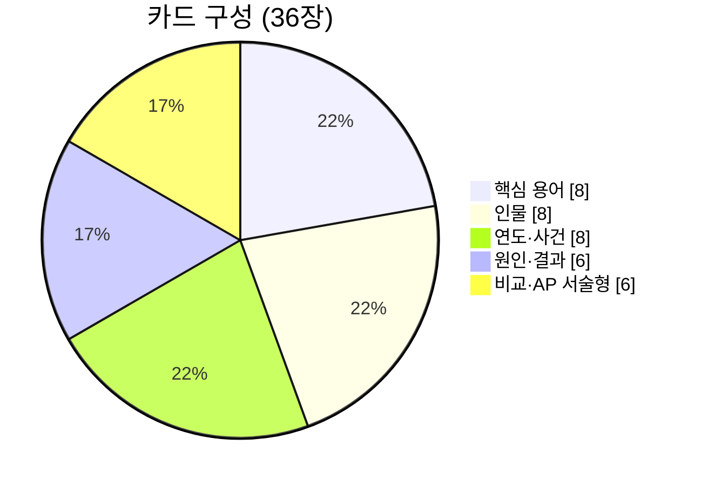

# AP 세계사: 모던 — 토픽 6.3 1750–1900년 국가의 팽창에 대한 토착민의 대응 (Indigenous Responses to State Expansion from 1750 to 1900) · 플래시카드

> 출처: CED 기준 · 교재 반영 전

---

## 1. 핵심 용어

- [ ] **"직접적 저항 (Direct resistance)"과 "주변부의 새로운 국가 (New states on the peripheries)"는 어떻게 다른가?**

▶ 정답
직접적 저항은 제국 안에서 벌인 공개적 또는 무장 저항이다(예: 페루의 투팍 아마루 2세, 1857년 인도 항쟁). 주변부의 새로운 국가는 제국의 가장자리에서, 흔히 제국의 압력에 대응해 세운 국가다(예: 발칸반도의 국가들, 소코토 칼리프국, 체로키 네이션, 줄루 왕국).

- [ ] **스페인령 페루의 *미타 (Mita)*와 *레파르토 (Reparto de mercancías)*는 무엇이었는가?**

▶ 정답
미타는 안데스 원주민을 포토시 같은 광산에서 일하게 한 강제 노동 징발 제도다. 레파르토는 원주민에게 스페인 관리(코레히도르 Corregidor)의 물건을 비싼 값에 강제로 사게 한 제도다. 둘 다 투팍 아마루 2세 반란의 주요 불만이었다.

- [ ] **황금 의자 (Golden Stool)란 무엇이었는가?**

▶ 정답
아산테 민족의 영혼을 상징하는 신성한 물건이다. 1900년 영국 총독 프레더릭 호지슨 (Frederic Hodgson)이 자신이 앉겠다며 이를 요구하자 야 아산테와 전쟁(황금 의자 전쟁)이 일어났다. 영국은 끝내 이를 손에 넣지 못했다.

- [ ] **세포이 (Sepoy)란 누구이며, "기름 바른 탄약포 (Greased cartridges)"란 무엇이었는가?**

▶ 정답
세포이는 영국 동인도 회사 군대의 인도인 병사다. 새 엔필드 소총의 탄약포에 소와 돼지의 기름을 발랐다는 소문이 돌았고, 병사들은 탄약포를 이로 물어뜯어야 했다. 이는 힌두교도와 무슬림 모두에게 모욕이었고, 1857년 항쟁의 불씨가 되었다.

- [ ] **실권 원칙 (Doctrine of Lapse)이란 무엇이었는가?**

▶ 정답
통치자가 친아들 상속자 없이 죽으면 동인도 회사가 그 토후국을 차지할 수 있게 한 정책이다. 아와드 (Awadh) 병합(1856)과 함께 1857년 이전 인도 군주들의 분노를 샀다.

- [ ] **음페카네 (Mfecane)란 무엇이었는가?**

▶ 정답
"짓밟기"라는 뜻으로, 1800년대 초 샤카의 줄루 왕국이 성장하던 무렵 남아프리카에서 일어난 전쟁과 이주의 시기다. 이에 대응해 은데벨레 (Ndebele)와 소토 (Sotho) 왕국 같은 새 국가들이 생겼다. 원인에 대해서는 논쟁이 있다. 예전 견해는 샤카를 탓했지만, 일부 역사가는 노예 사냥, 가뭄, 정착민의 압력도 원인으로 본다.

- [ ] **유령의 춤 (Ghost Dance)이란 무엇이었는가?**

▶ 정답
1889년 네바다의 파이우트족 예언자 워보카 (Wovoka)가 시작한 종교 운동이다. 춤과 기도와 평화로운 생활이 죽은 조상과 들소를 되돌리고 옛 생활 방식을 되살릴 것이라고 가르쳤다. 일부 라코타족은 총알을 막아 준다고 믿은 "유령 셔츠 (Ghost shirts)"를 입었다.

- [ ] **"마흐디 (Mahdi)"는 무슨 뜻이며, 누가 이 칭호를 내세웠는가?**

▶ 정답
"올바르게 인도된 자"라는 뜻으로, 일부 이슬람 전통에서 기다리는 구원자다. 1881년 수단의 무함마드 아마드 (Muhammad Ahmad)가 자신이 마흐디라고 선언하고, 이슬람을 정화하고 이집트-오스만 통치를 끝내기 위한 성전을 촉구했다.

## 2. 인물

- [ ] **투팍 아마루 2세 (Túpac Amaru II)는 누구인가?**

▶ 정답
마지막 잉카 통치자의 후손이라고 주장한 메스티소 쿠라카 (Kuraka, 현지 원주민 지도자) 호세 가브리엘 콘도르캉키 (José Gabriel Condorcanqui)다. 1780년 스페인의 세금, 강제 노동, 상품 강매에 맞서 대규모 반란을 이끌었다. 붙잡혀 1781년 쿠스코에서 처형되었다.

- [ ] **사모리 투레 (Samory Touré)는 누구인가?**

▶ 정답
니제르강 상류 지역에 와술루 제국 (Wassoulou Empire)을 세운 만딩카족 무슬림 지도자다. 프리타운을 통해 연발총을 사들였고, 초토화 전술을 썼으며, 1882년부터 1898년까지 프랑스와 싸우면서 나라를 동쪽으로 옮겼다. 1898년 붙잡혀 가봉으로 추방되었다.

- [ ] **야 아산테와 (Yaa Asantewaa)는 누구인가?**

▶ 정답
아산테 왕국 에지수 (Ejisu)의 왕대비다. 영국이 아산테 왕 프렘페 1세 (Prempeh I)를 추방하고 황금 의자를 요구하자, 1900년 봉기를 이끌고 쿠마시의 영국 요새를 포위했다. 그 뒤 세이셸로 추방되었다.

- [ ] **우스만 단 포디오 (Usman dan Fodio)는 누구인가?**

▶ 정답
풀라니족 무슬림 학자이자 수피 스승이다. 하우사 왕들이 이슬람에 토착 종교를 섞고 부당한 세금을 물린다고 비판하며 지하드(1804–1809)를 이끌었다. 이 지하드로 오늘날 나이지리아 북부에 소코토 칼리프국이 세워졌다.

- [ ] **샤카 (Shaka)는 누구인가?**

▶ 정답
군사 개혁으로 강력한 왕국을 세운 줄루 왕(재위 c. 1816–1828)이다. 연령별 연대, 짧은 찌르기 창, 커다란 방패, "물소 뿔" 대형을 도입했다. 1828년 암살되었다.

- [ ] **세쿼이아 (Sequoyah)는 누구인가?**

▶ 정답
체로키어의 음절 문자(글자 체계)를 만든 체로키인으로, 1821년에 완성했다. 이 문자 덕분에 2개 국어 신문 체로키 피닉스 (Cherokee Phoenix, 1828)가 나올 수 있었고, 체로키 네이션이 근대적 정부를 세우는 데 도움이 되었다.

- [ ] **농콰우세 (Nongqawuse)는 누구인가?**

▶ 정답
1856년 코사족이 소를 죽이고 곡식을 없애면 조상들이 되살아나고, 새 소가 나타나며, 영국인이 바다로 쓸려 나갈 것이라고 말한 십 대 코사족 예언자다. 그의 예언으로 코사족 가축 도살 운동이 시작되었다.

- [ ] **무함마드 아마드 (Muhammad Ahmad)는 누구인가?**

▶ 정답
1881년 자신이 마흐디라고 선언한 수단의 종교 지도자다. 그의 군대는 1885년 하르툼을 점령하고 영국 장군 찰스 고든 (Charles Gordon)을 죽였다. 그는 1885년에 죽었지만, 그가 세운 마흐디 국가는 1898년까지 이어졌다.

## 3. 연도·사건

- [ ] **1780–1781년**

▶ 정답
페루의 투팍 아마루 2세 반란. 그가 스페인 코레히도르를 처형하면서 시작되어(1780) 쿠스코에서 그가 처형되면서 끝났다(1781). 다만 싸움은 1782–1783년 무렵까지 이어졌다.

- [ ] **1804–1809년**

▶ 정답
우스만 단 포디오가 하우사 왕들에 맞서 벌인 지하드로, 소코토 칼리프국이 세워졌다. 수도 소코토는 1809년에 건설되었다.

- [ ] **1838–1839년**

▶ 정답
눈물의 길 (Trail of Tears). 미군이 약 16,000명의 체로키를 서쪽의 인디언 준주(오늘날 오클라호마)로 강제 이주시켰고, 약 4,000명이 죽었다(추정치).

- [ ] **1857–1858년**

▶ 정답
인도 항쟁. 1857년 5월 메루트의 세포이들이 일으켜 1858년까지 진압되었다. 인도 통치법(1858)으로 동인도 회사의 통치가 끝나고 영국 왕실의 직접 통치가 시작되었다.

- [ ] **1878년**

▶ 정답
베를린 회의 (Congress of Berlin)가 세르비아, 루마니아, 몬테네그로의 오스만 제국으로부터의 독립을 인정하고, 불가리아를 자치 공국으로 만들었다.

- [ ] **1885년**

▶ 정답
두 사건이 있었다. 수단에서 마흐디군이 하르툼을 점령하고 찰스 고든을 죽였고, 서양식 교육을 받은 인도인들이 봄베이에서 인도 국민회의 (Indian National Congress)를 세웠다.

- [ ] **1890년 12월**

▶ 정답
유령의 춤이 무력으로 꺾였다. 경찰이 시팅 불 (Sitting Bull)을 죽였고(12월 15일), 미국 제7기병대가 운디드니 개울에서 라코타족 약 250–300명을 죽였다(12월 29일). 그 가운데 많은 이가 여성과 어린이였다.

- [ ] **1898년**

▶ 정답
아프리카의 저항이 두 번 패배했다. 맥심 기관총을 갖춘 영국-이집트군이 옴두르만에서 마흐디군을 무너뜨렸고, 프랑스가 사모리 투레를 붙잡았다.

## 4. 원인·결과

- [ ] **원인 → 결과: 1857년 항쟁은 왜 일어났으며, 무엇을 바꾸었는가?**

▶ 정답
원인: 힌두교도와 무슬림을 모욕한 기름 바른 탄약포, 실권 원칙과 아와드 병합, 선교사와 영국식 개혁에 대한 두려움, 경제적 압박. 결과: 동인도 회사의 통치가 끝나고 영국 왕실이 인도를 직접 다스리게 되었으며(영국령 인도 제국, British Raj), 무굴 왕조가 끝났고, 빅토리아 여왕은 인도의 종교에 간섭하지 않겠다고 약속했다.

- [ ] **원인 → 결과: 1856–1857년 많은 코사족이 소를 죽인 이유와 그 결과는?**

▶ 정답
코사족은 변경 전쟁으로 땅을 잃었고, 소 전염병(우폐역, Lungsickness)이 가축을 죽이고 있었다. 그래서 세상이 새로워지고 영국인이 쫓겨날 것이라는 농콰우세의 약속이 희망을 주었다. 예언이 이루어지지 않자 기근으로 수만 명이 죽었고, 총독 조지 그레이 (George Grey)는 코사족의 땅을 빼앗고 살아남은 사람들을 케이프 식민지의 임금 노동으로 내몰았다.

- [ ] **원인 → 결과: 투팍 아마루 2세 반란은 뒷날 페루의 독립에 어떤 영향을 주었는가?**

▶ 정답
대규모 원주민 봉기는 자신의 권력을 잃을까 두려워한 크리오요 (Creole, 아메리카에서 태어난 스페인계) 엘리트를 겁먹게 했다. 많은 크리오요가 독립에 조심스러워졌고, 페루는 스페인에서 가장 늦게 독립한 식민지 가운데 하나가 되었다(1821–1824).

- [ ] **원인 → 결과: 체로키는 강제 이주에 어떻게 맞섰으며, 왜 실패했는가?**

▶ 정답
성문 헌법(1827), 체로키 피닉스 신문, 소송 같은 서양식 수단을 썼다. 워체스터 대 조지아 판결 (Worcester v. Georgia, 1832)에서 이겼지만, 땅과 금을 원한 정착민의 요구, 인디언 이주법(1830), 판결을 집행하지 않은 잭슨 대통령 때문에 눈물의 길(1838–1839)로 이어졌다.

- [ ] **원인 → 결과: 1900년까지 무장 저항이 대부분 실패한 이유는?**

▶ 정답
산업 국가들이 훨씬 뛰어난 무기와 자원을 가졌기 때문이다. 옴두르만(1898)에서 맥심 기관총은 마흐디 병사 약 11,000명을 죽였지만, 영국-이집트 쪽 전사자는 50명이 안 되었다. 식민지 민족 내부의 분열도 영향을 주었다. 1857년에는 많은 인도 군주와 시크교도가 영국 편에 섰다.

- [ ] **원인 → 결과: 계몽사상과 민족주의는 반식민주의 운동에 어떻게 기여했는가?**

▶ 정답
자연권과 동의에 의한 통치라는 생각, 그리고 아이티 혁명과 라틴아메리카 독립 혁명의 사례는 식민지 사람들이 제국의 권위를 문제 삼게 했다. 서양식 교육을 받은 엘리트는 이 생각으로 인도 국민회의(1885) 같은 조직을 만들었고, 발칸반도의 민족들은 민족주의를 내세워 오스만 제국에서 독립했다.

## 5. 비교·AP 서술형

- [ ] **비교: "새로운 국가"로서 발칸반도의 국가들과 체로키 네이션의 공통점과 차이점은?**

▶ 정답
공통점: 둘 다 민족주의와 헌법 같은 서양의 정치사상을 이용해 스스로 다스릴 권리를 주장했다. 차이점: 발칸반도의 국가들은 러시아, 영국, 프랑스의 도움을 일부 받아 오스만 제국에서 독립했다. 체로키에게는 외부 동맹이 없었고, 미국은 연방 대법원이 체로키 편을 들어 준 판결에도 불구하고 그들을 땅에서 쫓아냈다.

- [ ] **비교: 유령의 춤과 코사족 가축 도살 운동의 공통점과 차이점은?**

▶ 정답
공통점: 둘 다 땅을 잃고 군사적으로 패한 뒤 예언자(워보카, 농콰우세)가 이끌었고, 조상이 돌아오고 옛 세상이 되살아날 것이라고 약속했다. 차이점: 코사족 운동은 사람들에게 자신의 소와 곡식을 없애라고 해서 기근을 불렀다. 유령의 춤은 춤추고 기도하라고 했지만, 미군이 운디드니(1890)에서 이를 짓밟았다.

- [ ] **비교: 1857년 항쟁과 인도 국민회의는 어떻게 달랐는가?**

▶ 정답
1857년 항쟁은 병사, 군주, 옛 무굴 궁정이 이끈 무장 봉기로, 옛 통치자를 되돌아보았다. 인도 국민회의(1885)는 서양식 교육을 받은 중산층 인도인이 이끌었고, 청원, 집회, 언론을 활용했으며, 처음에는 독립이 아니라 영국 지배 안에서의 개혁을 요구했다.

- [ ] **AP 단답형: 1750–1900년 일부 저항 운동이 종교적 형태를 띤 이유 하나를 설명하라.**

▶ 정답

**주장:** 일부 저항 운동이 종교적 형태를 띤 것은 군사적 패배와 토지 상실로 다른 선택지가 거의 없었고, 종교가 초자연적 도움에 대한 희망을 주었기 때문이다. 
**근거:** 라코타족이 보호구역에 갇히고 들소가 거의 사라진 뒤, 많은 이들이 죽은 이들과 옛 생활 방식이 돌아온다고 약속한 유령의 춤(1889–1890)에 기댔다. 수단에서는 무함마드 아마드가 마흐디를 자처하며 이집트-오스만 통치에 맞서 추종자를 하나로 묶었다. 
**설명:** 종교 지도자는 씨족과 지역을 넘어 사람들을 뭉치게 하고, 더 강한 산업 국가를 이길 수 있다는 믿음을 줄 수 있었다. 그래서 제국 통치에 대한 불만이 예언과 성전의 형태로 표출되었다.

- [ ] **AP 단답형: 1857년 인도 항쟁과 1750–1900년의 다른 직접적 저항 운동 사이의 공통점 하나를 설명하라.**

▶ 정답

**주장:** 1857년 인도 항쟁과 페루의 투팍 아마루 2세 반란은 모두 제국 통치에 맞선 직접적 저항이었고, 정당성을 얻으려고 옛 왕조를 내세웠다. 
**근거:** 인도의 반란군은 무굴 황제 바하두르 샤 2세 (Bahadur Shah II)를 지도자로 내세웠고, 투팍 아마루 2세는 마지막 잉카 통치자의 이름을 썼다. 두 반란은 모두 진압되었고(1858, 1781), 둘 다 제국이 통치 방식을 바꾸게 했다. 영국은 동인도 회사의 통치를 끝냈고, 스페인은 상품 강매를 없앴다. 
**설명:** 존경받던 옛 왕조와 저항을 연결하면 지도자가 추종자를 모으기 쉬웠다. 그러나 어느 반란도 사회 전체를 하나로 묶지 못했기 때문에 더 잘 무장한 제국이 이겼다.

- [ ] **AP 논술형 논지: 1750–1900년 저항 운동이 국가의 팽창을 막는 데 어느 정도 성공했는지 평가하라.**

▶ 정답

**주장:** 1900년 이전의 저항 운동은 대부분 국가의 팽창을 막지 못했다. 그러나 민족주의와 외부 지원이 있던 곳에서는 제한적으로 성공했고, 제국의 통치 방식을 바꾸었다. 
**근거:** 투팍 아마루 2세, 사모리 투레, 마흐디 세력, 줄루, 라코타는 더 잘 무장한 국가에 패했다(예: 1898년 옴두르만, 1890년 운디드니). 그러나 그리스, 세르비아, 루마니아, 몬테네그로는 1878년까지 오스만 제국에서 독립했고, 1857년 항쟁은 영국이 동인도 회사의 통치를 끝내게 만들었다. 
**설명:** 산업 시대의 무기와 식민지 민족 내부의 분열 덕분에 제국은 대부분의 전쟁에서 이겼다. 하지만 저항은 새 국가를 만들고, 개혁을 이끌어 냈으며, 황금 의자와 인도 국민회의처럼 훗날 독립운동이 이어받은 상징과 조직을 남겼다.

