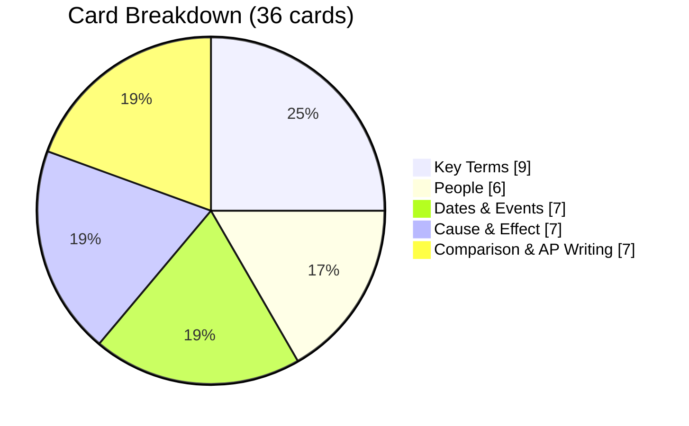

# AP World History: Modern — Topic 6.4 Global Economic Development from 1750 to 1900 · Flashcards

> Source: Based on the College Board CED · Textbook not yet incorporated

---

## 1. Key Terms

- [ ] **What is an export economy?**

▶ Answer
An economy that specializes in producing one or a few raw materials or crops for sale abroad. Examples: cotton in Egypt, guano in Peru, meat in Argentina and Uruguay. The profits were used to buy finished goods from industrial countries.

- [ ] **What is the core–periphery pattern of the world economy?**

▶ Answer
Industrial countries (the core: Britain, Western Europe, the US) made high-value finished goods, while other regions (the periphery) supplied low-value raw materials and food. Peripheral economies often depended on a single export.

- [ ] **What was "legitimate commerce"?**

▶ Answer
The trade in goods such as palm oil that Britain promoted in West Africa after it abolished the slave trade in 1807. It was meant to replace the trade in enslaved people, but slave labor inside West Africa actually grew to produce palm oil.

- [ ] **What is monoculture, and why was it risky?**

▶ Answer
Growing a single crop over a large area, as with cotton in Egypt. It wore out soils and tied the whole economy to one world price, so a pest or a price drop hit everything at once.

- [ ] **What is guano, and why was it valuable?**

▶ Answer
Seabird droppings rich in nitrogen and phosphate. On Peru's rainless coastal islands it piled up for centuries. European farmers bought it as fertilizer to grow more food for industrial cities.

- [ ] **What is vulcanization, and why did it matter for the global economy?**

▶ Answer
Charles Goodyear's 1839 process that made rubber stable in heat and cold. It made rubber useful for belts, hoses, cable insulation, and later tires, which set off rubber booms in the Amazon and the Congo.

- [ ] **What were refrigerated ships and frigoríficos?**

▶ Answer
Refrigerated ships (from the late 1870s) had cooling machinery that kept meat from spoiling at sea. Frigoríficos were large meatpacking and freezing plants in Argentina and Uruguay (from the 1880s). Together they let the Río de la Plata region ship frozen beef and mutton to Britain.

- [ ] **What is debt peonage? Give an example from this topic.**

▶ Answer
A labor system in which workers are bound by debts they can never fully repay. Amazon rubber tappers (seringueiros) received food and tools on credit from merchants and were trapped in debt.

- [ ] **What were closed compounds?**

▶ Answer
Fenced barracks at the Kimberley diamond mines (from the mid-1880s) where African migrant workers lived under guard and could be searched. They became a model for later labor control in South Africa.

## 2. People

- [ ] **Who was Muhammad Ali, and how did he shape Egypt's export economy?**

▶ Answer
The ruler of Egypt from 1805 to 1848. He made cotton a state monopoly, forced peasants (fellahin) to grow long-staple cotton for export, and used corvée labor to dig irrigation canals.

- [ ] **Who was Khedive Ismail?**

▶ Answer
Ruler of Egypt from 1863 to 1879. He borrowed heavily from European banks for railroads, the Suez Canal, and modernization during the cotton boom. When cotton prices fell, he sold Egypt's Suez shares to Britain (1875), and Egypt went bankrupt (1876).

- [ ] **Who was King Leopold II of Belgium?**

▶ Answer
The king who ruled the Congo Free State as his personal property (1885–1908). His agents and army, the Force Publique, forced Congolese villagers to gather wild rubber under quotas, enforced with hostage-taking, burning, and mutilation.

- [ ] **Who was Cecil Rhodes?**

▶ Answer
A British businessman and imperialist who founded De Beers (1880) and formed De Beers Consolidated Mines (1888), which came to control about 90% of the world's diamonds. He used the fortune to found the British South Africa Company (1889) and served as prime minister of the Cape Colony.

- [ ] **Who was Henry Wickham, and why does he matter?**

▶ Answer
An Englishman who shipped about 70,000 rubber seeds from Brazil to Kew Gardens in London in 1876. The seedlings started British rubber plantations in Ceylon and Malaya, which later undercut wild Amazon rubber and ended the Manaus boom.

- [ ] **Who was Jaja of Opobo?**

▶ Answer
An African merchant-king in the Niger Delta who controlled the palm oil trade between the interior and the coast. The British deported him in 1887 so that European firms could trade with producers directly.

## 3. Dates & Events

- [ ] **1807**

▶ Answer
Britain abolishes the slave trade. British merchants then promote palm oil in West Africa as "legitimate commerce."

- [ ] **1846**

▶ Answer
Britain repeals the Corn Laws and moves toward free trade, opening its market to imported food and raw materials.

- [ ] **1861–1865**

▶ Answer
The American Civil War cuts off Southern cotton to Britain. Egyptian cotton prices and exports soar, then fall after the war ends.

- [ ] **1867 and 1871**

▶ Answer
Diamonds are found near the Orange River in southern Africa (1867), and a rush begins at Kimberley (1871).

- [ ] **1869**

▶ Answer
The Suez Canal opens, shortening the route between Europe and Asia. Egypt's debts for building it later helped lead to bankruptcy and British occupation.

- [ ] **1879–1884**

▶ Answer
The War of the Pacific. Chile defeats Peru and Bolivia and takes the nitrate- and guano-rich provinces of Tarapacá and Antofagasta; Bolivia loses its coastline.

- [ ] **1885–1908**

▶ Answer
The Congo Free State, King Leopold II's personal colony, built on forced rubber collection. It ends when Belgium takes over the colony in 1908.

## 4. Cause & Effect

- [ ] **Cause → Effect: Why did industrialization lead to export economies around the world?**

▶ Answer
Factories needed raw materials (cotton, rubber, oils, fertilizer), and growing cities needed food. Industrial countries could not supply all of this themselves, so other regions specialized in exporting those goods. Steamships, railroads, refrigeration, and free trade made the trade cheap.

- [ ] **Cause → Effect: How did Peru's climate make it a guano exporter, and what happened to the deposits?**

▶ Answer
Peru's coastal islands get almost no rain, so seabird droppings piled up for centuries instead of washing away. During the Age of Guano (c. 1840–1880) the best deposits were mined out within a few decades, and Peru fell into debt.

- [ ] **Cause → Effect: How did the American Civil War affect Egypt?**

▶ Answer
The war cut off Southern cotton, so Egyptian cotton prices and exports boomed and more land went to cotton. After 1865 prices fell, Egypt could not pay its European loans, went bankrupt (1876), and was occupied by Britain (1882).

- [ ] **Cause → Effect: Why did the Amazon rubber boom collapse?**

▶ Answer
Henry Wickham's seeds started British plantations in Ceylon and Malaya. There, trees could be planted in rows without the leaf blight that attacked them in the Amazon, so plantation rubber became cheaper than wild Amazon rubber by the 1910s. Manaus declined.

- [ ] **Cause → Effect: How did refrigeration change Argentina and Uruguay?**

▶ Answer
Before refrigeration, the pampas exported mainly hides, tallow, and salted beef. Refrigerated ships and frigoríficos let the region sell frozen beef and mutton to Britain, which brought British investment in railways and ports, more ranch land, and European immigrant workers.

- [ ] **Cause → Effect: What did British abolition of the slave trade mean for West African economies?**

▶ Answer
West African states and merchants shifted to exporting palm oil for British soap, candles, and machine lubricants. However, states such as Dahomey used enslaved workers to produce it, so slavery within West Africa grew.

- [ ] **Cause → Effect: Why did Chile fight the War of the Pacific, and what was the result?**

▶ Answer
Chile, Peru, and Bolivia all claimed nitrate and guano lands in the Atacama Desert, valuable for fertilizer and explosives. Chile won (1879–1884), took Tarapacá and Antofagasta, and nitrate taxes became a large share of its government revenue, though British investors dominated the industry.

## 5. Comparison & AP Writing

- [ ] **Compare: How were rubber extraction in the Amazon and in the Congo similar and different?**

▶ Answer
Similar: both collected wild rubber from rainforests for industrial demand (belts, hoses, tires), and both used coerced labor. Different: Amazon tappers were mostly migrant workers trapped in debt peonage under private rubber barons, while Congo villagers were forced to meet quotas by the army of Leopold II's personal colony. Congo collectors often cut down the vines, while Amazon tappers tapped trees again and again.

- [ ] **Compare: How were Egyptian cotton and Argentine meat similar and different as export economies?**

▶ Answer
Similar: both depended on environmental advantages (Nile irrigation; the pampas) and sold mainly to Britain. Different: Egypt's cotton economy began as a state monopoly under Muhammad Ali and ended in debt and British occupation, while Argentina stayed independent but depended on British capital, railways, and buyers.

- [ ] **Compare: How were the guano and diamond industries alike in their environmental effects?**

▶ Answer
Both extracted nonrenewable resources that had built up over very long periods. Guano deposits on Peru's islands were mined out in a few decades, and diamond mining at Kimberley dug the "Big Hole" and stripped nearby woodlands for fuel.

- [ ] **Sourcing (Skill 2.B): Roger Casement, a British consul, wrote a report on the Congo Free State in 1904. Explain how his purpose might affect how historians use it.**

▶ Answer
Casement wrote for the British government to investigate reported abuses, and he became a leading reformer. His purpose makes the report detailed evidence of forced labor and violence, but historians also note that Britain was a rival colonial power with its own abuses, so they compare the report with other sources such as missionary accounts and Congolese testimony.

- [ ] **AP Short Answer: Explain one way industrialization changed economies outside Europe between 1750 and 1900.**

▶ Answer

**Claim:** Industrialization turned many economies outside Europe into export economies that specialized in one raw material or food. 
**Evidence:** Egypt shifted to long-staple cotton for British textile mills, and its exports soared during the American Civil War (1861–1865). 
**Reasoning:** Factories needed raw materials, so Egypt earned profits from cotton and used them to buy finished goods. When cotton prices fell after 1865, Egypt fell into debt, which shows its new dependence on the industrial core.

- [ ] **AP Short Answer: Explain one environmental effect of export economies from 1750 to 1900.**

▶ Answer

**Claim:** Export economies depleted natural resources that could not be quickly replaced. 
**Evidence:** Guano had piled up for centuries on Peru's rainless islands, but it was mined out within a few decades during the Age of Guano (c. 1840–1880). 
**Reasoning:** European farms needed fertilizer to feed industrial cities, so demand drove extraction faster than nature could rebuild the deposits, and Peru lost its main source of income.

- [ ] **AP Long Essay Thesis: Evaluate the extent to which environmental factors shaped the development of the global economy from 1750 to 1900.**

▶ Answer

**Claim:** Environmental factors largely decided where export economies developed, but industrial demand, technology, and political power decided how they were run and who profited. 
**Evidence:** Climate and geography made Peru a guano supplier, the pampas a meat supplier, and the rainforests of the Amazon and Congo rubber suppliers. However, refrigerated ships made the meat trade possible, Leopold II's forced labor system ran Congo rubber, and Wickham's seeds let British plantations in Asia take over the rubber market. 
**Reasoning:** Natural resources gave regions their role in the global economy, but industrial technology and imperial control turned those resources into a core–periphery system in which producing regions depended on one export and on prices set elsewhere.

