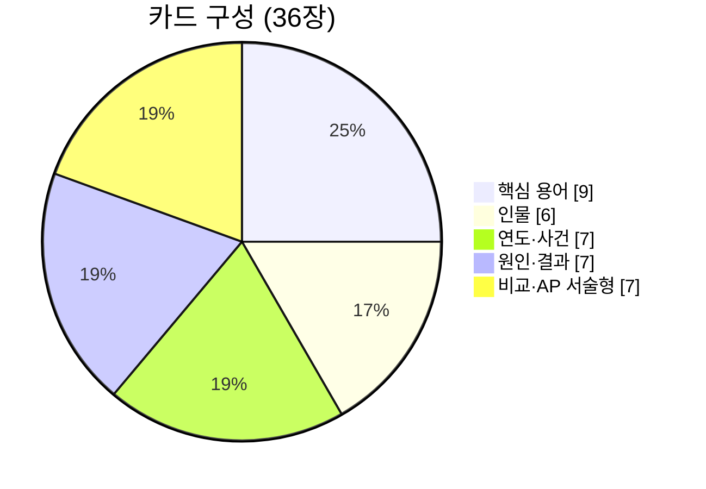

# AP 세계사: 모던 — 토픽 6.4 1750–1900년 세계 경제의 발전 (Global Economic Development from 1750 to 1900) · 플래시카드

> 출처: CED 기준 · 교재 반영 전

---

## 1. 핵심 용어

- [ ] **수출 경제 (Export economy)란 무엇인가?**

▶ 정답
해외에 팔 한 가지 또는 몇 가지 원료나 작물 생산에 특화한 경제다. 예: 이집트의 면화, 페루의 구아노, 아르헨티나와 우루과이의 육류. 그 이윤은 산업 국가의 완제품을 사는 데 쓰였다.

- [ ] **세계 경제의 중심부–주변부 (Core–periphery) 구조란 무엇인가?**

▶ 정답
산업 국가(중심부: 영국, 서유럽, 미국)는 부가가치가 높은 완제품을 만들고, 다른 지역(주변부)은 값싼 원료와 식량을 공급하는 구조다. 주변부 경제는 흔히 한 가지 수출품에 의존했다.

- [ ] **"합법 무역 (Legitimate commerce)"이란 무엇이었는가?**

▶ 정답
1807년 노예 무역을 폐지한 뒤 영국이 서아프리카에서 장려한 야자유 등의 상품 무역이다. 노예 무역을 대신하려는 것이었지만, 실제로는 야자유를 생산하려고 서아프리카 안에서 노예 노동이 늘었다.

- [ ] **단일 경작 (Monoculture)이란 무엇이며, 왜 위험했는가?**

▶ 정답
이집트의 면화처럼 넓은 땅에 한 가지 작물만 기르는 것이다. 토양을 지치게 했고 경제 전체를 하나의 세계 가격에 묶었다. 그래서 병충해나 가격 하락이 한꺼번에 모든 것을 덮쳤다.

- [ ] **구아노 (Guano)란 무엇이며, 왜 가치가 있었는가?**

▶ 정답
질소와 인이 풍부한 바닷새 배설물이다. 비가 오지 않는 페루 해안의 섬에 수백 년 동안 쌓였다. 유럽 농민들은 산업 도시를 먹일 식량을 더 많이 기르려고 이를 비료로 샀다.

- [ ] **가황법 (Vulcanization)이란 무엇이며, 세계 경제에 왜 중요했는가?**

▶ 정답
고무가 더위와 추위에도 변하지 않게 한 찰스 굿이어 (Charles Goodyear)의 1839년 공정이다. 덕분에 고무를 벨트, 호스, 케이블 절연재, 나중에는 타이어에 쓸 수 있었고, 이것이 아마존과 콩고의 고무 호황을 불렀다.

- [ ] **냉동선 (Refrigerated ship)과 프리고리피코 (Frigorífico)란 무엇이었는가?**

▶ 정답
냉동선(1870년대 후반부터)은 냉각 장치로 바다에서 고기가 상하지 않게 한 배다. 프리고리피코는 아르헨티나와 우루과이의 대형 정육·냉동 공장이다(1880년대부터). 이 둘 덕분에 라플라타강 (Río de la Plata) 지역이 냉동 쇠고기와 양고기를 영국에 보낼 수 있었다.

- [ ] **채무 노동 (Debt peonage)이란 무엇인가? 이 토픽에서 예를 들어라.**

▶ 정답
노동자가 끝내 다 갚을 수 없는 빚에 묶여 일하는 노동 제도다. 아마존의 고무 채취꾼(세링게이루 (Seringueiros))은 상인에게 식량과 도구를 외상으로 받았고, 그 빚에 묶였다.

- [ ] **폐쇄 합숙소 (Closed compound)란 무엇이었는가?**

▶ 정답
킴벌리 (Kimberley) 다이아몬드 광산에서(1880년대 중반부터) 아프리카인 이주 노동자가 감시를 받으며 살고 몸수색을 당한 울타리 친 숙소다. 훗날 남아프리카 노동 통제의 본보기가 되었다.

## 2. 인물

- [ ] **무함마드 알리 (Muhammad Ali)는 누구이며, 이집트의 수출 경제를 어떻게 만들었는가?**

▶ 정답
1805년부터 1848년까지 이집트를 다스린 통치자다. 면화를 국가 독점으로 만들고, 농민(펠라힌 (Fellahin))에게 수출용 장섬유 면화 재배를 강요했으며, 부역 (Corvée)으로 관개 수로를 팠다.

- [ ] **헤디브 이스마일 (Khedive Ismail)은 누구인가?**

▶ 정답
1863년부터 1879년까지 이집트를 다스린 통치자다. 면화 호황기에 철도, 수에즈 운하, 근대화 사업을 위해 유럽 은행에서 많은 돈을 빌렸다. 면화 가격이 떨어지자 이집트의 수에즈 운하 주식을 영국에 팔았고(1875), 이집트는 파산했다(1876).

- [ ] **벨기에 국왕 레오폴드 2세 (Leopold II)는 누구인가?**

▶ 정답
콩고 자유국 (Congo Free State)을 개인 소유로 다스린 왕이다(1885–1908). 그의 관리들과 군대인 공안군 (Force Publique)은 콩고 마을 사람들에게 할당량을 정해 야생 고무를 모으게 했고, 인질 잡기, 방화, 신체 절단으로 이를 강제했다.

- [ ] **세실 로즈 (Cecil Rhodes)는 누구인가?**

▶ 정답
드비어스 (De Beers)를 세우고(1880) 드비어스 연합 광산 (De Beers Consolidated Mines)을 만든(1888) 영국의 사업가이자 제국주의자다. 이 회사는 세계 다이아몬드의 약 90%를 장악하게 되었다. 그는 이 재산으로 영국 남아프리카 회사 (British South Africa Company, 1889)를 세웠고, 케이프 식민지 총리를 지냈다.

- [ ] **헨리 위컴 (Henry Wickham)은 누구이며, 왜 중요한가?**

▶ 정답
1876년 브라질에서 고무 씨앗 약 7만 개를 런던의 큐 식물원 (Kew Gardens)으로 보낸 영국인이다. 묘목은 실론과 말라야의 영국 고무 대농장의 시작이 되었고, 이 대농장이 나중에 아마존의 야생 고무를 밀어내 마나우스 (Manaus) 호황을 끝냈다.

- [ ] **오포보의 자자 (Jaja of Opobo)는 누구인가?**

▶ 정답
니제르강 삼각주 (Niger Delta)에서 내륙과 해안 사이의 야자유 무역을 장악한 아프리카의 상인 왕이다. 유럽 회사들이 생산자와 직접 거래할 수 있도록 영국이 1887년 그를 추방했다.

## 3. 연도·사건

- [ ] **1807년**

▶ 정답
영국이 노예 무역을 폐지했다. 이후 영국 상인들은 서아프리카에서 야자유를 "합법 무역"으로 장려했다.

- [ ] **1846년**

▶ 정답
영국이 곡물법 (Corn Laws)을 폐지하고 자유 무역 (Free trade)으로 나아갔다. 수입 식량과 원료에 시장을 열었다.

- [ ] **1861–1865년**

▶ 정답
미국 남북전쟁 (American Civil War)으로 남부 면화가 영국에 들어가지 못했다. 이집트 면화의 가격과 수출이 치솟았다가, 전쟁이 끝나자 떨어졌다.

- [ ] **1867년과 1871년**

▶ 정답
남아프리카 오렌지강 (Orange River) 근처에서 다이아몬드가 발견되었고(1867), 킴벌리에서 채굴 열풍이 시작되었다(1871).

- [ ] **1869년**

▶ 정답
수에즈 운하 (Suez Canal)가 개통되어 유럽과 아시아 사이의 항로가 짧아졌다. 운하 건설로 진 이집트의 빚은 훗날 파산과 영국의 점령으로 이어졌다.

- [ ] **1879–1884년**

▶ 정답
태평양 전쟁 (War of the Pacific). 칠레가 페루와 볼리비아를 꺾고 질산염과 구아노가 풍부한 타라파카 (Tarapacá)와 안토파가스타 (Antofagasta)를 차지했다. 볼리비아는 해안을 잃었다.

- [ ] **1885–1908년**

▶ 정답
강제 고무 채취 위에 세워진 레오폴드 2세의 개인 식민지, 콩고 자유국. 1908년 벨기에 정부가 식민지를 넘겨받으면서 끝났다.

## 4. 원인·결과

- [ ] **원인 → 결과: 산업화는 왜 세계 곳곳에 수출 경제를 낳았는가?**

▶ 정답
공장은 원료(면화, 고무, 기름, 비료)가, 커지는 도시는 식량이 필요했다. 산업 국가는 이 모든 것을 스스로 공급할 수 없었으므로, 다른 지역이 그 상품의 수출에 특화했다. 증기선, 철도, 냉동 기술, 자유 무역이 이 무역을 싸게 만들었다.

- [ ] **원인 → 결과: 페루의 기후는 어떻게 페루를 구아노 수출국으로 만들었으며, 매장지는 어떻게 되었는가?**

▶ 정답
페루 해안의 섬에는 비가 거의 오지 않아 바닷새 배설물이 씻겨 내려가지 않고 수백 년 동안 쌓였다. 구아노 시대 (Age of Guano, c. 1840–1880)에 좋은 매장지는 수십 년 만에 바닥났고, 페루는 빚더미에 올랐다.

- [ ] **원인 → 결과: 미국 남북전쟁은 이집트에 어떤 영향을 주었는가?**

▶ 정답
전쟁으로 남부 면화가 끊기자 이집트 면화의 가격과 수출이 급증했고, 더 많은 땅이 면화밭이 되었다. 1865년 이후 가격이 떨어지자 이집트는 유럽 차관을 갚지 못해 파산했고(1876), 영국에 점령당했다(1882).

- [ ] **원인 → 결과: 아마존 고무 호황은 왜 무너졌는가?**

▶ 정답
헨리 위컴의 씨앗으로 실론과 말라야에 영국 대농장이 생겼다. 그곳에서는 아마존에서 나무를 공격하던 잎마름병 (Leaf blight) 없이 나무를 줄지어 심을 수 있었다. 그래서 1910년대에는 대농장 고무가 아마존의 야생 고무보다 싸졌고, 마나우스는 쇠퇴했다.

- [ ] **원인 → 결과: 냉동 기술은 아르헨티나와 우루과이를 어떻게 바꾸었는가?**

▶ 정답
냉동 기술 이전에 팜파스 (Pampas)는 주로 가죽, 수지, 소금에 절인 쇠고기를 수출했다. 냉동선과 프리고리피코 덕분에 냉동 쇠고기와 양고기를 영국에 팔 수 있게 되었다. 그 결과 철도와 항만에 대한 영국의 투자, 목장 용지의 확대, 유럽 이민 노동자의 유입이 이어졌다.

- [ ] **원인 → 결과: 영국의 노예 무역 폐지는 서아프리카 경제에 무엇을 의미했는가?**

▶ 정답
서아프리카의 국가와 상인들은 영국의 비누, 양초, 기계 윤활유에 쓰일 야자유 수출로 방향을 바꾸었다. 그러나 다호메이 (Dahomey) 같은 국가는 노예 노동자를 써서 야자유를 생산했기 때문에, 서아프리카 안의 노예제는 오히려 커졌다.

- [ ] **원인 → 결과: 칠레는 왜 태평양 전쟁을 벌였으며, 그 결과는 무엇이었는가?**

▶ 정답
칠레, 페루, 볼리비아는 모두 비료와 폭약에 쓰이는 아타카마 사막 (Atacama Desert)의 질산염과 구아노 지대를 차지하려 했다. 칠레가 이겨(1879–1884) 타라파카와 안토파가스타를 차지했고, 질산염 세금이 정부 수입의 큰 부분이 되었다. 다만 산업은 영국 투자자들이 장악했다.

## 5. 비교·AP 서술형

- [ ] **비교: 아마존과 콩고의 고무 채취는 어떤 점이 같고 어떤 점이 달랐는가?**

▶ 정답
공통점: 둘 다 산업 수요(벨트, 호스, 타이어)를 위해 열대 우림에서 야생 고무를 모았고, 둘 다 강압적인 노동을 썼다. 차이점: 아마존의 채취꾼은 주로 민간 고무 거상 밑에서 채무 노동에 묶인 이주 노동자였다. 반면 콩고의 마을 사람들은 레오폴드 2세 개인 식민지의 군대에게 할당량을 강요받았다. 콩고의 채취꾼은 덩굴을 베어 버리는 일이 많았지만, 아마존의 채취꾼은 같은 나무에서 거듭 수액을 받았다.

- [ ] **비교: 수출 경제로서 이집트 면화와 아르헨티나 육류는 어떤 점이 같고 어떤 점이 달랐는가?**

▶ 정답
공통점: 둘 다 환경적 이점(나일강 관개, 팜파스)에 기댔고, 주로 영국에 팔았다. 차이점: 이집트의 면화 경제는 무함마드 알리의 국가 독점으로 시작해 부채와 영국의 점령으로 끝났다. 반면 아르헨티나는 독립을 유지했지만 영국의 자본, 철도, 구매자에 의존했다.

- [ ] **비교: 구아노 산업과 다이아몬드 산업은 환경적 영향에서 어떤 점이 비슷했는가?**

▶ 정답
둘 다 아주 오랜 시간에 걸쳐 쌓인 재생 불가능한 자원을 캐냈다. 페루 섬들의 구아노 매장지는 수십 년 만에 바닥났고, 킴벌리의 다이아몬드 채굴은 "빅 홀 (Big Hole)"을 파고 주변 숲을 연료용으로 베어 냈다.

- [ ] **사료 분석 (Skill 2.B): 영국 영사 로저 케이스먼트 (Roger Casement)는 1904년 콩고 자유국에 관한 보고서를 썼다. 그의 목적이 역사가들의 보고서 활용에 어떤 영향을 줄 수 있는지 설명하라.**

▶ 정답
케이스먼트는 보고된 학대를 조사하라는 영국 정부의 지시로 보고서를 썼고, 이후 대표적인 개혁 운동가가 되었다. 이런 목적 때문에 보고서는 강제 노동과 폭력에 관한 자세한 증거가 된다. 하지만 영국도 자기 나름의 학대를 저지른 경쟁 식민 강국이었다. 그래서 역사가들은 이 보고서를 선교사의 기록이나 콩고인의 증언 같은 다른 사료와 비교한다.

- [ ] **AP 단답형: 1750–1900년 산업화가 유럽 밖의 경제를 바꾼 방식 하나를 설명하라.**

▶ 정답

**주장:** 산업화는 유럽 밖의 많은 경제를 한 가지 원료나 식량에 특화한 수출 경제로 바꾸었다. 
**근거:** 이집트는 영국 섬유 공장을 위한 장섬유 면화 재배로 방향을 바꾸었고, 미국 남북전쟁(1861–1865) 동안 수출이 치솟았다. 
**설명:** 공장에는 원료가 필요했으므로, 이집트는 면화로 이윤을 얻고 그 돈으로 완제품을 샀다. 1865년 이후 면화 가격이 떨어지자 이집트는 빚더미에 올랐다. 이는 이집트가 산업 중심부에 새로 의존하게 되었음을 보여 준다.

- [ ] **AP 단답형: 1750–1900년 수출 경제가 가져온 환경적 영향 하나를 설명하라.**

▶ 정답

**주장:** 수출 경제는 빠르게 다시 채울 수 없는 천연자원을 고갈시켰다. 
**근거:** 구아노는 비가 오지 않는 페루의 섬들에 수백 년 동안 쌓였지만, 구아노 시대(c. 1840–1880)에 수십 년 만에 바닥났다. 
**설명:** 유럽 농장은 산업 도시를 먹이려고 비료가 필요했다. 그래서 수요가 자연이 매장지를 다시 쌓는 속도보다 빠르게 채굴을 몰아붙였고, 페루는 가장 중요한 수입원을 잃었다.

- [ ] **AP 논술형 논지: 1750–1900년 환경적 요인이 세계 경제의 발전을 어느 정도 형성했는지 평가하라.**

▶ 정답

**주장:** 환경적 요인은 수출 경제가 어디에 생길지를 대체로 정했다. 하지만 그 경제를 어떻게 운영하고 누가 이익을 얻을지는 산업 수요, 기술, 정치권력이 정했다. 
**근거:** 기후와 지리는 페루를 구아노 공급지로, 팜파스를 육류 공급지로, 아마존과 콩고의 열대 우림을 고무 공급지로 만들었다. 그러나 육류 무역을 가능하게 한 것은 냉동선이었고, 콩고 고무를 움직인 것은 레오폴드 2세의 강제 노동 체제였으며, 위컴의 씨앗 덕분에 아시아의 영국 대농장이 고무 시장을 차지했다. 
**설명:** 천연자원은 각 지역에 세계 경제 속 역할을 주었다. 그러나 산업 기술과 제국의 지배가 그 자원을 중심부–주변부 체제로 바꾸었고, 그 안에서 생산 지역은 한 가지 수출품과 다른 곳에서 정해지는 가격에 의존하게 되었다.

