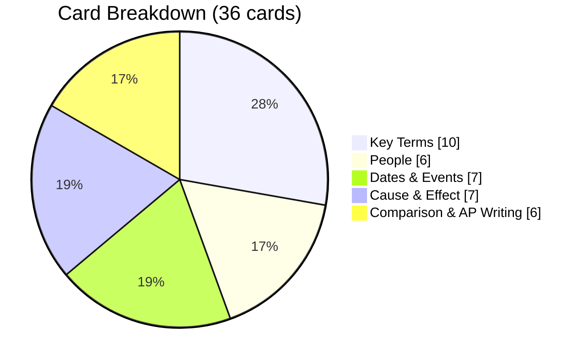

# AP World History: Modern — Topic 6.5 Economic Imperialism from 1750 to 1900 · Flashcards

> Source: Based on the College Board CED · Textbook not yet incorporated

---

## 1. Key Terms

- [ ] **What is economic imperialism?**

▶ Answer
Control of a weaker country's economy (its trade, finances, and infrastructure) by an industrial state and its businesses, without making it a formal colony. The CED says industrialized states practiced it primarily in Asia and Latin America.

- [ ] **What is "informal empire"?**

▶ Answer
Influence over a formally independent country through trade, investment, and finance rather than direct rule. Britain's relationship with Argentina is the classic example: Argentina governed itself, but British capital shaped its economy.

- [ ] **What was the Canton System?**

▶ Answer
The Qing policy (1757–1842) that limited Western trade to the port of Canton (Guangzhou), where foreigners could trade only with licensed Chinese merchants called the Cohong. The Treaty of Nanjing ended it.

- [ ] **What were unequal treaties?**

▶ Answer
Treaties forced on China, Japan, and other states, usually after a military defeat or a show of force, that gave foreign powers trading privileges, low fixed tariffs, and extraterritoriality without equal rights in return. Examples: the Treaty of Nanjing (1842) and the Harris Treaty (1858).

- [ ] **What is extraterritoriality?**

▶ Answer
The right of foreigners to be tried under their own country's laws and courts rather than local ones. Britain gained it in China in 1843 (Treaty of the Bogue), and Western powers gained it in Japan in 1858.

- [ ] **What were treaty ports?**

▶ Answer
Ports that a weaker state was forced to open to foreign trade and residence. The Treaty of Nanjing opened five: Canton, Xiamen (Amoy), Fuzhou, Ningbo, and Shanghai. Later treaties opened many more.

- [ ] **What were spheres of influence in China?**

▶ Answer
Regions where one foreign power held special economic rights, such as railway and mining rights. After 1895: Britain in the Yangzi valley, France in the south, Germany in Shandong, Russia in Manchuria, and Japan in Fujian.

- [ ] **What were the Open Door notes?**

▶ Answer
Notes from U.S. Secretary of State John Hay (1899–1900) asking the powers to give all nations equal trading rights in China and to respect China's territorial integrity. The U.S. had no sphere of influence and wanted access to Chinese markets.

- [ ] **What was the Ottoman Public Debt Administration?**

▶ Answer
A body created in 1881, after the Ottoman default of 1875, and run by representatives of European bondholders. It collected major Ottoman revenues, such as salt and tobacco taxes, to repay foreign creditors.

- [ ] **What was the Port of Buenos Aires (Puerto Madero), and why does the CED cite it?**

▶ Answer
A modern harbor built in the late 1800s with the support of British firms and London loans, because the shallow Río de la Plata kept large ships offshore. It is the CED's example of economic imperialism in Latin America: British capital built infrastructure that served exports of beef, wheat, and wool to Britain.

## 2. People

- [ ] **Who was Lin Zexu?**

▶ Answer
The Qing official sent to Canton to end the opium trade. In 1839 he confiscated and destroyed about 20,000 chests of British opium and wrote to Queen Victoria asking Britain to stop the trade. Britain responded with the First Opium War.

- [ ] **Who was the Qianlong Emperor, and what did he tell Britain in 1793?**

▶ Answer
The Qing emperor who received the British Macartney mission. In his edict to King George III, he said China possessed all things and had no need for British manufactures. This trade imbalance pushed Britain to sell opium to China.

- [ ] **Who was Commodore Matthew Perry?**

▶ Answer
A U.S. naval officer who arrived in Japan with steam warships in 1853 and returned in 1854 to force the Treaty of Kanagawa, which opened Japanese ports to American ships and ended Japan's long policy of limited contact.

- [ ] **Who was Isma'il Pasha?**

▶ Answer
The ruler of Egypt (r. 1863–1879) who borrowed heavily from European banks for modernization projects, including the Suez Canal. Debt forced him to sell Egypt's canal shares to Britain in 1875, and Egypt went bankrupt in 1876.

- [ ] **Who was John Hay?**

▶ Answer
The U.S. Secretary of State who wrote the Open Door notes (1899–1900), asking for equal trading rights for all nations in China.

- [ ] **Who was Jaja of Opobo?**

▶ Answer
An African trader-king in the Niger Delta who built a strong position in the palm oil trade and tried to deal directly with Britain. A British consul arrested and exiled him in 1887, which gave British firms more control of the palm oil trade.

## 3. Dates & Events

- [ ] **1839–1842**

▶ Answer
The First Opium War. Britain's steam warships defeated the Qing after Lin Zexu destroyed British opium.

- [ ] **1842**

▶ Answer
The Treaty of Nanjing: Hong Kong ceded to Britain, five treaty ports opened, a large indemnity paid, the Cohong abolished, and low fixed tariffs set.

- [ ] **1856–1860**

▶ Answer
The Second Opium War (Arrow War). Britain and France won the Treaty of Tianjin (1858) and the Beijing Convention (1860): more treaty ports, diplomats in Beijing, freedom for missionaries, legal opium, and Kowloon ceded to Britain. Anglo-French troops burned the Old Summer Palace in 1860.

- [ ] **1853–1854**

▶ Answer
Commodore Perry forces Japan open. He arrives in 1853, and the Treaty of Kanagawa follows in 1854. The unequal Harris Treaty follows in 1858.

- [ ] **1875**

▶ Answer
Egypt sells its Suez Canal shares to Britain, and the Ottoman Empire defaults on its foreign debt.

- [ ] **1881**

▶ Answer
The Ottoman Public Debt Administration is created, giving European bondholders control of major Ottoman revenues.

- [ ] **1882**

▶ Answer
Britain occupies Egypt after the 'Urabi revolt against foreign financial control. Egypt stays formally Ottoman, but Britain controls its finances and government.

## 4. Cause & Effect

- [ ] **Cause → Effect: Why did Britain sell opium to China, and what did it lead to?**

▶ Answer
Britain bought large amounts of Chinese tea but China wanted few British goods, so Britain paid in silver. Selling Indian opium to China reversed the flow: silver left China, addiction spread, the Qing banned the trade, and the conflict led to the First Opium War.

- [ ] **Cause → Effect: How did the Opium Wars limit China's sovereignty?**

▶ Answer
The unequal treaties took away China's control of its own tariffs, opened treaty ports, ceded Hong Kong and Kowloon, and gave foreigners extraterritoriality. Later, foreign powers carved out spheres of influence, leaving China semi-colonial.

- [ ] **Cause → Effect: How did the American Civil War affect Egypt?**

▶ Answer
The war (1861–1865) cut off U.S. cotton, so Egyptian cotton exports to Britain boomed. When prices fell after the war, Egypt, already borrowing heavily under Isma'il Pasha, slid into debt and bankruptcy (1876).

- [ ] **Cause → Effect: How did foreign debt lead to foreign control in Egypt and the Ottoman Empire?**

▶ Answer
Both borrowed heavily from European banks and could not repay. The Ottomans defaulted (1875) and accepted the Ottoman Public Debt Administration (1881). Egypt sold its Suez shares (1875), went bankrupt (1876), came under Anglo-French financial control, and was occupied by Britain (1882).

- [ ] **Cause → Effect: What did British investment in Argentina's port and railways lead to?**

▶ Answer
Argentina could export beef, wheat, wool, and hides cheaply, and it grew rich. But the railways ran to the port rather than linking regions, British firms took much of the profit, and the economy depended on British markets and capital, as the Baring Crisis (1890) showed.

- [ ] **Cause → Effect: How did Britain's ban on the slave trade (1807) affect West Africa's economy?**

▶ Answer
British merchants turned to "legitimate commerce," especially palm oil, which European industry used for soap, candles, and machine lubricants. Exports grew, but European firms controlled shipping and prices and pushed aside African middlemen such as Jaja of Opobo.

- [ ] **Cause → Effect: How was the trade in Chilean copper organized, and who benefited?**

▶ Answer
Chile was one of the world's leading copper producers in the mid-1800s, but much of its ore went to British smelters (especially Swansea), and British merchant houses handled finance and sales. After 1900, U.S. companies took over the largest mines. Foreign firms captured much of the profit, and Chile depended on mineral exports.

## 5. Comparison & AP Writing

- [ ] **Compare: How did formal colonial rule differ from economic imperialism?**

▶ Answer
Formal rule: the imperial state governed directly (for example, British India after 1858), and sovereignty was lost completely. Economic imperialism: the local government stayed in place, but foreigners controlled tariffs, courts, revenues, ports, or railways (China, Argentina, the Ottoman Empire). In both, raw materials and profits flowed to the industrial powers.

- [ ] **Compare: How did China and Japan respond differently to unequal treaties?**

▶ Answer
Both were forced to open ports and accept extraterritoriality and fixed tariffs. China's reforms were limited, and by 1900 it had lost more ground to spheres of influence. Japan's Meiji government industrialized rapidly, ended extraterritoriality (1899), regained tariff control (1911), and became an imperial power itself.

- [ ] **Compare: How does Topic 6.4 differ from Topic 6.5?**

▶ Answer
6.4 (ENV) asks which environments and resources produced export economies, such as Egyptian cotton or Argentine beef. 6.5 (ECN) asks who controlled the trade, finance, and profits: industrial states and European and U.S. companies that practiced economic imperialism.

- [ ] **AP Short Answer: Explain one way the Opium Wars changed China's relationship with Western states.**

▶ Answer

**Claim:** The Opium Wars turned China from a state that set the terms of trade into one forced to accept Western terms. 
**Evidence:** Under the Canton System, the Qing limited Western trade to Canton. After the First Opium War, the Treaty of Nanjing (1842) ceded Hong Kong, opened five treaty ports, and fixed low tariffs, and the 1843 supplementary treaty gave Britain extraterritoriality. The Second Opium War added more ports and legal opium. 
**Reasoning:** By losing control of its tariffs, ports, and legal jurisdiction over foreigners, China lost economic sovereignty, which let Britain and France expand their influence without making China a colony.

- [ ] **AP Short Answer: Explain one way industrialized states practiced economic imperialism in Latin America.**

▶ Answer

**Claim:** British firms practiced economic imperialism in Argentina by financing and building the infrastructure that served exports to Britain. 
**Evidence:** British firms and London loans supported the construction of the Port of Buenos Aires, and British companies built and owned most of Argentina's railways, which carried beef, wheat, and wool from the pampas to the port. 
**Reasoning:** Argentina stayed politically independent, but British investors controlled key infrastructure and much of the profit, so its economy depended on British capital and markets, as the Baring Crisis of 1890 showed.

- [ ] **AP Long Essay Thesis: Compare economic imperialism in China and in Latin America from 1750 to 1900.**

▶ Answer

**Claim:** In both China and Latin America, industrial states and their businesses gained economic control without formal colonial rule, but in China this control was imposed by war and unequal treaties, while in Latin America it came mainly through investment and loans that local governments invited. 
**Evidence:** Britain and France used the Opium Wars to force treaty ports, fixed tariffs, and extraterritoriality on China. In Argentina, British firms financed the Port of Buenos Aires and the railways, and in Chile British smelters and merchants controlled the copper trade. 
**Reasoning:** Both cases show economic factors driving the global economy, with profits flowing to Europe, but China lost legal sovereignty while Argentina and Chile kept their independence and became dependent on exports to industrial markets.

