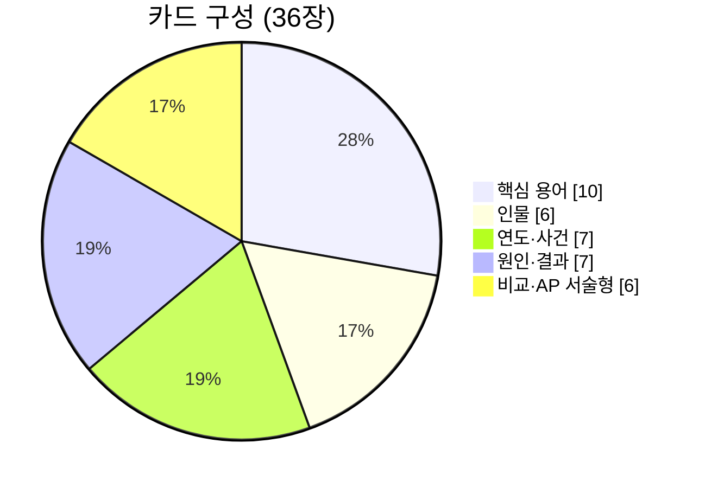

# AP 세계사: 모던 — 토픽 6.5 1750–1900년 경제적 제국주의 (Economic Imperialism from 1750 to 1900) · 플래시카드

> 출처: CED 기준 · 교재 반영 전

---

## 1. 핵심 용어

- [ ] **경제적 제국주의 (Economic imperialism)란 무엇인가?**

▶ 정답
산업 국가와 그 기업이 약한 나라를 공식 식민지로 삼지 않고 그 나라의 경제(교역, 재정, 기반 시설)를 장악하는 것이다. CED는 산업화된 국가들이 주로 아시아와 라틴아메리카에서 이를 실행했다고 본다.

- [ ] **"비공식 제국 (Informal empire)"이란 무엇인가?**

▶ 정답
직접 통치하지 않고 교역, 투자, 금융으로 형식상 독립국에 영향력을 행사하는 것이다. 대표적인 예는 영국과 아르헨티나의 관계다. 아르헨티나는 스스로 통치했지만, 영국 자본이 그 경제를 좌우했다.

- [ ] **광저우 체제 (Canton System)란 무엇이었는가?**

▶ 정답
서양과의 교역을 광저우 (Canton, Guangzhou) 항구로 한정한 청의 정책이다 (1757–1842). 외국인은 공행 (Cohong)이라는 허가받은 중국 상인하고만 거래할 수 있었다. 난징 조약으로 폐지되었다.

- [ ] **불평등 조약 (Unequal treaties)이란 무엇이었는가?**

▶ 정답
대개 군사적 패배나 무력 시위 뒤에 중국, 일본 등에 강요된 조약이다. 외국 열강에게 교역 특권, 낮은 고정 관세, 치외법권을 주었지만 대등한 권리는 돌려주지 않았다. 예: 난징 조약 (1842), 해리스 조약 (1858).

- [ ] **치외법권 (Extraterritoriality)이란 무엇인가?**

▶ 정답
외국인이 현지 법정이 아니라 자기 나라의 법과 법정에서 재판받을 권리다. 영국은 1843년(후먼 조약 (Treaty of the Bogue)) 중국에서 이 권리를 얻었고, 서양 열강은 1858년 일본에서 이 권리를 얻었다.

- [ ] **조약항 (Treaty ports)이란 무엇이었는가?**

▶ 정답
약한 나라가 외국인의 교역과 거주를 위해 강제로 연 항구다. 난징 조약은 광저우, 샤먼 (Amoy), 푸저우, 닝보, 상하이의 다섯 항구를 열었다. 이후 조약들로 훨씬 더 많은 항구가 열렸다.

- [ ] **중국의 세력권 (Spheres of influence)이란 무엇이었는가?**

▶ 정답
한 외국 세력이 철도 부설권, 광산 채굴권 같은 특별한 경제적 권리를 가진 지역이다. 1895년 이후 영국은 양쯔강 유역, 프랑스는 남부, 독일은 산둥, 러시아는 만주, 일본은 푸젠을 세력권으로 삼았다.

- [ ] **문호 개방 각서 (Open Door notes)란 무엇이었는가?**

▶ 정답
미국 국무장관 존 헤이 (John Hay)가 보낸 각서다 (1899–1900). 열강에게 중국에서 모든 나라에 동등한 교역 권리를 주고 중국의 영토 보전을 존중할 것을 요구했다. 미국은 세력권이 없었고 중국 시장에 들어가기를 원했다.

- [ ] **오스만 공공 부채 관리청 (Ottoman Public Debt Administration)이란 무엇이었는가?**

▶ 정답
1875년 오스만 제국의 채무 불이행 이후 1881년에 만들어진 기구로, 유럽 채권자의 대표들이 운영했다. 소금세, 담배세 같은 주요 오스만 세입을 거두어 외국 채권자에게 갚았다.

- [ ] **부에노스아이레스 항 (Port of Buenos Aires, 푸에르토 마데로 (Puerto Madero))이란 무엇이며, CED는 왜 이를 예로 드는가?**

▶ 정답
수심이 얕은 라플라타강 (Río de la Plata) 때문에 큰 배가 먼 바다에 머물러야 했으므로, 1800년대 후반 영국 회사의 지원과 런던 차관으로 지은 근대식 항구다. CED가 드는 라틴아메리카 경제적 제국주의의 예이다. 영국 자본이 영국으로 가는 쇠고기, 밀, 양모 수출을 위한 기반 시설을 지었다.

## 2. 인물

- [ ] **임칙서 (Lin Zexu)는 누구인가?**

▶ 정답
아편 무역을 끝내라는 명을 받고 광저우에 파견된 청의 관리다. 1839년에 영국 아편 약 2만 상자를 몰수해 폐기했고, 빅토리아 여왕 (Queen Victoria)에게 아편 무역을 멈추라는 편지를 썼다. 영국은 제1차 아편 전쟁으로 대응했다.

- [ ] **건륭제 (Qianlong Emperor)는 누구이며, 1793년 영국에 무엇이라고 했는가?**

▶ 정답
영국의 매카트니 사절단 (Macartney mission)을 맞은 청의 황제다. 조지 3세 (George III)에게 보낸 칙서에서 중국은 모든 것을 갖추고 있어 영국 제품이 필요 없다고 말했다. 이 무역 불균형 때문에 영국은 중국에 아편을 팔게 되었다.

- [ ] **매슈 페리 제독 (Commodore Matthew Perry)은 누구인가?**

▶ 정답
1853년 증기 군함을 이끌고 일본에 왔다가 1854년에 다시 와서 가나가와 조약 (Treaty of Kanagawa)을 강요한 미국 해군 장교다. 이 조약으로 일본 항구가 미국 배에 열렸고, 오랫동안 외부와의 접촉을 제한해 온 일본의 정책이 끝났다.

- [ ] **이스마일 파샤 (Isma'il Pasha)는 누구인가?**

▶ 정답
수에즈 운하를 비롯한 근대화 사업을 위해 유럽 은행에서 막대한 돈을 빌린 이집트의 통치자다 (r. 1863–1879). 빚 때문에 1875년 이집트의 운하 주식을 영국에 팔았고, 이집트는 1876년 파산했다.

- [ ] **존 헤이 (John Hay)는 누구인가?**

▶ 정답
중국에서 모든 나라에 동등한 교역 권리를 요구한 문호 개방 각서 (1899–1900)를 쓴 미국 국무장관이다.

- [ ] **오포보의 자자 (Jaja of Opobo)는 누구인가?**

▶ 정답
니제르 삼각주의 아프리카 상인 왕으로, 야자유 무역에서 강한 지위를 쌓고 영국과 직접 거래하려 했다. 1887년 영국 영사가 그를 체포해 추방했고, 그 결과 영국 회사들이 야자유 무역을 더 많이 장악했다.

## 3. 연도·사건

- [ ] **1839–1842년**

▶ 정답
제1차 아편 전쟁 (First Opium War). 임칙서가 영국 아편을 폐기한 뒤, 영국의 증기 군함이 청군을 격파했다.

- [ ] **1842년**

▶ 정답
난징 조약 (Treaty of Nanjing). 홍콩을 영국에 할양하고, 5개 조약항을 열고, 막대한 배상금을 물고, 공행을 폐지하고, 낮은 고정 관세를 정했다.

- [ ] **1856–1860년**

▶ 정답
제2차 아편 전쟁 (Second Opium War, 애로호 전쟁 (Arrow War)). 영국과 프랑스는 톈진 조약 (1858)과 베이징 조약 (1860)을 얻어 냈다. 조약항이 늘고, 외교관이 베이징에 상주하고, 선교사가 자유롭게 활동하고, 아편이 합법화되고, 주룽이 영국에 할양되었다. 1860년 영국·프랑스군이 원명원을 불태웠다.

- [ ] **1853–1854년**

▶ 정답
페리 제독이 일본을 강제로 개항시켰다. 1853년에 왔고, 1854년에 가나가와 조약이 맺어졌다. 1858년에는 불평등한 해리스 조약이 뒤따랐다.

- [ ] **1875년**

▶ 정답
이집트가 수에즈 운하 주식을 영국에 팔았고, 오스만 제국이 외채에 대해 채무 불이행을 선언했다.

- [ ] **1881년**

▶ 정답
오스만 공공 부채 관리청이 설립되어, 유럽 채권자가 오스만의 주요 세입을 통제하게 되었다.

- [ ] **1882년**

▶ 정답
외국의 재정 통제에 맞선 우라비 반란 ('Urabi revolt) 이후 영국이 이집트를 점령했다. 이집트는 형식상 오스만 제국의 일부로 남았지만, 영국이 재정과 정부를 장악했다.

## 4. 원인·결과

- [ ] **원인 → 결과: 영국이 중국에 아편을 판 이유와 그 결과는?**

▶ 정답
영국은 중국 차를 대량으로 샀지만 중국은 영국 상품을 별로 원하지 않아서, 영국은 은으로 값을 치렀다. 인도 아편을 중국에 팔면서 흐름이 뒤바뀌었다. 은이 중국 밖으로 빠져나갔고, 중독이 퍼졌으며, 청이 아편 무역을 금지했다. 이 갈등이 제1차 아편 전쟁으로 이어졌다.

- [ ] **원인 → 결과: 아편 전쟁은 중국의 주권을 어떻게 제한했는가?**

▶ 정답
불평등 조약으로 중국은 스스로 관세를 정할 권리를 잃었고, 조약항을 열었으며, 홍콩과 주룽을 할양했고, 외국인에게 치외법권을 주었다. 이후 외국 열강이 세력권을 나누어 가지면서 중국은 반식민지 (Semi-colonial) 상태가 되었다.

- [ ] **원인 → 결과: 미국 남북 전쟁은 이집트에 어떤 영향을 주었는가?**

▶ 정답
전쟁 (1861–1865)으로 미국 면화 공급이 끊기자 영국으로 가는 이집트 면화 수출이 급증했다. 전쟁 뒤 가격이 떨어지자, 이스마일 파샤 아래에서 이미 많은 돈을 빌리고 있던 이집트는 빚에 빠져 파산했다 (1876).

- [ ] **원인 → 결과: 외채는 어떻게 이집트와 오스만 제국에 대한 외국의 통제로 이어졌는가?**

▶ 정답
두 나라 모두 유럽 은행에서 많은 돈을 빌렸지만 갚지 못했다. 오스만 제국은 채무 불이행을 선언했고 (1875), 오스만 공공 부채 관리청을 받아들였다 (1881). 이집트는 수에즈 운하 주식을 팔았고 (1875), 파산했으며 (1876), 영국·프랑스의 재정 통제를 받다가 영국에 점령되었다 (1882).

- [ ] **원인 → 결과: 영국이 아르헨티나의 항구와 철도에 투자한 결과는?**

▶ 정답
아르헨티나는 쇠고기, 밀, 양모, 가죽을 싸게 수출할 수 있게 되어 부유해졌다. 하지만 철도는 지역끼리 잇지 않고 항구로만 이어졌고, 영국 회사가 이윤의 상당 부분을 가져갔으며, 경제는 영국 시장과 자본에 의존하게 되었다. 베어링 위기 (Baring Crisis, 1890)가 이를 보여 주었다.

- [ ] **원인 → 결과: 영국의 노예 무역 금지 (1807)는 서아프리카 경제에 어떤 영향을 주었는가?**

▶ 정답
영국 상인들은 "합법 무역 (Legitimate commerce)", 특히 야자유 (Palm oil)로 눈을 돌렸다. 유럽 산업은 야자유를 비누, 양초, 기계 윤활유에 썼다. 수출은 늘었지만, 유럽 회사가 해운과 가격을 장악했고 오포보의 자자 같은 아프리카 중개상을 밀어냈다.

- [ ] **원인 → 결과: 칠레 구리 (Copper) 교역은 어떻게 조직되었으며, 누가 이익을 얻었는가?**

▶ 정답
칠레는 1800년대 중반 세계 최대 수준의 구리 생산국 가운데 하나였다. 그러나 광석 상당량이 영국 제련소(특히 스완지 (Swansea))로 갔고, 영국 상사가 자금 조달과 판매를 맡았다. 1900년 이후에는 미국 회사들이 가장 큰 광산들을 차지했다. 외국 회사가 이윤의 상당 부분을 가져갔고, 칠레는 광물 수출에 의존하게 되었다.

## 5. 비교·AP 서술형

- [ ] **비교: 공식 식민 지배 (Formal colonial rule)와 경제적 제국주의는 어떻게 달랐는가?**

▶ 정답
공식 식민 지배에서는 제국 국가가 직접 통치했고 (예: 1858년 이후 영국령 인도), 주권을 완전히 잃었다. 경제적 제국주의에서는 현지 정부가 그대로 남았지만, 외국인이 관세, 법정, 세입, 항구, 철도를 통제했다 (중국, 아르헨티나, 오스만 제국). 두 경우 모두 원료와 이윤이 산업 강국으로 흘러갔다.

- [ ] **비교: 중국과 일본은 불평등 조약에 어떻게 다르게 대응했는가?**

▶ 정답
두 나라 모두 항구를 열고 치외법권과 고정 관세를 받아들여야 했다. 중국의 개혁은 제한적이었고, 1900년에는 세력권으로 더 많은 것을 잃었다. 일본의 메이지 정부는 빠르게 산업화하여 치외법권을 없애고 (1899), 관세 자주권을 되찾았으며 (1911), 스스로 제국주의 국가가 되었다.

- [ ] **비교: 토픽 6.4와 토픽 6.5는 어떻게 다른가?**

▶ 정답
6.4 (ENV)는 이집트 면화나 아르헨티나 쇠고기처럼 어떤 환경과 자원이 수출 경제 (Export economies)를 만들었는지 묻는다. 6.5 (ECN)는 교역, 금융, 이윤을 누가 장악했는지, 곧 경제적 제국주의를 실행한 산업 국가와 유럽·미국 회사를 묻는다.

- [ ] **AP 단답형: 아편 전쟁이 중국과 서양 국가의 관계를 바꾼 방식 하나를 설명하라.**

▶ 정답

**주장:** 아편 전쟁으로 중국은 교역 조건을 정하던 나라에서 서양의 조건을 받아들여야 하는 나라로 바뀌었다. 
**근거:** 광저우 체제 아래에서 청은 서양 교역을 광저우로 한정했다. 제1차 아편 전쟁 뒤 난징 조약 (1842)으로 홍콩을 할양하고, 5개 조약항을 열고, 낮은 관세를 고정했다. 1843년의 추가 조약은 영국에 치외법권을 주었다. 제2차 아편 전쟁으로 조약항이 더 늘고 아편이 합법화되었다. 
**설명:** 관세, 항구, 외국인에 대한 사법권을 잃으면서 중국은 경제 주권을 잃었다. 그래서 영국과 프랑스는 중국을 식민지로 삼지 않고도 영향력을 넓힐 수 있었다.

- [ ] **AP 단답형: 산업화된 국가들이 라틴아메리카에서 경제적 제국주의를 실행한 방식 하나를 설명하라.**

▶ 정답

**주장:** 영국 회사들은 영국으로 가는 수출을 위한 기반 시설에 돈을 대고 건설함으로써 아르헨티나에서 경제적 제국주의를 실행했다. 
**근거:** 영국 회사와 런던 차관이 부에노스아이레스 항 건설을 지원했다. 영국 회사들은 아르헨티나 철도 대부분을 건설하고 소유했으며, 이 철도는 팜파스 (Pampas)의 쇠고기, 밀, 양모를 항구로 실어 날랐다. 
**설명:** 아르헨티나는 정치적으로 독립을 유지했지만, 영국 투자자들이 핵심 기반 시설과 이윤의 상당 부분을 장악했다. 그래서 1890년 베어링 위기가 보여 주듯 아르헨티나 경제는 영국 자본과 시장에 의존하게 되었다.

- [ ] **AP 논술형 논지: 1750–1900년 중국과 라틴아메리카의 경제적 제국주의를 비교하라.**

▶ 정답

**주장:** 중국과 라틴아메리카 모두에서 산업 국가와 그 기업은 공식 식민 지배 없이 경제적 통제권을 얻었다. 그러나 중국에서는 전쟁과 불평등 조약으로 통제가 강요되었고, 라틴아메리카에서는 주로 현지 정부가 끌어들인 투자와 차관을 통해 통제가 이루어졌다. 
**근거:** 영국과 프랑스는 아편 전쟁으로 중국에 조약항, 고정 관세, 치외법권을 강요했다. 아르헨티나에서는 영국 회사가 부에노스아이레스 항과 철도에 돈을 댔고, 칠레에서는 영국 제련소와 상인이 구리 교역을 장악했다. 
**설명:** 두 사례 모두 경제적 요인이 세계 경제를 이끌었고 이윤이 유럽으로 흘러갔음을 보여 준다. 하지만 중국은 사법 주권을 잃은 반면, 아르헨티나와 칠레는 독립을 유지하면서 산업 시장으로의 수출에 의존하게 되었다.

