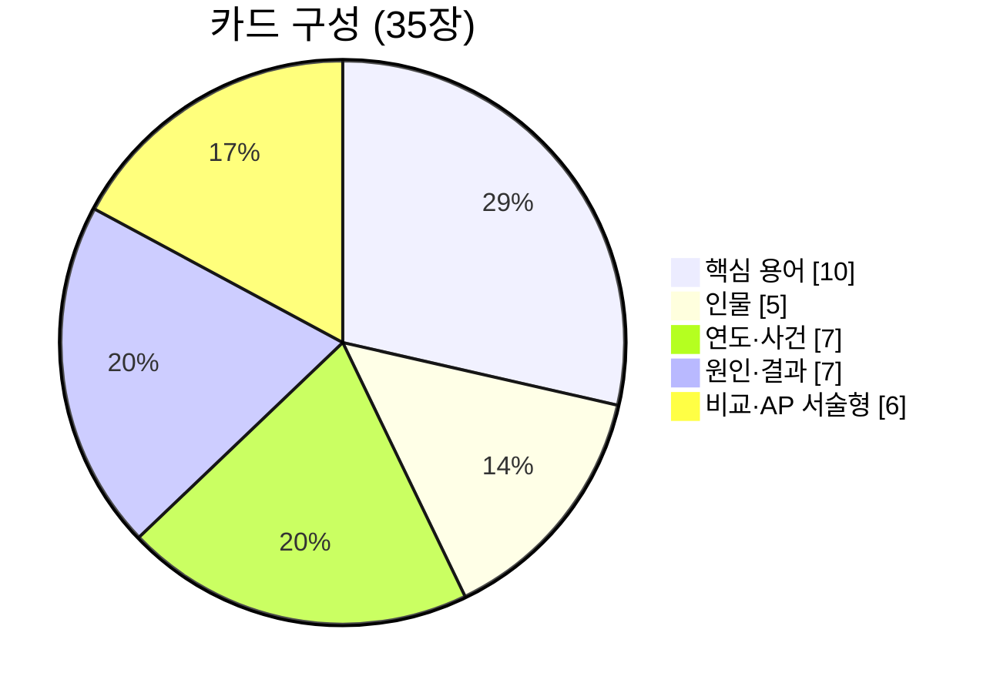

# AP 세계사: 모던 — 토픽 6.6 서로 연결된 세계에서 이주의 원인 (Causes of Migration in an Interconnected World) · 플래시카드

> 출처: CED 기준 · 교재 반영 전

---

## 1. 핵심 용어

- [ ] **밀어내는 요인 (Push factor)과 끌어당기는 요인 (Pull factor)이란 무엇인가? 각각 예를 하나씩 들어라.**

▶ 정답
밀어내는 요인은 사람들을 고향에서 떠나게 만드는 조건이고, 끌어당기는 요인은 사람들을 새로운 곳으로 끌어들이는 조건이다. 밀어내는 요인의 예: 아일랜드 대기근 (1845–1852). 끌어당기는 요인의 예: 미국의 공장과 철도 일자리.

- [ ] **국내 이주 (Internal migration)와 해외 이주 (External migration)는 어떻게 다른가?**

▶ 정답
국내 이주는 잉글랜드 농업 노동자가 맨체스터로 간 것처럼 한 나라 안에서 이동하는 것이다. 해외 이주는 이탈리아인이 아르헨티나로 간 것처럼 국경이나 바다를 건너는 것이다. CED는 두 이주민 모두 점점 더 도시로 갔다고 설명한다.

- [ ] **19세기의 세계적 도시화 (Urbanization)란 무엇이었는가?**

▶ 정답
국내·해외 이주민이 도시로 몰려들면서 전 세계의 도시가 빠르게 성장한 현상이다. 1851년에 영국 인구의 절반 이상이 도시에 살았고, 부에노스아이레스, 싱가포르, 캘커타 같은 항구 도시도 빠르게 커졌다.

- [ ] **귀환 이주 (Return migration)란 무엇이며, 1750년 이후 왜 더 흔해졌는가?**

▶ 정답
이주민이 주기적으로 또는 영구적으로 고향 사회에 돌아가는 것이다. 증기선과 철도가 여행을 더 싸고, 빠르고, 정기적으로 만들었기 때문에 더 흔해졌다.

- [ ] **송금 (Remittances)이란 무엇인가?**

▶ 정답
이주민이 고향의 가족에게 보내는 돈이다. 예를 들어 아메리카의 레바논 상인과 하와이의 일본인 플랜테이션 노동자는 땅을 사고 빚을 갚도록 저축한 돈을 고향에 보냈다.

- [ ] **연쇄 이주 (Chain migration)란 무엇인가?**

▶ 정답
먼저 떠난 가족이나 같은 마을 사람을 뒤따라가는 이주다. 해외의 친척이 뱃삯을 보내 주고, 새로 온 사람이 집과 일자리를 찾도록 도왔다.

- [ ] **계약 노동 (Indentured servitude)이란 무엇이며, 왜 반강제라고 부르는가?**

▶ 정답
뱃삯, 식량, 숙소, 적은 임금을 받는 대가로 정해진 기간(흔히 5년) 일하기로 한 계약이다. 노동자가 계약서에 서명하기는 했지만, 모집인에게 속는 일이 많았고, 고용주를 바꿀 수 없었으며, 계약을 어기면 처벌받을 수 있었기 때문에 반강제라고 부른다.

- [ ] **외상 운임 제도 (Credit-ticket system)란 무엇이었는가?**

▶ 정답
중개인이 중국인 이주민의 미국행 뱃삯을 내고, 이주민이 임금으로 갚는 제도다. 캘리포니아로 간 중국인 이주민 대부분은 정식 계약 노동이 아니라 이 방식으로 왔다.

- [ ] **죄수 유배 (Penal transportation)란 무엇이었는가?**

▶ 정답
죄수를 먼 식민지로 보내 강제 노동으로 형기를 채우게 한 것이다. 영국은 약 16만 명의 죄수를 오스트레일리아로 보냈고(1788–1868), 프랑스는 프랑스령 기아나와 뉴칼레도니아로 죄수를 보냈다.

- [ ] **골론드리나스 (Golondrinas)는 누구였는가?**

▶ 정답
"제비"라는 뜻으로, 해마다 대서양을 건너 아르헨티나로 간 이탈리아인 계절 노동자다. 남반구 여름에 수확하고 이탈리아의 농사철에 고향으로 돌아갔다. 증기선이 가능하게 한 귀환 이주의 분명한 예다.

## 2. 인물

- [ ] **1800년대 중반에 왜 그렇게 많은 아일랜드인 (Irish)이 미국으로 이주했으며, 어떤 일을 했는가?**

▶ 정답
아일랜드 대기근 (1845–1852), 가난, 강제 퇴거가 이들을 밀어냈다. 보스턴과 뉴욕 같은 도시에서 아일랜드 남성은 운하와 철도를 건설하고 부두와 공장에서 일했으며, 많은 아일랜드 여성은 가사 노동자로 일했다.

- [ ] **영국인 기술자와 지질학자 (British engineers and geologists)는 왜 남아시아와 아프리카로 갔는가?**

▶ 정답
제국 안의 숙련되고 보수가 좋은 일자리를 얻기 위해서였다. 인도에서는 철도(첫 여객 철도 1853), 전신, 운하를 건설했고, 인도 지질 조사국 (1851)은 석탄을 찾았다. 남아프리카에서는 다이아몬드 광산(킴벌리, 1867)과 금광(위트워터스랜드, 1886)에서 일했다. 많은 사람이 근무 기간을 마친 뒤 영국으로 돌아갔다.

- [ ] **하와이의 일본인 농업 노동자 (Japanese agricultural workers)는 누구였으며, 왜 많은 사람이 돌아갔는가?**

▶ 정답
1885년부터 3년짜리 정부 계약으로 하와이의 사탕수수 플랜테이션에 간 일본 농민이다. 메이지 정부의 지조와 1880년대 불황 때문에 빚을 지고 있었다. 많은 사람이 일해서 저축한 뒤 일본으로 돌아갈 계획이었고, 실제로 많이 돌아갔다.

- [ ] **아메리카의 레바논 상인 (Lebanese merchants)은 누구였는가?**

▶ 정답
토지 압박과 견직물 산업의 쇠퇴 때문에 오스만 시리아의 레바논산 (Mount Lebanon)을 떠난 이주민이다. 미국, 브라질, 아르헨티나, 멕시코에서 행상으로 시작해 상점 주인과 무역상이 되었다. 오스만 여권 때문에 "투르코 (Turcos)"라고 불렸고, 많은 사람이 고향에 송금했으며 일부는 돌아갔다.

- [ ] **중국인 노동자 (Chinese workers)는 미국 서부에서 어떤 역할을 했는가?**

▶ 정답
캘리포니아 골드러시 때 건너왔고, 1860년대에는 센트럴 퍼시픽 철도 (Central Pacific Railroad)의 상당 부분을 건설했다. 대부분은 외상 운임 제도로 와서 뱃삯을 임금으로 갚았다.

## 3. 연도·사건

- [ ] **1788–1868년**

▶ 정답
1788년 제1함대 (First Fleet)를 시작으로 영국이 약 16만 명의 죄수를 오스트레일리아로 보냈다.

- [ ] **1807년**

▶ 정답
영국이 대서양 노예무역을 금지했다. 이후 영국은 1833년에 제국 전체에서 노예제를 폐지했다(1834년 시행).

- [ ] **1834년**

▶ 정답
플랜테이션이 해방된 노예를 대신할 노동자를 찾으면서 첫 인도인 계약 노동자가 모리셔스 (Mauritius)에 도착했다. 이 제도는 1917년까지 이어졌다.

- [ ] **1845–1852년**

▶ 정답
아일랜드 대기근 (Irish Potato Famine). 감자 마름병이 주식 작물을 망쳤고, 약 100만 명이 죽고 100만 명 이상이 이주했다.

- [ ] **1849년과 1851년**

▶ 정답
캘리포니아 골드러시(1849)와 오스트레일리아 골드러시(1851)가 유럽, 아메리카, 중국에서 이주민을 끌어들였다.

- [ ] **1885년**

▶ 정답
첫 일본 정부 계약 노동자가 사탕수수 플랜테이션에서 일하려고 하와이에 도착했다.

- [ ] **1888년**

▶ 정답
브라질이 노예제를 폐지했다. 아메리카에서 가장 늦게 폐지한 나라다. 노예 수입은 1850년에 이미 끝냈다.

## 4. 원인·결과

- [ ] **원인 → 결과: 증기선과 철도는 이주를 어떻게 바꾸었는가?**

▶ 정답
여행을 더 싸고, 빠르고, 정기적으로 만들었다. 더 많은 가난한 사람이 이주할 수 있었고, 더 많은 사람이 항구 도시와 철도 도시로 갔으며, 많은 사람이 주기적으로 또는 영구적으로 고향에 돌아갈 수 있었다.

- [ ] **원인 → 결과: 인구 증가는 어떻게 이주로 이어졌는가?**

▶ 정답
식량 공급이 나아지고 새로운 작물이 들어오면서 유럽, 중국, 인도, 일본의 인구가 늘었다. 농지는 더 작게 쪼개지고 땅이 부족해졌다. 그래서 많은 사람이 도시나 다른 나라로 떠났다.

- [ ] **원인 → 결과: 환경 재해는 어떻게 아일랜드에서 대규모 이주를 일으켰는가?**

▶ 정답
감자 마름병이 대부분의 아일랜드 가정이 의존하던 작물을 망쳤다. 그 결과 일어난 기근(1845–1852)으로 약 100만 명이 죽었고, 100만 명 이상이 주로 미국으로 이주했다.

- [ ] **원인 → 결과: 노예제 폐지는 어떻게 계약 노동으로 이어졌는가?**

▶ 정답
영국이 노예제를 폐지한 뒤(1833) 모리셔스, 영국령 기아나, 트리니다드 같은 곳의 플랜테이션 주인들은 노동력을 잃었다. 그래서 노예 노동자를 대신할 인도인과 중국인 계약 노동자를 모집했다.

- [ ] **원인 → 결과: 새로운 세계 자본주의 경제는 왜 계속 강제 노동을 썼는가?**

▶ 정답
산업 국가들은 값싼 설탕, 면화, 커피, 구아노, 광물을 원했다. 고용주들은 구할 수 있는 가장 값싼 노동력에 의존했다. 브라질·쿠바·미국 남부의 노예, 카리브해와 페루의 계약 노동자, 오스트레일리아의 죄수가 그 예다.

- [ ] **원인 → 결과: 일본 농민은 왜 하와이로 이주했는가?**

▶ 정답
메이지 지조 개정(1873)과 1880년대 불황으로 많은 농민이 빚을 졌고, 하와이의 사탕수수 농장주들은 노동자가 필요해 더 높은 임금을 주었다. 그 결과 1885년부터 계약 이주가 일어났고, 많은 노동자가 나중에 돌아갔다.

- [ ] **원인 → 결과: 금 발견은 이주에 어떤 영향을 주었는가?**

▶ 정답
캘리포니아(1849), 오스트레일리아(1851), 남아프리카(1886)의 골드러시는 엄청난 수의 자유 이주민을 끌어들였다. 그 결과 샌프란시스코, 멜버른, 요하네스버그처럼 빠르게 성장하는 다민족 도시가 생겼다.

## 5. 비교·AP 서술형

- [ ] **비교: 미국으로 간 아일랜드인의 이주는 인도인 계약 노동자의 이주와 어떻게 달랐는가?**

▶ 정답
공통점: 둘 다 가난과 기근 때문에 일어났다. 차이점: 아일랜드인은 스스로 뱃삯을 내고 일자리를 바꿀 수 있는 자유 이주민이었다. 인도인 계약 노동자는 정해진 계약을 조건으로 뱃삯을 받았고, 한 고용주에게 묶였으며, 주로 영국의 플랜테이션 식민지로 갔다.

- [ ] **비교: 인도인 계약 노동과 중국인 계약 노동의 공통점과 차이점은?**

▶ 정답
공통점: 둘 다 노예제 폐지 뒤 노예 노동을 대신했고, 세계 자본주의 경제 속에서 플랜테이션에 노동력을 공급했다. 차이점: 인도인 계약 노동은 영국 식민지 정부가 조직하고 규제했다(1834–1917, 모리셔스, 카리브해, 나탈, 피지). 쿠바와 페루로 가는 중국인 쿨리 무역은 민간 중개인이 운영했고(1847–1874), 납치와 사기가 흔했다.

- [ ] **비교: 계약 노동은 노예제와 어떻게 달랐는가?**

▶ 정답
노예는 평생 재산으로 취급되었고, 그 자녀도 노예로 태어났다. 계약 노동자는 정해진 기간의 계약에 서명하고 적은 임금을 받았으며, 계약이 끝나면 자유인이 되거나 고향에 돌아갈 수 있었다. 그러나 두 제도 모두 가혹한 통제를 썼고 플랜테이션 경제에 이바지했다.

- [ ] **AP 단답형: 1750–1900년에 이주를 일으킨 환경적 요인 하나를 설명하라.**

▶ 정답

**주장:** 작물 병으로 생긴 기근은 많은 사람을 이주하게 만들었다. 
**근거:** 아일랜드 대기근(1845–1852) 동안 감자 마름병이 아일랜드의 주식 작물을 망쳤다. 약 100만 명이 죽었고, 100만 명 이상이 주로 미국으로 이주했다. 
**설명:** 이미 인구 압박을 받던 사회에서 환경 재해가 식량 공급을 무너뜨리자 사람들은 고향에서 더는 살아갈 수 없었다. 그래서 이주가 굶주림에서 벗어나는 주된 길이 되었다.

- [ ] **AP 단답형: 1750–1900년에 계약 노동이 세계 자본주의 경제를 떠받친 방식 하나를 설명하라.**

▶ 정답

**주장:** 계약 노동은 노예제 폐지 뒤 플랜테이션에 값싼 노동력을 공급했다. 
**근거:** 영국이 1833년에 노예제를 폐지한 뒤 100만 명 이상의 인도인이 계약을 맺고 모리셔스, 영국령 기아나, 트리니다드, 나탈, 피지로 갔다. 중국인 노동자는 쿠바와 페루로 실려 갔다(1847–1874). 
**설명:** 이 반강제 노동자들은 산업 시장을 위한 설탕과 구아노 생산을 낮은 비용으로 이어 갔다. 그래서 세계 경제는 노예제가 끝난 뒤에도 자유롭지 않은 노동에 계속 의존했다.

- [ ] **AP 논술형 논지: 1750–1900년 이주의 원인으로서 환경적 요인과 경제적 요인의 상대적 중요성을 평가하라.**

▶ 정답

**주장:** 환경적·인구적 압박은 흔히 사람들을 떠나게 했지만, 이주민이 어디로 어떻게 가는지를 정했기 때문에 경제적 요인이 더 중요했다. 
**근거:** 인구 증가와 아일랜드 대기근 같은 기근은 아일랜드, 중국, 인도에서 수백만 명을 밀어냈다. 그러나 공장, 광산, 철도, 골드러시의 일자리는 자유 이주민을 아메리카와 오스트레일리아로 끌어당겼고, 노예제 폐지 뒤 플랜테이션의 노동 수요는 인도인과 중국인의 계약 노동을 만들어 냈다. 
**설명:** 환경적 압박은 사람들이 왜 떠났는지를 설명한다. 그러나 증기선과 철도를 활용한 새로운 세계 자본주의 경제의 필요가 목적지, 노동의 형태(자유, 반강제, 강제), 그리고 귀환 가능성까지 결정했다.

