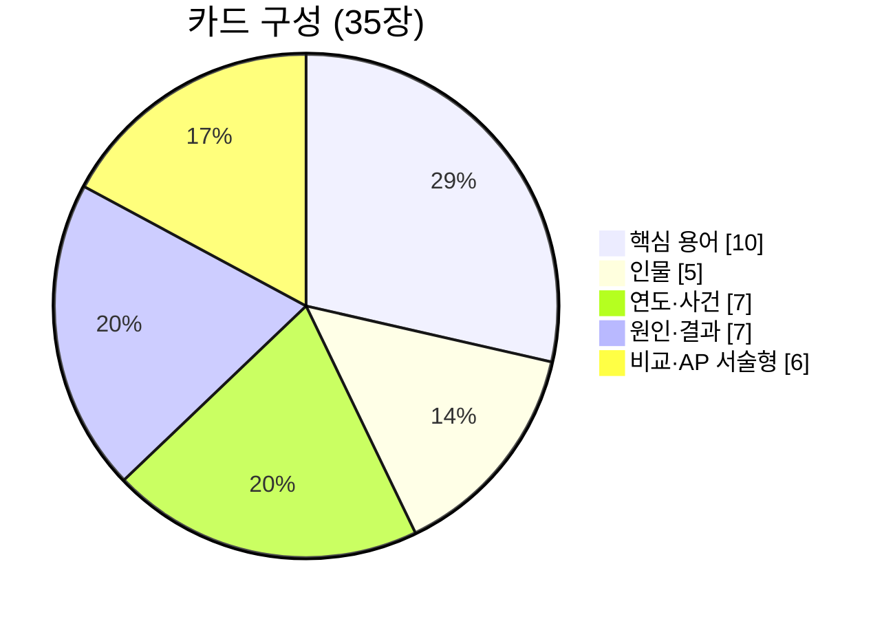

# AP 세계사: 모던 — 토픽 6.7 이주의 영향 (Effects of Migration) · 플래시카드

> 출처: CED 기준 · 교재 반영 전

---

## 1. 핵심 용어

- [ ] **민족 거주지 (Ethnic enclave)란 무엇인가?**

▶ 정답
한 이주민 집단이 모여 살면서 자신들의 언어, 종교, 음식, 제도를 지키는 동네나 공동체다. 예: 샌프란시스코의 차이나타운 (Chinatown), 뉴욕의 리틀 이탈리아 (Little Italy), 보스턴의 아일랜드인 가톨릭 교구, 나탈 (Natal) 더반의 인도인 공동체.

- [ ] **송금 (Remittances)이란 무엇이며, 고향 사회에 왜 중요했는가?**

▶ 정답
이주민이 가족에게 부치는 돈이다. 많은 가족이 남성 한 명을 해외로 보내 그의 임금으로 고향의 집안을 꾸렸고, 고향 사회의 여성들이 흔히 이 돈을 관리했다.

- [ ] **"하얀 과부 (White widows)" (vedove bianche)는 누구였는가?**

▶ 정답
남편이 아메리카로 이주해 흔히 여러 해 동안 돌아오지 않은 남부 이탈리아의 아내들이다. 이들은 집안 땅을 경작하고, 일꾼을 고용하고, 송금을 관리하고, 땅을 사고, 관리들을 상대했다.

- [ ] **"독신 남성 사회 (Bachelor society)"란 무엇이었는가?**

▶ 정답
미국의 초기 차이나타운 같은, 대부분 남성으로 이루어진 이주민 공동체다. 이주민 대부분이 남성이었고, 페이지법 (Page Act, 1875) 같은 법이 중국인 여성의 입국을 막았기 때문에 생겼다.

- [ ] **중화회관 (Chinese Six Companies)은 무엇이었는가?**

▶ 정답
샌프란시스코의 중국인 지역 동향 단체(회관 (Huiguan))들의 연합이다. 이민자를 돕고, 분쟁을 해결하고, 변호사를 고용하고, 반중국인 법에 맞서 로비를 벌였다.

- [ ] **"승객 인도인 (Passenger Indians)"은 누구였는가?**

▶ 정답
계약 노동자들이 온 뒤 자비로 나탈과 동아프리카에 건너간, 주로 구자라트 출신의 인도인 상인이다. 이들은 상점을 열었고, 백인 정착민의 반감을 샀다.

- [ ] **이민 배척주의 (Nativism)란 무엇인가?**

▶ 정답
스스로를 "토박이" 주민으로 여기는 사람들이 이민자에게 보이는 적대감이다. 1800년대에는 아일랜드인과 이탈리아인 가톨릭교도를 종교적·민족적 이유로, 아시아인을 인종적 이유로 겨냥했다.

- [ ] **노낫싱당 (Know-Nothing Party)은 무엇이었는가?**

▶ 정답
1850년대 미국의 반가톨릭·반이민 정당이다(공식 이름은 아메리칸당 (American Party)). 이민자, 특히 아일랜드인 가톨릭교도의 정치적 힘을 제한하려 했다.

- [ ] **인두세 (Head tax)란 무엇이며, 어느 나라가 중국인 이민자에게 부과했는가?**

▶ 정답
특정 집단의 이민자 한 명마다 매긴 요금이다. 캐나다의 중국인 이민법 (Chinese Immigration Act, 1885)은 중국인 이민자 한 명당 50달러를 매겼고, 이를 100달러(1900), 500달러(1903)로 올렸다.

- [ ] **백호주의 정책 (White Australia policy)의 받아쓰기 시험 (Dictation test)이란 무엇이었는가?**

▶ 정답
이민 제한법 (Immigration Restriction Act, 1901)에 따른 입국 시험이다. 관리는 이민자에게 자신이 고른 아무 유럽 언어로 50단어를 받아쓰게 할 수 있었다. 그래서 법에 인종을 명시하지 않고도 비유럽인을 배제할 수 있었다.

## 2. 인물

- [ ] **모한다스 간디 (Mohandas Gandhi)는 누구이며, 나탈에서 무엇을 했는가?**

▶ 정답
1893년 나탈에 온 젊은 인도인 변호사다. 인도인이라는 이유로 피터마리츠버그에서 기차 1등칸에서 쫓겨난 뒤, 인도인의 투표권과 세금에 관한 법에 맞서려고 나탈 인도인 회의 (Natal Indian Congress, 1894)를 세우는 데 앞장섰다. 이후의 사티아그라하 (Satyagraha) 운동(1906년부터)은 그가 인도에서 지도자가 되는 바탕이 되었다.

- [ ] **데니스 커니 (Denis Kearney)는 누구였는가?**

▶ 정답
1870년대 후반 캘리포니아 노동자당 (Workingmen's Party)의 지도자로, "중국인은 나가라!"라는 구호로 유명하다. 그는 낮은 임금을 중국인 노동자 탓으로 돌렸고, 중국인 배척법 (Chinese Exclusion Act)을 요구하는 압력을 키웠다.

- [ ] **에마 래저러스 (Emma Lazarus)는 누구이며, 그의 시가 이 토픽에 왜 유용한가?**

▶ 정답
「새로운 거상 (The New Colossus)」(1883)을 쓴 미국 시인이다. 이 시에는 "지치고 가난한 이들을 내게 주오, 자유롭게 숨 쉬기를 갈망하며 웅크린 무리를"이라는 구절이 있다. 이 시는 중국인 배척법 바로 다음 해에 쓰였다. 이는 미국이 이민자를 환영하는 동시에 배제했음을 보여 준다.

- [ ] **중국인 배척법에 서명한 미국 대통령은 누구인가?**

▶ 정답
체스터 A. 아서 (Chester A. Arthur)로, 1882년에 서명했다.

- [ ] **웡킴아크 (Wong Kim Ark)는 누구였는가?**

▶ 정답
샌프란시스코에서 중국인 부모에게서 태어난 사람이다. 미국 대 웡킴아크 (United States v. Wong Kim Ark, 1898) 판결에서 연방 대법원은 그가 출생에 따라 미국 시민이라고 판결했다. 그의 부모는 중국인 배척법 때문에 시민이 될 수 없었다.

## 3. 연도·사건

- [ ] **1845–1852년**

▶ 정답
아일랜드 대기근 (Great Famine). 약 100만 명의 아일랜드인이 주로 미국과 캐나다로 이주했고, 보스턴과 뉴욕 같은 도시에 가톨릭 거주지를 만들었다.

- [ ] **1860년**

▶ 정답
인도인 계약 노동자들이 사탕수수 플랜테이션에서 일하려고 나탈에 도착하기 시작했다. 승객 인도인이 합류하면서 이 공동체는 아프리카에서 가장 큰 인도인 공동체가 되었다.

- [ ] **1875년**

▶ 정답
미국의 페이지법이 중국인 여성의 입국을 매우 어렵게 만들었다. 이 때문에 차이나타운은 독신 남성 사회가 되었다.

- [ ] **1882년**

▶ 정답
미국의 중국인 배척법이 중국인 노동자의 입국을 10년간 금지하고 중국인의 시민권 취득을 막았다. 특정 민족이나 국적 집단의 이민을 금지한 미국 최초의 주요 법이었다.

- [ ] **1885년**

▶ 정답
캐나다의 중국인 이민법이 중국인 이민자에게 50달러의 인두세를 매겼다. 같은 해 와이오밍의 록스프링스 학살 (Rock Springs Massacre)에서 백인 광부들이 중국인 광부들을 죽였다.

- [ ] **1894년**

▶ 정답
간디가 나탈에서 인도인의 권리를 지키려고 나탈 인도인 회의를 세우는 데 앞장섰다.

- [ ] **1901년**

▶ 정답
새로 생긴 오스트레일리아 연방이 받아쓰기 시험을 둔 이민 제한법을 통과시켰다. 이 법이 백호주의 정책의 핵심이었다.

## 4. 원인·결과

- [ ] **원인: 이주민 대부분이 남성이었던 이유는?**

▶ 정답
고용주들이 광산, 철도, 플랜테이션, 부두에서 일할 젊은 남성 노동자를 원했다. 가족들은 송금을 받으려고 남성 한 명을 해외로 보냈다. 또 페이지법 같은 법과 모집 관행이 여성을 막았다.

- [ ] **원인 → 결과: 남성의 이주는 고향 사회 여성의 역할을 어떻게 바꾸었는가?**

▶ 정답
여성들이 남성이 맡던 역할을 떠맡았다. 남부 이탈리아에서는 "하얀 과부"가 농사를 짓고 돈을 관리했다. 남중국에서는 아내들이 집안을 꾸리고 송금을 관리했다. 인도에서는 여성들이 밭을 갈고 임금 노동을 했다. 이런 변화로 여성의 경제적 책임은 커졌지만, 변화는 일시적인 경우가 많았다.

- [ ] **원인 → 결과: 이주민들이 민족 거주지를 만든 이유와 민족 거주지의 역할은?**

▶ 정답
이주민들은 낯선 언어, 저임금 노동, 적대감에 부딪혔기 때문에 고향 사람들 가까이에 정착했다. 민족 거주지는 집, 일자리, 대출, 보호를 제공했다. 또 사원과 교회, 음식, 신문, 축제, 상호 부조 단체 (Mutual-aid society)를 통해 문화를 옮겨 심었다.

- [ ] **원인 → 결과: 일자리 경쟁은 어떻게 미국의 반중국인 법으로 이어졌는가?**

▶ 정답
철도가 완공된 뒤 많은 중국인 노동자가 다른 일자리를 찾았고, 백인 노동자들은 낮은 임금을 그들 탓으로 돌렸다. 커니의 노동자당 같은 단체와 록스프링스 학살 같은 폭력이 중국인 배척법(1882)을 요구하는 압력을 키웠다.

- [ ] **원인 → 결과: 사회 진화론 (Social Darwinism)과 과학적 인종주의 (Scientific racism)는 이민 정책에 어떤 영향을 주었는가?**

▶ 정답
이 사상들은 민족들을 인종 위계로 줄 세웠다(6.1 참고). 그래서 국가들은 유럽 이민자는 환영하면서 아시아인은 인종을 이유로 제한했다. 중국인 배척법, 캐나다의 인두세, 백호주의 정책이 그 예이다.

- [ ] **원인 → 결과: 브라질이 1888년 이후 이탈리아인 노동자를 모집한 이유는?**

▶ 정답
브라질이 1888년 노예제를 폐지하자 상파울루의 커피 농장주들에게 새 노동자가 필요했다. 국가가 이탈리아인의 뱃삯을 대 주었고, 이들은 상파울루 일대에 큰 공동체를 이루었다.

- [ ] **원인 → 결과: 나탈의 반인도인 법은 어떻게 조직적 저항으로 이어졌는가?**

▶ 정답
나탈은 계약이 끝난 인도인에게 세금을 매기고, 대부분의 인도인이 투표하지 못하게 하고, 입국 시험을 도입했다(1895–1897). 간디와 나탈 인도인 회의(1894)는 청원과 항의를 조직했고, 이는 그의 사티아그라하 운동으로 발전했다.

## 5. 비교·AP 서술형

- [ ] **비교: 중국인 배척법(1882)과 백호주의 정책(1901).**

▶ 정답
공통점: 둘 다 인종을 기준으로 이민을 제한했고, 사회 진화론의 사고를 반영했으며, 값싼 아시아 노동력에 대한 백인 노동자들의 두려움에 응답했다. 차이점: 미국 법은 중국인을 법에 명시했지만, 오스트레일리아는 유럽 언어 받아쓰기 시험을 사용해 법에 인종을 쓰지 않았다. 미국 법은 중국인 노동자를 겨냥했지만, 오스트레일리아의 정책은 모든 비유럽인을 겨냥했다.

- [ ] **비교: 미국 사회가 아일랜드인 이민자와 중국인 이민자를 받아들인 방식.**

▶ 정답
둘 다 편견과 폭력을 겪었다. 아일랜드인은 종교적·민족적 이민 배척주의(노낫싱당, 필라델피아 성경 폭동)에 부딪혔지만, 시민이 되어 투표하고 정치 머신 (Political machine)을 만들 수 있었다. 중국인은 인종적 배제를 겪었다. 시민권을 얻을 수 없었고, 1882년 이후에는 노동자로 입국하는 것도 막혔다.

- [ ] **비교: 미국의 이탈리아인 이주민과 아르헨티나의 이탈리아인 이주민.**

▶ 정답
공통점: 둘 다 가톨릭 교구, 상호 부조 단체, 이탈리아어 신문을 갖춘 거주지(뉴욕의 리틀 이탈리아, 부에노스아이레스의 라 보카 (La Boca))를 만들었고, 많은 이주민이 고향으로 돌아갔다. 차이점: 미국에서 이탈리아인은 편견과 폭력(1891년 뉴올리언스)을 겪었지만, 아르헨티나는 국가가 유럽 이민자를 적극적으로 모집했고, 이탈리아인은 아르헨티나의 말, 음식, 탱고에 영향을 주었다.

- [ ] **AP 단답형: 1750–1900년 이주가 고향 사회의 성별 역할을 바꾼 방식 하나를 설명하라.**

▶ 정답

**주장:** 이주민 대부분이 남성이었기 때문에, 고향 사회의 여성들은 남성이 맡던 경제적 역할을 떠맡았다. 
**근거:** 남부 이탈리아에서는 미국과 아르헨티나로 떠난 남성들의 아내인 "하얀 과부"가 집안 땅을 경작하고, 일꾼을 고용하고, 송금을 관리하고, 땅을 샀다. 
**설명:** 남편이 여러 해 동안 없었기 때문에 누군가는 농사와 집안 돈을 맡아야 했다. 그래서 여성의 법적 지위는 대개 바뀌지 않았지만, 여성은 새로운 경제적 책임을 얻었다. 

- [ ] **AP 단답형: 1750–1900년 늘어난 이민에 국가가 대응한 방식 하나를 설명하라.**

▶ 정답

**주장:** 미국은 중국인 이민을 인종을 기준으로 제한하는 방식으로 대응했다. 
**근거:** 중국인 배척법(1882)은 중국인 노동자의 입국을 10년간 금지하고 중국인의 시민권 취득을 막았다. 이 법은 1892년에 연장되고 1902년에 영구화되었다. 
**설명:** 철도가 완공된 뒤 백인 노동자들은 낮은 임금을 중국인 노동자 탓으로 돌렸고, 사회 진화론 같은 인종 사상이 배제를 받아들일 만한 것으로 보이게 했다. 그래서 국가는 인종적으로 바람직하지 않다고 본 집단을 막는 데 국경 통제를 사용했다. 

- [ ] **AP 논술형 논지: 1750년부터 1900년까지 이주가 이민을 받아들이는 사회를 어느 정도 바꾸었는지 평가하라.**

▶ 정답

**주장:** 이주는 새로운 문화를 옮겨 심은 민족 거주지를 만들어 받아들이는 사회를 크게 바꾸었다. 그러나 국가들이 편견과 새로운 국경 통제로 대응하면서 인종 위계도 더 굳어졌다. 
**근거:** 중국인, 인도인, 아일랜드인, 이탈리아인 이주민은 샌프란시스코의 차이나타운, 나탈의 인도인 공동체, 보스턴의 아일랜드인 교구, 부에노스아이레스의 이탈리아인 거주지 라 보카 같은 거주지를 만들었다. 동시에 중국인 배척법(1882), 캐나다의 인두세(1885), 나탈의 법, 백호주의 정책(1901)은 아시아 이민자를 인종을 이유로 제한했다. 
**설명:** 이주민은 받아들이는 사회의 문화, 노동력, 정치를 바꾸었다. 하지만 그 사회들은 아시아인보다 유럽인 이주민을 더 환영했다. 그래서 이주는 사회를 다양하게 만드는 동시에, 국가가 시민권과 국경을 인종 기준으로 정하도록 밀어붙였다. 

