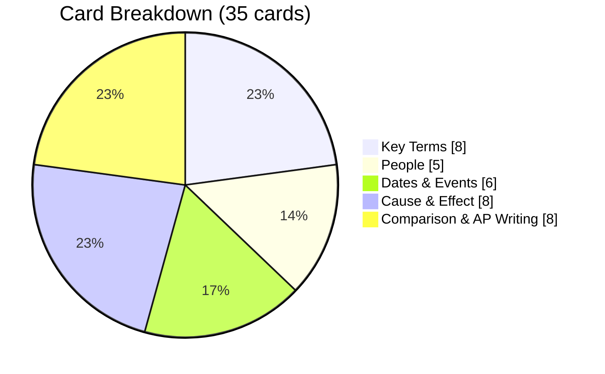

# AP World History: Modern — Topic 6.8 Causation in the Imperial Age · Flashcards

> Source: Based on the College Board CED · Textbook not yet incorporated

---

## 1. Key Terms

- [ ] **What does "relative significance" mean in the 6.8 learning objective?**

▶ Answer
Weighing effects against each other to decide which mattered most, using a criterion such as scale, depth, duration, or reach. Listing effects is not enough.

- [ ] **What is economic imperialism? Give the two CED examples from 6.5.**

▶ Answer
Control of another region's economy through trade, investment, or treaties, without full colonial rule. Examples: Britain and France expanding their influence in China through the Opium Wars, and the Port of Buenos Aires built with the support of British firms.

- [ ] **What is an export economy? Name three examples.**

▶ Answer
An economy that specializes in extracting natural resources or growing food and industrial crops for export, and uses the profits to buy finished goods. Examples: cotton in Egypt, palm oil in West Africa, rubber in the Amazon and Congo basin, guano in Peru and Chile.

- [ ] **What is an unequal treaty? Give an example.**

▶ Answer
A treaty forced on a weaker state that favored the foreign power. The Treaty of Nanjing (1842), after the First Opium War, opened treaty ports and gave Hong Kong to Britain.

- [ ] **What is a settler colony? Give the CED example.**

▶ Answer
A colony where many Europeans settled permanently and took land from indigenous peoples. The CED example is New Zealand; Australia, South Africa, and Algeria are others.

- [ ] **What is indentured servitude, and why did it grow in the 19th century?**

▶ Answer
Labor under a contract for a fixed number of years, often in exchange for passage abroad. It grew after the British Empire abolished slavery, as Chinese and Indian workers replaced enslaved labor on plantations and in mines.

- [ ] **What is an ethnic enclave? Give two examples.**

▶ Answer
A community of migrants that keeps its culture in a new place. Examples: Chinese in Southeast Asia, the Caribbean, and the Americas; Indians in East and Southern Africa and the Caribbean.

- [ ] **What do corroborate, qualify, and modify mean in skill 6.D?**

▶ Answer
Corroborate: add evidence that supports a claim. Qualify: limit a claim, for example by naming exceptions. Modify: change a claim in light of evidence that does not fit. Together they make a complex argument.

## 2. People

- [ ] **Who was King Leopold II, and what does his rule show about the effects of imperialism?**

▶ Answer
The king of Belgium who personally owned the Congo Free State (1885–1908). Forced rubber collection led to mass killing and mutilation, and international outrage led Belgium's government to take over the colony in 1908.

- [ ] **Who was Lin Zexu, and how is his 1839 letter useful as a source?**

▶ Answer
The Qing official sent to stop the opium trade at Canton. His letter to Queen Victoria shows the Qing view of the trade's harm, but as an official's appeal it cannot show what British merchants or Chinese users thought.

- [ ] **Who was Samory Touré?**

▶ Answer
A West African leader who built a state and fought the French in a long military resistance until his capture in 1898. He is a CED example of direct resistance (6.3).

- [ ] **Who was Yaa Asantewaa?**

▶ Answer
An Asante queen mother who led the 1900 war against the British in West Africa (the Yaa Asantewaa War), a CED example of direct resistance (6.3).

- [ ] **What does Rudyard Kipling's "The White Man's Burden" (1899) show, and what is its limitation as evidence of imperialism's effects?**

▶ Answer
It shows how imperialists used the civilizing mission to justify empire. It is a rationale written by a supporter, so it cannot show what colonized peoples actually experienced.

## 3. Dates & Events

- [ ] **1839–1842**

▶ Answer
The First Opium War. It ended with the Treaty of Nanjing (1842), which opened treaty ports and gave Hong Kong to Britain.

- [ ] **1857–1858**

▶ Answer
The rebellion in India, after which the British Crown took direct rule of India from the East India Company (1858).

- [ ] **1882**

▶ Answer
The United States passed the Chinese Exclusion Act, and Britain occupied Egypt.

- [ ] **1884–1885**

▶ Answer
The Berlin Conference set rules for European claims in Africa and sped up the partition of the continent.

- [ ] **1896**

▶ Answer
Ethiopia defeated Italy at the Battle of Adwa and stayed independent.

- [ ] **1908**

▶ Answer
Belgium's government took the Congo from King Leopold II, a shift from private to state colonial control.

## 4. Cause & Effect

- [ ] **Cause: How did industrialization lead to imperialism?**

▶ Answer
Factories needed raw materials and markets, and investors wanted profits. Steamships, railways, telegraphs, quinine, and new guns made conquest cheaper and easier.

- [ ] **Effect: What were the short-term and long-term effects of the Opium Wars on China?**

▶ Answer
Short-term: treaty ports, low tariffs, and the loss of Hong Kong. Long-term: the Qing lost control of its trade and grew weaker, and foreign powers expanded their influence in China.

- [ ] **Effect: What was the long-term effect of the borders drawn after the Berlin Conference?**

▶ Answer
Colonial borders often split some peoples and grouped rivals together, and most of them became the borders of independent African states.

- [ ] **Cause → Effect: Why did export economies lead to economic dependence?**

▶ Answer
Regions that specialized in one or a few raw materials sold them cheaply and used the profits to buy finished goods, so they depended on world prices and foreign buyers. Egypt's debts even led to British occupation in 1882.

- [ ] **Effect: What was an unintended effect of Western education in the colonies?**

▶ Answer
Western-educated elites learned ideas such as liberty and national self-determination and used them against empire, for example by founding the Indian National Congress (1885).

- [ ] **Cause → Effect: How did imperialism and the global capitalist economy change migration (KC-5.4)?**

▶ Answer
Migration patterns changed dramatically and the number of migrants rose sharply. Indentured Chinese and Indian workers went to plantations, and free migrants such as the Irish and Italians went to the Americas.

- [ ] **Effect: How did male migration affect women in home societies?**

▶ Answer
Because most migrants were men, women at home took on new roles that men had held.

- [ ] **Cause → Effect: Why did some receiving societies pass exclusion laws?**

▶ Answer
Ethnic and racial prejudice, supported by ideas such as Social Darwinism, led states to regulate the flow of migrants. Examples: the Chinese Exclusion Act (1882) and the White Australia policy.

## 5. Comparison & AP Writing

- [ ] **Compare: How did the effects of imperialism differ for colonizers and the colonized?**

▶ Answer
Colonizers gained raw materials, markets, profits, and cheaper consumer goods, which raised standards of living for some. Most colonized peoples lost self-rule, land, and control of their economies, although some local elites and merchants gained wealth.

- [ ] **Compare: How did imperialism in Africa differ from imperialism in Latin America?**

▶ Answer
Africa came mostly under formal colonial rule after the Berlin Conference, so political effects were most visible. Latin American states stayed independent, but economic imperialism made them dependent on exports such as guano, copper, and meat and on foreign investment, as with the Port of Buenos Aires.

- [ ] **Compare: How did imperialism affect India and China differently?**

▶ Answer
India came under direct British rule (the Crown from 1858) and became an exporter of raw cotton and opium. China kept its emperor but lost control of trade through the Opium Wars and unequal treaties.

- [ ] **Qualify: Which two cases limit the claim that imperialism ended non-Western sovereignty everywhere?**

▶ Answer
Ethiopia, which defeated Italy at Adwa (1896), and Japan, which avoided colonization and became an imperial power itself.

- [ ] **AP Short Answer: Explain one effect of imperialism in Africa from 1750 to 1900.**

▶ Answer

**Claim:** Imperialism caused many African peoples to lose their political sovereignty. 
**Evidence:** The Berlin Conference (1884–1885) set rules for claiming African land, and by 1914 all of Africa except Ethiopia and Liberia was under European rule. 
**Reasoning:** European states drew borders without regard to African political or ethnic boundaries, so Africans lost self-rule. Resistance such as the Yaa Asantewaa War shows how strongly Africans opposed this loss.

- [ ] **AP Short Answer: Explain one effect of imperialism in Asia from 1750 to 1900.**

▶ Answer

**Claim:** Imperialism weakened Qing China's control over its own economy. 
**Evidence:** After the Opium Wars, the Treaty of Nanjing (1842) and later treaties forced China to open treaty ports, accept low tariffs, and give Hong Kong to Britain. 
**Reasoning:** British and French merchants gained access to Chinese markets, while the Qing lost control of its tariffs and trade, which made the dynasty weaker.

- [ ] **AP Long Essay Thesis (economic emphasis): Evaluate the relative significance of the effects of imperialism from 1750 to 1900.**

▶ Answer

**Claim:** The most significant effect of imperialism was economic, because it turned Africa, Asia, and Latin America into export economies dependent on industrial states, although in Africa the loss of sovereignty mattered even more. 
**Evidence:** Egyptian cotton, Congolese rubber, and Peruvian guano were sold to factories, and the profits bought finished goods; even independent China and Argentina were shaped by the Opium Wars and British-built ports. 
**Reasoning:** Economic effects reached every region, including states that were never colonies, and created a lasting divide between industrial and raw-material economies, so they had the widest reach.

- [ ] **AP Long Essay Thesis (political emphasis): Evaluate the relative significance of the effects of imperialism from 1750 to 1900.**

▶ Answer

**Claim:** The most significant effect of imperialism was the loss of political sovereignty, because political control made economic and social changes possible, although economic dependence also reached independent states. 
**Evidence:** The Berlin Conference divided Africa, and the British Crown took direct rule of India after 1857; these governments then reorganized trade, labor, and borders. 
**Reasoning:** Without political control, Europeans could not have imposed export economies or forced labor on such a scale, and the colonial borders they drew outlasted the empires themselves.

