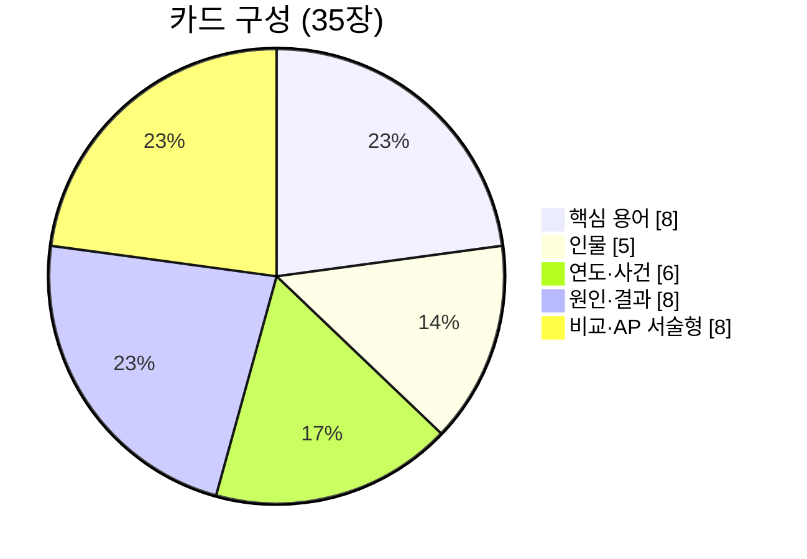

# AP 세계사: 모던 — 토픽 6.8 제국주의 시대의 인과관계 (Causation in the Imperial Age) · 플래시카드

> 출처: CED 기준 · 교재 반영 전

---

## 1. 핵심 용어

- [ ] **6.8 학습 목표의 "상대적 중요성 (Relative significance)"이란 무엇을 뜻하는가?**

▶ 정답
규모, 깊이, 지속 기간, 범위 같은 기준을 써서 여러 영향을 서로 저울질하고 어느 것이 가장 중요했는지 판단하는 것이다. 영향을 나열하는 것만으로는 부족하다.

- [ ] **경제적 제국주의 (Economic imperialism)란 무엇인가? 6.5의 CED 예시 두 가지를 들어라.**

▶ 정답
완전한 식민 통치 없이 교역, 투자, 조약을 통해 다른 지역의 경제를 지배하는 것이다. 예시: 아편 전쟁 (Opium Wars)을 통해 중국에서 영향력을 넓힌 영국과 프랑스, 영국 회사들의 지원을 받은 부에노스아이레스 항 (Port of Buenos Aires) 건설.

- [ ] **수출 경제 (Export economy)란 무엇인가? 예를 세 가지 들어라.**

▶ 정답
천연자원 채취나 식량·공업용 작물 재배를 수출용으로 특화하고, 그 이윤으로 완제품을 사는 경제다. 예: 이집트의 면화, 서아프리카의 야자유, 아마존과 콩고 분지의 고무, 페루와 칠레의 구아노 (Guano).

- [ ] **불평등 조약 (Unequal treaty)이란 무엇인가? 예를 들어라.**

▶ 정답
약한 국가에 강요되어 외국 열강에 유리했던 조약이다. 제1차 아편 전쟁 뒤의 난징 조약 (Treaty of Nanjing)(1842)은 조약항을 열고 홍콩을 영국에 넘겼다.

- [ ] **정착 식민지 (Settler colony)란 무엇인가? CED 예시를 들어라.**

▶ 정답
많은 유럽인이 영구히 정착하고 토착민의 땅을 빼앗은 식민지다. CED 예시는 뉴질랜드 (New Zealand)이다. 오스트레일리아, 남아프리카, 알제리도 그 예이다.

- [ ] **계약 노동 (Indentured servitude)이란 무엇이며, 19세기에 왜 늘어났는가?**

▶ 정답
흔히 해외 뱃삯을 대가로, 정해진 햇수 동안 계약에 따라 일하는 노동이다. 영국 제국이 노예제를 폐지한 뒤 중국인과 인도인 노동자가 플랜테이션과 광산에서 노예 노동을 대신하면서 늘어났다.

- [ ] **민족 거주지 (Ethnic enclave)란 무엇인가? 예를 두 가지 들어라.**

▶ 정답
새로운 곳에서 자기 문화를 지키며 사는 이주민 공동체다. 예: 동남아시아, 카리브해, 아메리카의 중국인. 동아프리카와 남아프리카, 카리브해의 인도인.

- [ ] **스킬 6.D에서 입증하기 (Corroborate), 한정하기 (Qualify), 수정하기 (Modify)는 무엇을 뜻하는가?**

▶ 정답
입증하기: 주장을 뒷받침하는 근거를 더한다. 한정하기: 예외를 밝히는 식으로 주장의 범위를 좁힌다. 수정하기: 들어맞지 않는 근거를 보고 주장을 고친다. 이 셋이 모여 복합적인 논증 (Complex argument)을 만든다.

## 2. 인물

- [ ] **레오폴드 2세 (King Leopold II)는 누구이며, 그의 통치는 제국주의의 영향에 대해 무엇을 보여 주는가?**

▶ 정답
콩고 자유국 (Congo Free State)(1885–1908)을 개인 소유로 삼은 벨기에 왕이다. 강제 고무 채집은 대량 학살과 신체 절단으로 이어졌고, 국제적 분노 속에 벨기에 정부가 1908년 이 식민지를 넘겨받았다.

- [ ] **임칙서 (Lin Zexu)는 누구이며, 그의 1839년 편지는 사료로서 어떤 쓸모가 있는가?**

▶ 정답
광저우 (Canton)에서 아편 무역을 막으라는 명을 받은 청나라 관리다. 빅토리아 여왕에게 보낸 그의 편지는 아편 무역의 해악에 대한 청나라의 관점을 보여 준다. 그러나 관리의 호소문이므로 영국 상인이나 중국인 아편 사용자의 생각은 보여 주지 못한다.

- [ ] **사모리 투레 (Samory Touré)는 누구인가?**

▶ 정답
국가를 세우고 1898년 붙잡힐 때까지 오랫동안 프랑스에 맞서 군사적으로 저항한 서아프리카의 지도자다. 직접적 저항의 CED 예시이다 (6.3).

- [ ] **야 아산테와 (Yaa Asantewaa)는 누구인가?**

▶ 정답
1900년 서아프리카에서 영국에 맞선 전쟁(야 아산테와 전쟁 (Yaa Asantewaa War))을 이끈 아산테 (Asante)의 왕대비 (Queen mother)다. 직접적 저항의 CED 예시이다 (6.3).

- [ ] **러디어드 키플링 (Rudyard Kipling)의 「백인의 짐 (The White Man's Burden)」(1899)은 무엇을 보여 주며, 제국주의의 영향을 보여 주는 근거로서 어떤 한계가 있는가?**

▶ 정답
제국주의자들이 문명화 사명 (Civilizing mission)으로 제국을 어떻게 정당화했는지 보여 준다. 지지자가 쓴 정당화 논리이므로 피식민 민족이 실제로 겪은 일은 보여 주지 못한다.

## 3. 연도·사건

- [ ] **1839–1842**

▶ 정답
제1차 아편 전쟁. 난징 조약(1842)으로 끝났고, 이 조약은 조약항을 열고 홍콩을 영국에 넘겼다.

- [ ] **1857–1858**

▶ 정답
인도 항쟁. 그 뒤 영국 왕실이 동인도 회사 (East India Company)로부터 인도를 넘겨받아 직접 통치했다(1858).

- [ ] **1882**

▶ 정답
미국이 중국인 배척법 (Chinese Exclusion Act)을 통과시켰고, 영국이 이집트를 점령했다.

- [ ] **1884–1885**

▶ 정답
베를린 회의 (Berlin Conference)가 아프리카에 대한 유럽의 영유권 주장 규칙을 정했고, 아프리카 분할을 앞당겼다.

- [ ] **1896**

▶ 정답
에티오피아가 아도와 (Adwa) 전투에서 이탈리아를 물리치고 독립을 지켰다.

- [ ] **1908**

▶ 정답
벨기에 정부가 레오폴드 2세로부터 콩고를 넘겨받았다. 사적 식민 지배에서 국가의 식민 지배로 바뀐 사례이다.

## 4. 원인·결과

- [ ] **원인: 산업화는 어떻게 제국주의로 이어졌는가?**

▶ 정답
공장에는 원료와 시장이 필요했고, 투자자는 이윤을 원했다. 증기선, 철도, 전신, 키니네 (Quinine), 새로운 총기가 정복을 더 싸고 쉽게 만들었다.

- [ ] **결과: 아편 전쟁이 중국에 미친 단기적·장기적 영향은 무엇이었는가?**

▶ 정답
단기적: 조약항, 낮은 관세, 홍콩 상실. 장기적: 청나라는 교역에 대한 통제권을 잃고 약해졌으며, 외국 열강은 중국에서 영향력을 넓혔다.

- [ ] **결과: 베를린 회의 이후 그어진 국경의 장기적 영향은 무엇이었는가?**

▶ 정답
식민지 국경은 흔히 한 민족을 갈라놓고 서로 경쟁하던 민족들을 한데 묶었다. 그리고 대부분이 독립한 아프리카 국가의 국경이 되었다.

- [ ] **원인 → 결과: 수출 경제는 왜 경제적 종속으로 이어졌는가?**

▶ 정답
한두 가지 원료에 특화한 지역은 원료를 싸게 팔고 그 이윤으로 완제품을 샀기 때문에, 세계 시장 가격과 외국 구매자에게 의존하게 되었다. 이집트의 부채는 1882년 영국의 점령으로까지 이어졌다.

- [ ] **결과: 식민지에서 서구식 교육 (Western education)이 낳은 의도하지 않은 영향은 무엇이었는가?**

▶ 정답
서구식 교육을 받은 엘리트들이 자유와 민족 자결 같은 사상을 배워 제국에 맞서는 데 썼다. 인도 국민회의 (Indian National Congress)(1885) 창립이 그 예이다.

- [ ] **원인 → 결과: 제국주의와 세계 자본주의 경제는 이주를 어떻게 바꾸었는가 (KC-5.4)?**

▶ 정답
이주 양상이 극적으로 바뀌었고 이주민의 수가 크게 늘었다. 중국인과 인도인 계약 노동자가 플랜테이션으로 갔고, 아일랜드인과 이탈리아인 같은 자유 이주민이 아메리카로 갔다.

- [ ] **결과: 남성의 이주는 고향 사회의 여성에게 어떤 영향을 주었는가?**

▶ 정답
이주민 대부분이 남성이었기 때문에, 고향에 남은 여성들이 남성이 맡던 새로운 역할을 떠맡았다.

- [ ] **원인 → 결과: 이민을 받는 일부 사회는 왜 배척법을 만들었는가?**

▶ 정답
사회 진화론 (Social Darwinism) 같은 사상이 뒷받침한 민족적·인종적 편견 때문에 국가들이 이주민의 흐름을 규제했다. 예: 중국인 배척법(1882), 백호주의 정책 (White Australia policy).

## 5. 비교·AP 서술형

- [ ] **비교: 제국주의의 영향은 식민 지배자와 피식민자에게 어떻게 달랐는가?**

▶ 정답
식민 지배자는 원료, 시장, 이윤, 더 싼 소비재를 얻었고, 일부 사람들의 생활 수준이 높아졌다. 대부분의 피식민 민족은 자치, 땅, 경제에 대한 통제권을 잃었다. 다만 일부 현지 엘리트와 상인은 부를 얻었다.

- [ ] **비교: 아프리카의 제국주의는 라틴아메리카의 제국주의와 어떻게 달랐는가?**

▶ 정답
아프리카는 베를린 회의 이후 대부분 공식 식민 통치를 받았기 때문에 정치적 영향이 가장 두드러졌다. 라틴아메리카 국가들은 독립을 유지했지만, 경제적 제국주의 때문에 구아노, 구리, 육류 같은 수출품과 부에노스아이레스 항 같은 외국 투자에 의존하게 되었다.

- [ ] **비교: 제국주의는 인도와 중국에 어떻게 다르게 영향을 주었는가?**

▶ 정답
인도는 영국의 직접 통치(1858년부터 왕실 통치)를 받았고 원면과 아편의 수출지가 되었다. 중국은 황제를 유지했지만 아편 전쟁과 불평등 조약을 거치며 교역에 대한 통제권을 잃었다.

- [ ] **한정하기: "제국주의가 모든 곳에서 비서구 국가의 주권을 끝냈다"는 주장을 제한하는 두 사례는 무엇인가?**

▶ 정답
아도와(1896)에서 이탈리아를 물리친 에티오피아, 그리고 식민지가 되지 않고 스스로 제국주의 국가가 된 일본이다.

- [ ] **AP 단답형: 1750–1900년 아프리카에서 제국주의가 낳은 영향 하나를 설명하라.**

▶ 정답

**주장:** 제국주의 때문에 많은 아프리카 민족이 정치적 주권을 잃었다. 
**근거:** 베를린 회의(1884–1885)가 아프리카 땅에 대한 영유권 주장 규칙을 정했고, 1914년에는 에티오피아와 라이베리아를 뺀 아프리카 전체가 유럽의 지배를 받았다. 
**설명:** 유럽 국가들이 아프리카의 정치적·민족적 경계를 무시하고 국경을 그었기 때문에 아프리카인들은 자치를 잃었다. 야 아산테와 전쟁 같은 저항은 아프리카인들이 이 상실에 얼마나 강하게 맞섰는지 보여 준다.

- [ ] **AP 단답형: 1750–1900년 아시아에서 제국주의가 낳은 영향 하나를 설명하라.**

▶ 정답

**주장:** 제국주의는 청나라가 자국 경제를 통제하는 힘을 약하게 만들었다. 
**근거:** 아편 전쟁 뒤 난징 조약(1842)과 그 뒤의 조약들이 중국에 조약항 개방, 낮은 관세, 홍콩 할양을 강요했다. 
**설명:** 영국과 프랑스 상인은 중국 시장에 진출했고, 청나라는 관세와 교역에 대한 통제권을 잃어 약해졌다.

- [ ] **AP 논술형 논지 (경제 강조): 1750–1900년 제국주의가 낳은 여러 영향의 상대적 중요성을 평가하라.**

▶ 정답

**주장:** 제국주의의 가장 중요한 영향은 경제적인 것이었다. 아프리카, 아시아, 라틴아메리카를 산업 국가에 의존하는 수출 경제로 바꾸었기 때문이다. 다만 아프리카에서는 주권 상실이 더 중요했다. 
**근거:** 이집트의 면화, 콩고의 고무, 페루의 구아노가 공장으로 팔려 갔고, 그 이윤으로 완제품을 샀다. 독립국인 중국과 아르헨티나조차 아편 전쟁과 영국이 지은 항구의 영향을 받았다. 
**설명:** 경제적 영향은 식민지가 된 적 없는 국가를 포함해 모든 지역에 미쳤고, 산업 경제와 원료 경제 사이의 오래가는 격차를 만들었다. 그래서 범위가 가장 넓었다.

- [ ] **AP 논술형 논지 (정치 강조): 1750–1900년 제국주의가 낳은 여러 영향의 상대적 중요성을 평가하라.**

▶ 정답

**주장:** 제국주의의 가장 중요한 영향은 정치적 주권의 상실이었다. 정치적 지배가 경제적·사회적 변화를 가능하게 했기 때문이다. 다만 경제적 종속은 독립국에까지 미쳤다. 
**근거:** 베를린 회의가 아프리카를 나누었고, 1857년 이후 영국 왕실이 인도를 직접 통치했다. 이 정부들이 교역, 노동, 국경을 재편했다. 
**설명:** 정치적 지배가 없었다면 유럽인은 그만한 규모로 수출 경제나 강제 노동을 강요할 수 없었다. 그리고 그들이 그은 식민지 국경은 제국 자체보다 오래 남았다.

