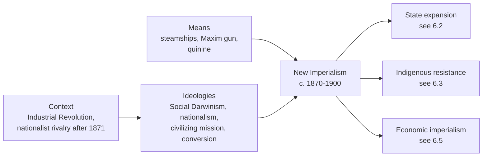
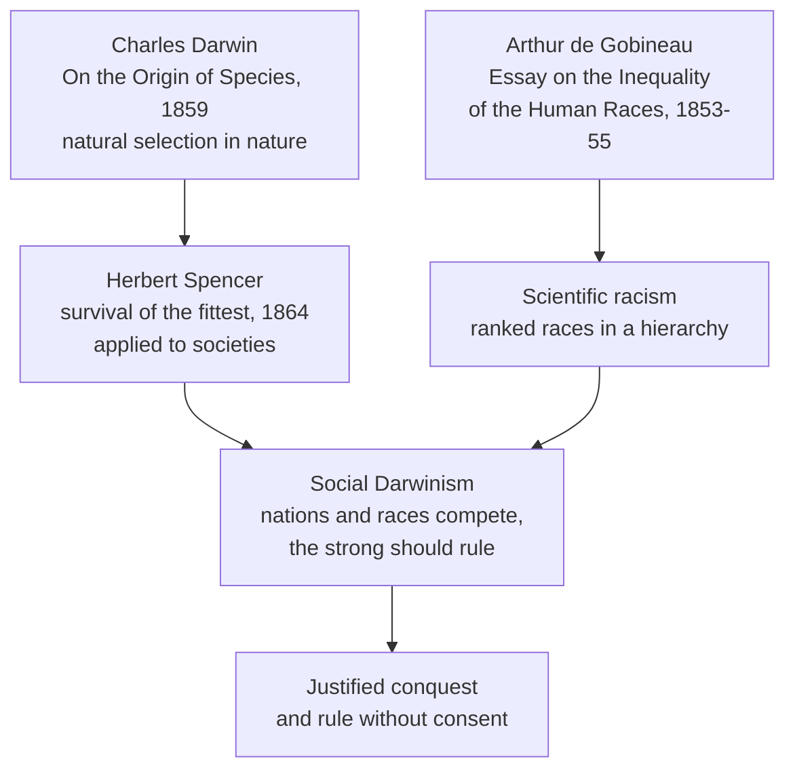
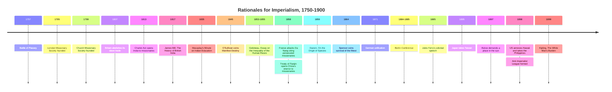
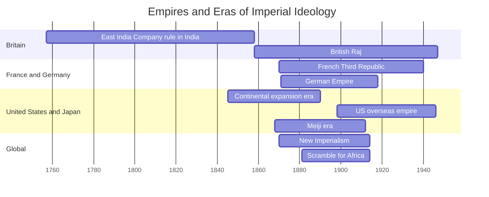
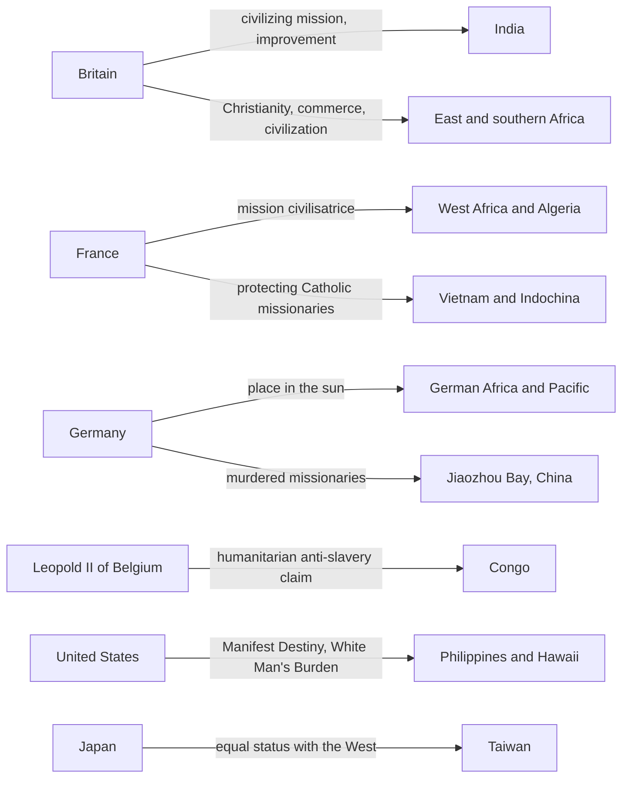
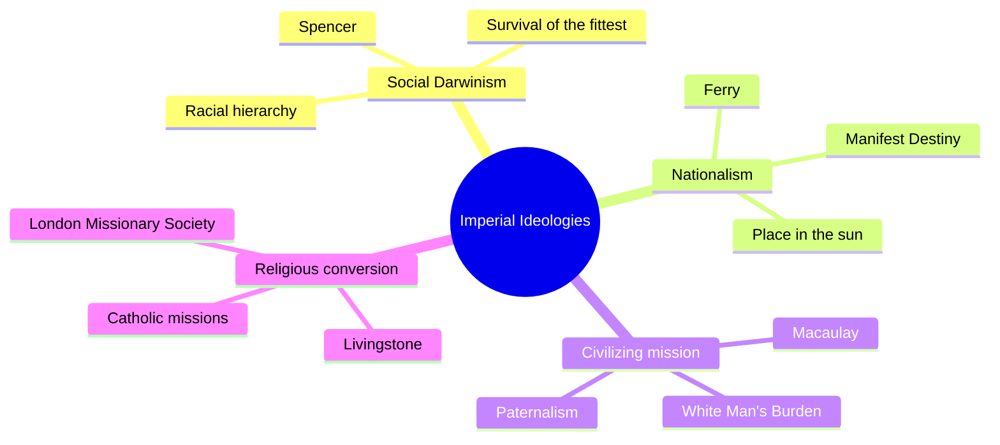

# AP World History: Modern — Topic 6.1 Rationales for Imperialism from 1750 to 1900

**Focus Question:** How did ideologies contribute to the development of imperialism from 1750 to 1900?

> Source: Based on the College Board CED · Textbook not yet incorporated

**Unit 6: Consequences of Industrialization (c. 1750–1900)**

---

## Learning Objective

| Code | Learning Objective |
|---|---|
| 6.1 LO-A (CDI) | Explain how ideologies contributed to the development of imperialism from 1750 to 1900. |

## Historical Developments (CED)

| # | Historical Development | Covered in |
|---|---|---|
| HD1 | KC-5.2.III: A range of cultural, religious, and racial ideologies were used to justify imperialism, including Social Darwinism, nationalism, the concept of the civilizing mission, and the desire to religiously convert indigenous populations. | §1 (context), §2 (early "improvement" arguments), §3 (Social Darwinism and racial ideologies), §4 (nationalism), §5 (civilizing mission), §6 (religious conversion), §7 (critiques) |

The CED lists no illustrative examples for this topic. The people, texts, and events in these notes are standard examples from scholarship, not CED examples.

**Suggested skill:** 4.B Contextualization — Explain how a specific historical development or process is situated within a broader historical context.

---

## The Big Picture

> "Take up the White Man's burden— Send forth the best ye breed— Go bind your sons to exile To serve your captives' need"
> — Rudyard Kipling, "The White Man's Burden" (1899), addressed to the United States over the Philippines

> ⚠️ Needs verification: the line breaks and punctuation of this stanza vary between printings. Check the exact wording against a reliable edition before quoting it.

Between 1750 and 1900, and especially in the **"New Imperialism"** after about **1870**, industrial states in Europe, along with the **United States** and **Japan**, took control of most of Africa and much of Asia and the Pacific. The **Industrial Revolution** (Unit 5) explains much of the *why*: factories needed **raw materials**, producers wanted **markets**, and steamships needed **coaling stations**. New technology explains the *how*: **steamships**, the **Maxim gun**, and **quinine** made conquest cheap. But empire also needed a **justification** that voters, missionaries, soldiers, and officials could believe in. Four ideologies supplied it: **Social Darwinism** (and the scientific racism around it), **nationalism**, the **civilizing mission**, and the desire to **convert indigenous peoples to Christianity**. These ideas often blended together, and they often covered economic motives (see 6.5).

---

## §1. Context: Why Empire Needed a Justification

### Motives, means, and justifications

| Part | What it was | Examples |
|---|---|---|
| **Motives** | Mostly economic, created by industrialization | Raw materials (cotton, rubber, palm oil, minerals); markets for factory goods; places to invest capital; coaling stations for steamships |
| **Means** | Industrial technology that made conquest cheap | **Steamships** (river gunboats and ocean shipping); the **Maxim gun** (1884, an early machine gun); **quinine** against malaria; the telegraph; the Suez Canal (1869) |
| **Justifications** | Ideas that made empire seem right, natural, or necessary | Social Darwinism; nationalism; the civilizing mission; religious conversion |

- **Nationalist rivalry** sharpened after the unification of **Italy** (1861, with Rome added in 1870–71) and **Germany** (1871). New great powers wanted colonies as proof of status, and older powers such as Britain and France competed harder to keep their lead.
- The **"New Imperialism"** (about 1870–1914) was faster and more competitive than earlier empire-building. In Africa, Europeans went from controlling about a tenth of the continent to almost all of it within roughly 30 years (the Scramble for Africa; see 6.2).
- The **4.B skill** asks you to place a development in its wider context. For this topic, that means linking imperial ideologies to industrialization (Unit 5), to Enlightenment ideas (Unit 5), and to the expansion and resistance they produced (6.2, 6.3).

> **Key idea:** Ideology rarely caused imperialism by itself. It explained and excused expansion that economic, strategic, and technological forces had already made possible.

## §2. Early Justifications, 1750–1850: "Improvement" in British India

- After the **Battle of Plassey (1757)**, the **British East India Company** became the real ruler of Bengal and later of most of India. At first, many Company officials respected Indian learning and worked through Indian institutions.
- By about 1800, two British groups argued that Britain had a duty to **"improve"** India.

| Group | Key figure or text | Core argument | Result |
|---|---|---|---|
| **Evangelicals** (Protestant reformers) | Charles Grant (1792); William Wilberforce | Indian religion and customs were "immoral"; Britain should spread Christianity | The **Charter Act of 1813** opened India to missionaries |
| **Utilitarians** (followers of Jeremy Bentham) | **James Mill, *The History of British India* (1817)** | Indian civilization was backward and stagnant; rational British law and government would bring progress | Mill's book was used in training Company officials; it dismissed Indian history without Mill ever visiting India |
| **Liberal reformers** | Governor-General William Bentinck | British rule should end "barbaric" practices | **Sati** (widow burning) banned in 1829 |
| **Anglicists** (supporters of English education) | **Thomas Macaulay, Minute on Indian Education (1835)** | Western learning was superior; English should replace Sanskrit and Persian in state-funded education | The **English Education Act (1835)**; the goal was a class of Indians who were "English in taste, in opinions, in morals and in intellect" |

> ⚠️ Needs verification: Macaulay's most quoted lines ("a single shelf of a good European library was worth the whole native literature of India and Arabia" and "English in taste, in opinions, in morals and in intellect") are widely reproduced. Check the exact wording against the full text of the 1835 Minute before quoting it.

- Britain's abolition of the **slave trade (1807)** later became part of the same story: Britain presented its navy and its empire as a moral force that ended slavery.
- These early arguments set the pattern for the rest of the century: rule was justified as a **gift** to the ruled, not as profit for the rulers.

## §3. Social Darwinism and Scientific Racism

- **Charles Darwin, *On the Origin of Species* (1859):** explained how species of plants and animals change over time through **natural selection**. The book was about biology. It did not argue that nations or races should compete or conquer one another.
- **Herbert Spencer** coined the phrase **"survival of the fittest"** (*Principles of Biology*, 1864) and applied evolutionary ideas to **human societies**. Thinkers who followed him argued that nations and races were locked in a struggle in which the "fittest" would win.
- **Arthur de Gobineau, *Essay on the Inequality of the Human Races* (1853–55):** a French writer who claimed that races were unequal by nature and that a "white" or "Aryan" race was superior. His book came before Darwin's and shows that racial ideology did not depend on evolution.
- **Scientific racism** used skull measurements and other false "science" to rank peoples in a fixed **racial hierarchy**, with Europeans at the top.
- **How it justified imperialism:**
  - Conquest was presented as **natural**: strong nations would inevitably take over weaker ones.
  - Rule without self-government was presented as **necessary**: "lower" races were said to be unable to govern themselves.
  - The decline of indigenous populations in settler colonies (Australia, North America, southern Africa) was explained away as the "natural" fate of "unfit" peoples.
  - Businessman and politician **Cecil Rhodes** wrote (1877) that the British were "the finest race in the world" and that the more of the world they inhabited, the better for humanity.

> ⚠️ Needs verification: historians disagree about how far Darwin himself shared the ideas later called Social Darwinism. *The Descent of Man* (1871) applies evolution to humans and contains racial rankings common in his time. The safe AP point is that Social Darwinism was developed by others, especially Spencer, who applied natural selection to societies and races.

## §4. Nationalism: Empire as National Prestige

- **Nationalism** (Unit 5) taught people to see their nation as a community in competition with other nations. By the late 1800s, many Europeans believed a **great power** must have an empire.

| Country | Statement or idea | Context |
|---|---|---|
| **France** | **Jules Ferry**, speech to the Chamber of Deputies (**28 July 1885**): France needed colonies for markets, for naval bases, and to remain a great nation; "superior races" had a "duty to civilize the inferior races" | France had lost the Franco-Prussian War (1870–71) and Alsace-Lorraine; colonies in Africa and Indochina would restore national pride |
| **Germany** | **Bernhard von Bülow**, Reichstag speech (**1897**): Germany did not want to put anyone in the shade, but it demanded "our own place in the sun" | Unified only in 1871, Germany took colonies in Africa and the Pacific (1884–85) and seized **Jiaozhou Bay** in China (1897) |
| **United States** | **Manifest Destiny**, a phrase coined by **John L. O'Sullivan (1845)**: Americans had a God-given destiny to spread across the continent | The idea first justified westward expansion; in **1898** the US annexed Hawaii and, after the war with Spain, took the Philippines, Guam, and Puerto Rico |
| **Japan** | Empire as proof of **equal status** with the Western powers | After the Meiji Restoration (1868), Japan industrialized; it won **Taiwan in 1895** (Treaty of Shimonoseki) after the Sino-Japanese War |
| **Britain** | Pride in the largest empire in history, "on which the sun never sets" | Britain treated the empire as the source of its world power and defended it against rivals |

> ⚠️ Needs verification: Ferry's and Bülow's words are quoted here in common English translations. Check the exact wording against a full translation of each speech before quoting it.

- Nationalism turned empire into a **competition**: each new colony was a gain for one nation and a loss for its rivals. This helps explain why powers took territories that cost more than they earned.
- Imperial success also built **domestic support**: newspapers, school textbooks, and exhibitions celebrated colonial victories.
- **Japan** shows that the same ideology could be adopted outside Europe. Japanese leaders argued that a modern nation had to have colonies to avoid being colonized itself.

## §5. The Civilizing Mission

- The **civilizing mission** was the belief that imperial powers had a **duty** to bring "civilization" (their own religion, law, education, science, and customs) to peoples they saw as backward.
- In France it was called the **mission civilisatrice**. The French Third Republic presented its empire as spreading the ideals of the French Revolution and French language and culture, especially in West Africa, Algeria, and Indochina. Its long-term aim was **assimilation**: making colonized elites culturally French.
- **Rudyard Kipling, "The White Man's Burden" (1899):** written to urge the **United States** to take and govern the **Philippines**. It described colonial rule as a heavy, unselfish duty that white men must accept even though the colonized would not thank them.
- **Paternalism:** colonized peoples were treated like **children** who needed a guardian. Kipling called them "half-devil and half-child." This view denied them the right to govern themselves.
- Reasons given for rule:
  - **Ending the slave trade.** European powers at the Berlin Conference (1884–85) and the Brussels Conference (1889–90) promised to suppress the slave trade in Africa.
  - **Western law** and "order" in place of local custom.
  - **Western education**, hospitals, railways, and sanitation.
- **The gap between words and actions:** King **Leopold II** of Belgium presented his **Congo Free State** (1885) as a humanitarian, anti-slavery project. In practice, his agents forced Congolese people to collect rubber under brutal conditions (see 6.5).
- Even liberal thinkers accepted the idea. **John Stuart Mill**, author of *On Liberty* (1859) and an East India Company official, argued that liberty applied only to "civilized" peoples and that despotism was a legitimate way to govern "barbarians" if it aimed at their improvement.

## §6. Religious Conversion and Missionaries

### Missionary organizations

| Organization | Founded | Tradition | Main fields |
|---|---|---|---|
| Baptist Missionary Society | 1792 | Protestant (William Carey) | India |
| **London Missionary Society** | **1795** | Protestant | South Pacific, southern Africa, China |
| **Church Missionary Society** | **1799** | Protestant (Anglican) | West and East Africa, India, New Zealand |
| Missionaries of Africa ("White Fathers") | 1868 | Catholic (Cardinal Charles Lavigerie) | North and Central Africa |

- **David Livingstone (1813–1873):** a Scottish missionary and explorer of southern and central Africa. He argued that **"Christianity, commerce, and civilization"** would end the East African slave trade by giving Africans legitimate trade to replace it. His travels made him a hero in Britain and drew more Europeans into Africa.
- **Catholic missions** grew again in the 1800s, supported especially by France. France claimed the role of protector of Catholic missionaries in Asia and the Middle East.
- **Religion as a reason for intervention:**
  - **Vietnam (1858):** France, with Spain, attacked Da Nang after Vietnamese rulers persecuted and executed Catholic missionaries and converts. This began the French conquest of Indochina.
  - **China:** the **Treaty of Tianjin (1858)** and **Convention of Beijing (1860)**, signed after the Second Opium War, allowed missionaries to travel and preach in the interior. Missionaries became part of the unequal treaty system, and anger at them later fed the Boxer Rebellion (see 6.3).
  - **Germany (1897):** the killing of two German Catholic missionaries in Shandong gave Germany its reason to seize **Jiaozhou Bay**.

### Missionaries both supported and complicated imperial rule

| Supported imperial rule | Complicated imperial rule |
|---|---|
| Gave the public a moral reason to support empire | Some criticized settlers and officials for abusing indigenous peoples (for example, LMS missionaries in the Cape Colony) |
| Often arrived before soldiers and asked their governments for protection | Their attacks on local religion and customs provoked resistance that disrupted colonial rule |
| Spread European languages, values, and schooling | Mission schools trained a Western-educated elite who later led nationalist movements |
| Their stories of "heathen" peoples reinforced the civilizing mission | They translated the Bible into local languages and sometimes valued local cultures, which strengthened local identity |

## §7. Critiques and Limits of Imperial Ideology

- **Ideology often covered economic motives.** Ferry openly listed markets alongside "civilizing." Leopold II's humanitarian claims hid forced labor. Missionary and civilizing language made profit-driven expansion look moral (see 6.5 on economic imperialism).
- **Conflict with Enlightenment ideals (Unit 5).** The Enlightenment and the Atlantic revolutions proclaimed natural rights, equality, and government by consent. Imperialism denied all three to colonized peoples. Racial ideology was one way Europeans resolved this contradiction: if colonized peoples were "not ready," denying them rights seemed consistent.
- **The American Anti-Imperialist League (1898):** formed to oppose the annexation of the **Philippines**. Its members argued that ruling people without their consent violated the Declaration of Independence. **Mark Twain** became a leading voice; his essay "To the Person Sitting in Darkness" (1901) mocked the civilizing mission.
- **Voices from the colonized** rejected these justifications as well, using Western ideas of rights and nationalism against their rulers (see 6.3).

---

## Timeline

---

## Map: Imperial Powers and Their Justifications

---

## Comparison Table: The Four Ideologies

| Ideology | Core claim | Key thinker or text | Where it was used | Empires that used it |
|---|---|---|---|---|
| **Social Darwinism** and scientific racism | Nations and races compete; the "fittest" should rule | Herbert Spencer (1864); Gobineau (1853–55) | Southern Africa, Australia, the American West | Britain, Germany, the US |
| **Nationalism** | Colonies prove a nation's power and prestige | Jules Ferry (1885); Bülow (1897); O'Sullivan (1845) | Africa, the Pacific, Taiwan | France, Germany, the US, Japan, Italy |
| **Civilizing mission** | The rulers have a duty to "civilize" backward peoples | Macaulay (1835); Kipling (1899) | India, French West Africa, the Philippines | Britain, France, the US |
| **Religious conversion** | Indigenous peoples must be brought to Christianity | Livingstone; the LMS and CMS | Africa, the Pacific, China, Vietnam | Britain, France, Germany |

## Comparison Table: How Five Empires Justified Their Rule

| Empire | Main justification | Key example | Economic motive behind it (see 6.5) |
|---|---|---|---|
| **Britain** | "Improvement," civilizing mission, Christianity | Macaulay's Minute (1835); Livingstone | Indian cotton market and revenue; African raw materials |
| **France** | Mission civilisatrice and national prestige | Ferry's speech (1885); protecting missionaries in Vietnam (1858) | Markets for French goods; rubber and rice in Indochina |
| **Germany** | National prestige for a new great power | Bülow's "place in the sun" (1897) | Trade bases and raw materials in Africa and China |
| **United States** | Manifest Destiny and the civilizing mission | O'Sullivan (1845); Kipling's appeal over the Philippines (1899) | Pacific naval bases and access to the China market; Hawaiian sugar |
| **Japan** | Equal status with the Western powers | Taiwan (1895) | Raw materials and markets for Japanese industry |

---

## Key Terms

| Theme | Term | Definition |
|---|---|---|
| Government | Imperialism | One state's domination of other lands and peoples by conquest, colonies, or economic control |
| Government | New Imperialism | The rapid, competitive expansion of industrial powers into Africa, Asia, and the Pacific from about 1870 |
| Culture | Social Darwinism | The application of "survival of the fittest" to societies, nations, and races, used to justify conquest |
| Culture | Survival of the fittest | Herbert Spencer's phrase (1864) for the idea that the strongest survive in competition |
| Culture | Scientific racism | False "science" that ranked human races in a fixed hierarchy |
| Culture | Nationalism | Loyalty to one's nation; in this era, the belief that a great nation needed an empire |
| Culture | Civilizing mission | The belief that imperial powers had a duty to bring their "civilization" to colonized peoples |
| Culture | Mission civilisatrice | The French form of the civilizing mission, aimed at assimilation into French culture |
| Culture | The White Man's Burden | Kipling's 1899 poem describing colonial rule as a duty of white men |
| Culture | Paternalism | Treating colonized peoples like children who needed a guardian |
| Culture | Manifest Destiny | The US belief (O'Sullivan, 1845) in a God-given destiny to expand across the continent |
| Culture | Missionary | A person sent to spread a religion; Protestant and Catholic missionaries worked across Africa and Asia |
| Culture | "Christianity, commerce, and civilization" | Livingstone's formula for ending the slave trade and transforming Africa |
| Government | Minute on Indian Education | Macaulay's 1835 argument for English-language, Western education in India |
| Government | Anti-Imperialist League | A US group (1898) that opposed annexing the Philippines as a violation of government by consent |
| Technology | Maxim gun | An early machine gun (1884) that gave European armies a huge advantage |
| Technology | Quinine | A drug from cinchona bark that protected Europeans against malaria |
| Economics | Coaling station | A port where steamships refueled with coal, a reason to acquire small islands and harbors |
