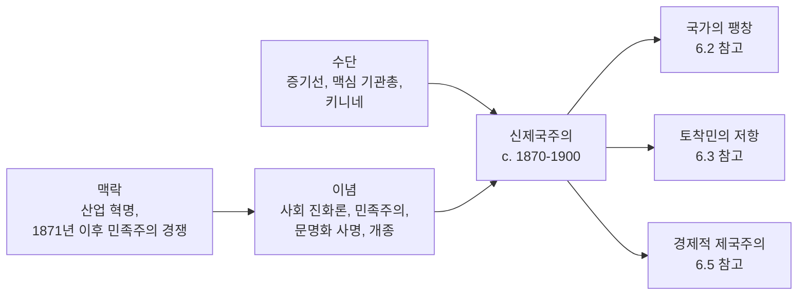
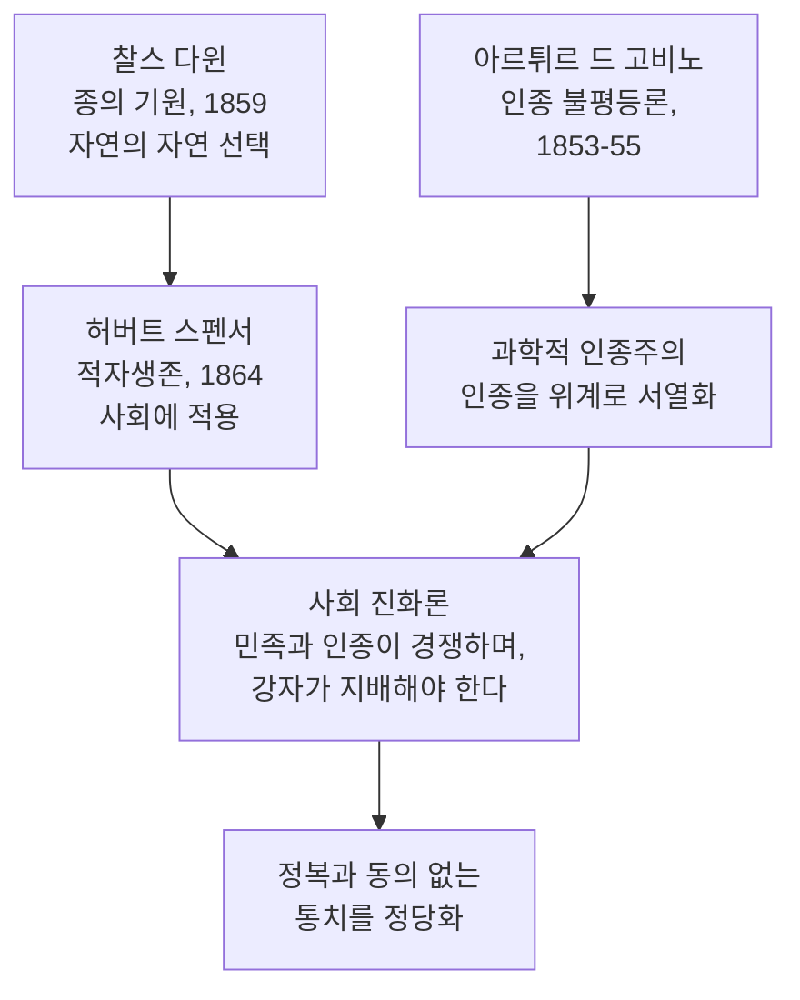
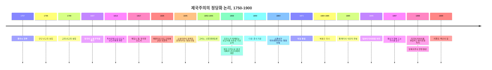
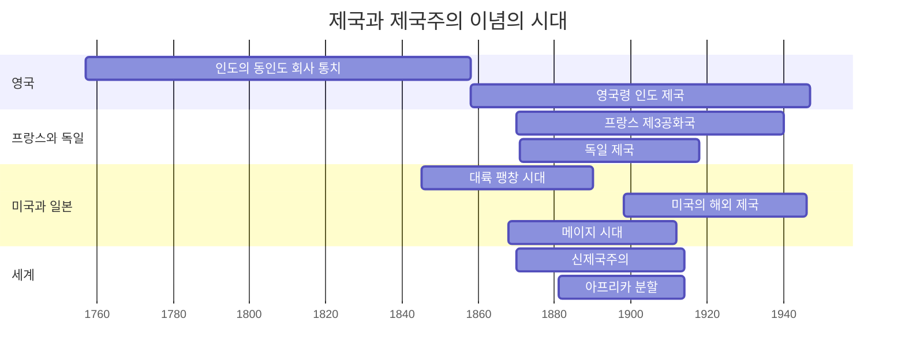
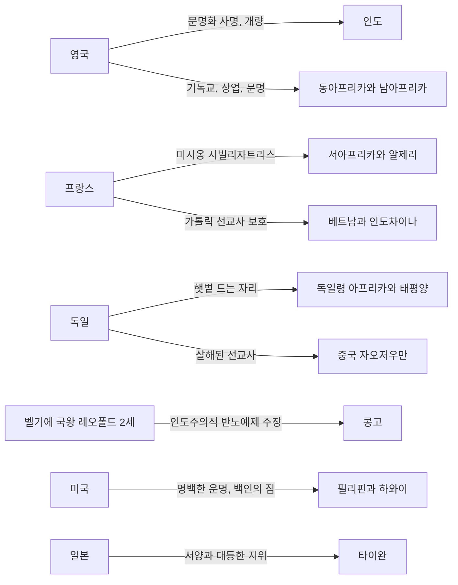
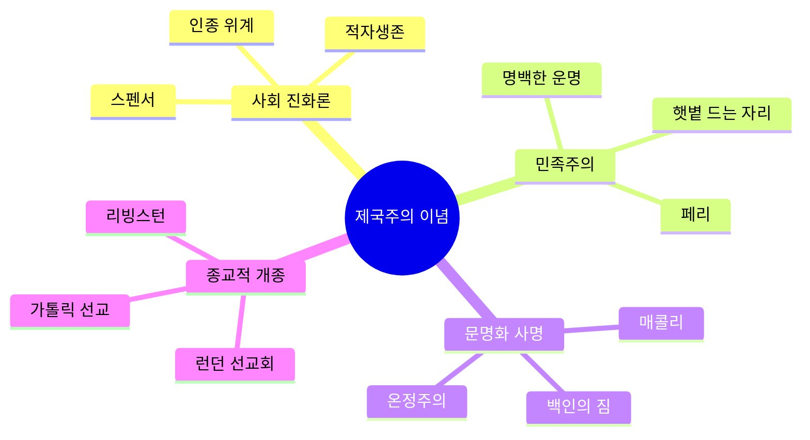

# AP 세계사: 모던 — 토픽 6.1 1750–1900년 제국주의의 정당화 논리 (Rationales for Imperialism from 1750 to 1900)

**Focus Question:** 1750년부터 1900년까지 여러 이념은 제국주의의 전개에 어떻게 기여했는가?

> 출처: CED 기준 · 교재 반영 전

**Unit 6: 산업화의 결과 (Consequences of Industrialization, c. 1750–1900)**

---

## 학습 목표 (Learning Objective)

| 코드 | 학습 목표 |
|---|---|
| 6.1 LO-A (CDI) | 1750년부터 1900년까지 여러 이념이 제국주의의 전개에 어떻게 기여했는지 설명한다. |

## 역사적 개념 (Historical Developments, CED)

| # | 역사적 개념 | 다루는 곳 |
|---|---|---|
| HD1 | KC-5.2.III: 사회 진화론 (Social Darwinism), 민족주의 (Nationalism), 문명화 사명 (Civilizing mission)이라는 관념, 토착민을 종교적으로 개종시키려는 열망 등 다양한 문화적·종교적·인종적 이념이 제국주의 (Imperialism)를 정당화하는 데 사용되었다. | §1 (맥락), §2 (초기의 "개량" 논리), §3 (사회 진화론과 인종 이념), §4 (민족주의), §5 (문명화 사명), §6 (종교적 개종), §7 (비판) |

CED는 이 토픽에 예시 (Illustrative examples)를 제시하지 않는다. 이 노트에 나오는 인물, 문헌, 사건은 학계에서 흔히 쓰는 사례이며 CED 예시가 아니다.

**권장 스킬:** 4.B Contextualization (맥락화) — 특정한 역사적 전개나 과정이 더 넓은 역사적 맥락 속에서 어떻게 자리 잡고 있는지 설명한다.

---

## 큰 그림 요약

> "백인의 짐을 짊어져라— 너희가 기른 가장 뛰어난 자들을 내보내라— 너희 아들들을 유배지에 묶어 두어라 너희 포로들의 필요를 채우도록"
> — 러디어드 키플링 (Rudyard Kipling), 「백인의 짐 (The White Man's Burden)」(1899). 필리핀 문제를 두고 미국에 보낸 시이다.

> ⚠️ 확인 필요: 이 연의 줄 바꿈과 문장 부호는 판본마다 다르다. 인용하기 전에 믿을 만한 판본으로 원문을 확인해야 한다.

1750년부터 1900년까지, 특히 약 **1870년** 이후의 **"신제국주의 (New Imperialism)"** 시기에 유럽의 산업 국가들과 **미국**, **일본**은 아프리카 대부분과 아시아·태평양의 넓은 지역을 지배하게 되었다. *왜* 팽창했는지는 상당 부분 **산업 혁명 (Industrial Revolution)**(Unit 5)으로 설명된다. 공장은 **원료**가 필요했고, 생산자는 **시장**을 원했으며, 증기선은 **석탄 보급항 (Coaling station)**이 필요했다. *어떻게* 팽창했는지는 새로운 기술로 설명된다. **증기선 (Steamship)**, **맥심 기관총 (Maxim gun)**, **키니네 (Quinine)** 덕분에 정복 비용이 싸졌다. 그러나 제국에는 유권자, 선교사, 군인, 관리가 믿을 수 있는 **정당화 논리**도 필요했다. 네 가지 이념이 그 역할을 했다. **사회 진화론**(그리고 그와 연결된 과학적 인종주의), **민족주의**, **문명화 사명**, 그리고 **토착민을 기독교로 개종시키려는 열망**이다. 이 이념들은 서로 섞이는 경우가 많았고, 경제적 동기를 가리는 경우도 많았다(6.5 참고).

---

## §1. 맥락: 제국에 정당화 논리가 필요했던 이유

### 동기, 수단, 정당화 논리

| 구분 | 내용 | 예 |
|---|---|---|
| **동기 (Motives)** | 대부분 경제적 동기로, 산업화가 만들어 냈다 | 원료(면화, 고무, 팜유, 광물), 공장 제품을 팔 시장, 자본 투자처, 증기선용 석탄 보급항 |
| **수단 (Means)** | 정복 비용을 낮춘 산업 기술 | **증기선**(하천 포함과 대양 해운), **맥심 기관총**(1884, 초기 기관총), 말라리아를 막는 **키니네**, 전신, 수에즈 운하 (Suez Canal, 1869) |
| **정당화 논리 (Justifications)** | 제국을 옳고, 자연스럽고, 꼭 필요한 것처럼 보이게 한 사상 | 사회 진화론, 민족주의, 문명화 사명, 종교적 개종 |

- **이탈리아**(1861년 통일, 1870–71년 로마 편입)와 **독일**(1871년)이 통일된 뒤 **민족주의 경쟁**이 더 치열해졌다. 새 강대국은 지위를 증명하려고 식민지를 원했고, 영국과 프랑스 같은 기존 강대국은 앞선 자리를 지키려고 더 치열하게 경쟁했다.
- **"신제국주의"**(약 1870–1914년)는 이전의 제국 건설보다 더 빠르고 경쟁적이었다. 아프리카에서 유럽인이 지배한 땅은 약 30년 만에 대륙의 10분의 1 정도에서 거의 전부로 늘었다(아프리카 분할 (Scramble for Africa), 6.2 참고).
- **4.B 스킬**은 어떤 전개를 더 넓은 맥락 속에 놓고 설명하라고 요구한다. 이 토픽에서는 제국주의 이념을 산업화(Unit 5), 계몽사상(Unit 5), 그리고 그 이념이 낳은 팽창과 저항(6.2, 6.3)과 연결하는 것이다.

> **핵심:** 이념만으로 제국주의가 생긴 경우는 드물었다. 이념은 경제·전략·기술의 힘이 이미 가능하게 만든 팽창을 설명하고 변명했다.

## §2. 초기의 정당화 논리, 1750–1850년: 영국령 인도의 "개량 (Improvement)"

- **플라시 전투 (Battle of Plassey, 1757)** 이후 **영국 동인도 회사 (British East India Company)**는 벵골의 실질적인 지배자가 되었고, 나중에는 인도 대부분을 지배했다. 처음에는 많은 회사 관리가 인도의 학문을 존중했고 인도의 제도를 통해 통치했다.
- 1800년 무렵, 영국의 두 집단이 영국에게는 인도를 **"개량"**할 의무가 있다고 주장했다.

| 집단 | 핵심 인물·문헌 | 핵심 주장 | 결과 |
|---|---|---|---|
| **복음주의자 (Evangelicals)**(개신교 개혁가) | 찰스 그랜트 (Charles Grant, 1792), 윌리엄 윌버포스 (William Wilberforce) | 인도의 종교와 관습은 "부도덕"하므로 영국이 기독교를 전해야 한다 | **1813년 특허장법 (Charter Act of 1813)**이 인도를 선교사에게 개방했다 |
| **공리주의자 (Utilitarians)**(제러미 벤담 (Jeremy Bentham)의 추종자) | **제임스 밀 (James Mill), 『영국령 인도사 (The History of British India)』(1817)** | 인도 문명은 뒤처지고 정체되어 있으므로, 합리적인 영국의 법과 정부가 진보를 가져올 것이다 | 이 책은 회사 관리 교육에 쓰였다. 밀은 인도에 한 번도 가 보지 않고 인도의 역사를 깎아내렸다 |
| **자유주의 개혁가 (Liberal reformers)** | 총독 윌리엄 벤팅크 (William Bentinck) | 영국의 통치는 "야만적인" 관습을 없애야 한다 | 1829년 **사티 (Sati)**(과부 순장) 금지 |
| **영어 교육파 (Anglicists)** | **토머스 매콜리 (Thomas Macaulay), 「인도 교육에 관한 의견서 (Minute on Indian Education)」(1835)** | 서양 학문이 더 우월하므로, 국가가 지원하는 교육에서 산스크리트어와 페르시아어 대신 영어를 써야 한다 | **1835년 영어 교육법 (English Education Act)**. 목표는 "취향, 의견, 도덕, 지성에서 영국인"인 인도인 계층을 만드는 것이었다 |

> ⚠️ 확인 필요: 매콜리의 가장 유명한 구절("좋은 유럽 도서관의 책장 한 칸이 인도와 아라비아의 토착 문헌 전체만큼의 가치가 있다", "취향, 의견, 도덕, 지성에서 영국인")은 널리 인용된다. 인용하기 전에 1835년 의견서 전문으로 정확한 문구를 확인해야 한다.

- 영국의 **노예 무역 폐지 (1807)**도 나중에 같은 이야기의 일부가 되었다. 영국은 자국의 해군과 제국을 노예제를 끝낸 도덕적 힘으로 내세웠다.
- 이 초기 논리는 이후 한 세기의 틀이 되었다. 통치는 지배자의 이익이 아니라 피지배자에게 주는 **선물**로 정당화되었다.

## §3. 사회 진화론과 과학적 인종주의

- **찰스 다윈 (Charles Darwin), 『종의 기원 (On the Origin of Species)』(1859):** 식물과 동물의 종이 **자연 선택 (Natural selection)**을 통해 시간에 따라 변한다는 것을 설명했다. 이 책은 생물학에 관한 책이었다. 민족이나 인종이 서로 경쟁하거나 정복해야 한다고 주장하지 않았다.
- **허버트 스펜서 (Herbert Spencer)**는 **"적자생존 (Survival of the fittest)"**이라는 말을 만들었고(『생물학 원리 (Principles of Biology)』, 1864), 진화 사상을 **인간 사회**에 적용했다. 그를 따른 사상가들은 민족과 인종이 투쟁 속에 있으며 "가장 적합한" 쪽이 이긴다고 주장했다.
- **아르튀르 드 고비노 (Arthur de Gobineau), 『인종 불평등론 (Essay on the Inequality of the Human Races)』(1853–55):** 프랑스 작가로, 인종은 본래 불평등하며 "백인" 또는 "아리아인" 인종이 우월하다고 주장했다. 이 책은 다윈보다 먼저 나왔다. 이는 인종 이념이 진화론에 의존하지 않았음을 보여 준다.
- **과학적 인종주의 (Scientific racism)**는 두개골 측정 같은 거짓 "과학"을 이용해 사람들을 고정된 **인종 위계 (Racial hierarchy)**로 서열화했고, 유럽인을 맨 위에 두었다.
- **제국주의를 정당화한 방식:**
  - 정복을 **자연스러운** 일로 보이게 했다. 강한 민족이 약한 민족을 차지하는 것은 피할 수 없다고 했다.
  - 자치 없는 통치를 **필요한** 일로 보이게 했다. "열등한" 인종은 스스로 다스릴 능력이 없다고 했다.
  - 정착 식민지 (Settler colony)(오스트레일리아, 북아메리카, 남아프리카)에서 토착민 인구가 줄어든 것을 "부적합한" 민족의 "자연스러운" 운명이라고 변명했다.
  - 사업가이자 정치가인 **세실 로즈 (Cecil Rhodes)**는 영국인이 "세계에서 가장 뛰어난 인종"이며, 영국인이 세계에 더 많이 살수록 인류에게 더 좋다고 썼다(1877).

> ⚠️ 확인 필요: 다윈 자신이 훗날 사회 진화론이라고 불린 생각을 어느 정도 공유했는지에 대해서는 역사가들의 의견이 갈린다. 『인간의 유래 (The Descent of Man)』(1871)는 진화론을 인간에게 적용했고, 당시 흔했던 인종 서열을 담고 있다. AP 시험에서 안전한 설명은 사회 진화론이 다른 사람들, 특히 자연 선택을 사회와 인종에 적용한 스펜서가 발전시켰다는 것이다.

## §4. 민족주의: 국가 위신으로서의 제국

- **민족주의**(Unit 5)는 사람들에게 자기 민족을 다른 민족과 경쟁하는 공동체로 보게 했다. 1800년대 후반 많은 유럽인은 **강대국 (Great power)**이라면 제국을 가져야 한다고 믿었다.

| 국가 | 발언·사상 | 맥락 |
|---|---|---|
| **프랑스** | **쥘 페리 (Jules Ferry)**의 하원 (Chamber of Deputies) 연설(**1885년 7월 28일**): 프랑스는 시장과 해군 기지를 얻고 강대국으로 남기 위해 식민지가 필요하다. "우월한 인종"에게는 "열등한 인종을 문명화할 의무"가 있다 | 프랑스는 프로이센-프랑스 전쟁 (Franco-Prussian War, 1870–71)에서 져서 알자스-로렌 (Alsace-Lorraine)을 잃었다. 아프리카와 인도차이나의 식민지가 민족의 자존심을 되살려 줄 것이었다 |
| **독일** | **베른하르트 폰 뷜로 (Bernhard von Bülow)**의 제국 의회 (Reichstag) 연설(**1897**): 독일은 누구도 그늘에 두려 하지 않지만, "우리 자신의 햇볕 드는 자리 (A place in the sun)"를 요구한다 | 1871년에야 통일된 독일은 아프리카와 태평양에서 식민지를 얻었고(1884–85), 중국의 **자오저우만 (Jiaozhou Bay)**을 차지했다(1897) |
| **미국** | **존 L. 오설리번 (John L. O'Sullivan)**이 만든 말인 **명백한 운명 (Manifest Destiny, 1845)**: 미국인에게는 대륙 전체로 퍼져 나갈 신이 준 운명이 있다 | 이 사상은 처음에는 서부 팽창을 정당화했다. **1898년** 미국은 하와이를 병합했고, 에스파냐와의 전쟁 뒤 필리핀, 괌, 푸에르토리코를 차지했다 |
| **일본** | 서양 열강과 **대등한 지위**를 증명하는 수단으로서의 제국 | 메이지 유신 (Meiji Restoration, 1868) 이후 일본은 산업화했다. 청일 전쟁 (Sino-Japanese War)에서 이겨 **1895년 타이완 (Taiwan)**을 얻었다(시모노세키 조약 (Treaty of Shimonoseki)) |
| **영국** | 역사상 가장 큰 제국, "해가 지지 않는" 제국이라는 자부심 | 영국은 제국을 세계적 힘의 원천으로 여겼고, 경쟁국으로부터 제국을 지켰다 |

> ⚠️ 확인 필요: 페리와 뷜로의 말은 흔히 쓰는 영어 번역을 바탕으로 옮겼다. 인용하기 전에 각 연설의 전체 번역으로 정확한 문구를 확인해야 한다.

- 민족주의는 제국을 **경쟁**으로 바꾸었다. 새 식민지 하나는 한 나라의 이득이자 경쟁국의 손실이었다. 이는 열강이 버는 것보다 비용이 더 드는 땅까지 차지한 이유를 설명해 준다.
- 제국의 성공은 **국내의 지지**도 키웠다. 신문, 학교 교과서, 박람회가 식민지에서의 승리를 찬양했다.
- **일본**은 같은 이념이 유럽 밖에서도 받아들여질 수 있었음을 보여 준다. 일본 지도자들은 근대 국가가 스스로 식민지가 되지 않으려면 식민지를 가져야 한다고 주장했다.

## §5. 문명화 사명

- **문명화 사명 (Civilizing mission)**은 제국 열강에게 자신들이 뒤처졌다고 본 민족에게 "문명"(자신들의 종교, 법, 교육, 과학, 관습)을 전할 **의무**가 있다는 믿음이었다.
- 프랑스에서는 이를 **미시옹 시빌리자트리스 (Mission civilisatrice)**라고 불렀다. 프랑스 제3공화국 (French Third Republic)은 자국 제국이 프랑스 혁명의 이상과 프랑스어·프랑스 문화를 퍼뜨린다고 내세웠다. 특히 서아프리카, 알제리, 인도차이나에서 그러했다. 장기 목표는 식민지 엘리트를 문화적으로 프랑스인으로 만드는 **동화 (Assimilation)**였다.
- **러디어드 키플링, 「백인의 짐」(1899):** **미국**에게 **필리핀**을 차지해 다스리라고 촉구하려고 쓴 시이다. 식민 통치를 피지배자가 고마워하지 않더라도 백인이 받아들여야 하는 무겁고 이타적인 의무로 묘사했다.
- **온정주의 (Paternalism):** 식민지 사람들을 보호자가 필요한 **어린아이**처럼 대했다. 키플링은 그들을 "반은 악마, 반은 어린아이"라고 불렀다. 이런 시각은 그들이 스스로를 다스릴 권리를 부정했다.
- 통치의 이유로 내세운 것:
  - **노예 무역 종식.** 유럽 열강은 베를린 회의 (Berlin Conference, 1884–85)와 브뤼셀 회의 (Brussels Conference, 1889–90)에서 아프리카의 노예 무역을 억제하겠다고 약속했다.
  - 현지 관습 대신 **서양의 법**과 "질서".
  - **서양식 교육**, 병원, 철도, 위생 시설.
- **말과 행동의 차이:** 벨기에의 국왕 **레오폴드 2세 (Leopold II)**는 자신의 **콩고 자유국 (Congo Free State, 1885)**을 인도주의적인 반노예제 사업으로 내세웠다. 실제로는 그의 대리인들이 콩고 사람들에게 잔혹한 조건에서 고무를 모으도록 강요했다(6.5 참고).
- 자유주의 사상가들도 이 생각을 받아들였다. 『자유론 (On Liberty)』(1859)의 저자이자 동인도 회사 관리였던 **존 스튜어트 밀 (John Stuart Mill)**은 자유는 "문명화된" 민족에게만 적용되며, "야만인"을 개량하는 것이 목적이라면 전제 정치도 정당한 통치 방식이라고 주장했다.

## §6. 종교적 개종과 선교사

### 선교 단체

| 단체 | 설립 | 전통 | 주요 활동 지역 |
|---|---|---|---|
| 침례교 선교회 (Baptist Missionary Society) | 1792 | 개신교(윌리엄 캐리 (William Carey)) | 인도 |
| **런던 선교회 (London Missionary Society)** | **1795** | 개신교 | 남태평양, 남아프리카, 중국 |
| **교회 선교회 (Church Missionary Society)** | **1799** | 개신교(성공회) | 서아프리카와 동아프리카, 인도, 뉴질랜드 |
| 아프리카 선교회 (Missionaries of Africa, "백의 신부회 (White Fathers)") | 1868 | 가톨릭(샤를 라비주리 (Charles Lavigerie) 추기경) | 북아프리카와 중앙아프리카 |

- **데이비드 리빙스턴 (David Livingstone, 1813–1873):** 남아프리카와 중앙아프리카를 탐험한 스코틀랜드 선교사이다. 그는 **"기독교, 상업, 문명 (Christianity, commerce, and civilization)"**이 아프리카인에게 노예 무역을 대신할 정당한 교역을 주어 동아프리카 노예 무역을 끝낼 것이라고 주장했다. 그의 여행은 그를 영국의 영웅으로 만들었고, 더 많은 유럽인을 아프리카로 끌어들였다.
- **가톨릭 선교 (Catholic missions)**는 1800년대에 다시 성장했고, 특히 프랑스의 지원을 받았다. 프랑스는 아시아와 중동에서 가톨릭 선교사의 보호자 역할을 자처했다.
- **개입의 이유가 된 종교:**
  - **베트남 (1858):** 베트남 군주들이 가톨릭 선교사와 신자를 박해하고 처형하자, 프랑스는 에스파냐와 함께 다낭 (Da Nang)을 공격했다. 이것이 프랑스의 인도차이나 정복의 시작이었다.
  - **중국:** 제2차 아편 전쟁 (Second Opium War) 뒤 맺은 **톈진 조약 (Treaty of Tianjin, 1858)**과 **베이징 조약 (Convention of Beijing, 1860)**은 선교사가 내륙을 여행하며 선교할 수 있게 했다. 선교사는 불평등 조약 체제의 일부가 되었고, 선교사에 대한 분노는 훗날 의화단 운동 (Boxer Rebellion)으로 이어졌다(6.3 참고).
  - **독일 (1897):** 산둥 (Shandong)에서 독일 가톨릭 선교사 두 명이 살해되자, 독일은 이를 구실로 **자오저우만**을 차지했다.

### 선교사는 제국 통치를 뒷받침하기도 하고 복잡하게 만들기도 했다

| 제국 통치를 뒷받침함 | 제국 통치를 복잡하게 만듦 |
|---|---|
| 대중에게 제국을 지지할 도덕적 이유를 주었다 | 일부는 정착민과 관리가 토착민을 학대한다고 비판했다(예: 케이프 식민지 (Cape Colony)의 런던 선교회 선교사) |
| 군대보다 먼저 도착하는 경우가 많았고, 자국 정부에 보호를 요청했다 | 현지 종교와 관습을 공격해 저항을 불러일으켰고, 이 저항이 식민 통치를 흔들었다 |
| 유럽의 언어, 가치관, 학교 교육을 퍼뜨렸다 | 선교 학교는 서양식 교육을 받은 엘리트를 길러 냈고, 이들이 나중에 민족주의 운동을 이끌었다 |
| "이교도" 민족에 관한 이야기로 문명화 사명을 강화했다 | 성경을 현지어로 번역하고 때로는 현지 문화를 존중해, 현지인의 정체성을 오히려 강화했다 |

## §7. 제국주의 이념에 대한 비판과 한계

- **이념은 경제적 동기를 가리는 경우가 많았다.** 페리는 "문명화"와 함께 시장을 공공연하게 내세웠다. 레오폴드 2세의 인도주의적 주장은 강제 노동을 감추었다. 선교와 문명화의 언어는 이윤을 노린 팽창을 도덕적인 일처럼 보이게 했다(경제적 제국주의는 6.5 참고).
- **계몽사상의 이상과의 충돌(Unit 5).** 계몽사상과 대서양 혁명은 자연권, 평등, 동의에 의한 통치를 내세웠다. 제국주의는 식민지 사람들에게 이 세 가지를 모두 부정했다. 인종 이념은 유럽인이 이 모순을 해소하는 한 가지 방법이었다. 식민지 사람들이 "아직 준비되지 않았다"고 하면, 그들의 권리를 부정하는 것이 모순이 아닌 것처럼 보였다.
- **미국 반제국주의 연맹 (Anti-Imperialist League, 1898):** **필리핀** 병합에 반대하려고 결성되었다. 회원들은 동의 없이 사람을 다스리는 것이 독립 선언서 (Declaration of Independence)에 어긋난다고 주장했다. **마크 트웨인 (Mark Twain)**은 대표적인 목소리가 되었고, 그의 글 「어둠 속에 앉은 사람에게 (To the Person Sitting in Darkness)」(1901)는 문명화 사명을 조롱했다.
- **식민지 사람들의 목소리**도 이런 정당화 논리를 거부했다. 그들은 서양의 권리 사상과 민족주의를 지배자에게 거꾸로 사용했다(6.3 참고).

---

## 연표

---

## 지도: 제국주의 열강과 정당화 논리

---

## 비교표: 네 가지 이념

| 이념 | 핵심 주장 | 핵심 사상가·문헌 | 사용된 지역 | 사용한 제국 |
|---|---|---|---|---|
| **사회 진화론 (Social Darwinism)**과 과학적 인종주의 (Scientific racism) | 민족과 인종은 경쟁하며, "가장 적합한" 쪽이 지배해야 한다 | 허버트 스펜서 (Herbert Spencer, 1864), 고비노 (Gobineau, 1853–55) | 남아프리카, 오스트레일리아, 미국 서부 | 영국, 독일, 미국 |
| **민족주의 (Nationalism)** | 식민지는 민족의 힘과 위신을 증명한다 | 쥘 페리 (Jules Ferry, 1885), 뷜로 (Bülow, 1897), 오설리번 (O'Sullivan, 1845) | 아프리카, 태평양, 타이완 | 프랑스, 독일, 미국, 일본, 이탈리아 |
| **문명화 사명 (Civilizing mission)** | 지배자에게는 뒤처진 민족을 "문명화"할 의무가 있다 | 매콜리 (Macaulay, 1835), 키플링 (Kipling, 1899) | 인도, 프랑스령 서아프리카, 필리핀 | 영국, 프랑스, 미국 |
| **종교적 개종 (Religious conversion)** | 토착민을 기독교로 이끌어야 한다 | 리빙스턴 (Livingstone), 런던 선교회 (LMS)와 교회 선교회 (CMS) | 아프리카, 태평양, 중국, 베트남 | 영국, 프랑스, 독일 |

## 비교표: 다섯 제국의 정당화 방식

| 제국 | 주요 정당화 논리 | 핵심 사례 | 그 뒤의 경제적 동기 (6.5 참고) |
|---|---|---|---|
| **영국** | "개량 (Improvement)", 문명화 사명, 기독교 | 매콜리의 의견서 (1835), 리빙스턴 | 인도의 면직물 시장과 세수, 아프리카의 원료 |
| **프랑스** | 미시옹 시빌리자트리스 (Mission civilisatrice)와 국가 위신 | 페리의 연설 (1885), 베트남의 선교사 보호 (1858) | 프랑스 상품의 시장, 인도차이나의 고무와 쌀 |
| **독일** | 새 강대국의 국가 위신 | 뷜로의 "햇볕 드는 자리 (A place in the sun)" (1897) | 아프리카와 중국의 교역 거점과 원료 |
| **미국** | 명백한 운명 (Manifest Destiny)과 문명화 사명 | 오설리번 (1845), 필리핀을 둘러싼 키플링의 호소 (1899) | 태평양 해군 기지와 중국 시장 진출, 하와이의 설탕 |
| **일본** | 서양 열강과 대등한 지위 | 타이완 (1895) | 일본 산업을 위한 원료와 시장 |

---

## Key Terms (핵심 용어)

| 주제 | 용어 | 정의 |
|---|---|---|
| 정치 | 제국주의 (Imperialism) | 한 국가가 정복, 식민지, 경제적 통제를 통해 다른 땅과 민족을 지배하는 것 |
| 정치 | 신제국주의 (New Imperialism) | 약 1870년부터 산업 열강이 아프리카, 아시아, 태평양으로 빠르고 경쟁적으로 팽창한 것 |
| 문화 | 사회 진화론 (Social Darwinism) | "적자생존"을 사회, 민족, 인종에 적용한 사상으로, 정복을 정당화하는 데 쓰임 |
| 문화 | 적자생존 (Survival of the fittest) | 경쟁에서 가장 강한 자가 살아남는다는 뜻으로 허버트 스펜서가 만든 말 (1864) |
| 문화 | 과학적 인종주의 (Scientific racism) | 인류의 인종을 고정된 위계로 서열화한 거짓 "과학" |
| 문화 | 민족주의 (Nationalism) | 자기 민족에 대한 충성. 이 시기에는 위대한 민족이라면 제국을 가져야 한다는 믿음으로 이어짐 |
| 문화 | 문명화 사명 (Civilizing mission) | 제국 열강에게 식민지 사람들에게 자신들의 "문명"을 전할 의무가 있다는 믿음 |
| 문화 | 미시옹 시빌리자트리스 (Mission civilisatrice) | 프랑스식 문명화 사명으로, 프랑스 문화로의 동화를 목표로 함 |
| 문화 | 백인의 짐 (The White Man's Burden) | 식민 통치를 백인의 의무로 묘사한 키플링의 1899년 시 |
| 문화 | 온정주의 (Paternalism) | 식민지 사람들을 보호자가 필요한 어린아이처럼 대하는 태도 |
| 문화 | 명백한 운명 (Manifest Destiny) | 대륙 전체로 팽창하는 것이 신이 준 운명이라는 미국의 믿음 (오설리번, 1845) |
| 문화 | 선교사 (Missionary) | 종교를 전하려고 파견된 사람. 개신교와 가톨릭 선교사가 아프리카와 아시아 곳곳에서 활동함 |
| 문화 | "기독교, 상업, 문명 (Christianity, commerce, and civilization)" | 노예 무역을 끝내고 아프리카를 바꾸려 한 리빙스턴의 공식 |
| 정치 | 인도 교육에 관한 의견서 (Minute on Indian Education) | 인도에서 영어로 하는 서양식 교육을 주장한 매콜리의 1835년 문서 |
| 정치 | 반제국주의 연맹 (Anti-Imperialist League) | 필리핀 병합이 동의에 의한 통치를 어긴다며 반대한 미국 단체 (1898) |
| 기술 | 맥심 기관총 (Maxim gun) | 유럽 군대에 큰 우위를 준 초기 기관총 (1884) |
| 기술 | 키니네 (Quinine) | 기나나무 껍질에서 얻은 약으로, 유럽인을 말라리아로부터 보호함 |
| 경제 | 석탄 보급항 (Coaling station) | 증기선이 석탄을 보충하는 항구로, 작은 섬과 항구를 차지하는 이유가 됨 |
