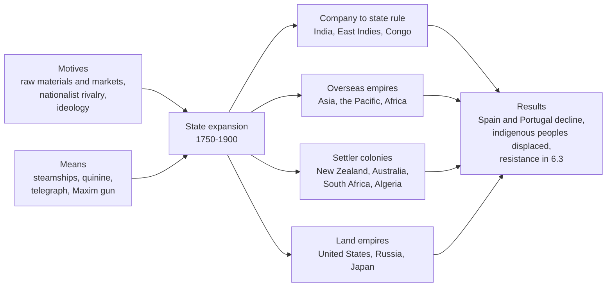
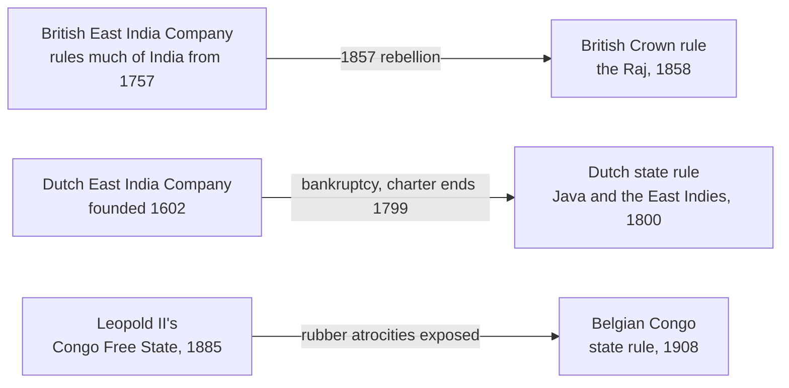
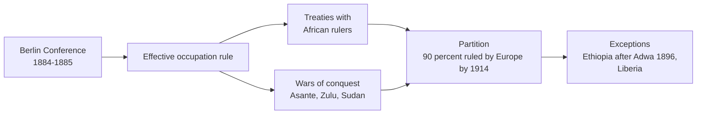
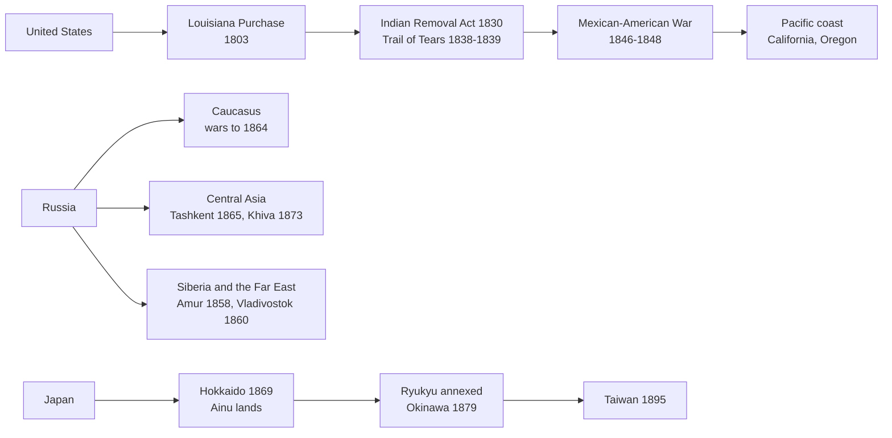
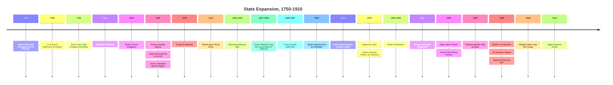
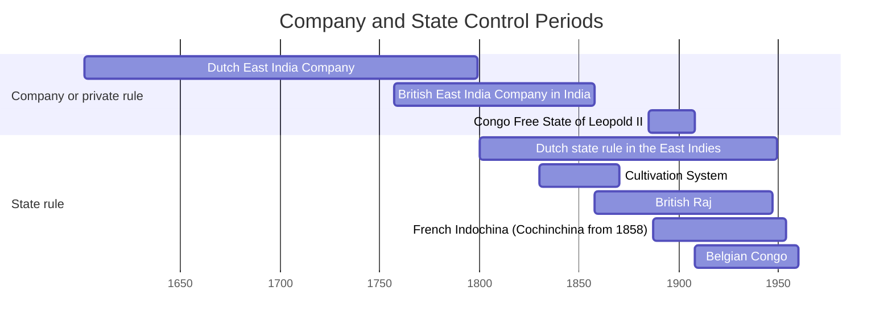
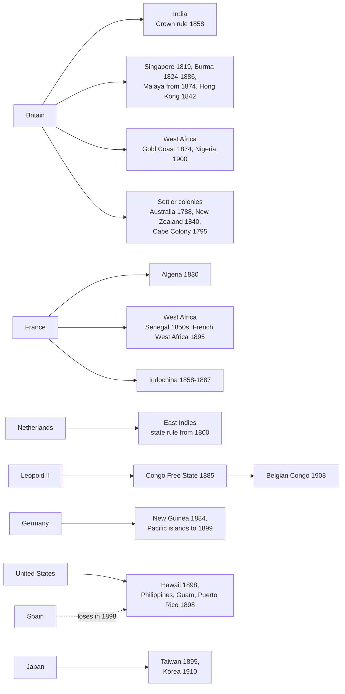

# AP World History: Modern — Topic 6.2 State Expansion from 1750 to 1900

**Focus Question:** How did different states expand their power and territory from 1750 to 1900, and how were those processes similar and different?

> Source: Based on the College Board CED · Textbook not yet incorporated

**Unit 6: Consequences of Industrialization (c. 1750–1900)**

---

## Learning Objective

| Code | Learning Objective |
|---|---|
| 6.2 LO-B (GOV) | Compare processes by which state power shifted in various parts of the world from 1750 to 1900. |

## Historical Developments (CED)

| # | Historical Development | Covered in |
|---|---|---|
| HD1 | KC-5.2.I.A: Some states with existing colonies strengthened their control over those colonies and in some cases assumed direct control over colonies previously held by non-state entities. | §2 |
| HD1 · Ex. | Illustrative example (KC-5.2.I.A) — *Non-state to state colonial control:* Shift from the private ownership of the Congo by King Leopold II to the Belgium government | §2 (Congo Free State to Belgian Congo), §4 |
| HD1 · Ex. | Illustrative example (KC-5.2.I.A) — *Non-state to state colonial control:* Shift from the Dutch East India Company to Dutch government control in Indonesia and Southeast Asia | §2 (VOC to the Dutch state, Cultivation System) |
| HD2 | KC-5.2.I.B: European states as well as the United States and Japan acquired territories throughout Asia and the Pacific, while Spanish and Portuguese influence declined. | §3, §6 (Japan's Taiwan) |
| HD3 | KC-5.2.I.C: Many European states used both warfare and diplomacy to expand their empires in Africa. | §4 |
| HD3 · Ex. | Illustrative example (KC-5.2.I.C) — *European states that expanded empires in Africa:* Britain in West Africa | §4 (Gold Coast, Asante, Nigeria) |
| HD3 · Ex. | Illustrative example (KC-5.2.I.C) — *European states that expanded empires in Africa:* Belgium in the Congo | §2, §4 |
| HD3 · Ex. | Illustrative example (KC-5.2.I.C) — *European states that expanded empires in Africa:* French in West Africa | §4 (Senegal, Western Sudan, Dahomey) |
| HD4 | KC-5.2.I.D: Europeans established settler colonies in some parts of their empires. | §5 |
| HD4 · Ex. | Illustrative example (KC-5.2.I.D) — *Settler colonies established in empires:* New Zealand | §5 (Treaty of Waitangi, New Zealand Wars) |
| HD5 | KC-5.2.II.B: The United States, Russia, and Japan expanded their land holdings by conquering and settling neighboring territories. | §6 |

---

## The Big Picture

> "Whatever happens, we have got
> The Maxim gun, and they have not."
> — Hilaire Belloc, *The Modern Traveller* (1898), satirical verse spoken by a fictional character

Between 1750 and 1900, industrial states pushed their power over much of the world. They wanted **raw materials and markets** for their factories (see 6.5), they competed with each other out of **nationalist rivalry**, and they justified conquest with ideologies such as the civilizing mission (see 6.1). A widening **technology gap** (steamships, quinine, the telegraph, and the Maxim gun) made conquest cheaper and faster. State power shifted in several ways. **Governments took over colonies from companies and private rulers**: the British Crown replaced the East India Company in India (1858), the Dutch state replaced the Dutch East India Company (1799), and Belgium took the Congo from King Leopold II (1908). **Europeans, the United States, and Japan took territory in Asia and the Pacific**, while Spain and Portugal declined. **European states carved up Africa** through both diplomacy (the Berlin Conference, treaties) and warfare. **Settlers** moved into New Zealand, Australia, South Africa, and Algeria. On land, the **United States, Russia, and Japan** conquered and settled the territories next to them.

---

## §1. Context: Why and How States Expanded After 1750

### Motives

| Motive | What it meant | Link |
|---|---|---|
| **Raw materials** | Factories needed cotton, rubber, palm oil, copper, and tin | 6.4, 6.5 |
| **Markets** | Industrial producers wanted buyers for textiles and other manufactured goods | 6.5 |
| **Nationalist rivalry** | Colonies were a sign of national power; if one state did not claim land, a rival would | 6.1 |
| **Strategy** | Ports, coaling stations, and routes such as the Suez Canal (1869) protected trade and navies | 6.5 |
| **Ideology** | Social Darwinism, the civilizing mission, and Christian missions justified rule over others | 6.1 |

### The Technology Gap

| Technology | Effect on expansion |
|---|---|
| **Steamships and river gunboats** | Carried troops up rivers such as the Niger and the Congo; British gunboats were decisive in the Opium War (1839–1842) |
| **Quinine** | Taken against malaria from the mid-1800s, it let Europeans survive in tropical Africa |
| **Telegraph** | Linked colonial officials to home governments within hours or days |
| **Railroads** | Moved troops and goods inland (for example, in India and later in Africa) |
| **Breech-loading rifles and the Maxim gun** | The Maxim gun (invented 1884) fired about 500 rounds a minute; small forces could defeat much larger armies |

- **Key idea:** before about 1800 Europeans mostly held coastal trading posts in Africa and Asia. Industrial technology let them move **inland** and rule **directly**.

## §2. From Company Rule to State Rule (KC-5.2.I.A)

In the early modern era (Unit 4), many colonies were run by **joint-stock companies** or other **non-state entities**. In the 1800s, governments took direct control. Reasons included company **bankruptcy**, **rebellion**, and public outrage at **abuses**.

### British India: From the East India Company to the Raj

- After the **Battle of Plassey (1757)**, the **British East India Company (EIC)** became a ruling power in Bengal and gained the right to collect its taxes (the *diwani*) in **1765**.
- Parliament gradually tightened control (the Regulating Act of 1773 and the India Act of 1784), but the company still ran the government and its private army of **sepoys** (Indian soldiers).
- The **1857 rebellion** (also called the Sepoy Mutiny or the Indian Rebellion; details in 6.3) spread across northern India before British forces crushed it.
- The **Government of India Act (1858)** ended company rule. The British Crown ruled India directly through a **viceroy** and the India Office. This period is called the **British Raj** (1858–1947). Queen Victoria became **Empress of India** in 1876.
- The Crown still ruled more than 500 **princely states** indirectly through their own princes, under British advisers.

### The Dutch East Indies: From the VOC to the Dutch State (CED example)

- The **Dutch East India Company (VOC)**, founded in **1602**, had controlled the spice trade and parts of Java.
- By the late 1700s the VOC was deep in debt from corruption, war, and falling profits. Its charter ran out and it was **dissolved in 1799**. The **Dutch government took over its territories in 1800**.
- After a brief British occupation of Java (1811–1816) and the costly **Java War (1825–1830)**, the Dutch state introduced the **Cultivation System** (*cultuurstelsel*) in **1830**. Javanese villages had to set aside part of their land (often about one-fifth) or labor to grow **export crops** such as coffee, sugar, and indigo for the government.
- The system made large profits for the Netherlands but caused hunger in some regions. It was criticized in the novel *Max Havelaar* (1860) and phased out after about 1870.
- The Dutch state kept expanding across the islands, for example in the long **Aceh War (1873–1904)** in Sumatra.

### The Congo: From Leopold II's Private Colony to the Belgian State (CED example)

- **King Leopold II** of Belgium used private organizations and the explorer **Henry Morton Stanley** to sign treaties with Congo chiefs (1879–1884).
- At the **Berlin Conference (1884–1885)**, the powers recognized the **Congo Free State (1885)** as Leopold's **personal possession**, not a Belgian colony.
- Leopold's agents and his army, the **Force Publique**, forced Congolese villagers to collect wild **rubber** under quotas. Hostage-taking, beatings, and the cutting off of hands were used as punishment.
- Missionaries, the journalist **E. D. Morel**, and the British consul **Roger Casement** (report of 1904) exposed the abuses, and the **Congo Reform Association** campaigned internationally.
- Under this pressure, the **Belgian government annexed the territory in 1908**, creating the **Belgian Congo**.

> ⚠️ Needs verification: The number of Congolese deaths under the Congo Free State is disputed. Figures of up to 10 million (about half the population) are often cited, but there was no census, and historians disagree on how much of the loss came from violence, famine, or disease.

### Companies Still Mattered

- The shift to state rule was not complete everywhere by 1900. Chartered companies still led expansion in parts of Africa, such as the **Royal Niger Company** (chartered 1886, taken over by the British government in 1900) and Cecil Rhodes's **British South Africa Company** (chartered 1889). In many cases these companies prepared the ground and the state took over later.

## §3. Asia and the Pacific (KC-5.2.I.B)

| Power | Territories gained | How |
|---|---|---|
| **Britain** | India (see §2); **Singapore (1819)**, founded by Stamford Raffles of the EIC; the Straits Settlements (1826); **Burma** (three wars, 1824–1886); **Malaya** (protectorates over the sultans from 1874); **Hong Kong (1842)** | Company trading posts, wars, treaties with local rulers; Hong Kong was ceded by China in the Treaty of Nanjing after the Opium War |
| **France** | **Indochina**: Cochinchina from 1858, Cambodia (1863), Annam and Tonkin (1883–1884); the Indochinese Union formed in **1887**; Laos added in 1893 | Naval attacks and wars with Vietnam and China, then protectorates |
| **Netherlands** | **Indonesia** (the East Indies), expanding from Java to the outer islands | State rule after the VOC; wars such as the Aceh War |
| **Germany** | German New Guinea (1884), the Marshall Islands (1885), the Caroline and Mariana Islands (bought from Spain in 1899), and Samoa (1899) | Claims made through diplomacy among the great powers |
| **United States** | **Hawaii** (annexed 1898 after American planters overthrew Queen Liliuokalani in 1893); the **Philippines, Guam, and Puerto Rico** (from Spain in 1898) | Settler-planter pressure and the **Spanish–American War (1898)** |
| **Japan** | **Taiwan (1895)** after the First Sino–Japanese War; Korea, annexed in **1910** just after this period | War with China, then direct colonial rule |

- Siam (Thailand) stayed independent. It was a **buffer** between British Burma and French Indochina, and its kings modernized the state and made treaties with both powers.
- The United States fought the **Philippine–American War (1899–1902)** against Filipino independence fighters to secure its new colony.

### The Decline of Spain and Portugal

| | Spain | Portugal |
|---|---|---|
| Losses | Most of its American empire in the **Latin American independence wars** (1810s–1820s, Unit 5); **Cuba, Puerto Rico, the Philippines, and Guam in 1898** | **Brazil** became independent in **1822** (Unit 5) |
| What remained | A few small territories in Africa (for example, Spanish Guinea and Spanish Sahara) | Angola, Mozambique, Guinea-Bissau, Goa, Macau, and East Timor |
| Why it declined | Weak industry, debt, political instability, and defeat by an industrial power (the United States) | Weak industry; in **1890** a British ultimatum forced Portugal to drop its plan to link Angola and Mozambique |

- **Key idea:** the early modern maritime empires (Spain and Portugal) were overtaken by **industrial** powers such as Britain, France, Germany, the United States, and Japan.

## §4. Africa: Warfare and Diplomacy (KC-5.2.I.C)

### The Scramble for Africa

- In **1870** Europeans controlled only about 10 percent of Africa, mostly along the coast (plus French Algeria and the British and Boer areas of the south).
- By **1914**, about 90 percent was under European rule. Only **Ethiopia** and **Liberia** were independent.
- This rapid partition, mostly after 1880, is called the **Scramble for Africa**.

### Diplomacy

| Tool | Example |
|---|---|
| **International conference** | The **Berlin Conference (1884–1885)**, called by German chancellor **Otto von Bismarck**, set rules for claiming African land. No Africans were invited |
| **"Effective occupation"** | A power could claim a territory only if it actually occupied it (officials, troops, or treaties) and notified the other powers. This pushed states to send forces inland quickly |
| **Treaties with African rulers** | Agents such as Stanley (for Leopold), Pierre Savorgnan de Brazza (for France), and the Royal Niger Company signed treaties that African rulers often understood as trade or friendship agreements, not a transfer of sovereignty |
| **Agreements between Europeans** | Bilateral treaties drew borders on maps, often ignoring ethnic and political boundaries. Britain and France settled the **Fashoda Incident (1898)** on the Nile by negotiation rather than war |

### Warfare

| War | Who | Result |
|---|---|---|
| **Anglo-Asante wars** (1824–1900) | Britain vs. the **Asante Empire** (Gold Coast) | Britain made the **Gold Coast** a crown colony in **1874** after the 1873–1874 war and annexed Asante in 1901 after the War of the Golden Stool (see 6.3) |
| **French conquest of Senegal and the Western Sudan** (1850s–1890s) | France vs. the Tukulor Empire, Samory Touré's state (see 6.3), and others | Governor **Louis Faidherbe** expanded inland from Senegal in the 1850s–1860s; French forces then advanced up the Niger. Dahomey was conquered in 1892–1894, and **French West Africa** was formed in **1895** |
| **Anglo-Zulu War** (1879) | Britain vs. the **Zulu Kingdom** | The Zulu won at **Isandlwana**, but Britain won at **Ulundi** later in 1879 and broke up the kingdom |
| **Battle of Omdurman** (1898) | Britain and Egypt vs. the Mahdist state in **Sudan** | Machine guns and artillery killed more than 10,000 Sudanese soldiers, while fewer than 50 soldiers on the British side died |
| **Battle of Adwa** (1896) | Italy vs. **Ethiopia** under **Menelik II** | **Ethiopia won**. Menelik had bought modern rifles and artillery, so Ethiopia stayed independent (the exception; see 6.3) |

### The CED Examples

- **Britain in West Africa:** Britain held Sierra Leone (crown colony 1808), took Lagos (1861), made the **Gold Coast** a colony (1874), and used the **Royal Niger Company** to claim the lower Niger. The British government took over in **1900** and created the protectorates that became **Nigeria** (united in 1914). Governor **Frederick Lugard** ruled Northern Nigeria through existing emirs, a system called **indirect rule**.
- **French in West Africa:** France expanded from **Senegal** along the Senegal and Niger rivers, conquered the **Western Sudan** and **Dahomey**, and in **1895** joined its colonies into the federation of **French West Africa**, ruled from Dakar. France generally used **direct rule** by French officials. In North Africa, France also held **Algeria** (from 1830) and made **Tunisia** a protectorate (1881).
- **Belgium in the Congo:** Leopold II gained the Congo through treaties and the Berlin Conference, ruled it as the Congo Free State, and the Belgian state took it over in 1908 (see §2).

## §5. Settler Colonies (KC-5.2.I.D)

A **settler colony** is a colony where large numbers of Europeans moved permanently, took land, and built societies that pushed aside or displaced indigenous peoples. Most colonies in tropical Africa and Asia had few European settlers. Settler colonies grew in **temperate** regions where Europeans could farm and raise livestock.

| Colony | Settlement | Key events | Effect on indigenous peoples |
|---|---|---|---|
| **New Zealand** (CED example) | British settlers from the 1840s | **Treaty of Waitangi (1840)** between the British Crown and Māori chiefs; the **New Zealand Wars** (1845–1872) | Māori lost much of their land through sales, confiscation, and war; the Māori population fell sharply |
| **Australia** | British penal colony at **Sydney from 1788**; free settlers and the gold rush of the 1850s | The colonies federated as the Commonwealth of Australia in 1901 | Aboriginal peoples lost land under the idea of *terra nullius* ("nobody's land"); disease and frontier violence killed many |
| **South Africa** | Dutch at the Cape from 1652; **Britain took the Cape Colony** in 1795 and formally in 1814 | Boers (Afrikaners) left British rule in the **Great Trek** (1830s–1840s) and founded the Transvaal and the Orange Free State; diamonds (1867) and gold (1886) drew more British settlers; the South African War (1899–1902) | Xhosa, Zulu, and other African peoples lost land and became a labor force for settler farms and mines |
| **French Algeria** | French invasion in **1830**; European settlers (*colons*) | Resistance led by **Abd al-Qadir** until 1847; Algeria was declared part of France in 1848 | Algerians lost the best farmland to settlers and had fewer rights than Europeans |

### New Zealand in Detail (CED example)

- In **1840**, more than 500 Māori chiefs signed the **Treaty of Waitangi** with the British Crown. The English text gave Britain **sovereignty**, but the Māori text used a word closer to **governance** and promised chiefs continued authority over their lands.
- As settlers poured in and demanded land, disputes over land sales led to the **New Zealand Wars** (1845–1872). The colonial government **confiscated** large areas of Māori land after the wars.
- By 1900, settlers far outnumbered Māori, and most good farmland was in settler hands.

- **Key idea:** settler colonies show the **strongest form of state expansion**: the land itself, not just trade or taxes, changed hands.

## §6. Land-Based Expansion: The United States, Russia, and Japan (KC-5.2.II.B)

These three states expanded **overland** into neighboring territories by conquering them and then **settling** them with their own people.

| State | Main expansions | Methods | Effects on local peoples |
|---|---|---|---|
| **United States** | **Louisiana Purchase (1803)** from France; Texas (1845); Oregon (1846); the **Mexican–American War (1846–1848)**, after which Mexico ceded about half its territory in the Treaty of Guadalupe Hidalgo; Alaska bought from Russia (1867) | Purchase, war, the **Indian Removal Act (1830)** signed by President Andrew Jackson, the Homestead Act (1862), railroads, and the belief in **Manifest Destiny** (the idea that Americans were destined to spread across the continent, a phrase from 1845) | The **Trail of Tears** (1838–1839) forced the Cherokee and other nations west, and thousands died; Plains peoples were confined to reservations after wars ending around 1890 |
| **Russia** | The **Caucasus** (Georgia 1801; wars against Imam Shamil and the Circassians to 1864); **Central Asia** (Tashkent 1865, Bukhara 1868, Khiva 1873, Kokand 1876); **Siberia and the Far East** (the Amur region from China in 1858 and 1860, founding of Vladivostok 1860) | Military conquest, protectorates over khanates, Cossack and peasant settlement, and the Trans-Siberian Railway (begun 1891) | Many Circassians were killed or expelled to the Ottoman Empire; Central Asian lands were turned to **cotton** for Russian mills; rivalry with Britain was called the **Great Game** |
| **Japan** | **Hokkaido** (Ezo renamed in 1869); the Kuril Islands (1875); the **Ryukyu Kingdom**, annexed as **Okinawa Prefecture in 1879**; **Taiwan (1895)** | A colonization office, settlers and former samurai, assimilation policies, and war with China | The **Ainu** lost hunting and fishing lands and were pushed to assimilate; the Ryukyu king was removed |

- **Key idea:** land-based expansion often produced **settler societies inside the expanding state**. It is the overland version of what Europeans did overseas in settler colonies.
- Russia also gave up a territory: it sold **Alaska** to the United States in 1867.

---

## Timeline

---

## Map: Who Took What

---

## Comparison Table: Overseas vs. Land-Based Expansion

| Feature | Overseas (maritime) expansion | Land-based expansion |
|---|---|---|
| Main states | Britain, France, the Netherlands, Belgium, Germany, the US (after 1898), Japan (Taiwan) | The United States, Russia, Japan (Hokkaido, Ryukyu) |
| Where | Africa, South and Southeast Asia, the Pacific | Territories next to the home state: the American West, the Caucasus, Central Asia, Siberia, Hokkaido |
| Methods | Navies, steamships, treaties, colonial armies, chartered companies | Armies, purchase, treaties, railroads, peasant and settler migration |
| Ruling method | Separate colonies under direct rule, indirect rule, or company rule | Usually absorbed into the state as provinces or territories |
| Settlers | Mostly few, except in settler colonies | Many; settlement was the goal |
| Indigenous outcome | Ruled, taxed, and made to grow export crops; displaced in settler colonies | Displaced, removed, or assimilated (Native Americans, Circassians, Ainu) |
| Similarity | Both used industrial technology and military force, and both took land and labor from indigenous peoples | (same) |

## Comparison Table: Forms of Imperial Control

| Form | How it worked | Who governed day to day | Examples |
|---|---|---|---|
| **Company rule** | A chartered or private company held political power and ran the colony for profit | Company officials and company armies | The British East India Company in India (to 1858); the VOC (to 1799); Leopold II's Congo Free State (1885–1908); the Royal Niger Company (to 1900) |
| **Direct rule** | The colonial state replaced local rulers with its own officials and laws | European officials | French West Africa; French Indochina; the Dutch East Indies; the Belgian Congo; British India after 1858 (outside the princely states) |
| **Indirect rule** | The colonial state kept local rulers in place but controlled them through advisers | Local rulers (emirs, princes, sultans) under European supervision | Lugard in Northern Nigeria; the princely states of India; the Malay sultanates |
| **Settler colony** | Large numbers of Europeans settled permanently and took the land | Settler governments, often with self-government later | New Zealand; Australia; the Cape Colony; French Algeria |

## Comparison Table: State Expansion in Africa vs. Asia

| Feature | Africa | Asia and the Pacific |
|---|---|---|
| Timing | Mostly after 1880 (the Scramble), very fast | Gradual, from the late 1700s (India) through the 1890s |
| Earlier European presence | Mostly coastal forts and trading posts | Long-standing company rule (EIC, VOC) |
| Main powers | Britain, France, Belgium, Germany, Portugal, Italy | Britain, France, the Netherlands, Germany, the US, Japan |
| Methods | The Berlin Conference, treaties, and wars of conquest | Wars, unequal treaties, protectorates, and the transfer of company territories to states |
| Non-European colonizers | None | The United States and Japan |
| States that stayed independent | Ethiopia and Liberia | Siam, Japan, and China (though China lost territory and sovereignty) |

---

## Key Terms

| Theme | Term | Definition |
|---|---|---|
| Government | State expansion | A state extending its power over new territory and peoples, by conquest, treaty, purchase, or settlement |
| Government | Non-state entity | A company or private ruler, not a government, that controls a colony (for example, the EIC, the VOC, Leopold II) |
| Government | British East India Company (EIC) | A British joint-stock company that ruled much of India from 1757 until 1858 |
| Government | British Raj | Direct British Crown rule of India (1858–1947) after the Government of India Act |
| Government | Dutch East India Company (VOC) | A Dutch joint-stock company (1602–1799) whose territories passed to the Dutch state |
| Economics | Cultivation System | A Dutch policy (from 1830) forcing Javanese villages to grow export crops for the government |
| Government | Congo Free State | Leopold II's personal colony (1885–1908), notorious for forced rubber collection |
| Government | Belgian Congo | The Congo under Belgian state rule after 1908 |
| Government | Berlin Conference | A meeting of European powers (1884–1885) that set rules for claiming Africa |
| Government | Effective occupation | The Berlin Conference rule that a claim required actual control on the ground |
| Government | Scramble for Africa | The rapid European partition of Africa, mostly 1880–1914 |
| Government | Direct rule | Colonial rule through European officials who replaced local rulers |
| Government | Indirect rule | Colonial rule through existing local rulers supervised by Europeans |
| Government | Protectorate | A territory whose local ruler remained but whose foreign affairs and key decisions were controlled by an outside power |
| Society | Settler colony | A colony where many Europeans settled permanently and took land from indigenous peoples |
| Society | Treaty of Waitangi | The 1840 treaty between the British Crown and Māori chiefs in New Zealand |
| Society | Great Trek | The migration of Boers inland from the British Cape Colony in the 1830s–1840s |
| Government | Manifest Destiny | The belief that the United States was destined to expand across North America |
| Society | Indian Removal Act | The 1830 US law that forced Native nations west of the Mississippi; led to the Trail of Tears |
| Government | Great Game | The 19th-century rivalry between Russia and Britain in Central Asia |
| Society | Ainu | The indigenous people of Hokkaido, pushed to assimilate after Japan colonized the island |
| Technology | Maxim gun | An early machine gun (1884) that gave Europeans a huge advantage in colonial wars |
| Technology | Quinine | A drug from cinchona bark that protected Europeans against malaria |
