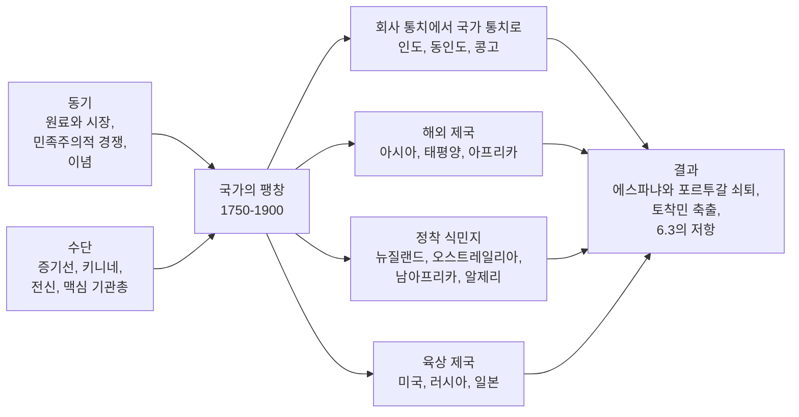
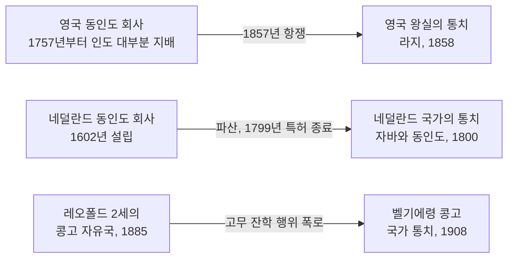
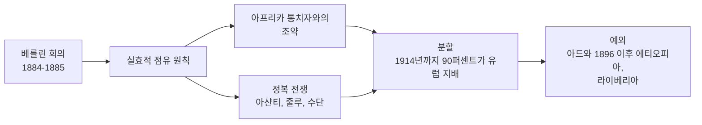
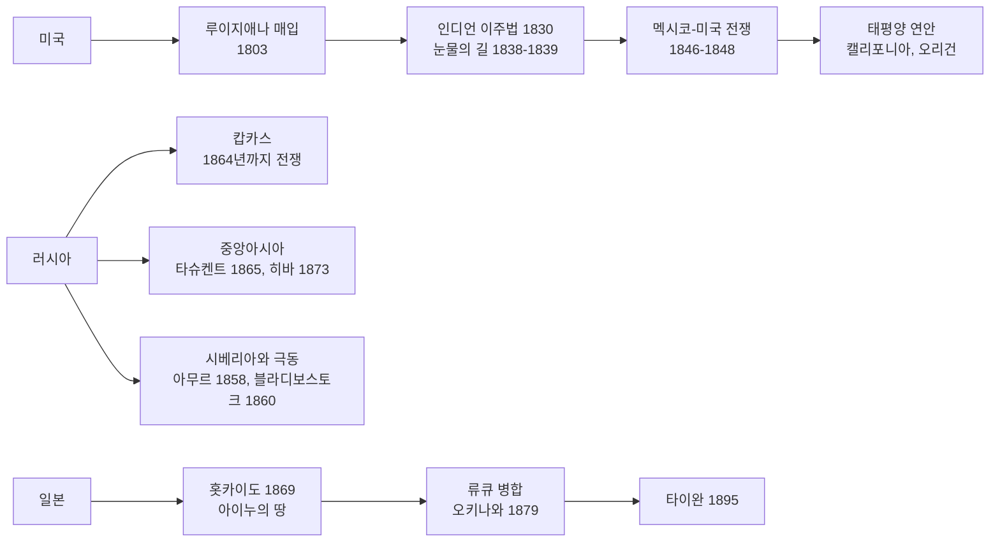
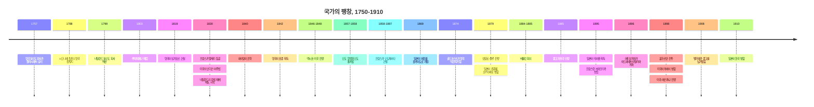
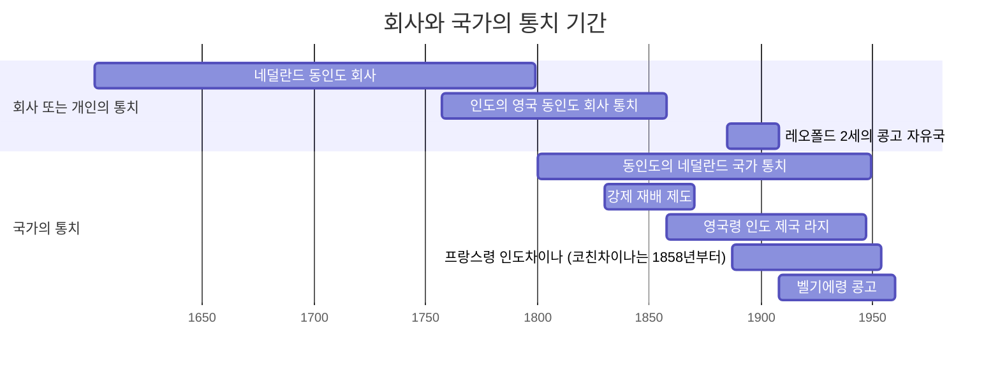
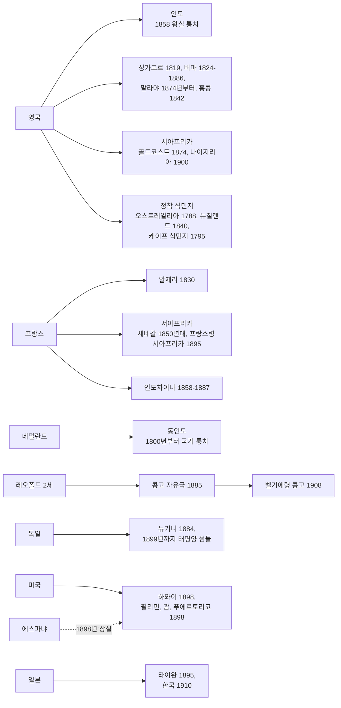

# AP 세계사: 모던 — 토픽 6.2 1750–1900년 국가의 팽창 (State Expansion from 1750 to 1900)

**Focus Question:** 1750–1900년에 여러 국가는 어떻게 권력과 영토를 넓혔으며, 그 과정은 어떤 점에서 비슷하고 달랐는가?

> 출처: CED 기준 · 교재 반영 전

**Unit 6: 산업화의 결과 (Consequences of Industrialization, c. 1750–1900)**

---

## 학습 목표 (Learning Objective)

| 코드 | 학습 목표 |
|---|---|
| 6.2 LO-B (GOV) | 1750년부터 1900년까지 세계 여러 지역에서 국가 권력이 이동한 과정을 비교한다. |

## 역사적 개념 (Historical Developments, CED)

| # | 역사적 개념 | 다루는 곳 |
|---|---|---|
| HD1 | KC-5.2.I.A: 이미 식민지를 가진 일부 국가는 그 식민지에 대한 통제를 강화했고, 어떤 경우에는 이전에 비국가 주체 (Non-state entities)가 보유하던 식민지를 직접 통치하게 되었다. | §2 |
| HD1 · 예시 | 예시 (Illustrative example, KC-5.2.I.A) — *비국가 주체에서 국가로의 식민지 통제 이전 (Non-state to state colonial control):* 레오폴드 2세의 콩고 사유지에서 벨기에 정부 통치로의 전환 (Shift from the private ownership of the Congo by King Leopold II to the Belgium government) | §2 (콩고 자유국에서 벨기에령 콩고로), §4 |
| HD1 · 예시 | 예시 (Illustrative example, KC-5.2.I.A) — *비국가 주체에서 국가로의 식민지 통제 이전 (Non-state to state colonial control):* 인도네시아와 동남아시아에서 네덜란드 동인도 회사의 통치에서 네덜란드 정부 통치로의 전환 (Shift from the Dutch East India Company to Dutch government control in Indonesia and Southeast Asia) | §2 (VOC에서 네덜란드 국가로, 강제 재배 제도) |
| HD2 | KC-5.2.I.B: 유럽 국가들뿐 아니라 미국과 일본도 아시아와 태평양 곳곳에서 영토를 획득했으며, 그사이 에스파냐와 포르투갈의 영향력은 쇠퇴했다. | §3, §6 (일본의 타이완) |
| HD3 | KC-5.2.I.C: 많은 유럽 국가는 전쟁과 외교를 모두 활용해 아프리카에서 제국을 확장했다. | §4 |
| HD3 · 예시 | 예시 (Illustrative example, KC-5.2.I.C) — *아프리카에서 제국을 확장한 유럽 국가 (European states that expanded empires in Africa):* 서아프리카의 영국 (Britain in West Africa) | §4 (골드코스트, 아샨티, 나이지리아) |
| HD3 · 예시 | 예시 (Illustrative example, KC-5.2.I.C) — *아프리카에서 제국을 확장한 유럽 국가 (European states that expanded empires in Africa):* 콩고의 벨기에 (Belgium in the Congo) | §2, §4 |
| HD3 · 예시 | 예시 (Illustrative example, KC-5.2.I.C) — *아프리카에서 제국을 확장한 유럽 국가 (European states that expanded empires in Africa):* 서아프리카의 프랑스 (French in West Africa) | §4 (세네갈, 서부 수단, 다호메이) |
| HD4 | KC-5.2.I.D: 유럽인들은 자국 제국의 일부 지역에 정착 식민지 (Settler colony)를 세웠다. | §5 |
| HD4 · 예시 | 예시 (Illustrative example, KC-5.2.I.D) — *제국 안에 세워진 정착 식민지 (Settler colonies established in empires):* 뉴질랜드 (New Zealand) | §5 (와이탕이 조약, 뉴질랜드 전쟁) |
| HD5 | KC-5.2.II.B: 미국, 러시아, 일본은 인접 지역을 정복하고 그곳에 정착함으로써 영토를 넓혔다. | §6 |

---

## 큰 그림 요약

> "무슨 일이 일어나든 우리에게는
> 맥심 기관총이 있고, 그들에게는 없다."
> — 힐레어 벨록 (Hilaire Belloc), 『현대의 여행자 (The Modern Traveller)』(1898). 가상의 인물이 읊는 풍자시

1750–1900년 사이 산업화된 국가들은 세계 곳곳으로 힘을 뻗었다. 이들은 공장에 필요한 **원료와 시장**을 원했고(6.5 참고), **민족주의적 경쟁 (Nationalist rivalry)** 속에서 서로 다투었으며, 문명화 사명 (Civilizing mission) 같은 이념으로 정복을 정당화했다(6.1 참고). 증기선, 키니네 (Quinine), 전신, 맥심 기관총 (Maxim gun)으로 **기술 격차 (Technology gap)**가 벌어지면서 정복은 더 싸고 빨라졌다. 국가 권력은 여러 방식으로 이동했다. **정부가 회사와 개인 통치자에게서 식민지를 넘겨받았다.** 인도에서는 영국 왕실이 동인도 회사를 대신했고(1858), 네덜란드 국가는 네덜란드 동인도 회사를 대신했으며(1799), 벨기에는 레오폴드 2세 (Leopold II)에게서 콩고를 넘겨받았다(1908). **유럽 국가와 미국, 일본은 아시아와 태평양에서 영토를 차지했고**, 에스파냐와 포르투갈은 쇠퇴했다. **유럽 국가들은 외교**(베를린 회의, 조약)**와 전쟁으로 아프리카를 나누어 가졌다.** 뉴질랜드, 오스트레일리아, 남아프리카, 알제리에는 **정착민**이 몰려들었다. 육지에서는 **미국, 러시아, 일본**이 인접 지역을 정복하고 그곳에 사람을 정착시켰다.

---

## §1. 배경: 1750년 이후 국가가 팽창한 이유와 방법

### 동기

| 동기 | 의미 | 관련 토픽 |
|---|---|---|
| **원료 (Raw materials)** | 공장에는 면화, 고무, 팜유, 구리, 주석이 필요했음 | 6.4, 6.5 |
| **시장 (Markets)** | 산업 생산자는 직물 같은 공산품을 사 줄 구매자를 원했음 | 6.5 |
| **민족주의적 경쟁 (Nationalist rivalry)** | 식민지는 국력의 상징이었음. 한 나라가 땅을 차지하지 않으면 경쟁국이 차지할 것이었음 | 6.1 |
| **전략 (Strategy)** | 항구, 석탄 보급 기지, 수에즈 운하 (Suez Canal, 1869) 같은 항로가 교역과 해군을 지켜 주었음 | 6.5 |
| **이념 (Ideology)** | 사회 진화론 (Social Darwinism), 문명화 사명, 기독교 선교가 다른 민족에 대한 지배를 정당화했음 | 6.1 |

### 기술 격차

| 기술 | 팽창에 끼친 영향 |
|---|---|
| **증기선과 하천 포함 (Steamships and river gunboats)** | 니제르강과 콩고강 같은 강을 따라 군대를 내륙으로 실어 날랐음. 아편 전쟁 (Opium War, 1839–1842)에서 영국 포함이 결정적 역할을 했음 |
| **키니네 (Quinine)** | 1800년대 중반부터 말라리아 예방약으로 쓰여 유럽인이 열대 아프리카에서 살아남을 수 있게 했음 |
| **전신 (Telegraph)** | 식민지 관리와 본국 정부를 몇 시간이나 며칠 만에 연결했음 |
| **철도 (Railroads)** | 군대와 물자를 내륙으로 옮겼음 (예: 인도, 이후 아프리카) |
| **후장식 소총과 맥심 기관총 (Breech-loading rifles and the Maxim gun)** | 맥심 기관총(1884년 발명)은 1분에 약 500발을 쏘았음. 적은 병력으로도 훨씬 큰 군대를 이길 수 있었음 |

- **핵심:** 1800년 무렵까지 유럽인은 아프리카와 아시아에서 주로 해안의 교역 거점만 가지고 있었다. 산업 기술 덕분에 이들은 **내륙**으로 들어가 **직접** 통치할 수 있게 되었다.

## §2. 회사 통치에서 국가 통치로 (KC-5.2.I.A)

근세 (Unit 4)에는 많은 식민지를 **합자 회사 (Joint-stock company)**나 다른 **비국가 주체**가 운영했다. 1800년대에는 정부가 직접 통제하게 되었다. 그 이유는 회사의 **파산**, **반란**, 그리고 **학대**에 대한 여론의 분노였다.

### 영국령 인도: 동인도 회사에서 라지로

- **플라시 전투 (Battle of Plassey, 1757)** 이후 **영국 동인도 회사 (British East India Company, EIC)**는 벵골의 지배 세력이 되었고, **1765년**에는 벵골의 세금을 거둘 권리(디와니, *diwani*)를 얻었다.
- 영국 의회는 규제법 (Regulating Act, 1773)과 인도법 (India Act, 1784)으로 점차 통제를 강화했지만, 정부와 **세포이 (Sepoy, 인도인 병사)**로 이루어진 사병 군대는 여전히 회사가 운영했다.
- **1857년 인도 항쟁 (1857 rebellion in India)**(세포이 항쟁이라고도 한다. 자세한 내용은 6.3)은 북인도 전역으로 퍼졌으나 영국군에게 진압되었다.
- **인도 통치법 (Government of India Act, 1858)**으로 회사 통치가 끝났다. 영국 왕실은 **총독 (Viceroy)**과 인도부 (India Office)를 통해 인도를 직접 다스렸다. 이 시기를 **영국령 인도 제국, 라지 (British Raj, 1858–1947)**라고 한다. 빅토리아 여왕은 1876년 **인도 여제 (Empress of India)**가 되었다.
- 왕실은 500개가 넘는 **번왕국 (Princely states)**은 여전히 그 나라 군주를 통해 간접적으로 다스렸고, 영국인 고문이 이들을 감독했다.

### 네덜란드령 동인도: VOC에서 네덜란드 국가로 (CED 예시)

- **1602년**에 세워진 **네덜란드 동인도 회사 (Dutch East India Company, VOC)**는 향신료 무역과 자바 일부를 장악하고 있었다.
- 1700년대 후반 VOC는 부패, 전쟁, 이윤 감소로 큰 빚을 졌다. 특허가 만료되면서 **1799년 해산되었고**, **1800년 네덜란드 정부가 그 영토를 넘겨받았다.**
- 영국의 짧은 자바 점령(1811–1816)과 막대한 비용이 든 **자바 전쟁 (Java War, 1825–1830)** 뒤, 네덜란드 국가는 **1830년 강제 재배 제도 (Cultivation System, *cultuurstelsel*)**를 도입했다. 자바의 마을들은 땅의 일부(흔히 약 5분의 1)나 노동력을 내어 정부를 위해 커피, 설탕, 인디고 같은 **수출 작물**을 길러야 했다.
- 이 제도는 네덜란드에 큰 이익을 주었지만 일부 지역에 기근을 불러왔다. 소설 『막스 하벨라르 (Max Havelaar)』(1860)가 이를 비판했고, 1870년 무렵 이후 점차 폐지되었다.
- 네덜란드 국가는 여러 섬으로 계속 팽창했다. 수마트라의 오랜 **아체 전쟁 (Aceh War, 1873–1904)**이 그 예이다.

### 콩고: 레오폴드 2세의 사유 식민지에서 벨기에 국가로 (CED 예시)

- 벨기에의 **레오폴드 2세 (Leopold II)**는 민간 단체와 탐험가 **헨리 모턴 스탠리 (Henry Morton Stanley)**를 이용해 콩고의 족장들과 조약을 맺었다(1879–1884).
- **베를린 회의 (Berlin Conference, 1884–1885)**에서 열강은 **콩고 자유국 (Congo Free State, 1885)**을 벨기에의 식민지가 아니라 레오폴드의 **개인 소유지**로 인정했다.
- 레오폴드의 대리인과 그의 군대인 **공안군 (Force Publique)**은 콩고 주민들에게 할당량을 정해 야생 **고무**를 모으게 했다. 인질 잡기, 매질, 손 자르기가 처벌로 쓰였다.
- 선교사, 언론인 **E. D. 모렐 (E. D. Morel)**, 영국 영사 **로저 케이스먼트 (Roger Casement)**(1904년 보고서)가 학대를 폭로했고, **콩고 개혁 협회 (Congo Reform Association)**가 국제적인 운동을 벌였다.
- 이런 압력 속에서 **1908년 벨기에 정부가 이 지역을 병합해** **벨기에령 콩고 (Belgian Congo)**가 되었다.

> ⚠️ 확인 필요: 콩고 자유국 시기 콩고인 사망자 수는 논쟁 중이다. 최대 1,000만 명(인구의 약 절반)이라는 수치가 자주 인용되지만 인구 조사가 없었고, 그 손실 가운데 폭력, 기근, 질병이 각각 얼마를 차지하는지에 대해 역사가들의 의견이 갈린다.

### 회사의 역할은 계속되었다

- 1900년까지 모든 곳에서 국가 통치로 완전히 바뀐 것은 아니다. 아프리카 일부에서는 여전히 특허 회사가 팽창을 이끌었다. **왕립 니제르 회사 (Royal Niger Company)**(1886년 특허, 1900년 영국 정부가 인수)와 세실 로즈 (Cecil Rhodes)의 **영국 남아프리카 회사 (British South Africa Company)**(1889년 특허)가 그 예이다. 많은 경우 회사가 먼저 터를 닦고 나중에 국가가 넘겨받았다.

## §3. 아시아와 태평양 (KC-5.2.I.B)

| 국가 | 획득한 영토 | 방법 |
|---|---|---|
| **영국** | 인도(§2 참고); 동인도 회사의 스탬퍼드 래플스 (Stamford Raffles)가 세운 **싱가포르 (Singapore, 1819)**; 해협 식민지 (Straits Settlements, 1826); **버마 (Burma)**(세 차례 전쟁, 1824–1886); **말라야 (Malaya)**(1874년부터 술탄국에 대한 보호령); **홍콩 (Hong Kong, 1842)** | 회사의 교역 거점, 전쟁, 현지 통치자와의 조약. 홍콩은 아편 전쟁 뒤 난징 조약 (Treaty of Nanjing)으로 중국이 넘겨주었음 |
| **프랑스** | **인도차이나 (Indochina)**: 1858년부터 코친차이나 (Cochinchina), 캄보디아(1863), 안남 (Annam)과 통킹 (Tonkin)(1883–1884). **1887년** 인도차이나 연방 (Indochinese Union) 성립. 1893년 라오스 추가 | 베트남, 중국과의 해군 공격과 전쟁, 이후 보호령 |
| **네덜란드** | **인도네시아 (Indonesia, 동인도)**. 자바에서 바깥 섬들로 확장 | VOC 이후 국가 통치. 아체 전쟁 같은 전쟁 |
| **독일** | 독일령 뉴기니 (German New Guinea, 1884), 마셜 제도 (1885), 캐롤라인 제도와 마리아나 제도(1899년 에스파냐에게서 매입), 사모아 (1899) | 열강 사이의 외교를 통한 영유권 주장 |
| **미국** | **하와이 (Hawaii)**(1893년 미국인 농장주들이 릴리우오칼라니 여왕 (Queen Liliuokalani)을 몰아낸 뒤 1898년 병합); **필리핀, 괌, 푸에르토리코**(1898년 에스파냐에게서) | 정착 농장주의 압력과 **미국-에스파냐 전쟁 (Spanish–American War, 1898)** |
| **일본** | 청일 전쟁 (First Sino–Japanese War) 뒤 **타이완 (Taiwan, 1895)**; 이 시기 직후인 **1910년** 병합된 한국 | 중국과의 전쟁, 이후 직접 식민 통치 |

- 시암 (Siam, 타이)은 독립을 유지했다. 영국령 버마와 프랑스령 인도차이나 사이의 **완충국 (Buffer)**이었고, 국왕들이 국가를 근대화하고 두 열강과 조약을 맺었기 때문이다.
- 미국은 새 식민지를 확보하려고 필리핀 독립군과 **필리핀-미국 전쟁 (Philippine–American War, 1899–1902)**을 벌였다.

### 에스파냐와 포르투갈의 쇠퇴

| | 에스파냐 | 포르투갈 |
|---|---|---|
| 잃은 것 | **라틴 아메리카 독립 전쟁**(1810–1820년대, Unit 5)으로 아메리카 제국 대부분; **1898년 쿠바, 푸에르토리코, 필리핀, 괌** | **1822년** **브라질** 독립 (Unit 5) |
| 남은 것 | 아프리카의 작은 영토 몇 곳 (예: 에스파냐령 기니, 에스파냐령 사하라) | 앙골라, 모잠비크, 기니비사우, 고아, 마카오, 동티모르 |
| 쇠퇴 이유 | 약한 산업, 부채, 정치 불안, 산업 강국(미국)에 당한 패배 | 약한 산업. **1890년** 영국의 최후통첩으로 앙골라와 모잠비크를 잇겠다는 계획을 포기함 |

- **핵심:** 근세의 해양 제국(에스파냐와 포르투갈)은 영국, 프랑스, 독일, 미국, 일본 같은 **산업** 강국에게 밀려났다.

## §4. 아프리카: 전쟁과 외교 (KC-5.2.I.C)

### 아프리카 분할

- **1870년**에 유럽인이 지배한 땅은 아프리카의 약 10퍼센트뿐이었고, 대부분 해안 지역이었다(여기에 프랑스령 알제리와 남부의 영국·보어인 지역이 더해졌다).
- **1914년**에는 약 90퍼센트가 유럽의 지배를 받았다. 독립국은 **에티오피아**와 **라이베리아**뿐이었다.
- 주로 1880년 이후 일어난 이 빠른 분할을 **아프리카 분할 (Scramble for Africa)**이라고 한다.

### 외교

| 수단 | 사례 |
|---|---|
| **국제 회의** | 독일 총리 **오토 폰 비스마르크 (Otto von Bismarck)**가 소집한 **베를린 회의 (Berlin Conference, 1884–1885)**가 아프리카 영토를 주장하는 규칙을 정함. 아프리카인은 한 명도 초대받지 못함 |
| **"실효적 점유 (Effective occupation)"** | 한 나라가 어떤 지역을 실제로 점유하고(관리, 군대, 조약) 다른 열강에 알려야만 그 지역을 주장할 수 있었음. 이 때문에 각국이 서둘러 내륙으로 병력을 보냄 |
| **아프리카 통치자와의 조약** | 스탠리(레오폴드를 위해), 피에르 사보르냥 드 브라자 (Pierre Savorgnan de Brazza, 프랑스를 위해), 왕립 니제르 회사 같은 대리인이 조약을 맺음. 아프리카 통치자들은 이를 주권 이양이 아니라 교역이나 우호 협정으로 이해한 경우가 많았음 |
| **유럽 국가 간 협정** | 양국 조약으로 지도 위에 국경을 그었고, 민족과 정치 경계를 무시하는 경우가 많았음. 영국과 프랑스는 나일강의 **파쇼다 사건 (Fashoda Incident, 1898)**을 전쟁 대신 협상으로 해결함 |

### 전쟁

| 전쟁 | 교전 세력 | 결과 |
|---|---|---|
| **앵글로-아샨티 전쟁 (Anglo-Asante wars, 1824–1900)** | 영국 대 **아샨티 제국 (Asante Empire)**(골드코스트) | 영국은 1873–1874년 전쟁 뒤 **1874년** **골드코스트 (Gold Coast)**를 직할 식민지로 만들었고, 황금 의자 전쟁 (War of the Golden Stool) 뒤 1901년 아샨티를 병합함 (6.3 참고) |
| **프랑스의 세네갈·서부 수단 정복 (1850년대–1890년대)** | 프랑스 대 투쿨로르 제국 (Tukulor Empire), 사모리 투레 (Samory Touré)의 국가(6.3 참고) 등 | 총독 **루이 페데르브 (Louis Faidherbe)**가 1850–1860년대 세네갈에서 내륙으로 확장했고, 이후 프랑스군이 니제르강을 따라 진격함. 1892–1894년 다호메이 (Dahomey)를 정복했고, **1895년** **프랑스령 서아프리카 (French West Africa)**를 만듦 |
| **앵글로-줄루 전쟁 (Anglo-Zulu War, 1879)** | 영국 대 **줄루 왕국 (Zulu Kingdom)** | 줄루가 **이산들와나 (Isandlwana)**에서 이겼지만, 같은 해 영국이 **울룬디 (Ulundi)**에서 승리해 왕국을 해체함 |
| **옴두르만 전투 (Battle of Omdurman, 1898)** | 영국·이집트 대 **수단**의 마흐디 국가 (Mahdist state) | 기관총과 대포로 수단 병사 1만 명 이상이 죽었고, 영국 측 전사자는 50명이 안 됨 |
| **아드와 전투 (Battle of Adwa, 1896)** | 이탈리아 대 **메넬리크 2세 (Menelik II)**의 **에티오피아** | **에티오피아 승리.** 메넬리크가 근대식 소총과 대포를 사들였기 때문에 에티오피아는 독립을 지킴 (예외 사례, 6.3 참고) |

### CED 예시

- **서아프리카의 영국:** 영국은 시에라리온(1808년 직할 식민지)을 가지고 있었고, 라고스(1861)를 차지했으며, **골드코스트**를 식민지로 만들고(1874), **왕립 니제르 회사**를 이용해 니제르강 하류를 차지했다. **1900년** 영국 정부가 이를 넘겨받아 보호령을 세웠고, 이것이 **나이지리아**(1914년 통합)가 되었다. 총독 **프레더릭 루가드 (Frederick Lugard)**는 북나이지리아를 기존의 에미르 (Emir)를 통해 다스렸다. 이런 방식을 **간접 통치 (Indirect rule)**라고 한다.
- **서아프리카의 프랑스:** 프랑스는 **세네갈**에서 세네갈강과 니제르강을 따라 확장해 **서부 수단 (Western Sudan)**과 **다호메이**를 정복했고, **1895년** 식민지들을 묶어 다카르에서 다스리는 **프랑스령 서아프리카** 연방을 만들었다. 프랑스는 대체로 프랑스 관리가 다스리는 **직접 통치 (Direct rule)**를 했다. 북아프리카에서는 **알제리**(1830년부터)를 차지했고 **튀니지**를 보호령으로 삼았다(1881).
- **콩고의 벨기에:** 레오폴드 2세는 조약과 베를린 회의를 통해 콩고를 얻어 콩고 자유국으로 다스렸고, 1908년 벨기에 국가가 이를 넘겨받았다(§2 참고).

## §5. 정착 식민지 (KC-5.2.I.D)

**정착 식민지 (Settler colony)**는 많은 유럽인이 영구히 이주해 땅을 차지하고, 토착민을 밀어내거나 쫓아내며 사회를 세운 식민지이다. 열대 아프리카와 아시아의 식민지 대부분에는 유럽인 정착민이 적었다. 정착 식민지는 유럽인이 농사를 짓고 가축을 기를 수 있는 **온대** 지역에서 커졌다.

| 식민지 | 정착 | 주요 사건 | 토착민에게 끼친 영향 |
|---|---|---|---|
| **뉴질랜드 (New Zealand)** (CED 예시) | 1840년대부터 영국인 정착민 | 영국 왕실과 마오리 (Māori) 족장들 사이의 **와이탕이 조약 (Treaty of Waitangi, 1840)**; **뉴질랜드 전쟁 (New Zealand Wars, 1845–1872)** | 마오리는 매매, 몰수, 전쟁으로 많은 땅을 잃었고, 마오리 인구가 크게 줄었음 |
| **오스트레일리아 (Australia)** | **1788년부터 시드니**의 영국 유형 식민지 (Penal colony); 자유 이민과 1850년대 골드러시 | 식민지들이 1901년 오스트레일리아 연방 (Commonwealth of Australia)으로 통합됨 | 애버리지니 (Aboriginal peoples)는 *테라 눌리우스 (terra nullius, "주인 없는 땅")* 논리로 땅을 잃었고, 질병과 변경 지대의 폭력으로 많은 사람이 죽었음 |
| **남아프리카 (South Africa)** | 1652년부터 케이프의 네덜란드인; 1795년 **영국이 케이프 식민지 (Cape Colony)를 차지**했고 1814년 공식 영토가 됨 | 보어인 (Boers, 아프리카너 Afrikaners)이 영국 지배를 피해 **그레이트 트렉 (Great Trek, 1830–1840년대)**을 떠나 트란스발 (Transvaal)과 오렌지 자유국 (Orange Free State)을 세움; 다이아몬드(1867)와 금(1886)이 더 많은 영국인 정착민을 끌어들임; 남아프리카 전쟁 (South African War, 1899–1902) | 코사족 (Xhosa), 줄루족 등 아프리카 민족이 땅을 잃고 정착민의 농장과 광산의 노동력이 되었음 |
| **프랑스령 알제리 (French Algeria)** | **1830년** 프랑스의 침공; 유럽인 정착민 (*콜롱 colons*) | **압델카데르 (Abd al-Qadir)**가 1847년까지 저항을 이끎; 1848년 알제리가 프랑스의 일부로 선포됨 | 알제리인은 가장 좋은 농지를 정착민에게 빼앗겼고, 유럽인보다 적은 권리를 가졌음 |

### 뉴질랜드 자세히 보기 (CED 예시)

- **1840년** 500명이 넘는 마오리 족장이 영국 왕실과 **와이탕이 조약**에 서명했다. 영어본은 영국에게 **주권 (Sovereignty)**을 넘긴다고 했지만, 마오리어본은 **통치 (Governance)**에 가까운 단어를 썼고 족장들이 자기 땅에 대한 권한을 계속 가진다고 약속했다.
- 정착민이 몰려와 땅을 요구하면서 토지 매매를 둘러싼 분쟁이 **뉴질랜드 전쟁 (1845–1872)**으로 이어졌다. 식민 정부는 전쟁 뒤 마오리의 넓은 땅을 **몰수**했다.
- 1900년에는 정착민이 마오리보다 훨씬 많아졌고, 좋은 농지 대부분이 정착민 손에 있었다.

- **핵심:** 정착 식민지는 **가장 강한 형태의 국가 팽창**을 보여 준다. 교역이나 세금만이 아니라 땅 자체의 주인이 바뀌었기 때문이다.

## §6. 육상 팽창: 미국, 러시아, 일본 (KC-5.2.II.B)

이 세 나라는 **육지**로 이어진 인접 지역을 정복한 뒤 자국민을 **정착**시키는 방식으로 팽창했다.

| 국가 | 주요 팽창 | 방법 | 현지 주민에게 끼친 영향 |
|---|---|---|---|
| **미국** | 프랑스로부터의 **루이지애나 매입 (Louisiana Purchase, 1803)**; 텍사스(1845); 오리건(1846); **멕시코-미국 전쟁 (Mexican–American War, 1846–1848)** 뒤 과달루페 이달고 조약 (Treaty of Guadalupe Hidalgo)으로 멕시코가 영토의 약 절반을 넘겨줌; 러시아로부터 알래스카 매입(1867) | 매입, 전쟁, 앤드루 잭슨 (Andrew Jackson) 대통령이 서명한 **인디언 이주법 (Indian Removal Act, 1830)**, 홈스테드법 (Homestead Act, 1862), 철도, 그리고 **명백한 운명 (Manifest Destiny)**(미국인이 대륙 전체로 퍼져 나갈 운명이라는 생각으로, 1845년에 나온 표현)에 대한 믿음 | **눈물의 길 (Trail of Tears, 1838–1839)**로 체로키 (Cherokee)와 다른 원주민 부족이 서쪽으로 쫓겨났고 수천 명이 죽었음. 평원 원주민은 1890년 무렵 끝난 전쟁들 뒤 보호구역 (Reservation)에 갇혔음 |
| **러시아** | **캅카스 (Caucasus)**(1801년 조지아; 1864년까지 이맘 샤밀 (Imam Shamil), 체르케스인 (Circassians)과의 전쟁); **중앙아시아**(타슈켄트 1865, 부하라 1868, 히바 1873, 코칸트 1876); **시베리아와 극동**(1858년과 1860년 중국에게서 아무르 지역 획득, 1860년 블라디보스토크 건설) | 군사 정복, 칸국에 대한 보호령, 코사크와 농민의 정착, 시베리아 횡단 철도 (Trans-Siberian Railway, 1891년 착공) | 많은 체르케스인이 죽거나 오스만 제국으로 추방되었음. 중앙아시아 땅은 러시아 공장을 위한 **면화** 재배지로 바뀌었음. 영국과의 경쟁은 **그레이트 게임 (Great Game)**이라고 불림 |
| **일본** | **홋카이도 (Hokkaido)**(1869년 에조 (Ezo)에서 개칭); 쿠릴 열도(1875); **류큐 왕국 (Ryukyu Kingdom)**을 병합해 **1879년 오키나와현 (Okinawa Prefecture)** 설치; **타이완 (1895)** | 개척 관청, 정착민과 옛 사무라이, 동화 정책, 중국과의 전쟁 | **아이누 (Ainu)**는 사냥터와 어장을 잃고 동화를 강요받았음. 류큐 국왕은 폐위되었음 |

- **핵심:** 육상 팽창은 흔히 **팽창하는 국가 안에 정착민 사회**를 만들었다. 유럽인이 바다 건너 정착 식민지에서 한 일을 육지에서 한 셈이다.
- 러시아는 영토를 내놓기도 했다. 1867년 **알래스카**를 미국에 팔았다.

---

## 연표

---

## 지도: 누가 어디를 차지했나

---

## 비교표: 해외 팽창과 육상 팽창

| 항목 | 해외(해양) 팽창 | 육상 팽창 |
|---|---|---|
| 주요 국가 | 영국, 프랑스, 네덜란드, 벨기에, 독일, 미국(1898년 이후), 일본(타이완) | 미국, 러시아, 일본(홋카이도, 류큐) |
| 지역 | 아프리카, 남아시아와 동남아시아, 태평양 | 본국과 맞닿은 지역: 미국 서부, 캅카스, 중앙아시아, 시베리아, 홋카이도 |
| 방법 | 해군, 증기선, 조약, 식민지 군대, 특허 회사 | 육군, 매입, 조약, 철도, 농민과 정착민의 이주 |
| 통치 방식 | 직접 통치, 간접 통치, 회사 통치를 받는 별도의 식민지 | 대개 주나 준주로 국가에 흡수됨 |
| 정착민 | 정착 식민지를 빼면 대체로 적음 | 많음. 정착 자체가 목표였음 |
| 토착민의 처지 | 지배받고, 세금을 내고, 수출 작물 재배를 강요받음. 정착 식민지에서는 쫓겨남 | 쫓겨나거나, 강제 이주되거나, 동화됨 (아메리카 원주민, 체르케스인, 아이누) |
| 공통점 | 둘 다 산업 기술과 군사력을 썼고, 토착민의 땅과 노동력을 빼앗았음 | (동일) |

## 비교표: 제국 통치의 형태

| 형태 | 작동 방식 | 일상적인 통치 주체 | 사례 |
|---|---|---|---|
| **회사 통치 (Company rule)** | 특허 회사나 민간 회사가 정치권력을 쥐고 이윤을 위해 식민지를 운영함 | 회사 관리와 회사 군대 | 인도의 영국 동인도 회사(1858년까지); VOC(1799년까지); 레오폴드 2세의 콩고 자유국(1885–1908); 왕립 니제르 회사(1900년까지) |
| **직접 통치 (Direct rule)** | 식민 국가가 현지 통치자를 자국 관리와 법으로 대체함 | 유럽인 관리 | 프랑스령 서아프리카; 프랑스령 인도차이나; 네덜란드령 동인도; 벨기에령 콩고; 1858년 이후 영국령 인도(번왕국 제외) |
| **간접 통치 (Indirect rule)** | 식민 국가가 현지 통치자를 남겨 두되 고문을 통해 통제함 | 유럽인의 감독을 받는 현지 통치자(에미르, 번왕, 술탄) | 북나이지리아의 루가드; 인도의 번왕국; 말레이 술탄국 |
| **정착 식민지 (Settler colony)** | 많은 유럽인이 영구히 정착해 땅을 차지함 | 정착민 정부. 나중에 자치를 얻는 경우가 많음 | 뉴질랜드; 오스트레일리아; 케이프 식민지; 프랑스령 알제리 |

## 비교표: 아프리카와 아시아의 국가 팽창

| 항목 | 아프리카 | 아시아와 태평양 |
|---|---|---|
| 시기 | 주로 1880년 이후(아프리카 분할), 매우 빠름 | 1700년대 후반(인도)부터 1890년대까지 점진적 |
| 이전의 유럽 세력 | 주로 해안의 요새와 교역 거점 | 오래된 회사 통치 (EIC, VOC) |
| 주요 국가 | 영국, 프랑스, 벨기에, 독일, 포르투갈, 이탈리아 | 영국, 프랑스, 네덜란드, 독일, 미국, 일본 |
| 방법 | 베를린 회의, 조약, 정복 전쟁 | 전쟁, 불평등 조약, 보호령, 회사 영토의 국가 이전 |
| 비유럽 식민 세력 | 없음 | 미국과 일본 |
| 독립을 지킨 나라 | 에티오피아와 라이베리아 | 시암, 일본, 중국 (중국은 영토와 주권 일부를 잃음) |

---

## Key Terms (핵심 용어)

| 주제 | 용어 | 정의 |
|---|---|---|
| 정치 | 국가의 팽창 (State expansion) | 정복, 조약, 매입, 정착을 통해 국가가 새로운 영토와 주민에게 권력을 넓히는 것 |
| 정치 | 비국가 주체 (Non-state entity) | 정부가 아니면서 식민지를 지배하는 회사나 개인 통치자 (예: EIC, VOC, 레오폴드 2세) |
| 정치 | 영국 동인도 회사 (British East India Company, EIC) | 1757년부터 1858년까지 인도 대부분을 지배한 영국의 합자 회사 |
| 정치 | 영국령 인도 제국, 라지 (British Raj) | 인도 통치법 이후 영국 왕실이 인도를 직접 다스린 체제 (1858–1947) |
| 정치 | 네덜란드 동인도 회사 (Dutch East India Company, VOC) | 영토가 네덜란드 국가로 넘어간 네덜란드의 합자 회사 (1602–1799) |
| 경제 | 강제 재배 제도 (Cultivation System) | 자바의 마을들에게 정부를 위해 수출 작물을 기르도록 강요한 네덜란드의 정책 (1830년부터) |
| 정치 | 콩고 자유국 (Congo Free State) | 강제 고무 채집으로 악명 높았던 레오폴드 2세의 개인 식민지 (1885–1908) |
| 정치 | 벨기에령 콩고 (Belgian Congo) | 1908년 이후 벨기에 국가의 통치를 받은 콩고 |
| 정치 | 베를린 회의 (Berlin Conference) | 아프리카 영토를 주장하는 규칙을 정한 유럽 열강의 회의 (1884–1885) |
| 정치 | 실효적 점유 (Effective occupation) | 영유권을 주장하려면 현지를 실제로 통제해야 한다는 베를린 회의의 원칙 |
| 정치 | 아프리카 분할 (Scramble for Africa) | 주로 1880–1914년에 일어난 유럽의 빠른 아프리카 분할 |
| 정치 | 직접 통치 (Direct rule) | 현지 통치자를 대신한 유럽인 관리를 통한 식민 통치 |
| 정치 | 간접 통치 (Indirect rule) | 유럽인의 감독 아래 기존 현지 통치자를 통한 식민 통치 |
| 정치 | 보호령 (Protectorate) | 현지 통치자는 남아 있지만 외교와 주요 결정을 외부 강국이 통제하는 지역 |
| 사회 | 정착 식민지 (Settler colony) | 많은 유럽인이 영구히 정착해 토착민의 땅을 차지한 식민지 |
| 사회 | 와이탕이 조약 (Treaty of Waitangi) | 1840년 뉴질랜드에서 영국 왕실과 마오리 족장들이 맺은 조약 |
| 사회 | 그레이트 트렉 (Great Trek) | 1830–1840년대 보어인이 영국령 케이프 식민지를 떠나 내륙으로 이주한 일 |
| 정치 | 명백한 운명 (Manifest Destiny) | 미국이 북아메리카 전체로 팽창할 운명이라는 믿음 |
| 사회 | 인디언 이주법 (Indian Removal Act) | 원주민 부족을 미시시피강 서쪽으로 쫓아낸 1830년 미국 법률. 눈물의 길로 이어짐 |
| 정치 | 그레이트 게임 (Great Game) | 19세기 중앙아시아에서 벌어진 러시아와 영국의 경쟁 |
| 사회 | 아이누 (Ainu) | 홋카이도의 토착민. 일본이 섬을 식민화한 뒤 동화를 강요받음 |
| 기술 | 맥심 기관총 (Maxim gun) | 식민지 전쟁에서 유럽인에게 큰 우위를 준 초기 기관총 (1884) |
| 기술 | 키니네 (Quinine) | 기나나무 껍질에서 얻은 약으로, 유럽인을 말라리아로부터 보호함 |
