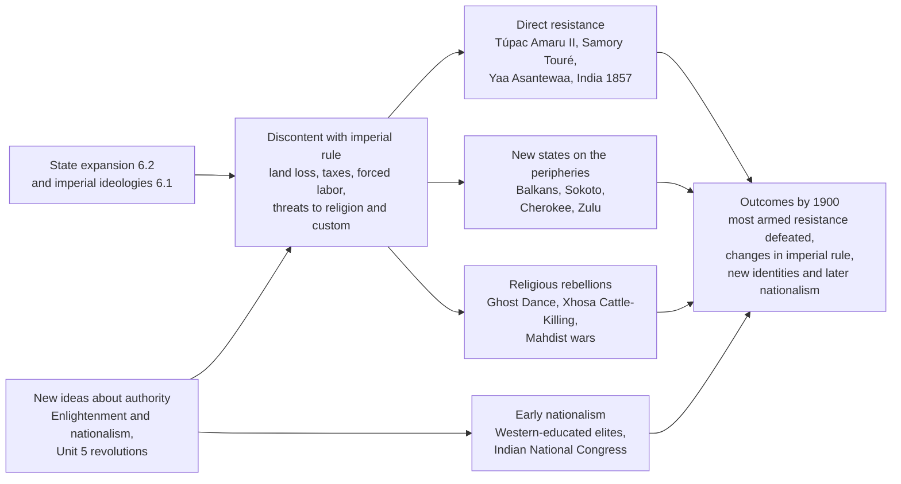
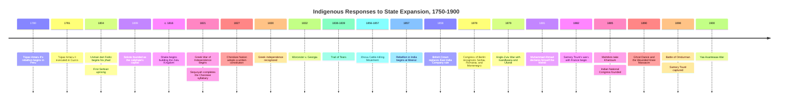
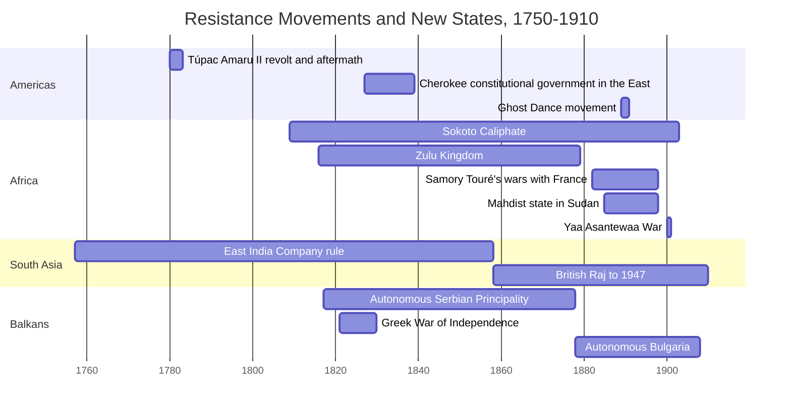
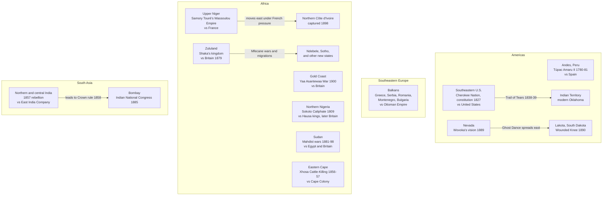
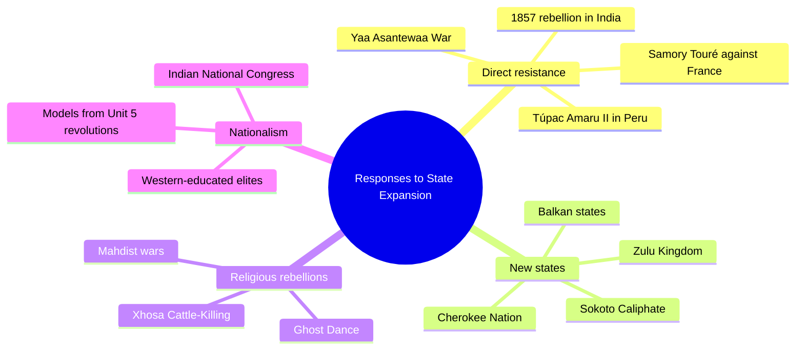

# AP World History: Modern — Topic 6.3 Indigenous Responses to State Expansion from 1750 to 1900

**Focus Question:** How and why did indigenous and colonized peoples resist state expansion from 1750 to 1900, and what forms did that resistance take?

> Source: Based on the College Board CED · Textbook not yet incorporated

**Unit 6: Consequences of Industrialization (c. 1750–1900)**

---

## Learning Objective

| Code | Learning Objective |
|---|---|
| 6.3 LO-C (GOV) | Explain how and why internal and external factors have influenced the process of state building from 1750 to 1900. |

## Historical Developments (CED)

| # | Historical Development | Covered in |
|---|---|---|
| HD1 | KC-5.3.III.D: Increasing questions about political authority and growing nationalism contributed to anticolonial movements. | §1, §5, §9, Comparison Tables |
| HD2 | KC-5.2.II.C: Anti-imperial resistance took various forms, including direct resistance within empires and the creation of new states on the peripheries. | §2, §3, §4, §5, §6, §7, Comparison Tables |
| HD2 · Ex. | Illustrative example (Direct resistance): Túpac Amaru II’s rebellion in Peru | §2 |
| HD2 · Ex. | Illustrative example (Direct resistance): Samory Touré’s military battles in West Africa | §3 |
| HD2 · Ex. | Illustrative example (Direct resistance): Yaa Asantewaa War in West Africa | §3 |
| HD2 · Ex. | Illustrative example (Direct resistance): 1857 rebellion in India | §4, §10 |
| HD2 · Ex. | Illustrative example (New states): Establishment of independent states in the Balkans | §5 |
| HD2 · Ex. | Illustrative example (New states): Sokoto Caliphate in modern-day Nigeria | §6 |
| HD2 · Ex. | Illustrative example (New states): Cherokee Nation | §7 |
| HD2 · Ex. | Illustrative example (New states): Zulu Kingdom | §6 |
| HD3 | KC-5.3.III.E: Increasing discontent with imperial rule led to rebellions, some of which were influenced by religious ideas. | §1, §8, §10 |
| HD3 · Ex. | Illustrative example (Rebellions): Ghost Dance in the U.S. | §8 |
| HD3 · Ex. | Illustrative example (Rebellions): Xhosa Cattle-Killing Movement in Southern Africa | §8 |
| HD3 · Ex. | Illustrative example (Rebellions): Mahdist wars in Sudan | §8 |

---

## The Big Picture

Between 1750 and 1900, industrial states and older empires pushed into new lands (6.2), and they justified it with ideas such as the civilizing mission and Social Darwinism (6.1). The peoples on the receiving end did not simply give in. Some fought **directly** inside the empire: **Túpac Amaru II** in Peru, **Samory Touré** and the Asante under **Yaa Asantewaa** in West Africa, and the soldiers and princes of the **1857 rebellion** in India. Others **built new states on the edges** of empires: the **Balkan states** that broke away from the Ottomans, the **Sokoto Caliphate**, the **Cherokee Nation**, and the **Zulu Kingdom**. Still others turned to **religious prophecy** when military options seemed hopeless: the **Ghost Dance**, the **Xhosa Cattle-Killing Movement**, and the **Mahdist** movement in Sudan. At the same time, Enlightenment ideas and **nationalism** (Unit 5) gave **Western-educated elites** a new language for questioning imperial authority, as in the **Indian National Congress** (1885). By 1900 most armed resistance had been defeated, but it forced changes in imperial rule and left memories and identities that later independence movements used.

---

## §1. Context: Expansion, Grievances, and New Ideas About Authority

- **State expansion (6.2):** Britain took control of India and large parts of Africa; France built an empire in West Africa; the United States pushed west across North America; the Ottoman Empire lost ground in Europe. The **Berlin Conference (1884–1885)** sped up the "Scramble for Africa."
- **Imperial ideologies (6.1):** the **civilizing mission**, **Social Darwinism**, and the drive to **convert** indigenous peoples told colonized people that their religions, laws, and customs were inferior.
- **Internal and external factors:** the LO asks how both shaped state building. External factors include imperial armies, settlers, and new weapons such as the Maxim gun. Internal factors include local leaders, religious reformers, and divisions inside colonized societies.

| Grievance | Examples |
|---|---|
| **Loss of land** | Cherokee removal from the Southeast; Xhosa land lost to the Cape Colony; Lakota confined to reservations |
| **Taxes and forced labor** | The *mita* labor draft and forced sale of goods in Peru; heavy taxes under Egyptian rule in Sudan |
| **Threats to religion and custom** | Greased cartridges in India; missionary pressure; U.S. bans on the Ghost Dance |
| **Loss of sovereignty** | Britain's exile of the Asante king Prempeh I and demand for the Golden Stool; annexation of Indian states |

- **New ideas about authority (KC-5.3.III.D):** Enlightenment ideas of natural rights and government by consent, and the examples of the **American (1776)**, **French (1789)**, **Haitian (1791–1804)**, and **Latin American (1810s–1820s)** revolutions, made colonized people ask why they should be ruled without a voice.
- **Nationalism** (Unit 5) taught that a people sharing a language, religion, or history should govern itself. This idea powered the Balkan independence movements and, later, Indian nationalism.

> **Key idea:** Resistance drew on **two sources**. Some movements looked **back** to older rulers, faiths, and ways of life. Others looked **forward** to new ideas such as constitutions and nationalism. Many movements mixed both.

## §2. Direct Resistance in the Americas: Túpac Amaru II's Rebellion (1780–1781)

- **Who:** José Gabriel Condorcanqui, a wealthy mestizo **kuraka** (local indigenous leader) in the Andes. He claimed descent from the last Inca ruler, Túpac Amaru (executed by the Spanish in 1572), and took the name **Túpac Amaru II**.
- **Grievances:** Spain's **Bourbon Reforms** raised sales taxes and tightened control. Indigenous people also suffered from the ***mita*** (forced labor in mines such as Potosí) and the ***reparto de mercancías***, which forced them to buy goods from Spanish officials (*corregidores*) at high prices.
- **Events:**
  - In **November 1780**, Túpac Amaru II seized and executed the local *corregidor*, Antonio de Arriaga.
  - He raised an army of tens of thousands, mostly indigenous peasants, and defeated a Spanish force at **Sangarará**.
  - His attack on **Cuzco** failed in early 1781. He was captured and **executed in Cuzco in May 1781**, along with his wife and co-leader **Micaela Bastidas**.
  - Relatives and the Aymara leader **Túpac Katari** (siege of La Paz, 1781) kept fighting until about **1782–1783**.
- **Results:**
  - Spain crushed the revolt brutally and banned Inca dress, titles, and symbols.
  - It ended the forced sale of goods and reorganized local government.
  - Creole (American-born Spanish) elites were frightened by a mass indigenous uprising. This made many of them cautious about independence, and Peru became one of the last Spanish colonies to break away (1821–1824).

> ⚠️ Needs verification: Historians debate Túpac Amaru II's goals. Early on he claimed loyalty to the Spanish king and attacked only "bad government," but some later statements suggest he aimed to end Spanish rule. Death-toll estimates for the whole uprising also vary widely (often given as about 100,000).

## §3. Direct Resistance in West Africa: Samory Touré and the Yaa Asantewaa War

### Samory Touré (c. 1830–1900)

- A **Mandinka (Malinke) Muslim** leader who built the **Wassoulou Empire** in the upper Niger region (parts of modern Guinea, Mali, and Côte d'Ivoire) in the 1860s–1870s. He took the title ***almami*** (Muslim leader).
- He built a **professional army**, bought **repeating rifles** through British-ruled **Freetown** (Sierra Leone), and had blacksmiths repair and copy firearms.
- He fought the **French** from **1882 to 1898**, signed treaties when needed, used **scorched-earth** tactics, and moved his whole state **eastward** to escape French columns.
- The French captured him in **1898** and exiled him to **Gabon**, where he died in 1900.
- **Significance:** one of the longest armed resistances to French rule in West Africa; later a hero of nationalism in Guinea.

### The Yaa Asantewaa War (War of the Golden Stool, 1900)

- The **Asante (Ashanti) Kingdom** in the Gold Coast (modern Ghana) fought several wars with Britain in the 1800s.
- In **1896** the British exiled the Asante king (**Asantehene**) **Prempeh I**.
- In **1900** the British governor, **Frederic Hodgson**, demanded the **Golden Stool**, the sacred symbol of the Asante nation's soul, so that he could sit on it.
- **Yaa Asantewaa**, the **queen mother of Ejisu**, called on Asante men to fight and led the uprising. Asante forces **besieged the British fort at Kumasi**.
- British reinforcements defeated the Asante. Yaa Asantewaa was exiled to the **Seychelles** (she died there in 1921), and Britain **annexed Asante** to the Gold Coast Colony (1902).
- **Significance:** the British never captured the Golden Stool, so the Asante kept their most important symbol. The war is remembered as a symbol of resistance and of women's leadership.

## §4. The 1857 Rebellion in India

- **Background:** the British **East India Company (EIC)** had ruled large parts of India since its victory at **Plassey (1757)**. Most of its soldiers were Indian **sepoys**.

| Cause | Details |
|---|---|
| **Greased cartridges** | The new Enfield rifle used cartridges said to be greased with **cow and pig fat**. Soldiers had to bite them open, which offended both **Hindus** (cows are sacred) and **Muslims** (pork is forbidden) |
| **Annexations** | Under the **Doctrine of Lapse**, the EIC took over Indian states whose rulers died without a natural male heir; it also annexed **Awadh** in 1856 |
| **Religious and social change** | Missionaries and British reforms seemed to threaten religion and caste |
| **Economic pressure** | High land taxes; Indian artisans hurt by cheap British textiles |

- **Events:**
  - In **May 1857**, sepoys at **Meerut** mutinied and marched to **Delhi**, where they proclaimed the aging Mughal emperor **Bahadur Shah II** as their leader.
  - The revolt spread across northern and central India (Kanpur, Lucknow, Jhansi). Leaders included **Rani Lakshmibai of Jhansi**, **Nana Sahib**, and **Tantia Tope**.
  - The British retook Delhi in **September 1857** and crushed the rebellion by **1858**. Both sides committed massacres.
- **Limits:** the rebellion was not a united national movement. Many princes, the Sikhs, and most of southern India stayed loyal to the British or neutral.
- **Results:**
  - The **Government of India Act (1858)** ended EIC rule. The **British Crown** now ruled India directly (the **British Raj**) through a viceroy.
  - The **Mughal dynasty ended**; Bahadur Shah II was exiled to Rangoon.
  - **Queen Victoria's Proclamation (1858)** promised not to interfere with Indian religions.
  - The British reorganized the army with more British soldiers. In 1876 Victoria took the title **Empress of India**.

## §5. New States on the Peripheries: Independent States in the Balkans

- The **Ottoman Empire** was losing control of its European provinces. Its Christian subjects (Greeks, Serbs, Romanians, Bulgarians, Montenegrins) used **nationalism** and **Orthodox Christian identity** to demand self-rule.
- **Great Powers** intervened for their own reasons: Russia as protector of Orthodox Christians, Britain and France to limit Russia.

| State | Key dates | How it broke away |
|---|---|---|
| **Serbia** | Uprisings 1804 and 1815; autonomy 1817–1830; independence 1878 | Serbian revolts led by Karađorđe and Miloš Obrenović |
| **Greece** | War of Independence 1821–1829; independence recognized 1830 | Britain, France, and Russia destroyed the Ottoman-Egyptian fleet at **Navarino (1827)**; European Romantics such as Lord Byron supported the Greeks |
| **Romania** | Moldavia and Wallachia united 1859; independence 1878 | Union of two Ottoman-ruled principalities |
| **Montenegro** | Independence recognized 1878 | Long-standing mountain principality that resisted Ottoman control |
| **Bulgaria** | April Uprising 1876; autonomy 1878; full independence 1908 | Ottoman repression of the uprising led to the **Russo-Turkish War (1877–1878)** |

- The **Congress of Berlin (1878)** recognized **Serbia, Romania, and Montenegro** as independent and made **Bulgaria** an autonomous principality.
- **Significance:** these were peoples on the **edge of a multiethnic empire** who used nationalism (KC-5.3.III.D) to create **new states** (KC-5.2.II.C). Their success depended partly on help from outside powers.

## §6. New States in Africa: The Sokoto Caliphate and the Zulu Kingdom

### The Sokoto Caliphate (modern-day northern Nigeria)

- **Usman dan Fodio** (1754–1817), a **Fulani** Muslim scholar and Sufi teacher, lived in the Hausa kingdom of Gobir.
- He accused the **Hausa kings** of mixing Islam with local religion, taxing people unjustly, and ruling corruptly.
- His **jihad (1804–1809)** overthrew the Hausa kings. His son **Muhammad Bello** founded the capital, **Sokoto**, in 1809.
- The caliphate became one of the **largest states in 19th-century Africa**: about 30 **emirates** (such as Kano) owed loyalty to the caliph.
- It spread **Islamic law, schools, and scholarship**. Usman's daughter **Nana Asma'u** was a poet and teacher who educated women.
- Its economy relied heavily on **enslaved labor** on farms and plantations.
- It lasted until the **British conquest of 1903**. The British then ruled through its emirs (**indirect rule**).
- **Why the CED lists it:** it shows that a new state could grow out of **internal religious reform** at the edge of the expanding Atlantic world, and that such a state could later stand up to European expansion.

### The Zulu Kingdom (southeastern Africa)

- **Shaka** (r. c. 1816–1828) turned a small Zulu chiefdom into a powerful kingdom in what is now KwaZulu-Natal, South Africa.
- **Military reforms:** **age-based regiments** (*amabutho*), a short **stabbing spear**, large cowhide shields, the encircling **"horns of the buffalo"** formation, and strict discipline.
- He absorbed neighboring peoples. Wars and migrations spread across southern Africa, a period called the **Mfecane** ("the crushing"). Other states formed in response, such as the Ndebele and the Sotho kingdom under Moshoeshoe.
- Shaka was assassinated in **1828** by his half-brothers. His successor **Dingane** was defeated by Boer settlers at **Blood River (1838)**.
- Under King **Cetshwayo**, the Zulu fought Britain in the **Anglo-Zulu War (1879)**. They won a famous victory at **Isandlwana** (January 1879) but lost at **Ulundi** (July 1879).
- Britain split the kingdom into 13 chiefdoms and annexed Zululand in **1887**.

> ⚠️ Needs verification: Historians debate the Mfecane. The older view blamed Shaka's wars for the upheaval. Some historians argue that slave raiding, drought, and pressure from European settlers also caused it, and that the older view was shaped by colonial writers. Check how your teacher presents it.

## §7. The Cherokee Nation

- The **Cherokee** lived in the southeastern United States (Georgia, Tennessee, North Carolina, Alabama).
- They used **Western political tools** to defend their land and sovereignty:
  - **Sequoyah** created a **Cherokee syllabary** (1821), and literacy spread quickly.
  - The ***Cherokee Phoenix*** (1828) was a newspaper printed in Cherokee and English.
  - A **written constitution (1827)** set up a government with three branches, modeled on the U.S. Constitution, with its capital at **New Echota**.
- **Pressure:** settlers wanted Cherokee land, and **gold was found in Georgia** (1829). Georgia claimed authority over Cherokee land, and Congress passed the **Indian Removal Act (1830)** under President **Andrew Jackson**.
- **Court cases:**
  - ***Cherokee Nation v. Georgia* (1831):** the Supreme Court called the Cherokee a "domestic dependent nation."
  - ***Worcester v. Georgia* (1832):** the Court ruled that Georgia's laws had **no force** in Cherokee territory. Jackson did not enforce the ruling.
- The **Treaty of New Echota (1835)** was signed by a small Cherokee faction. Principal Chief **John Ross** and most Cherokee opposed it.
- **Trail of Tears (1838–1839):** the U.S. Army forced about 16,000 Cherokee to move west to **Indian Territory** (modern Oklahoma). About **4,000 died**.
- The Cherokee rebuilt their nation in Indian Territory with a new constitution (1839) and a capital at **Tahlequah**.
- **Significance:** the Cherokee Nation was a **new state** built with Western forms (constitution, courts, press), but it could not stop an expanding state that ignored its own courts.

> ⚠️ Needs verification: The Trail of Tears death toll is an estimate. About 4,000 is the most common figure, but estimates range from about 2,000 to 8,000.

## §8. Rebellions Influenced by Religious Ideas

| Movement | Place and date | Leader or prophet | Religious promise | Outcome |
|---|---|---|---|---|
| **Xhosa Cattle-Killing Movement** | Eastern Cape, southern Africa, 1856–1857 | **Nongqawuse**, a teenage prophet, and her uncle **Mhlakaza** | If the Xhosa killed their cattle and destroyed their crops, the ancestors would rise, healthy new cattle would appear, and the British would be swept into the sea | About 400,000 cattle killed; famine; tens of thousands died; the Cape Colony took Xhosa land and labor |
| **Mahdist wars** | Sudan, 1881–1898 | **Muhammad Ahmad**, who declared himself the **Mahdi** ("guided one"); then the **Khalifa Abdallahi** | The Mahdi would purify Islam and end corrupt Egyptian-Ottoman rule | Took **Khartoum** (1885) and ruled a Mahdist state; destroyed at **Omdurman** (1898); Anglo-Egyptian rule from 1899 |
| **Ghost Dance** | American West and Great Plains, 1889–1890 | **Wovoka**, a Paiute prophet in Nevada | Dancing would bring back dead ancestors and the bison and restore the old way of life; Lakota "ghost shirts" were believed to stop bullets | U.S. banned it; Sitting Bull killed; **Wounded Knee Massacre** (December 1890) |

### Xhosa Cattle-Killing Movement (1856–1857)

- The Xhosa had lost land in a long series of **frontier wars** with the Cape Colony since the late 1700s.
- From 1854 a cattle disease (**lungsickness**) was killing their herds.
- In 1856 **Nongqawuse** said ancestors had told her that killing all cattle and destroying crops would bring renewal and drive out the British.
- Many Xhosa obeyed. When the promised day (February 1857) passed, **famine** followed.
- Governor **Sir George Grey** used the disaster to take Xhosa land for settlers and push survivors into **wage labor** in the colony.

### Mahdist Wars in Sudan (1881–1898)

- Egypt had conquered Sudan in the 1820s. Its rule meant heavy taxes, and Egypt itself came under **British occupation in 1882**.
- In **1881 Muhammad Ahmad** declared himself the **Mahdi**, a redeemer expected in some Islamic traditions, and called for a holy war to purify Islam.
- His forces destroyed an Egyptian army under the British officer William Hicks (1883) and took **Khartoum in January 1885**, killing the British general **Charles Gordon**.
- The Mahdi died in 1885, but his successor, the **Khalifa Abdallahi**, ruled the **Mahdist state** until 1898.
- A British-Egyptian army under **Herbert Kitchener** defeated the Mahdists at **Omdurman (1898)**. **Maxim guns** killed about 11,000 Mahdist soldiers, while fewer than 50 soldiers on the British-Egyptian side died.

### Ghost Dance (1889–1890)

- By the 1880s, Plains peoples such as the **Lakota (Sioux)** had been forced onto **reservations**, the **bison** had been nearly wiped out, and the **Dawes Act (1887)** broke up tribal land.
- In 1889 **Wovoka** had a vision and preached that a dance, peaceful living, and prayer would bring back the dead and the old world.
- The movement spread across the West. Some Lakota added **ghost shirts** they believed would stop bullets.
- U.S. officials saw it as a threat. On **December 15, 1890**, police killed the Lakota leader **Sitting Bull** during an arrest.
- On **December 29, 1890**, the U.S. 7th Cavalry killed about 250–300 Lakota, many of them women and children, at **Wounded Knee Creek** (South Dakota). This is often seen as the end of armed Plains resistance.

> ⚠️ Needs verification: Death tolls for these movements are estimates. For the Xhosa Cattle-Killing, about 40,000 deaths from famine is common, but figures vary. For Wounded Knee, estimates range from about 150 to 300 Lakota dead.

### Related Cases (not CED examples for this topic)

- **Taiping Rebellion (1850–1864):** Hong Xiuquan, who believed he was the younger brother of Jesus, led a rebellion against the Qing dynasty; it took tens of millions of lives.
- **Boxer Rebellion (1899–1901):** an anti-foreign and anti-Christian uprising in northern China, crushed by an international force.

## §9. Nationalism and the Rise of Anticolonial Movements

- **Questions about political authority:** Enlightenment ideas taught that legitimate government rests on **natural rights** and the **consent of the governed**. Colonized people asked why these ideas did not apply to them.
- **Revolutionary models (Unit 5):**
  - The **Haitian Revolution (1791–1804)** showed that enslaved and colonized people could overthrow a European power and found a state.
  - **Latin American independence (1810s–1820s)**, led by figures such as Simón Bolívar, showed that colonies could break away from empires.
- **Western-educated elites:** colonial schools and universities trained lawyers, teachers, journalists, and officials. They used Western ideas of liberty and the nation to criticize colonial rule.
  - Example: **Dadabhai Naoroji** argued that British rule "drained" wealth from India.
- **Indian National Congress (1885):** founded in **Bombay** by Western-educated Indians, with help from the retired British official **A. O. Hume**.
  - At first it was **moderate**: it asked for more Indians in the civil service and a voice in government, not independence.
  - It later became the main organization of the **Indian independence movement** (Units 7–8).
- **Contrast with 1857:** the 1857 rebellion was led largely by soldiers, princes, and the old Mughal court. Congress was led by a **new middle-class elite** using petitions, meetings, and the press.

## §10. Skill Focus: Sourcing and Situation (2.C)

The names and accounts of these events often reveal the **point of view** and **purpose** of the writer.

| Source | Point of view or purpose | How it limits the source's use |
|---|---|---|
| A British officer calls 1857 the **"Sepoy Mutiny"** | Treats it as a military revolt by disloyal soldiers | Hides civilian and princely grievances and the rebellion's wide spread |
| An Indian nationalist history (V. D. Savarkar, 1909) calls 1857 the **"First War of Independence"** | Written to inspire Indians against British rule | Overstates national unity in 1857 |
| A colonial governor's report on the Xhosa Cattle-Killing | Blames Xhosa "superstition" | Leaves out colonial land seizure and the cattle epidemic; the governor gained land from the disaster |
| U.S. newspaper reports on the Ghost Dance (1890) | Present it as a dangerous war threat | Exaggerate violence and misread a mostly peaceful religious movement |
| A proclamation by the Mahdi | Claims religious authority to win Muslim followers | Shows the movement's ideals more than ordinary Sudanese experience |

---

## Timeline

---

## Map: Resistance Movements by Region

---

## Comparison Table: The CED Examples by Form

| Example | Form | Region | Opponent | Outcome |
|---|---|---|---|---|
| Túpac Amaru II's rebellion (1780–1781) | Direct resistance | Andes, Peru | Spain | Crushed; leader executed 1781; some reforms but harsh repression |
| Samory Touré's battles (1882–1898) | Direct resistance | Upper Niger, West Africa | France | Long resistance; Samory captured 1898; French rule |
| Yaa Asantewaa War (1900) | Direct resistance | Gold Coast, West Africa | Britain | Defeated; Asante annexed 1902; Golden Stool never taken |
| 1857 rebellion in India | Direct resistance | Northern and central India | East India Company | Crushed; EIC rule ended; British Crown rule from 1858 |
| Independent Balkan states | New states | Southeastern Europe | Ottoman Empire | **Succeeded**: Greece 1830; Serbia, Romania, Montenegro 1878; Bulgaria autonomous 1878 |
| Sokoto Caliphate (1809) | New state | Northern Nigeria | Hausa kings; later Britain | Lasted almost a century; conquered by Britain 1903 |
| Cherokee Nation | New state | Southeastern U.S. | United States, Georgia | Won in court (1832) but removed 1838–1839; rebuilt in Indian Territory |
| Zulu Kingdom | New state | Southeastern Africa | African rivals, Boers, Britain | Defeated Britain at Isandlwana but lost the war of 1879; annexed 1887 |
| Ghost Dance | Religious rebellion | American West and Plains | United States | Suppressed; Wounded Knee Massacre 1890 |
| Xhosa Cattle-Killing | Religious movement | Eastern Cape, southern Africa | Britain, Cape Colony | Famine and collapse; land and labor taken by the colony |
| Mahdist wars | Religious rebellion and new state | Sudan | Egypt and Britain | Mahdist state 1885–1898; defeated at Omdurman 1898 |

## Comparison Table: Traditional Leaders vs. Early Nationalists

| Feature | Resistance led by traditional or religious leaders | Early nationalist movements |
|---|---|---|
| Leaders | Kings, queen mothers, chiefs, prophets, Muslim reformers | Western-educated lawyers, teachers, journalists |
| Goals | Restore old rulers, faith, land, and way of life | Self-government for a "nation," at first reform within the empire |
| Methods | Armed revolt, holy war, prophecy, building new states | Petitions, meetings, newspapers, political parties |
| Ideas | Local religion, Islam, loyalty to older dynasties | Enlightenment rights, nationalism, revolutionary models |
| Examples | Túpac Amaru II, Yaa Asantewaa, the Mahdi, Wovoka | Indian National Congress, Balkan nationalists |
| Outcome by 1900 | Mostly defeated by industrial weapons | Small but growing; laid groundwork for 20th-century independence |

---

## Key Terms

| Theme | Term | Definition |
|---|---|---|
| Government | Anticolonial movement | A movement that opposes colonial rule and seeks self-government or independence |
| Government | Direct resistance | Armed or open opposition to imperial rule from inside an empire |
| Government | New states on the peripheries | States created on the edges of empires, often in reaction to imperial pressure |
| Government | Túpac Amaru II | Andean kuraka who led a mass rebellion against Spanish rule in Peru (1780–1781) |
| Economics | Mita | Spanish colonial forced-labor draft that sent indigenous Andeans to work in mines |
| Government | Samory Touré | Mandinka Muslim ruler of the Wassoulou Empire who fought the French from 1882 to 1898 |
| Culture | Golden Stool | The sacred symbol of the Asante nation; Britain's demand for it sparked the Yaa Asantewaa War (1900) |
| Government | Yaa Asantewaa | Queen mother of Ejisu who led the Asante uprising against Britain in 1900 |
| Government | Sepoy | An Indian soldier in the army of the British East India Company |
| Government | 1857 rebellion | Uprising of sepoys and others in northern India; led to the end of EIC rule and to British Crown rule |
| Government | British Raj | Direct rule of India by the British Crown from 1858 |
| Government | Congress of Berlin (1878) | Meeting of European powers that recognized Serbia, Romania, and Montenegro as independent |
| Culture | Sokoto Caliphate | Islamic state in northern Nigeria founded after Usman dan Fodio's jihad (1804–1809) |
| Culture | Usman dan Fodio | Fulani Muslim scholar who led the jihad that created the Sokoto Caliphate |
| Government | Zulu Kingdom | Southern African kingdom built by Shaka through military reform (c. 1816–1828); defeated by Britain in 1879 |
| Society | Mfecane | Wars and migrations in southern Africa in the early 1800s; its causes are debated |
| Government | Cherokee Nation | Native American nation with a written constitution (1827), forced west on the Trail of Tears (1838–1839) |
| Culture | Sequoyah | Cherokee man who created a writing system (syllabary) for the Cherokee language |
| Government | Worcester v. Georgia (1832) | Supreme Court ruling that Georgia's laws did not apply in Cherokee territory |
| Culture | Ghost Dance | Religious movement started by the Paiute prophet Wovoka (1889) that promised renewal of Native life |
| Government | Wounded Knee Massacre | Killing of Lakota men, women, and children by the U.S. Army in December 1890 |
| Culture | Xhosa Cattle-Killing Movement | Movement (1856–1857) inspired by Nongqawuse's prophecy that led the Xhosa to destroy cattle and crops, causing famine |
| Culture | Mahdi | "Guided one," a redeemer expected in some Islamic traditions; title taken by Muhammad Ahmad in Sudan (1881) |
| Government | Battle of Omdurman (1898) | British-Egyptian victory over the Mahdist state, won with Maxim guns |
| Government | Indian National Congress | Organization founded in 1885 by Western-educated Indians; later led the independence movement |
| CED | Nationalism | The belief that a people sharing language, culture, or history should govern itself |
