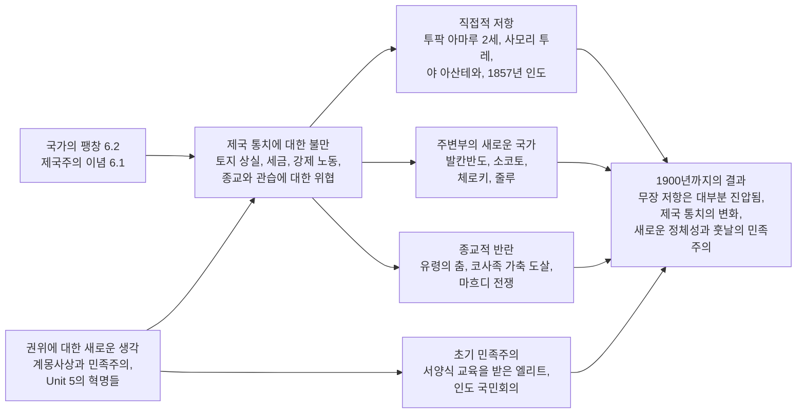
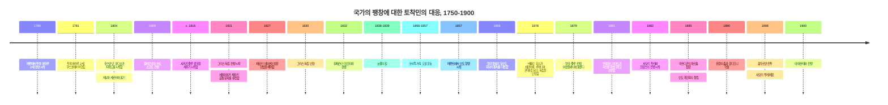
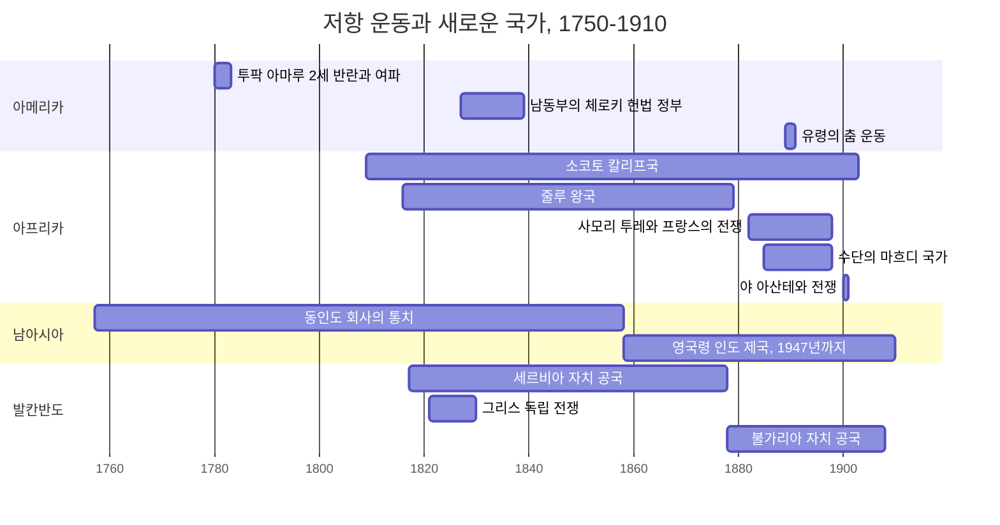
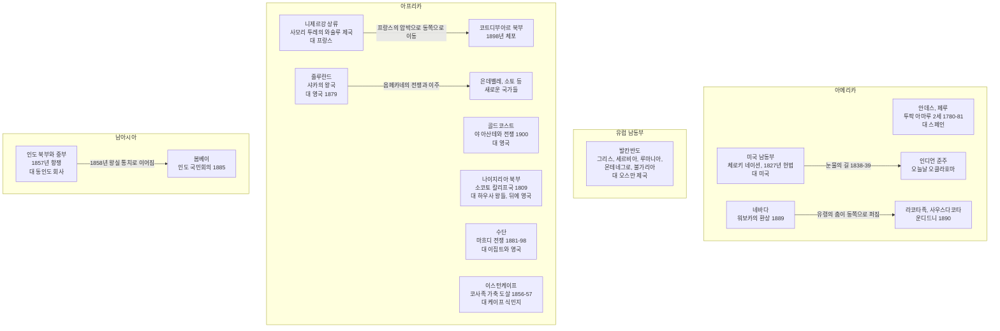
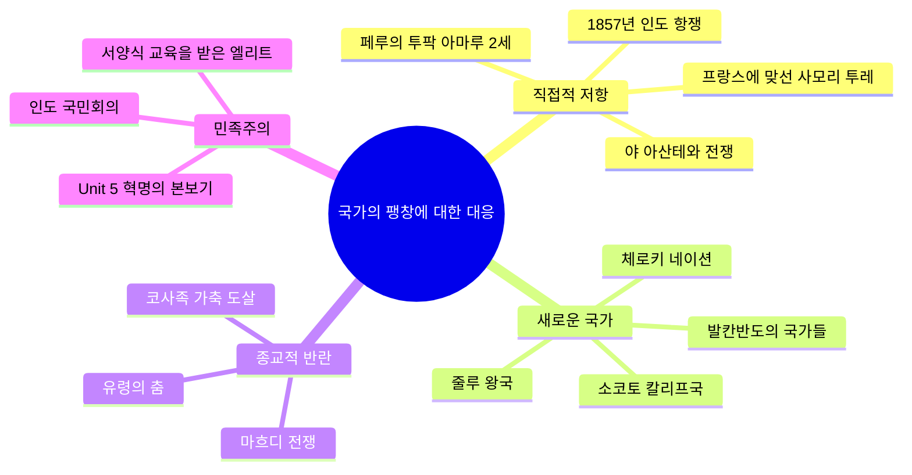

# AP 세계사: 모던 — 토픽 6.3 1750–1900년 국가의 팽창에 대한 토착민의 대응 (Indigenous Responses to State Expansion from 1750 to 1900)

**Focus Question:** 1750–1900년 토착민과 식민지 민족은 국가의 팽창에 어떻게, 그리고 왜 저항했으며, 그 저항은 어떤 형태를 띠었는가?

> 출처: CED 기준 · 교재 반영 전

**Unit 6: 산업화의 결과 (Consequences of Industrialization, c. 1750–1900)**

---

## 학습 목표 (Learning Objective)

| 코드 | 학습 목표 |
|---|---|
| 6.3 LO-C (GOV) | 1750년부터 1900년까지 내부 요인과 외부 요인이 국가 건설 과정에 어떻게, 그리고 왜 영향을 미쳤는지 설명한다. |

## 역사적 개념 (Historical Developments, CED)

| # | 역사적 개념 | 다루는 곳 |
|---|---|---|
| HD1 | KC-5.3.III.D: 정치 권위에 대한 의문이 커지고 민족주의가 성장하면서 반식민주의 운동 (Anticolonial movements)이 일어나는 데 기여했다. | §1, §5, §9, 비교표 |
| HD2 | KC-5.2.II.C: 반제국주의 저항은 제국 내부의 직접적 저항과 주변부에서의 새로운 국가 건설 등 여러 형태를 띠었다. | §2, §3, §4, §5, §6, §7, 비교표 |
| HD2 · 예시 | 예시 (직접적 저항): 페루의 투팍 아마루 2세 반란 (Túpac Amaru II’s rebellion in Peru) | §2 |
| HD2 · 예시 | 예시 (직접적 저항): 서아프리카에서 사모리 투레의 군사 투쟁 (Samory Touré’s military battles in West Africa) | §3 |
| HD2 · 예시 | 예시 (직접적 저항): 서아프리카의 야 아산테와 전쟁 (Yaa Asantewaa War in West Africa) | §3 |
| HD2 · 예시 | 예시 (직접적 저항): 1857년 인도 항쟁 (1857 rebellion in India) | §4, §10 |
| HD2 · 예시 | 예시 (새로운 국가): 발칸반도의 독립 국가 수립 (Establishment of independent states in the Balkans) | §5 |
| HD2 · 예시 | 예시 (새로운 국가): 오늘날 나이지리아의 소코토 칼리프국 (Sokoto Caliphate in modern-day Nigeria) | §6 |
| HD2 · 예시 | 예시 (새로운 국가): 체로키 네이션 (Cherokee Nation) | §7 |
| HD2 · 예시 | 예시 (새로운 국가): 줄루 왕국 (Zulu Kingdom) | §6 |
| HD3 | KC-5.3.III.E: 제국 통치에 대한 불만이 커지면서 반란이 일어났고, 그 가운데 일부는 종교 사상의 영향을 받았다. | §1, §8, §10 |
| HD3 · 예시 | 예시 (반란): 미국의 유령의 춤 (Ghost Dance in the U.S.) | §8 |
| HD3 · 예시 | 예시 (반란): 남아프리카의 코사족 가축 도살 운동 (Xhosa Cattle-Killing Movement in Southern Africa) | §8 |
| HD3 · 예시 | 예시 (반란): 수단의 마흐디 전쟁 (Mahdist wars in Sudan) | §8 |

---

## 큰 그림 요약

1750년부터 1900년까지 산업 국가와 오래된 제국들은 새로운 땅으로 팽창했고(6.2), 문명화 사명 (Civilizing mission)과 사회 진화론 (Social Darwinism) 같은 생각으로 이를 정당화했다(6.1). 팽창의 대상이 된 민족들은 그냥 굴복하지 않았다. 어떤 이들은 제국 안에서 **직접** 싸웠다. 페루의 **투팍 아마루 2세 (Túpac Amaru II)**, 서아프리카의 **사모리 투레 (Samory Touré)**와 **야 아산테와 (Yaa Asantewaa)**가 이끈 아산테인, 인도의 **1857년 항쟁**에 나선 병사와 군주들이 그 예이다. 다른 이들은 제국의 **주변부에 새로운 국가**를 세웠다. 오스만 제국에서 떨어져 나온 **발칸반도의 국가들**, **소코토 칼리프국 (Sokoto Caliphate)**, **체로키 네이션 (Cherokee Nation)**, **줄루 왕국 (Zulu Kingdom)**이 그 예이다. 군사적 수단이 가망 없어 보일 때 **종교적 예언**에 기댄 이들도 있었다. **유령의 춤 (Ghost Dance)**, **코사족 가축 도살 운동 (Xhosa Cattle-Killing Movement)**, 수단의 **마흐디 (Mahdi)** 운동이 그렇다. 같은 시기에 계몽사상과 **민족주의 (Nationalism)**(Unit 5)는 **서양식 교육을 받은 엘리트 (Western-educated elites)**에게 제국의 권위를 문제 삼을 새로운 언어를 주었다. **인도 국민회의 (Indian National Congress, 1885)**가 그 예이다. 1900년까지 무장 저항은 대부분 진압되었다. 그러나 저항은 제국 통치의 변화를 이끌어 냈고, 훗날 독립운동이 활용한 기억과 정체성을 남겼다.

---

## §1. 배경: 팽창, 불만, 그리고 권위에 대한 새로운 생각

- **국가의 팽창 (6.2):** 영국은 인도와 아프리카의 넓은 지역을 지배했다. 프랑스는 서아프리카에 제국을 세웠다. 미국은 북아메리카 서쪽으로 뻗어 나갔다. 오스만 제국은 유럽에서 영토를 잃었다. **베를린 회의 (Berlin Conference, 1884–1885)**는 "아프리카 분할 (Scramble for Africa)"을 가속했다.
- **제국주의 이념 (6.1):** **문명화 사명**, **사회 진화론**, 토착민을 **개종**시키려는 열망은 식민지 사람들의 종교·법·관습이 열등하다고 말했다.
- **내부 요인과 외부 요인:** 학습 목표는 두 요인이 국가 건설에 어떤 영향을 주었는지 묻는다. 외부 요인으로는 제국의 군대, 정착민, 맥심 기관총 (Maxim gun) 같은 새로운 무기가 있다. 내부 요인으로는 현지 지도자, 종교 개혁가, 식민지 사회 내부의 분열이 있다.

| 불만 | 예 |
|---|---|
| **토지 상실** | 체로키의 남동부 강제 이주, 케이프 식민지에 빼앗긴 코사족의 땅, 보호구역 (Reservation)에 갇힌 라코타족 (Lakota) |
| **세금과 강제 노동** | 페루의 *미타 (Mita)* 노동 징발과 상품 강매, 수단의 이집트 지배 아래 무거운 세금 |
| **종교와 관습에 대한 위협** | 인도의 기름 바른 탄약포, 선교사의 압력, 미국의 유령의 춤 금지 |
| **주권 상실** | 영국이 아산테 왕 프렘페 1세 (Prempeh I)를 추방하고 황금 의자 (Golden Stool)를 요구한 일, 인도 토후국 병합 |

- **권위에 대한 새로운 생각 (KC-5.3.III.D):** 자연권 (Natural rights)과 동의에 의한 통치라는 계몽사상, 그리고 **미국 혁명 (1776)**, **프랑스 혁명 (1789)**, **아이티 혁명 (1791–1804)**, **라틴아메리카 독립 혁명 (1810–1820년대)**의 사례는 식민지 사람들에게 왜 자신들이 발언권 없이 지배받아야 하는지 묻게 했다.
- **민족주의**(Unit 5)는 언어·종교·역사를 함께하는 민족이 스스로 다스려야 한다고 가르쳤다. 이 생각은 발칸반도의 독립운동을 이끌었고, 뒤에는 인도 민족주의의 바탕이 되었다.

> **핵심:** 저항은 **두 가지 원천**에서 힘을 얻었다. 어떤 운동은 옛 통치자, 신앙, 생활 방식을 되찾으려고 **과거**를 바라보았다. 다른 운동은 헌법과 민족주의 같은 새로운 생각을 따라 **미래**를 바라보았다. 많은 운동은 둘을 섞었다.

## §2. 아메리카의 직접적 저항: 투팍 아마루 2세 반란 (1780–1781)

- **인물:** 호세 가브리엘 콘도르캉키 (José Gabriel Condorcanqui)는 안데스의 부유한 메스티소 **쿠라카 (Kuraka, 현지 원주민 지도자)**였다. 그는 1572년 스페인에 처형된 마지막 잉카 통치자 투팍 아마루 (Túpac Amaru)의 후손이라고 주장하며 **투팍 아마루 2세**라는 이름을 썼다.
- **불만:** 스페인의 **부르봉 개혁 (Bourbon Reforms)**은 판매세를 올리고 통제를 강화했다. 원주민은 ***미타*** (포토시 (Potosí) 같은 광산의 강제 노동)와 ***레파르토 (Reparto de mercancías)***에도 시달렸다. 레파르토는 스페인 관리인 *코레히도르 (Corregidor)*에게서 물건을 비싼 값에 강제로 사게 한 제도였다.
- **전개:**
  - **1780년 11월**, 투팍 아마루 2세는 지역 *코레히도르* 안토니오 데 아리아가 (Antonio de Arriaga)를 붙잡아 처형했다.
  - 그는 주로 원주민 농민으로 이루어진 수만 명의 군대를 일으켜 **상가라라 (Sangarará)**에서 스페인군을 물리쳤다.
  - 1781년 초 **쿠스코 (Cuzco)** 공격은 실패했다. 그는 붙잡혀 **1781년 5월 쿠스코에서 처형되었다.** 아내이자 공동 지도자인 **미카엘라 바스티다스 (Micaela Bastidas)**도 함께 처형되었다.
  - 친척들과 아이마라족 지도자 **투팍 카타리 (Túpac Katari, 1781년 라파스 포위)**가 **1782–1783년** 무렵까지 싸움을 이어 갔다.
- **결과:**
  - 스페인은 반란을 잔혹하게 진압하고, 잉카의 옷차림·칭호·상징을 금지했다.
  - 상품 강매를 없애고 지방 행정을 개편했다.
  - 크리오요 (Creole, 아메리카에서 태어난 스페인계) 엘리트는 대규모 원주민 봉기에 겁을 먹었다. 그래서 많은 크리오요가 독립에 조심스러워졌고, 페루는 스페인에서 가장 늦게 독립한 식민지 가운데 하나가 되었다(1821–1824).

> ⚠️ 확인 필요: 투팍 아마루 2세의 목표에 대해서는 역사가들의 의견이 갈린다. 처음에 그는 스페인 국왕에게 충성한다고 말하며 "나쁜 정부"만 공격했다. 그러나 뒤의 일부 발언은 스페인 지배를 끝내려 했음을 보여 준다. 봉기 전체의 사망자 수 추정치도 크게 다르다(흔히 약 10만 명).

## §3. 서아프리카의 직접적 저항: 사모리 투레와 야 아산테와 전쟁

### 사모리 투레 (Samory Touré, c. 1830–1900)

- **만딩카 (Mandinka, 말링케 Malinke)** 출신의 **무슬림** 지도자로, 1860–1870년대에 니제르강 상류 지역(오늘날 기니, 말리, 코트디부아르 일부)에 **와술루 제국 (Wassoulou Empire)**을 세웠다. 그는 ***알마미 (Almami, 무슬림 지도자)***라는 칭호를 썼다.
- 그는 **직업 군대**를 만들고, 영국령 **프리타운 (Freetown, 시에라리온)**을 통해 **연발총 (Repeating rifles)**을 사들였으며, 대장장이들에게 총을 고치고 복제하게 했다.
- 그는 **1882년부터 1898년까지** **프랑스**와 싸웠다. 필요할 때는 조약을 맺었고, **초토화 (Scorched-earth)** 전술을 썼으며, 프랑스군을 피해 나라 전체를 **동쪽으로** 옮겼다.
- 프랑스는 **1898년** 그를 붙잡아 **가봉 (Gabon)**으로 추방했고, 그는 1900년 그곳에서 죽었다.
- **의미:** 서아프리카에서 프랑스 지배에 맞선 가장 긴 무장 저항 가운데 하나였다. 훗날 기니 민족주의의 영웅이 되었다.

### 야 아산테와 전쟁 (Yaa Asantewaa War, 황금 의자 전쟁 War of the Golden Stool, 1900)

- 골드코스트 (Gold Coast, 오늘날 가나)의 **아산테 왕국 (Asante/Ashanti Kingdom)**은 1800년대에 영국과 여러 차례 전쟁을 벌였다.
- **1896년** 영국은 아산테 왕 (**아산테헤네 Asantehene**) **프렘페 1세**를 추방했다.
- **1900년** 영국 총독 **프레더릭 호지슨 (Frederic Hodgson)**은 자신이 앉겠다며 **황금 의자**를 내놓으라고 요구했다. 황금 의자는 아산테 민족의 영혼을 상징하는 신성한 물건이었다.
- **에지수 (Ejisu)의 왕대비 (Queen mother)**인 **야 아산테와**는 아산테 남성들에게 싸우자고 호소하며 봉기를 이끌었다. 아산테군은 **쿠마시 (Kumasi)의 영국 요새를 포위했다.**
- 영국 증원군이 아산테군을 물리쳤다. 야 아산테와는 **세이셸 (Seychelles)**로 추방되어 1921년 그곳에서 죽었고, 영국은 **아산테를 골드코스트 식민지에 병합했다(1902).**
- **의미:** 영국은 끝내 황금 의자를 손에 넣지 못했다. 그래서 아산테는 가장 중요한 상징을 지켰다. 이 전쟁은 저항과 여성 지도력의 상징으로 기억된다.

## §4. 1857년 인도 항쟁

- **배경:** 영국 **동인도 회사 (East India Company, EIC)**는 **플라시 전투 (Battle of Plassey, 1757)**에서 이긴 뒤 인도의 넓은 지역을 지배했다. 회사 군대의 대부분은 인도인 **세포이 (Sepoy)**였다.

| 원인 | 내용 |
|---|---|
| **기름 바른 탄약포 (Greased cartridges)** | 새 엔필드 소총 (Enfield rifle)의 탄약포에 **소와 돼지의 기름**을 발랐다는 소문이 돌았다. 병사들은 탄약포를 이로 물어뜯어야 했는데, 이는 **힌두교도**(소는 신성함)와 **무슬림**(돼지고기는 금지됨) 모두에게 모욕이었다 |
| **병합 (Annexations)** | **실권 원칙 (Doctrine of Lapse)**에 따라 EIC는 친아들 상속자 없이 통치자가 죽은 토후국을 차지했다. 1856년에는 **아와드 (Awadh)**도 병합했다 |
| **종교·사회 변화** | 선교사와 영국의 개혁이 종교와 카스트 (Caste)를 위협하는 것처럼 보였다 |
| **경제적 압박** | 무거운 토지세, 값싼 영국 직물로 피해를 본 인도 장인들 |

- **전개:**
  - **1857년 5월**, **메루트 (Meerut)**의 세포이들이 반란을 일으켜 **델리 (Delhi)**로 진군했고, 늙은 무굴 황제 **바하두르 샤 2세 (Bahadur Shah II)**를 지도자로 내세웠다.
  - 반란은 인도 북부와 중부(칸푸르 Kanpur, 러크나우 Lucknow, 잔시 Jhansi)로 퍼졌다. 지도자로는 **잔시의 라니 락슈미바이 (Rani Lakshmibai of Jhansi)**, **나나 사히브 (Nana Sahib)**, **탄티아 토페 (Tantia Tope)**가 있었다.
  - 영국은 **1857년 9월** 델리를 되찾았고 **1858년**까지 반란을 진압했다. 양쪽 모두 학살을 저질렀다.
- **한계:** 이 항쟁은 하나로 뭉친 민족 운동이 아니었다. 많은 군주와 시크교도 (Sikhs), 남인도 대부분은 영국 편에 서거나 중립을 지켰다.
- **결과:**
  - **인도 통치법 (Government of India Act, 1858)**으로 EIC의 통치가 끝났다. 이제 **영국 왕실 (British Crown)**이 총독 (Viceroy)을 통해 인도를 직접 다스렸다(**영국령 인도 제국, British Raj**).
  - **무굴 왕조가 끝났다.** 바하두르 샤 2세는 랑군 (Rangoon)으로 추방되었다.
  - **빅토리아 여왕의 선언 (Queen Victoria's Proclamation, 1858)**은 인도의 종교에 간섭하지 않겠다고 약속했다.
  - 영국은 영국인 병사 비중을 늘려 군대를 개편했다. 1876년 빅토리아는 **인도 여제 (Empress of India)** 칭호를 얻었다.

## §5. 주변부의 새로운 국가: 발칸반도의 독립 국가 수립

- **오스만 제국 (Ottoman Empire)**은 유럽 쪽 영토에 대한 통제력을 잃어 가고 있었다. 그리스인, 세르비아인, 루마니아인, 불가리아인, 몬테네그로인 같은 기독교도 신민들은 **민족주의**와 **정교회 (Orthodox Christian) 정체성**을 내세워 자치를 요구했다.
- **열강 (Great Powers)**도 저마다의 이유로 개입했다. 러시아는 정교회 신자의 보호자를 자처했고, 영국과 프랑스는 러시아를 견제하려 했다.

| 국가 | 주요 연도 | 독립 과정 |
|---|---|---|
| **세르비아 (Serbia)** | 1804년·1815년 봉기, 1817–1830년 자치, 1878년 독립 | 카라조르제 (Karađorđe)와 밀로시 오브레노비치 (Miloš Obrenović)가 이끈 세르비아 봉기 |
| **그리스 (Greece)** | 1821–1829년 독립 전쟁, 1830년 독립 인정 | 영국·프랑스·러시아가 **나바리노 해전 (Battle of Navarino, 1827)**에서 오스만-이집트 함대를 격파함. 바이런 경 (Lord Byron) 같은 유럽 낭만주의자들이 그리스를 지지함 |
| **루마니아 (Romania)** | 1859년 몰다비아와 왈라키아 통합, 1878년 독립 | 오스만 지배 아래 있던 두 공국의 통합 |
| **몬테네그로 (Montenegro)** | 1878년 독립 인정 | 오랫동안 오스만의 통제에 맞서 온 산악 공국 |
| **불가리아 (Bulgaria)** | 1876년 4월 봉기, 1878년 자치, 1908년 완전 독립 | 오스만의 봉기 진압이 **러시아-튀르크 전쟁 (Russo-Turkish War, 1877–1878)**으로 이어짐 |

- **베를린 회의 (Congress of Berlin, 1878)**는 **세르비아, 루마니아, 몬테네그로**의 독립을 인정하고 **불가리아**를 자치 공국으로 만들었다.
- **의미:** 이들은 **다민족 제국의 가장자리**에 있던 민족으로, 민족주의(KC-5.3.III.D)를 이용해 **새로운 국가**(KC-5.2.II.C)를 세웠다. 이들의 성공은 어느 정도 외부 열강의 도움에 달려 있었다.

## §6. 아프리카의 새로운 국가: 소코토 칼리프국과 줄루 왕국

### 소코토 칼리프국 (Sokoto Caliphate, 오늘날 나이지리아 북부)

- **우스만 단 포디오 (Usman dan Fodio, 1754–1817)**는 **풀라니 (Fulani)**족 무슬림 학자이자 수피 (Sufi) 스승으로, 하우사 (Hausa) 왕국인 고비르 (Gobir)에 살았다.
- 그는 **하우사 왕들**이 이슬람에 토착 종교를 섞고, 백성에게 부당한 세금을 물리며, 부패하게 다스린다고 비판했다.
- 그의 **지하드 (Jihad, 1804–1809)**는 하우사 왕들을 무너뜨렸다. 그의 아들 **무함마드 벨로 (Muhammad Bello)**는 1809년 수도 **소코토**를 세웠다.
- 칼리프국은 **19세기 아프리카에서 가장 큰 국가 가운데 하나**가 되었다. 카노 (Kano) 같은 약 30개의 **에미르국 (Emirates)**이 칼리프에게 충성했다.
- 칼리프국은 **이슬람법, 학교, 학문**을 퍼뜨렸다. 우스만의 딸 **나나 아스마우 (Nana Asma'u)**는 시인이자 교사로서 여성을 교육했다.
- 경제는 농장과 플랜테이션의 **노예 노동**에 크게 의존했다.
- 칼리프국은 **1903년 영국에 정복될 때까지** 이어졌다. 그 뒤 영국은 에미르들을 통해 다스렸다(**간접 통치, Indirect rule**).
- **CED가 이 사례를 넣은 이유:** 팽창하는 대서양 세계의 가장자리에서 **내부의 종교 개혁**으로 새 국가가 생겨날 수 있었고, 그런 국가가 뒤에 유럽의 팽창에 맞설 수 있었음을 보여 준다.

### 줄루 왕국 (Zulu Kingdom, 아프리카 남동부)

- **샤카 (Shaka, 재위 c. 1816–1828)**는 작은 줄루 족장국을 오늘날 남아프리카 공화국 콰줄루나탈 (KwaZulu-Natal)의 강력한 왕국으로 키웠다.
- **군사 개혁:** **연령별 연대 (Age-based regiments, *아마부토 amabutho*)**, 짧은 **찌르기 창**, 커다란 소가죽 방패, 적을 에워싸는 **"물소 뿔 (Horns of the buffalo)" 대형**, 엄격한 규율.
- 그는 이웃 민족들을 흡수했다. 전쟁과 이주가 남아프리카 전역으로 퍼졌는데, 이 시기를 **음페카네 (Mfecane, "짓밟기")**라고 부른다. 이에 대응해 은데벨레 (Ndebele)와 모슈슈 (Moshoeshoe)가 이끈 소토 (Sotho) 왕국 같은 다른 국가들도 생겨났다.
- 샤카는 **1828년** 이복형제들에게 암살되었다. 그의 후계자 **딩가네 (Dingane)**는 **블러드강 전투 (Battle of Blood River, 1838)**에서 보어인 (Boer) 정착민에게 패했다.
- **세츠와요 (Cetshwayo)** 왕 때 줄루는 **영국-줄루 전쟁 (Anglo-Zulu War, 1879)**에서 영국과 싸웠다. 줄루는 **이산들와나 (Isandlwana, 1879년 1월)**에서 유명한 승리를 거두었지만 **울룬디 (Ulundi, 1879년 7월)**에서 패했다.
- 영국은 왕국을 13개 족장국으로 쪼갰고, **1887년** 줄루란드 (Zululand)를 병합했다.

> ⚠️ 확인 필요: 음페카네에 대해서는 역사가들의 논쟁이 있다. 예전 견해는 혼란의 원인을 샤카의 전쟁으로 보았다. 일부 역사가는 노예 사냥, 가뭄, 유럽 정착민의 압력도 원인이었고, 예전 견해는 식민지 시대 저술가들의 영향을 받았다고 주장한다. 선생님이 어떻게 가르치는지 확인이 필요하다.

## §7. 체로키 네이션

- **체로키 (Cherokee)**족은 미국 남동부(조지아, 테네시, 노스캐롤라이나, 앨라배마)에 살았다.
- 그들은 땅과 주권을 지키려고 **서양식 정치 수단**을 썼다.
  - **세쿼이아 (Sequoyah)**가 **체로키 음절 문자 (Cherokee syllabary, 1821)**를 만들었고, 글을 읽고 쓰는 능력이 빠르게 퍼졌다.
  - ***체로키 피닉스 (Cherokee Phoenix, 1828)***는 체로키어와 영어로 인쇄된 신문이었다.
  - **성문 헌법 (Written constitution, 1827)**은 미국 헌법을 본떠 삼권 분립 정부를 세웠고, 수도는 **뉴에코타 (New Echota)**였다.
- **압력:** 정착민은 체로키의 땅을 원했고, **조지아에서 금이 발견되었다(1829).** 조지아주는 체로키 땅에 대한 권한을 주장했고, 의회는 **앤드루 잭슨 (Andrew Jackson)** 대통령 아래 **인디언 이주법 (Indian Removal Act, 1830)**을 통과시켰다.
- **재판:**
  - ***체로키 네이션 대 조지아 (Cherokee Nation v. Georgia, 1831)*:** 연방 대법원은 체로키를 "국내의 종속 국가 (Domestic dependent nation)"라고 불렀다.
  - ***워체스터 대 조지아 (Worcester v. Georgia, 1832)*:** 대법원은 조지아주의 법이 체로키 영토에서 **효력이 없다**고 판결했다. 잭슨은 이 판결을 집행하지 않았다.
- **뉴에코타 조약 (Treaty of New Echota, 1835)**은 체로키의 작은 분파가 서명한 것이었다. 대추장 **존 로스 (John Ross)**와 대부분의 체로키는 이에 반대했다.
- **눈물의 길 (Trail of Tears, 1838–1839):** 미군은 약 16,000명의 체로키를 서쪽의 **인디언 준주 (Indian Territory, 오늘날 오클라호마)**로 강제 이주시켰다. 약 **4,000명이 죽었다.**
- 체로키는 인디언 준주에서 새 헌법(1839)을 만들고 **탈레쿼 (Tahlequah)**를 수도로 삼아 나라를 다시 세웠다.
- **의미:** 체로키 네이션은 헌법·법원·언론 같은 서양식 형식으로 세운 **새로운 국가**였다. 그러나 자국 법원의 판결조차 무시하는 팽창 국가를 막을 수는 없었다.

> ⚠️ 확인 필요: 눈물의 길의 사망자 수는 추정치다. 약 4,000명이 가장 흔한 수치이지만, 추정치는 약 2,000명에서 8,000명까지 다양하다.

## §8. 종교 사상의 영향을 받은 반란

| 운동 | 장소와 시기 | 지도자 또는 예언자 | 종교적 약속 | 결과 |
|---|---|---|---|---|
| **코사족 가축 도살 운동 (Xhosa Cattle-Killing Movement)** | 남아프리카 이스턴케이프, 1856–1857 | 십 대 예언자 **농콰우세 (Nongqawuse)**와 삼촌 **음라카자 (Mhlakaza)** | 코사족이 소를 죽이고 곡식을 없애면 조상들이 되살아나고, 건강한 새 소가 나타나며, 영국인이 바다로 쓸려 나간다 | 소 약 40만 마리 도살, 기근, 수만 명 사망, 케이프 식민지가 코사족의 땅과 노동력을 차지함 |
| **마흐디 전쟁 (Mahdist wars)** | 수단, 1881–1898 | 스스로 **마흐디 ("올바르게 인도된 자")**라고 선언한 **무함마드 아마드 (Muhammad Ahmad)**, 이후 **칼리파 압달라히 (Khalifa Abdallahi)** | 마흐디가 이슬람을 정화하고 부패한 이집트-오스만 통치를 끝낸다 | **하르툼 (Khartoum)** 점령(1885) 후 마흐디 국가를 다스림, **옴두르만 (Omdurman, 1898)**에서 무너짐, 1899년부터 영국-이집트 통치 |
| **유령의 춤 (Ghost Dance)** | 미국 서부와 대평원, 1889–1890 | 네바다의 파이우트족 (Paiute) 예언자 **워보카 (Wovoka)** | 춤을 추면 죽은 조상과 들소가 돌아오고 옛 생활 방식이 되살아난다. 라코타족은 "유령 셔츠 (Ghost shirts)"가 총알을 막는다고 믿음 | 미국이 금지함, 시팅 불 (Sitting Bull) 피살, **운디드니 학살 (Wounded Knee Massacre, 1890년 12월)** |

### 코사족 가축 도살 운동 (1856–1857)

- 코사족은 1700년대 후반부터 케이프 식민지 (Cape Colony)와 오랫동안 벌인 **변경 전쟁 (Frontier wars)**으로 땅을 잃었다.
- 1854년부터는 소 전염병(**우폐역, Lungsickness**)이 가축을 죽이고 있었다.
- 1856년 **농콰우세**는 조상들이 나타나, 소를 모두 죽이고 곡식을 없애면 세상이 새로워지고 영국인이 쫓겨날 것이라고 말했다고 전했다.
- 많은 코사족이 이를 따랐다. 약속된 날(1857년 2월)이 지나자 **기근**이 닥쳤다.
- 총독 **조지 그레이 경 (Sir George Grey)**은 이 참사를 이용해 코사족의 땅을 정착민에게 넘기고, 살아남은 사람들을 식민지의 **임금 노동 (Wage labor)**으로 내몰았다.

### 수단의 마흐디 전쟁 (1881–1898)

- 이집트는 1820년대에 수단을 정복했다. 이집트의 지배는 무거운 세금을 뜻했고, 이집트 자체도 **1882년 영국에 점령되었다.**
- **1881년 무함마드 아마드**는 자신이 **마흐디**라고 선언했다. 마흐디는 일부 이슬람 전통에서 기다리는 구원자이다. 그는 이슬람을 정화하기 위한 성전을 촉구했다.
- 그의 군대는 영국인 장교 윌리엄 힉스 (William Hicks)가 이끈 이집트군을 전멸시켰고(1883), **1885년 1월 하르툼**을 점령해 영국 장군 **찰스 고든 (Charles Gordon)**을 죽였다.
- 마흐디는 1885년에 죽었지만, 후계자 **칼리파 압달라히**가 1898년까지 **마흐디 국가 (Mahdist state)**를 다스렸다.
- **허버트 키치너 (Herbert Kitchener)**가 이끈 영국-이집트군이 **옴두르만 전투 (1898)**에서 마흐디군을 물리쳤다. **맥심 기관총**이 마흐디 병사 약 11,000명을 죽인 반면, 영국-이집트 쪽 전사자는 50명이 안 되었다.

### 유령의 춤 (1889–1890)

- 1880년대에 **라코타족 (수족, Sioux)** 같은 대평원 민족은 **보호구역**으로 내몰렸고, **들소 (Bison)**는 거의 사라졌으며, **도스법 (Dawes Act, 1887)**은 부족의 땅을 쪼갰다.
- 1889년 **워보카**는 환상을 보았고, 춤과 평화로운 생활과 기도가 죽은 이들과 옛 세상을 되돌려 줄 것이라고 가르쳤다.
- 이 운동은 서부 전역으로 퍼졌다. 일부 라코타족은 총알을 막아 준다고 믿은 **유령 셔츠**를 더했다.
- 미국 관리들은 이를 위협으로 보았다. **1890년 12월 15일**, 경찰은 체포 과정에서 라코타족 지도자 **시팅 불**을 죽였다.
- **1890년 12월 29일**, 미국 제7기병대는 사우스다코타의 **운디드니 개울 (Wounded Knee Creek)**에서 라코타족 약 250–300명을 죽였고, 그 가운데 많은 이가 여성과 어린이였다. 이 사건은 흔히 대평원 무장 저항의 끝으로 여겨진다.

> ⚠️ 확인 필요: 이 운동들의 사망자 수는 추정치다. 코사족 가축 도살 운동은 기근으로 약 4만 명이 죽었다는 수치가 흔하지만 수치는 다양하다. 운디드니는 라코타족 사망자를 약 150명에서 300명으로 추정한다.

### 관련 사례 (이 토픽의 CED 예시는 아님)

- **태평천국 운동 (Taiping Rebellion, 1850–1864):** 자신을 예수의 동생이라고 믿은 홍수전 (Hong Xiuquan)이 청 왕조 (Qing dynasty)에 맞서 일으킨 반란으로, 수천만 명이 목숨을 잃었다.
- **의화단 운동 (Boxer Rebellion, 1899–1901):** 중국 북부에서 일어난 반외세·반기독교 봉기로, 여러 나라의 연합군에 진압되었다.

## §9. 민족주의와 반식민주의 운동의 등장

- **정치 권위에 대한 의문:** 계몽사상은 정당한 정부가 **자연권**과 **피치자의 동의 (Consent of the governed)**에 바탕을 둔다고 가르쳤다. 식민지 사람들은 왜 이 생각이 자신들에게는 적용되지 않는지 물었다.
- **혁명의 본보기 (Unit 5):**
  - **아이티 혁명 (Haitian Revolution, 1791–1804)**은 노예였던 사람들과 식민지 사람들이 유럽 강대국을 무너뜨리고 국가를 세울 수 있음을 보여 주었다.
  - 시몬 볼리바르 (Simón Bolívar) 같은 인물이 이끈 **라틴아메리카 독립 (1810–1820년대)**은 식민지가 제국에서 떨어져 나올 수 있음을 보여 주었다.
- **서양식 교육을 받은 엘리트:** 식민지의 학교와 대학은 변호사, 교사, 언론인, 관리를 길러 냈다. 그들은 자유와 민족이라는 서양의 생각으로 식민 통치를 비판했다.
  - 예: **다다바이 나오로지 (Dadabhai Naoroji)**는 영국의 지배가 인도의 부를 "유출 (Drain)"시킨다고 주장했다.
- **인도 국민회의 (1885):** 서양식 교육을 받은 인도인들이 은퇴한 영국 관리 **A. O. 흄 (A. O. Hume)**의 도움을 받아 **봄베이 (Bombay)**에서 세웠다.
  - 처음에는 **온건**했다. 독립이 아니라 공무원직에 더 많은 인도인을 뽑고 정부에서 발언권을 달라고 요구했다.
  - 뒤에는 **인도 독립운동**의 중심 조직이 되었다(Unit 7–8).
- **1857년과의 대비:** 1857년 항쟁은 주로 병사, 군주, 옛 무굴 궁정이 이끌었다. 국민회의는 청원, 집회, 언론을 활용한 **새로운 중산층 엘리트**가 이끌었다.

## §10. 스킬 초점: 출처와 상황 (Sourcing and Situation, 2.C)

이 사건들의 이름과 기록은 흔히 글쓴이의 **관점 (Point of view)**과 **목적 (Purpose)**을 드러낸다.

| 사료 | 관점 또는 목적 | 사료 활용의 한계 |
|---|---|---|
| 영국 장교가 1857년을 **"세포이 반란 (Sepoy Mutiny)"**이라고 부름 | 충성하지 않은 병사들의 군사 반란으로 봄 | 민간인과 군주의 불만, 항쟁의 넓은 확산을 가림 |
| 인도 민족주의 역사서(V. D. 사바르카르 Savarkar, 1909)가 1857년을 **"제1차 독립 전쟁 (First War of Independence)"**이라고 부름 | 인도인이 영국 지배에 맞서도록 고무하려고 씀 | 1857년의 민족적 단결을 과장함 |
| 코사족 가축 도살 운동에 대한 식민지 총독의 보고서 | 코사족의 "미신"을 탓함 | 식민지의 토지 강탈과 소 전염병을 빠뜨림. 총독은 이 참사로 땅을 얻었음 |
| 유령의 춤에 대한 미국 신문 보도(1890) | 위험한 전쟁 위협으로 그림 | 폭력을 과장하고, 대체로 평화로운 종교 운동을 잘못 이해함 |
| 마흐디의 선언문 | 무슬림 추종자를 얻으려고 종교적 권위를 내세움 | 평범한 수단 사람들의 경험보다 운동의 이상을 더 많이 보여 줌 |

---

## 연표

---

## 지도: 지역별 저항 운동

---

## 비교표: 형태별로 본 CED 예시

| 예시 | 형태 | 지역 | 상대 | 결과 |
|---|---|---|---|---|
| 투팍 아마루 2세 반란 (Túpac Amaru II’s rebellion, 1780–1781) | 직접적 저항 | 안데스, 페루 | 스페인 | 진압됨. 지도자는 1781년 처형. 일부 개혁이 있었지만 가혹한 탄압 |
| 사모리 투레의 군사 투쟁 (Samory Touré, 1882–1898) | 직접적 저항 | 서아프리카 니제르강 상류 | 프랑스 | 오랜 저항. 1898년 사모리 체포. 프랑스 지배 |
| 야 아산테와 전쟁 (Yaa Asantewaa War, 1900) | 직접적 저항 | 서아프리카 골드코스트 | 영국 | 패배. 1902년 아산테 병합. 황금 의자는 끝내 빼앗기지 않음 |
| 1857년 인도 항쟁 (1857 rebellion in India) | 직접적 저항 | 인도 북부와 중부 | 동인도 회사 | 진압됨. EIC 통치 종식. 1858년부터 영국 왕실 통치 |
| 발칸반도의 독립 국가 (Independent Balkan states) | 새로운 국가 | 유럽 남동부 | 오스만 제국 | **성공**: 1830년 그리스, 1878년 세르비아·루마니아·몬테네그로, 1878년 불가리아 자치 |
| 소코토 칼리프국 (Sokoto Caliphate, 1809) | 새로운 국가 | 나이지리아 북부 | 하우사 왕들, 뒤에 영국 | 거의 100년 동안 존속. 1903년 영국에 정복됨 |
| 체로키 네이션 (Cherokee Nation) | 새로운 국가 | 미국 남동부 | 미국, 조지아주 | 재판에서 이겼으나(1832) 1838–1839년 강제 이주. 인디언 준주에서 재건 |
| 줄루 왕국 (Zulu Kingdom) | 새로운 국가 | 아프리카 남동부 | 아프리카의 경쟁 세력, 보어인, 영국 | 이산들와나에서 영국을 이겼지만 1879년 전쟁에서 패배. 1887년 병합 |
| 유령의 춤 (Ghost Dance) | 종교적 반란 | 미국 서부와 대평원 | 미국 | 진압됨. 1890년 운디드니 학살 |
| 코사족 가축 도살 운동 (Xhosa Cattle-Killing) | 종교 운동 | 남아프리카 이스턴케이프 | 영국, 케이프 식민지 | 기근과 붕괴. 식민지가 땅과 노동력을 차지함 |
| 마흐디 전쟁 (Mahdist wars) | 종교적 반란이자 새로운 국가 | 수단 | 이집트와 영국 | 1885–1898년 마흐디 국가. 1898년 옴두르만에서 패배 |

## 비교표: 전통 지도자와 초기 민족주의자

| 항목 | 전통·종교 지도자가 이끈 저항 | 초기 민족주의 운동 |
|---|---|---|
| 지도자 | 왕, 왕대비, 족장, 예언자, 무슬림 개혁가 | 서양식 교육을 받은 변호사, 교사, 언론인 |
| 목표 | 옛 통치자, 신앙, 땅, 생활 방식을 되찾기 | "민족"의 자치. 처음에는 제국 안에서의 개혁 |
| 방법 | 무장 봉기, 성전, 예언, 새 국가 건설 | 청원, 집회, 신문, 정당 |
| 사상 | 토착 종교, 이슬람, 옛 왕조에 대한 충성 | 계몽사상의 권리, 민족주의, 혁명의 본보기 |
| 예 | 투팍 아마루 2세, 야 아산테와, 마흐디, 워보카 | 인도 국민회의, 발칸반도의 민족주의자 |
| 1900년까지의 결과 | 대부분 산업 시대의 무기에 패배 | 작지만 성장함. 20세기 독립의 토대를 놓음 |

---

## Key Terms (핵심 용어)

| 주제 | 용어 | 정의 |
|---|---|---|
| 정치 | 반식민주의 운동 (Anticolonial movement) | 식민 통치에 반대하고 자치나 독립을 추구하는 운동 |
| 정치 | 직접적 저항 (Direct resistance) | 제국 안에서 제국 통치에 맞선 무장 또는 공개적 저항 |
| 정치 | 주변부의 새로운 국가 (New states on the peripheries) | 제국의 가장자리에서, 흔히 제국의 압력에 대응해 세워진 국가 |
| 정치 | 투팍 아마루 2세 (Túpac Amaru II) | 페루에서 스페인 지배에 맞서 대규모 반란을 이끈 안데스의 쿠라카 (1780–1781) |
| 경제 | 미타 (Mita) | 안데스 원주민을 광산 노동에 동원한 스페인 식민지의 강제 노동 징발 제도 |
| 정치 | 사모리 투레 (Samory Touré) | 1882년부터 1898년까지 프랑스와 싸운 와술루 제국의 만딩카족 무슬림 통치자 |
| 문화 | 황금 의자 (Golden Stool) | 아산테 민족의 신성한 상징. 영국이 이를 요구하면서 야 아산테와 전쟁(1900)이 일어남 |
| 정치 | 야 아산테와 (Yaa Asantewaa) | 1900년 영국에 맞선 아산테 봉기를 이끈 에지수의 왕대비 |
| 정치 | 세포이 (Sepoy) | 영국 동인도 회사 군대의 인도인 병사 |
| 정치 | 1857년 인도 항쟁 (1857 rebellion) | 인도 북부에서 세포이 등이 일으킨 봉기. EIC 통치의 종식과 영국 왕실 통치로 이어짐 |
| 정치 | 영국령 인도 제국 (British Raj) | 1858년부터 영국 왕실이 인도를 직접 다스린 체제 |
| 정치 | 베를린 회의 (Congress of Berlin, 1878) | 세르비아, 루마니아, 몬테네그로의 독립을 인정한 유럽 열강의 회의 |
| 문화 | 소코토 칼리프국 (Sokoto Caliphate) | 우스만 단 포디오의 지하드(1804–1809) 뒤 나이지리아 북부에 세워진 이슬람 국가 |
| 문화 | 우스만 단 포디오 (Usman dan Fodio) | 소코토 칼리프국을 세운 지하드를 이끈 풀라니족 무슬림 학자 |
| 정치 | 줄루 왕국 (Zulu Kingdom) | 샤카가 군사 개혁으로 세운 남아프리카의 왕국 (c. 1816–1828). 1879년 영국에 패함 |
| 사회 | 음페카네 (Mfecane) | 1800년대 초 남아프리카의 전쟁과 이주. 원인에 대해 논쟁이 있음 |
| 정치 | 체로키 네이션 (Cherokee Nation) | 성문 헌법(1827)을 가졌으나 눈물의 길(1838–1839)로 서쪽에 강제 이주된 아메리카 원주민 국가 |
| 문화 | 세쿼이아 (Sequoyah) | 체로키어 문자(음절 문자)를 만든 체로키인 |
| 정치 | 워체스터 대 조지아 판결 (Worcester v. Georgia, 1832) | 조지아주의 법이 체로키 영토에 적용되지 않는다고 본 연방 대법원 판결 |
| 문화 | 유령의 춤 (Ghost Dance) | 파이우트족 예언자 워보카가 시작한 종교 운동(1889)으로, 원주민 삶의 부활을 약속함 |
| 정치 | 운디드니 학살 (Wounded Knee Massacre) | 1890년 12월 미군이 라코타족 남성, 여성, 어린이를 죽인 사건 |
| 문화 | 코사족 가축 도살 운동 (Xhosa Cattle-Killing Movement) | 농콰우세의 예언에 따라 코사족이 소와 곡식을 없애 기근을 부른 운동 (1856–1857) |
| 문화 | 마흐디 (Mahdi) | 일부 이슬람 전통에서 기다리는 구원자인 "올바르게 인도된 자". 수단의 무함마드 아마드가 이 칭호를 씀(1881) |
| 정치 | 옴두르만 전투 (Battle of Omdurman, 1898) | 맥심 기관총으로 영국-이집트군이 마흐디 국가를 물리친 전투 |
| 정치 | 인도 국민회의 (Indian National Congress) | 1885년 서양식 교육을 받은 인도인들이 세운 조직. 뒤에 독립운동을 이끎 |
| CED | 민족주의 (Nationalism) | 언어, 문화, 역사를 함께하는 민족이 스스로 다스려야 한다는 믿음 |
