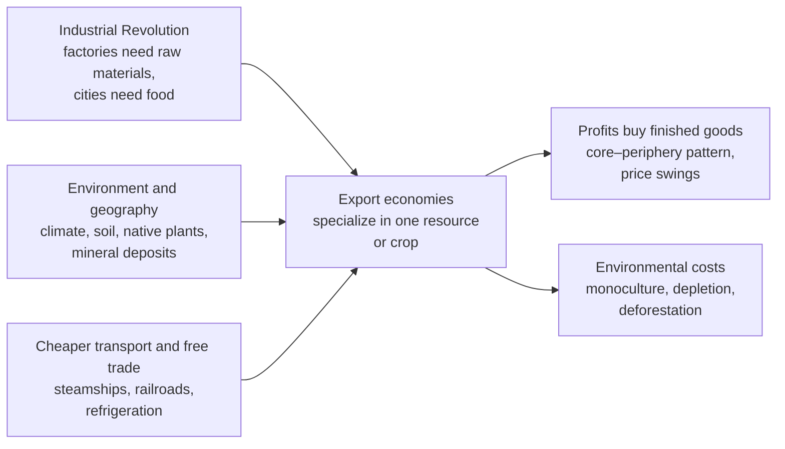
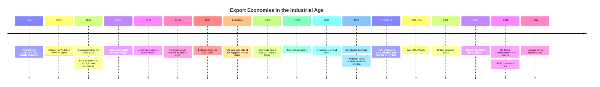
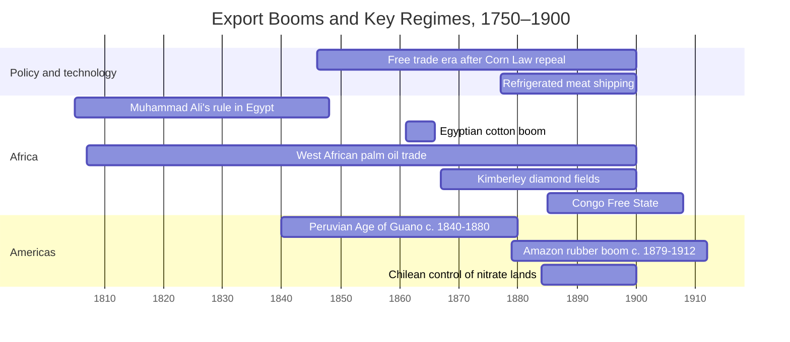
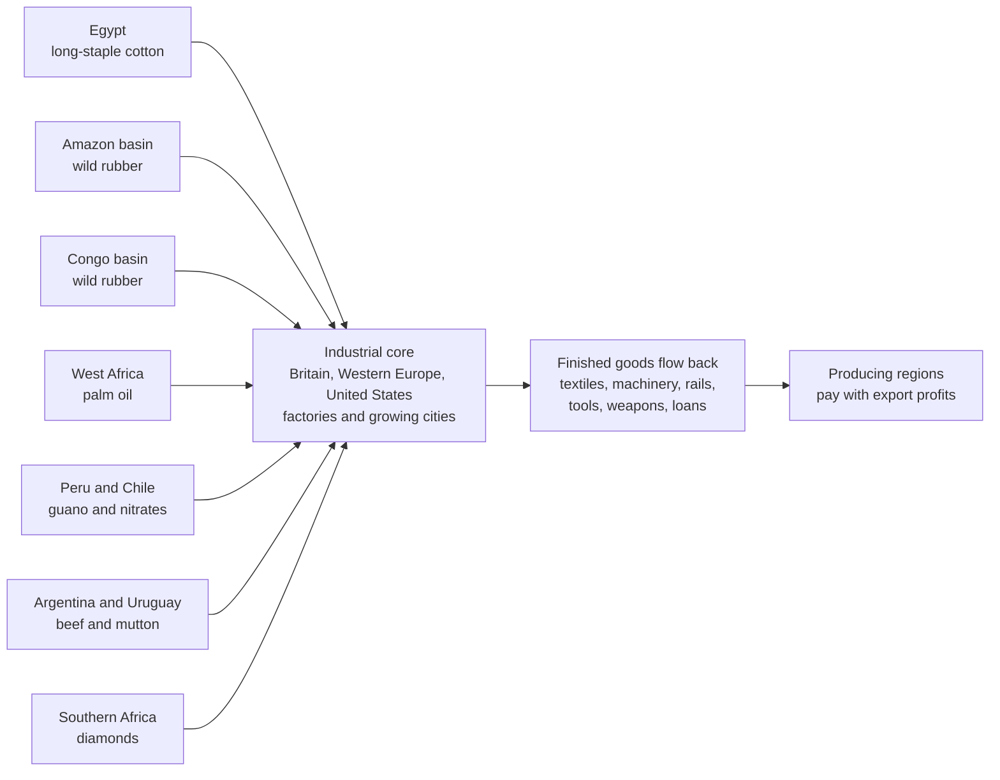
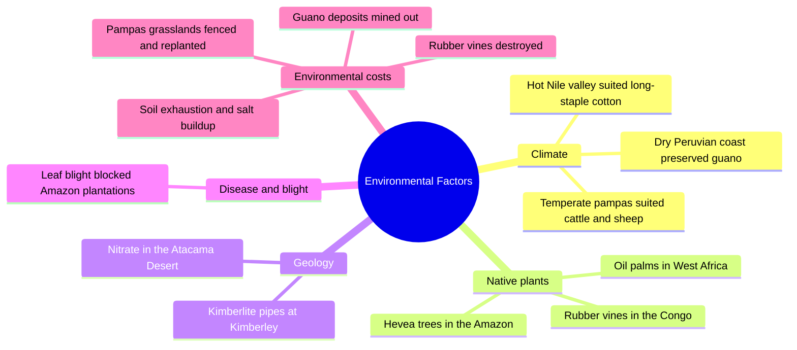

# AP World History: Modern — Topic 6.4 Global Economic Development from 1750 to 1900

**Focus Question:** How did environmental factors contribute to the development of the global economy from 1750 to 1900?

> Source: Based on the College Board CED · Textbook not yet incorporated

**Unit 6: Consequences of Industrialization (c. 1750–1900)**

---

## Learning Objective

| Code | Learning Objective |
|---|---|
| 6.4 LO-D (ENV) | Explain how various environmental factors contributed to the development of the global economy from 1750 to 1900. |

## Historical Developments (CED)

| # | Historical Development | Covered in |
|---|---|---|
| HD1 | KC-5.1.II.A: The need for raw materials for factories and increased food supplies for the growing population in urban centers led to the growth of export economies around the world that specialized in commercial extraction of natural resources and the production of food and industrial crops. The profits from these raw materials were used to purchase finished goods. | §1, §2, §3–§8, §9, §10 |
| HD1 · Ex. | Illustrative example — *Resource export economies:* Cotton production in Egypt | §3 |
| HD1 · Ex. | Illustrative example — *Resource export economies:* Rubber extraction in the Amazon and the Congo basin | §4 |
| HD1 · Ex. | Illustrative example — *Resource export economies:* The palm oil trade in West Africa | §5 |
| HD1 · Ex. | Illustrative example — *Resource export economies:* The guano industries in Peru and Chile | §6 |
| HD1 · Ex. | Illustrative example — *Resource export economies:* Meat from Argentina and Uruguay | §7 |
| HD1 · Ex. | Illustrative example — *Resource export economies:* Diamonds from Africa | §8 |

---

## The Big Picture

The **Industrial Revolution** (Unit 5) created two huge new needs. **Factories** in Britain, Western Europe, and the United States needed **raw materials** such as cotton, rubber, oils, and fertilizer. Their fast-growing **industrial cities** needed **food**. Few industrial countries could supply all of this themselves, so regions around the world turned into **export economies** that specialized in one or two natural resources or crops. **Environment and geography** decided which region supplied what: Egypt's hot, irrigated Nile valley grew fine cotton; rubber trees and vines grew wild in the Amazon and Congo rainforests; oil palms were native to West Africa; a rainless coast preserved **guano** in Peru; the temperate **pampas** fed cattle and sheep in Argentina and Uruguay; and ancient volcanic pipes held **diamonds** in southern Africa. **Steamships, railroads, the telegraph, refrigeration**, and the spread of **free trade** made it cheap to move these goods. The producing regions used their **profits to buy finished goods** from the industrial core, which created a **core–periphery** pattern of dependence on one export, painful **boom-and-bust** price swings, and serious **environmental costs** such as monoculture, soil exhaustion, deforestation, and the depletion of resources.

---

## §1. Context: Why Industrial Economies Needed the World

### Raw materials and food

- Mechanized factories (see Unit 5) consumed far more **raw material** than workshops ever had. British textile mills alone needed millions of bales of **cotton** each year.
- New machines and products created new demands: **rubber** for belts, hoses, and tires; **vegetable oils** for soap, candles, and lubricating machinery; **fertilizer** to raise farm output.
- **Urbanization** meant that millions of people no longer grew their own food. By the late 1800s, Britain imported much of its grain and meat.
- Industrial wealth also created a larger **middle class** that bought consumer and luxury goods, including **diamonds**.

### Cheaper and faster transport

| Technology or policy | Date | Effect on the global economy |
|---|---|---|
| **Steamships** | Spread from the mid-1800s | Faster, more reliable ocean shipping that no longer depended on winds |
| **Railroads** | From the 1830s in Europe; built abroad later in the century | Carried bulky goods from interiors to ports (for example, across the Argentine pampas) |
| **Suez Canal** | 1869 | Shortened the route between Europe and Asia and East Africa |
| **Telegraph and undersea cables** | From the 1850s–1860s | Merchants could follow prices and place orders across oceans |
| **Refrigerated ships** | Late 1870s–1880s | Fresh and frozen meat could cross the ocean without spoiling |
| **Free trade** | Adam Smith, *The Wealth of Nations* (1776); Britain repealed the **Corn Laws** (1846) | Britain moved from **mercantilism** to lower tariffs and opened its markets to imported food and raw materials |

> **Key idea:** Technology and free-trade policy lowered the cost of moving goods, so it became profitable for distant regions to specialize in a single export for industrial markets.

## §2. Environment and Geography: Who Became a Supplier

| Environmental factor | Example | Why it mattered |
|---|---|---|
| **Climate and water** | Egypt's hot, rain-free growing season and Nile irrigation | Ideal for **long-staple cotton** with long, strong fibers |
| **Native plants** | Wild *Hevea* rubber trees (Amazon); rubber vines (Congo); oil palms (West Africa) | Industries could **extract** wild resources before anyone planted them |
| **Dry coastal climate** | Almost no rain on Peru's coastal islands | Seabird droppings piled up for centuries as **guano** instead of washing away |
| **Desert geology** | Nitrate deposits in the **Atacama Desert** | A second fertilizer and explosives resource, which Peru, Bolivia, and Chile fought over |
| **Grasslands** | The temperate, flat **pampas** of Argentina and Uruguay | Huge herds of cattle and sheep could graze cheaply |
| **Mineral deposits** | Diamond-bearing **kimberlite** pipes at Kimberley | Rich deposits drew a mining rush and huge investment |
| **Disease and blight** | A leaf blight attacked rubber trees grown close together in the Amazon | Amazon rubber stayed wild and scattered, so later Asian plantations could undercut it |

- Environmental factors decided **where** each export economy could exist, but **people decided how** it was run: through state monopolies, foreign companies, or forced labor.

## §3. Cotton Production in Egypt

- **Muhammad Ali** (ruled 1805–1848) tried to make Egypt strong and modern (see Unit 5). He made cotton a **state monopoly**: peasants (**fellahin**) had to grow it and sell it to the state at fixed prices.
- From the 1820s Egypt grew **long-staple cotton**, prized by British mills for fine cloth. Peasants dug irrigation canals through **corvée** (forced) labor.
- **American Civil War (1861–1865):** the Union blockade cut off Southern cotton to Britain (the "cotton famine"). Egyptian cotton prices and exports **soared**, and more land was turned over to cotton.
- After 1865, American cotton returned and **prices fell**. Under **Khedive Ismail** (ruled 1863–1879), Egypt had already borrowed heavily from European banks for railroads, the **Suez Canal** (opened 1869), and modernization.
- Egypt went **bankrupt in 1876**, after Ismail had sold Egypt's Suez Canal shares to Britain in 1875. British and French officials took control of Egypt's finances, and **Britain occupied Egypt in 1882** (see 6.5).
- **Environmental effects:** year-round (**perennial**) irrigation allowed more cotton crops but caused **waterlogging and salt buildup** in the soil and spread water-borne diseases; Egypt became dependent on a **single crop**.

## §4. Rubber Extraction in the Amazon and the Congo Basin

### Why rubber?

- **Charles Goodyear's vulcanization (1839)** made rubber stable in heat and cold, so it could be used for machine belts, hoses, insulation for telegraph cables, and boots.
- The **pneumatic tire** (John Dunlop, **1888**) and the bicycle craze, followed by the automobile, made demand explode in the 1890s.

### The Amazon (Brazil and Peru)

- Rubber came from **wild *Hevea brasiliensis* trees** scattered through the rainforest. Workers called **seringueiros** (rubber tappers) cut the bark and collected the latex.
- Many tappers were migrants fleeing the **Great Drought (1877–1879)** in northeastern Brazil. Merchants advanced them food and tools on credit, which trapped them in **debt peonage**.
- In the Peruvian Putumayo region, the company of rubber baron **Julio César Arana** enslaved and killed Indigenous people; this was exposed between 1909 and 1912.
- **The Manaus boom (c. 1879–1912):** the jungle city of **Manaus** became one of the richest cities in Brazil, with electric streetlights and the **Teatro Amazonas** opera house (opened 1896).
- **The bust:** in **1876, Henry Wickham** shipped about 70,000 rubber seeds to Kew Gardens in London. Seedlings went to **British plantations in Ceylon and Malaya**, where rows of trees grew without the Amazon's leaf blight. By the 1910s cheap Asian plantation rubber undercut wild Amazon rubber, and Manaus declined.

### The Congo Basin

- At the **Berlin Conference (1884–1885)**, European powers recognized the **Congo Free State** as the personal property of **King Leopold II of Belgium** (see 6.2).
- Rubber there came from **wild vines**. Leopold's agents and companies set **quotas**; his army, the **Force Publique**, took hostages, burned villages, and cut off hands to punish villagers who fell short.
- Missionaries, the journalist **E. D. Morel**, and the British consul **Roger Casement** (report, **1904**) exposed the abuses. After an international outcry, **Belgium took over the colony in 1908**.
- **Environmental effects:** tappers under pressure often **cut down the vines** to drain them, which wiped out wild rubber in many areas and pushed collectors deeper into the forest.

> ⚠️ Needs verification: Estimates of population loss in the Congo Free State vary widely. A figure of about 10 million is often cited, but there was no census, and historians disagree about how much came from violence, famine, disease, and falling birth rates.

## §5. The Palm Oil Trade in West Africa

- **Oil palms** are native to West Africa. Palm oil was used in Britain for **soap**, **candles**, and **lubricating** factory machines and railroad engines, and in making **tinplate**.
- After **Britain abolished the slave trade (1807)**, British merchants and officials promoted palm oil as **"legitimate commerce"** to replace the trade in enslaved people.
- The trade centered on the **Niger Delta** (the "Oil Rivers") and the Bight of Benin. African middlemen such as **Jaja of Opobo** controlled the trade from the interior to the coast, until the British deported Jaja in 1887.
- **Labor:** the shift did not end slavery inside Africa. States such as **Dahomey** used **enslaved workers** to produce palm oil, and the demand for slave labor within West Africa **grew**. Women did much of the processing.
- Falling palm oil prices from the 1860s squeezed African traders, and European firms pushed to reach the producers directly, one of the economic pressures behind colonization (see 6.2 and 6.5).
- **Environmental effects:** most oil came from **wild and semi-wild groves**, so the environmental change was smaller than in later plantation farming.

## §6. The Guano Industries in Peru and Chile

- **Guano** is seabird droppings, rich in nitrogen and phosphate. On Peru's dry **Chincha Islands**, it had piled up for centuries into deposits many meters deep because it almost never rained there.
- European farmers, whose soils were exhausted by intensive farming to feed growing cities, bought guano as **fertilizer**. Peru's **"Age of Guano" (c. 1840–1880)** made guano the government's main source of income.
- The Peruvian state kept guano as a **state monopoly** and sold it through foreign merchant houses such as the British firm Antony Gibbs & Sons.
- **Labor:** digging guano was brutal work done largely by **Chinese indentured laborers** (often called "coolies"), along with convicts and enslaved workers (see 6.6).
- **Depletion:** the best deposits were **mined out by the 1870s**, and Peru fell into debt.
- **Nitrates:** sodium nitrate (saltpeter) from the **Atacama Desert** became the next fertilizer and was also used for **explosives**. Chile, Peru, and Bolivia all claimed nitrate and guano lands there.
- **War of the Pacific (1879–1884):** Chile defeated Peru and Bolivia and took the nitrate provinces of **Tarapacá** (from Peru) and **Antofagasta** (from Bolivia, which lost its coastline). British investors then dominated Chilean nitrate, and nitrate taxes became a large share of Chile's government revenue.

> ⚠️ Needs verification: Numbers for Chinese indentured workers sent to Peru (1849–1874) differ by source; about 90,000–100,000 is a common estimate.

## §7. Meat from Argentina and Uruguay

- The **pampas**, the flat, temperate grasslands of the Río de la Plata region, supported vast herds of **cattle and sheep**.
- **Before refrigeration,** the region exported **hides, tallow, and salted dried beef** (much of it to feed enslaved people in Brazil and Cuba). In 1865 the Liebig Extract of Meat Company opened at **Fray Bentos, Uruguay**, to turn beef into meat extract for Europe.
- **Refrigerated ships** from the late 1870s, and large meatpacking plants called **frigoríficos** from the 1880s, let Argentina and Uruguay ship **frozen and chilled beef and mutton** to Britain.
- **British investment** built the railways and port facilities that carried cattle to Buenos Aires (see 6.5). Argentina's **"Conquest of the Desert" (1878–1885)** pushed Indigenous peoples off the southern pampas and opened more land for ranching.
- **Labor:** **gauchos** (cowboys) became wage workers on large estates (**estancias**), and millions of **European immigrants**, mainly Italians and Spaniards, worked in meatpacking and farming (see 6.6).
- **Environmental effects:** native grasslands were **fenced with barbed wire**, overgrazed, and replanted with alfalfa and European grasses and grains.

> ⚠️ Needs verification: Sources give different "firsts" for refrigerated meat shipping. The French ship *Le Frigorifique* carried chilled meat from Buenos Aires to Rouen in 1876–1877, and the *Paraguay* carried frozen mutton to Le Havre in 1877–1878.

## §8. Diamonds from Africa

- In **1867**, diamonds were found near the **Orange River** in southern Africa. In **1871** a rush began at what became **Kimberley**, and Britain soon annexed the diamond fields.
- Thousands of small claims merged into a few companies. **Cecil Rhodes** founded the **De Beers** Mining Company (1880) and in **1888** formed **De Beers Consolidated Mines**, which came to control about 90% of the world's diamond output. De Beers limited supply to keep prices high.
- Rhodes used his diamond fortune to invest in gold mining on the Witwatersrand (discovered 1886), to found the **British South Africa Company (1889)**, and to serve as prime minister of the Cape Colony (1890–1896).
- **Labor:** tens of thousands of **African migrant workers** signed short contracts for low pay. From the mid-1880s they were housed in **closed compounds** where they could be searched and controlled, a model for later labor systems in South Africa.
- **Environmental effects:** the **"Big Hole"** at Kimberley became one of the largest hand-dug pits in the world; woodlands around the town were cut for fuel and timber, and water was scarce.
- **End use:** diamonds were mainly **luxury goods** for the growing wealthy and middle classes of industrial Europe and the United States.

## §9. Environmental Effects of Export Economies

| Effect | Example | Long-term result |
|---|---|---|
| **Monoculture** | Cotton in Egypt | Soils and the economy relied on one crop; pests and price drops hit everything at once |
| **Soil exhaustion and salinization** | Perennial irrigation in the Nile Delta | Salt buildup and waterlogging lowered yields |
| **Depletion of nonrenewable resources** | Guano on Peru's islands; diamonds at Kimberley | Deposits built over centuries were used up in decades |
| **Destruction of wild plants** | Rubber vines cut down in the Congo | Collectors had to go deeper into the forest under harsher pressure |
| **Deforestation** | Woodlands cut for fuel and timber at Kimberley; later clearing for Asian rubber plantations | Loss of forest and wildlife habitat |
| **Grassland conversion** | Fencing, overgrazing, and new crops on the pampas | Native grassland ecosystems largely disappeared |
| **Moving nutrients across the globe** | Guano and nitrates shipped to European farms | Industrial food supplies came to depend on distant, limited deposits |

- The demand for fertilizer shows how the **environment of the industrial core** (worn-out farmland around growing cities) shaped the **environment of the periphery**.

## §10. Profits for Finished Goods: The Core–Periphery Pattern

- Export regions sold **raw materials** and used the **profits to buy finished goods** (textiles, machinery, rails, tools, weapons) from industrial countries. This is the trade pattern the CED describes.
- Historians describe this as a **core–periphery** world economy: the industrial **core** (Britain, Western Europe, the US) made high-value manufactured goods, and the **periphery** supplied low-value raw materials and food.
- **Dependence on one export:** many economies relied on a single product, so their fortunes followed **world prices**.

| Export | Boom | What weakened it | Lasting effect |
|---|---|---|---|
| Egyptian cotton | 1861–1865 (US Civil War) | US cotton returned and prices fell | Debt, bankruptcy (1876), British occupation (1882) |
| Peruvian guano | c. 1840–1880 | Deposits mined out; nitrates replaced it | Debt; Peru lost its nitrate lands in the War of the Pacific |
| Amazon rubber | c. 1879–1912 | Cheap Asian plantation rubber from Wickham's seeds | Manaus declined, and the region returned to poverty |
| Congo rubber | 1890s–1908 | Wild vines exhausted; international outcry; Belgian takeover | Huge population losses and lasting trauma |
| West African palm oil | 1807 onward | Falling prices from the 1860s | European firms pushed inland; a step toward colonization |
| Argentine and Uruguayan meat | 1880s onward | Kept growing, but depended on British buyers, railways, and capital | Wealth for landowners alongside dependence on Britain |
| South African diamonds | 1870s onward | De Beers kept prices high by limiting supply | Migrant labor and compound system |

- **Who profited:** much of the profit went to **foreign investors**, merchant houses, and local **elites** (landowners, rulers), not to the workers who produced the goods. Foreign control of trade is the focus of **6.5 Economic Imperialism**.

---

## Timeline

---

## Map: Commodity Flows to the Industrial Core

---

## Comparison Table: Resource Export Economies

| Commodity | Region | End use in industrial economies | Environmental factor | Environmental effect | Labor system |
|---|---|---|---|---|---|
| **Cotton** | Egypt | Raw material for textile mills | Hot, rain-free season and Nile irrigation | Monoculture; waterlogging and salt buildup | Peasants forced to grow cotton for a state monopoly; corvée labor on canals |
| **Rubber** | Amazon (Brazil, Peru) | Belts, hoses, cable insulation, bicycle tires | Wild *Hevea* trees; leaf blight blocked plantations | Wild trees tapped; later forest clearing for plantations in Asia | Seringueiros in debt peonage; enslaved Indigenous people in the Putumayo |
| **Rubber** | Congo basin | Same uses as Amazon rubber | Wild rubber vines in the rainforest | Vines cut down and wiped out locally | Forced labor under quotas, enforced by the Force Publique |
| **Palm oil** | West Africa | Soap, candles, machine lubricants, tinplate | Native oil palms | Mostly wild groves, limited change | African producers and middlemen; enslaved workers in states such as Dahomey |
| **Guano and nitrates** | Peru and Chile | Fertilizer for European farms; nitrates also for explosives | Rainless coast and Atacama Desert | Deposits mined out in decades | Chinese indentured laborers, convicts; later wage miners in Chilean nitrate fields |
| **Meat** | Argentina and Uruguay | Food for industrial cities | Temperate, flat pampas grasslands | Fencing, overgrazing, grassland converted to crops | Gauchos as wage workers on estancias; European immigrants in meatpacking |
| **Diamonds** | Southern Africa (Kimberley) | Luxury goods for the wealthy and middle classes | Kimberlite pipes | The "Big Hole"; woodlands cut for fuel | African migrant workers in closed compounds |

---

## Key Terms

| Theme | Term | Definition |
|---|---|---|
| Economics | Export economy | An economy that specializes in producing one or a few raw materials or crops for sale abroad |
| Economics | Core–periphery | A world economy in which industrial countries make finished goods and other regions supply raw materials and food |
| Economics | Free trade | Trade with low or no tariffs; Britain adopted it after repealing the Corn Laws (1846) |
| Economics | Mercantilism | The older policy of using colonies and tariffs to build a country's wealth and limit imports |
| Economics | Legitimate commerce | The trade in goods such as palm oil that Britain promoted in West Africa to replace the slave trade |
| Economics | Debt peonage | A labor system in which workers are bound by debts they can never fully repay |
| Environment | Monoculture | Growing a single crop over a large area, as with cotton in Egypt |
| Environment | Guano | Seabird droppings, rich in nitrogen and phosphate, used as fertilizer |
| Environment | Nitrate | Sodium nitrate from the Atacama Desert, used for fertilizer and explosives |
| Environment | Pampas | The flat, temperate grasslands of Argentina and Uruguay |
| Environment | Long-staple cotton | Cotton with long, strong fibers, grown in Egypt from the 1820s |
| Technology | Vulcanization | Goodyear's 1839 process that made rubber stable in heat and cold |
| Technology | Refrigerated ship | A ship with cooling machinery that carried chilled or frozen meat across oceans |
| Technology | Frigorífico | A large meatpacking and freezing plant in Argentina or Uruguay |
| Government | Congo Free State | The Congo basin as King Leopold II's personal colony (1885–1908) |
| Government | War of the Pacific | Chile's war against Peru and Bolivia (1879–1884) over nitrate and guano lands |
| Government | Muhammad Ali | Ruler of Egypt (1805–1848) who made cotton a state monopoly |
| Society | Seringueiros | Rubber tappers in the Amazon, often trapped in debt |
| Society | Closed compound | Fenced barracks where African diamond miners were housed and controlled |
| Society | Chinese indentured laborers | Contract workers from China who dug guano in Peru under harsh conditions |
| Economics | De Beers | Cecil Rhodes's company that controlled most of the world's diamond supply by the 1890s |
