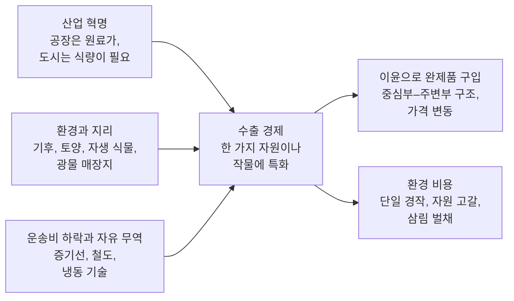
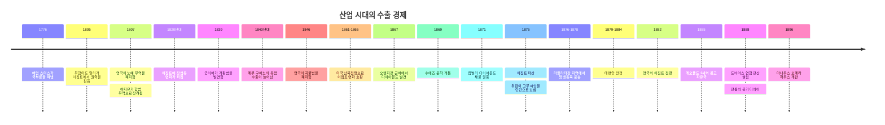
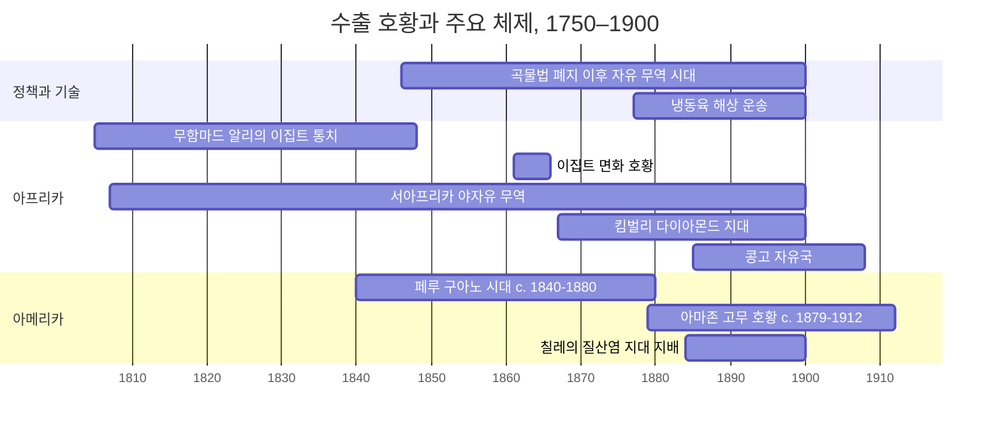
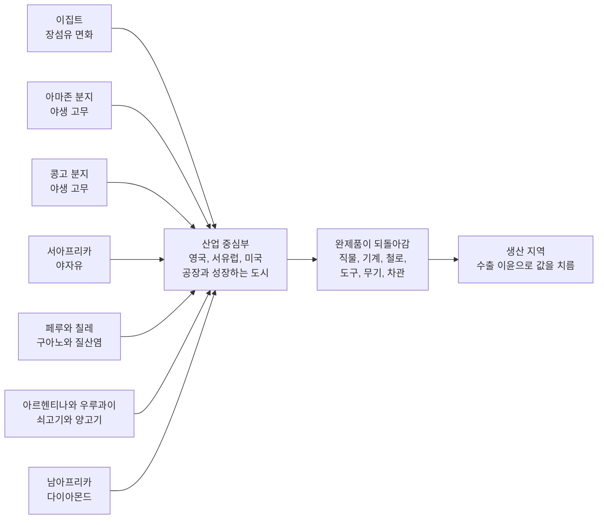
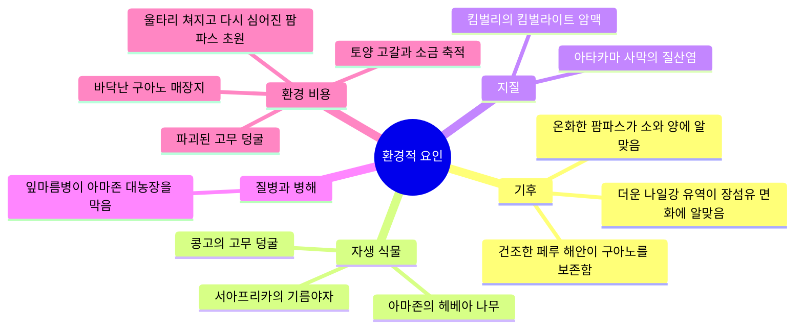

# AP 세계사: 모던 — 토픽 6.4 1750–1900년 세계 경제의 발전 (Global Economic Development from 1750 to 1900)

**Focus Question:** 1750년부터 1900년까지 환경적 요인은 세계 경제의 발전에 어떻게 기여했는가?

> 출처: CED 기준 · 교재 반영 전

**Unit 6: 산업화의 결과 (Consequences of Industrialization, c. 1750–1900)**

---

## 학습 목표 (Learning Objective)

| 코드 | 학습 목표 |
|---|---|
| 6.4 LO-D (ENV) | 1750년부터 1900년까지 여러 환경적 요인이 세계 경제의 발전에 어떻게 기여했는지 설명한다. |

## 역사적 개념 (Historical Developments, CED)

| # | 역사적 개념 | 다루는 곳 |
|---|---|---|
| HD1 | KC-5.1.II.A: 공장에 필요한 원료와 도시 중심지의 늘어나는 인구를 위한 식량 공급 증대의 필요는, 천연자원의 상업적 채취와 식량 및 공업용 작물 생산에 특화된 수출 경제 (Export economies)가 세계 곳곳에서 성장하는 결과를 낳았다. 이러한 원료에서 얻은 이윤은 완제품을 구입하는 데 쓰였다. | §1, §2, §3–§8, §9, §10 |
| HD1 · 예시 | 예시 (Illustrative example) — *자원 수출 경제 (Resource export economies):* 이집트의 면화 생산 (Cotton production in Egypt) | §3 |
| HD1 · 예시 | 예시 — *자원 수출 경제:* 아마존과 콩고 분지의 고무 채취 (Rubber extraction in the Amazon and the Congo basin) | §4 |
| HD1 · 예시 | 예시 — *자원 수출 경제:* 서아프리카의 야자유 무역 (The palm oil trade in West Africa) | §5 |
| HD1 · 예시 | 예시 — *자원 수출 경제:* 페루와 칠레의 구아노 산업 (The guano industries in Peru and Chile) | §6 |
| HD1 · 예시 | 예시 — *자원 수출 경제:* 아르헨티나와 우루과이의 육류 (Meat from Argentina and Uruguay) | §7 |
| HD1 · 예시 | 예시 — *자원 수출 경제:* 아프리카의 다이아몬드 (Diamonds from Africa) | §8 |

---

## 큰 그림 요약

**산업 혁명 (Industrial Revolution)**(Unit 5)은 두 가지 거대한 수요를 새로 만들었다. 영국, 서유럽, 미국의 **공장**은 면화, 고무, 기름, 비료 같은 **원료**가 필요했다. 빠르게 커지는 **산업 도시**는 **식량**이 필요했다. 산업 국가 가운데 이 모든 것을 스스로 공급할 수 있는 나라는 거의 없었다. 그래서 세계 각지의 지역들이 한두 가지 천연자원이나 작물에 특화된 **수출 경제 (Export economy)**로 바뀌었다. 어느 지역이 무엇을 공급할지는 **환경과 지리**가 정했다. 덥고 관개가 잘된 이집트 나일강 유역은 질 좋은 면화를 길렀다. 아마존과 콩고의 열대 우림에는 고무나무와 고무 덩굴이 야생으로 자랐다. 기름야자는 서아프리카가 원산지였다. 비가 오지 않는 페루 해안은 **구아노 (Guano)**를 보존했다. 온화한 **팜파스 (Pampas)**는 아르헨티나와 우루과이의 소와 양을 먹였다. 남아프리카의 오래된 화산 암맥에는 **다이아몬드**가 있었다. **증기선, 철도, 전신, 냉동 기술**, 그리고 **자유 무역 (Free trade)**의 확산으로 이런 상품을 싸게 옮길 수 있었다. 생산 지역은 **이윤으로 산업 중심부의 완제품을 샀다.** 그 결과 한 가지 수출품에 의존하는 **중심부–주변부 (Core–periphery)** 구조, 고통스러운 **호황과 불황**의 가격 변동, 그리고 단일 경작, 토양 고갈, 삼림 벌채, 자원 고갈 같은 심각한 **환경 비용**이 생겼다.

---

## §1. 배경: 산업 경제가 세계를 필요로 한 이유

### 원료와 식량

- 기계화된 공장(Unit 5 참고)은 예전의 작업장보다 훨씬 많은 **원료**를 썼다. 영국의 섬유 공장만 해도 해마다 수백만 꾸러미의 **면화**가 필요했다.
- 새로운 기계와 제품은 새로운 수요를 낳았다. 벨트, 호스, 타이어에 쓸 **고무**, 비누와 양초를 만들고 기계에 기름칠할 **식물성 기름**, 농업 생산을 늘릴 **비료**가 필요했다.
- **도시화 (Urbanization)**로 수백만 명이 더는 자기 식량을 직접 기르지 않게 되었다. 1800년대 후반 영국은 곡물과 고기의 상당 부분을 수입했다.
- 산업으로 생긴 부는 소비재와 사치품을 사는 **중산층**도 키웠다. **다이아몬드**도 그런 상품이었다.

### 더 싸고 빠른 운송

| 기술 또는 정책 | 시기 | 세계 경제에 준 영향 |
|---|---|---|
| **증기선 (Steamships)** | 1800년대 중반부터 확산 | 바람에 의존하지 않는, 더 빠르고 믿을 수 있는 해운이 가능해짐 |
| **철도 (Railroads)** | 유럽에서는 1830년대부터, 다른 지역에는 세기 후반에 건설 | 부피가 큰 상품을 내륙에서 항구로 실어 나름 (예: 아르헨티나 팜파스 횡단) |
| **수에즈 운하 (Suez Canal)** | 1869년 | 유럽과 아시아·동아프리카 사이의 항로를 줄임 |
| **전신과 해저 케이블 (Telegraph and undersea cables)** | 1850–1860년대부터 | 상인이 바다 건너의 가격을 확인하고 주문할 수 있게 됨 |
| **냉동선 (Refrigerated ships)** | 1870년대 후반–1880년대 | 신선육과 냉동육이 상하지 않고 바다를 건널 수 있게 됨 |
| **자유 무역 (Free trade)** | 애덤 스미스 (Adam Smith), 『국부론 (The Wealth of Nations)』(1776). 영국의 **곡물법 (Corn Laws)** 폐지 (1846) | 영국이 **중상주의 (Mercantilism)**에서 벗어나 관세를 낮추고 수입 식량과 원료에 시장을 열었음 |

> **핵심:** 기술과 자유 무역 정책이 상품 운송비를 낮췄다. 그래서 먼 지역도 산업 시장을 겨냥해 한 가지 수출품에 특화하면 이익을 낼 수 있게 되었다.

## §2. 환경과 지리: 누가 공급지가 되었는가

| 환경적 요인 | 예 | 중요성 |
|---|---|---|
| **기후와 물** | 덥고 비가 오지 않는 이집트의 재배 기간과 나일강 관개 | 섬유가 길고 질긴 **장섬유 면화 (Long-staple cotton)** 재배에 알맞았음 |
| **자생 식물** | 야생 *헤베아 (Hevea)* 고무나무(아마존), 고무 덩굴(콩고), 기름야자(서아프리카) | 누군가 심기 전부터 야생 자원을 **채취**할 수 있었음 |
| **건조한 해안 기후** | 비가 거의 오지 않는 페루 해안의 섬들 | 바닷새 배설물이 씻겨 내려가지 않고 수백 년 동안 쌓여 **구아노**가 되었음 |
| **사막의 지질** | **아타카마 사막 (Atacama Desert)**의 질산염 매장지 | 비료와 폭약의 두 번째 자원으로, 페루·볼리비아·칠레가 이를 두고 싸웠음 |
| **초원** | 온화하고 평평한 아르헨티나와 우루과이의 **팜파스** | 거대한 소 떼와 양 떼를 싸게 방목할 수 있었음 |
| **광물 매장지** | 킴벌리 (Kimberley)의 다이아몬드를 품은 **킴벌라이트 (Kimberlite)** 암맥 | 풍부한 매장량이 채굴 열풍과 막대한 투자를 불렀음 |
| **질병과 병해** | 아마존에서 촘촘히 심은 고무나무를 공격한 잎마름병 (Leaf blight) | 아마존 고무는 야생 상태로 흩어져 있었고, 그래서 나중에 아시아 대농장이 아마존을 앞지를 수 있었음 |

- 환경적 요인은 수출 경제가 **어디에** 생길 수 있는지를 정했다. 하지만 그 경제를 **어떻게** 운영할지는 사람이 정했다. 국가 독점, 외국 기업, 강제 노동 등이 그 방식이었다.

## §3. 이집트의 면화 생산

- **무함마드 알리 (Muhammad Ali)**(재위 1805–1848)는 이집트를 강하고 근대적인 나라로 만들려 했다(Unit 5 참고). 그는 면화를 **국가 독점 (State monopoly)**으로 만들었다. 농민(**펠라힌 (Fellahin)**)은 면화를 길러 국가에 정해진 가격으로 팔아야 했다.
- 1820년대부터 이집트는 고급 직물을 만드는 영국 공장이 높이 평가한 **장섬유 면화**를 길렀다. 농민들은 **부역 (Corvée)**(강제 노동)으로 관개 수로를 팠다.
- **미국 남북전쟁 (American Civil War, 1861–1865):** 북부의 해상 봉쇄로 남부 면화가 영국에 들어가지 못했다("면화 기근 (Cotton famine)"). 이집트 면화의 가격과 수출이 **치솟았고**, 더 많은 땅이 면화밭으로 바뀌었다.
- 1865년 이후 미국 면화가 돌아오면서 **가격이 떨어졌다.** **헤디브 이스마일 (Khedive Ismail)**(재위 1863–1879) 시기 이집트는 이미 철도, **수에즈 운하**(1869년 개통), 근대화 사업을 위해 유럽 은행에서 많은 돈을 빌린 상태였다.
- 이스마일은 1875년 이집트가 가진 수에즈 운하 주식을 영국에 팔았지만, 이집트는 **1876년 파산했다.** 영국과 프랑스 관리들이 이집트 재정을 장악했고, **영국은 1882년 이집트를 점령했다**(6.5 참고).
- **환경적 영향:** 1년 내내 물을 대는 **상시 관개 (Perennial irrigation)**로 면화를 더 많이 기를 수 있었다. 그러나 토양에 **물이 고이고 소금이 쌓였으며**, 물을 통해 퍼지는 질병이 늘었다. 이집트는 **단일 작물**에 의존하게 되었다.

## §4. 아마존과 콩고 분지의 고무 채취

### 왜 고무인가?

- **찰스 굿이어 (Charles Goodyear)의 가황법 (Vulcanization, 1839)**으로 고무가 더위와 추위에도 변하지 않게 되었다. 그래서 기계 벨트, 호스, 전신 케이블 절연재, 장화에 고무를 쓸 수 있었다.
- **공기 타이어 (Pneumatic tire)**(존 던롭 (John Dunlop), **1888**)와 자전거 열풍, 이어진 자동차의 등장으로 1890년대에 수요가 폭발했다.

### 아마존 (브라질과 페루)

- 고무는 열대 우림 곳곳에 흩어져 자라는 **야생 *헤베아 브라실리엔시스 (Hevea brasiliensis)* 나무**에서 나왔다. **세링게이루 (Seringueiros)**라고 불린 고무 채취꾼이 나무껍질을 베어 수액(라텍스)을 모았다.
- 채취꾼 가운데 많은 수는 브라질 북동부의 **대가뭄 (Great Drought, 1877–1879)**을 피해 온 이주민이었다. 상인들은 식량과 도구를 외상으로 내주었고, 채취꾼들은 **채무 노동 (Debt peonage)**에 묶였다.
- 페루의 푸투마요 (Putumayo) 지역에서는 고무 거상 **훌리오 세사르 아라나 (Julio César Arana)**의 회사가 원주민을 노예로 부리고 죽였다. 이 사실은 1909년부터 1912년 사이에 폭로되었다.
- **마나우스 호황 (c. 1879–1912):** 정글 도시 **마나우스 (Manaus)**는 브라질에서 가장 부유한 도시 가운데 하나가 되었다. 전기 가로등과 **아마조나스 극장 (Teatro Amazonas)** 오페라 하우스(1896년 개관)가 있었다.
- **몰락:** **1876년 헨리 위컴 (Henry Wickham)**은 고무 씨앗 약 7만 개를 런던의 큐 식물원 (Kew Gardens)으로 보냈다. 묘목은 **실론과 말라야의 영국 대농장**으로 옮겨졌다. 그곳에서는 아마존의 잎마름병 없이 나무를 줄지어 기를 수 있었다. 1910년대가 되자 값싼 아시아 대농장 고무가 아마존의 야생 고무를 밀어냈고, 마나우스는 쇠퇴했다.

### 콩고 분지

- **베를린 회의 (Berlin Conference, 1884–1885)**에서 유럽 열강은 **콩고 자유국 (Congo Free State)**을 **벨기에 국왕 레오폴드 2세 (Leopold II)**의 개인 소유로 인정했다(6.2 참고).
- 이곳의 고무는 **야생 덩굴**에서 나왔다. 레오폴드의 관리와 회사들은 **할당량 (Quota)**을 정했다. 그의 군대인 **공안군 (Force Publique)**은 할당량을 채우지 못한 마을 사람들을 벌하려고 인질을 잡고, 마을을 불태우고, 손을 잘랐다.
- 선교사, 언론인 **E. D. 모렐 (E. D. Morel)**, 영국 영사 **로저 케이스먼트 (Roger Casement)**(보고서, **1904**)가 이런 학대를 폭로했다. 국제적인 비난이 일자 **1908년 벨기에 정부가 식민지를 넘겨받았다.**
- **환경적 영향:** 압박을 받은 채취꾼들은 수액을 짜내려고 **덩굴을 아예 베어 내는** 일이 많았다. 그래서 여러 지역에서 야생 고무가 사라졌고, 채취꾼들은 숲속 더 깊이 들어가야 했다.

> ⚠️ 확인 필요: 콩고 자유국의 인구 감소 추정치는 자료마다 크게 다르다. 약 1,000만 명이라는 수치가 자주 인용되지만, 인구 조사가 없었고, 폭력·기근·질병·출생률 감소가 각각 얼마나 영향을 주었는지에 대해 역사가들의 의견이 엇갈린다.

## §5. 서아프리카의 야자유 무역

- **기름야자 (Oil palm)**는 서아프리카가 원산지다. 영국에서 야자유는 **비누**, **양초**, 공장 기계와 기관차의 **윤활유**, 그리고 **양철판 (Tinplate)** 제조에 쓰였다.
- **영국이 노예 무역을 폐지한 뒤(1807)**, 영국 상인과 관리들은 노예 무역을 대신할 **"합법 무역 (Legitimate commerce)"**으로 야자유를 장려했다.
- 무역의 중심은 **니제르강 삼각주 (Niger Delta)**("오일 리버스 (Oil Rivers)")와 베냉만이었다. **오포보의 자자 (Jaja of Opobo)** 같은 아프리카 중개상이 내륙에서 해안까지의 무역을 장악했지만, 1887년 영국이 자자를 추방했다.
- **노동:** 이 변화로 아프리카 안의 노예제가 끝나지는 않았다. **다호메이 (Dahomey)** 같은 국가는 **노예 노동자**를 써서 야자유를 생산했고, 서아프리카 안에서 노예 노동 수요는 오히려 **늘었다.** 가공 작업의 상당 부분은 여성이 맡았다.
- 1860년대부터 야자유 가격이 떨어지자 아프리카 상인들이 어려워졌다. 유럽 회사들은 생산자와 직접 거래하려 했고, 이는 식민지화를 부른 경제적 압력 가운데 하나가 되었다(6.2, 6.5 참고).
- **환경적 영향:** 야자유 대부분은 **야생 또는 반(半)야생 숲**에서 나왔다. 그래서 훗날의 대농장 농업보다 환경 변화가 작았다.

## §6. 페루와 칠레의 구아노 산업

- **구아노**는 질소와 인이 풍부한 바닷새 배설물이다. 페루의 건조한 **친차 제도 (Chincha Islands)**에는 비가 거의 오지 않아서, 구아노가 수백 년 동안 쌓여 수십 미터 깊이의 매장지가 되었다.
- 늘어나는 도시를 먹이려는 집약 농업으로 땅이 지친 유럽 농민들은 구아노를 **비료**로 샀다. 페루의 **"구아노 시대 (Age of Guano, c. 1840–1880)"**에 구아노는 정부의 가장 중요한 수입원이 되었다.
- 페루 정부는 구아노를 **국가 독점**으로 두고, 영국의 앤터니 기브스 앤드 선스 (Antony Gibbs & Sons) 같은 외국 상사를 통해 팔았다.
- **노동:** 구아노 채굴은 가혹한 일이었고, 주로 **중국인 계약 노동자 (Chinese indentured laborers)**("쿨리 (Coolies)"라고 불림)가 죄수, 노예 노동자와 함께 맡았다(6.6 참고).
- **고갈:** 좋은 매장지는 **1870년대에 바닥났고**, 페루는 빚더미에 올랐다.
- **질산염 (Nitrates):** **아타카마 사막**의 질산나트륨(초석)이 다음 비료가 되었고, **폭약**에도 쓰였다. 칠레, 페루, 볼리비아가 모두 그곳의 질산염과 구아노 지대를 차지하려 했다.
- **태평양 전쟁 (War of the Pacific, 1879–1884):** 칠레가 페루와 볼리비아를 꺾고 질산염 지역인 **타라파카 (Tarapacá)**(페루에게서)와 **안토파가스타 (Antofagasta)**(볼리비아에게서, 볼리비아는 해안을 잃음)를 차지했다. 이후 영국 투자자들이 칠레 질산염 산업을 장악했고, 질산염 세금은 칠레 정부 수입의 큰 부분을 차지했다.

> ⚠️ 확인 필요: 페루로 보내진 중국인 계약 노동자(1849–1874)의 수는 자료마다 다르다. 약 9만–10만 명이 흔히 쓰이는 추정치다.

## §7. 아르헨티나와 우루과이의 육류

- 라플라타강 (Río de la Plata) 지역의 평평하고 온화한 초원인 **팜파스**는 거대한 **소 떼와 양 떼**를 먹여 살렸다.
- **냉동 기술 이전에는** 이 지역이 **가죽, 수지(獸脂), 소금에 절여 말린 쇠고기**를 수출했다(상당량이 브라질과 쿠바의 노예를 먹이는 데 쓰였다). 1865년에는 리비히 육즙 회사 (Liebig Extract of Meat Company)가 **우루과이 프라이벤토스 (Fray Bentos)**에 공장을 열어 쇠고기를 유럽용 고기 추출물로 만들었다.
- 1870년대 후반의 **냉동선**과 1880년대부터 세워진 대형 정육·냉동 공장인 **프리고리피코 (Frigoríficos)** 덕분에 아르헨티나와 우루과이는 **냉동·냉장 쇠고기와 양고기**를 영국에 보낼 수 있었다.
- **영국 자본**이 소를 부에노스아이레스로 실어 나를 철도와 항만 시설을 지었다(6.5 참고). 아르헨티나의 **"사막 정복 (Conquest of the Desert, 1878–1885)"**은 원주민을 남부 팜파스에서 몰아내고 목장으로 쓸 땅을 더 열었다.
- **노동:** **가우초 (Gauchos)**(목동)는 대농장(**에스탄시아 (Estancias)**)의 임금 노동자가 되었다. 주로 이탈리아인과 스페인인인 수백만 명의 **유럽 이민자**가 정육 공장과 농장에서 일했다(6.6 참고).
- **환경적 영향:** 자연 초원은 **철조망 울타리 (Barbed wire)**로 나뉘었고, 과도한 방목에 시달렸으며, 알팔파와 유럽산 목초·곡물로 다시 심어졌다.

> ⚠️ 확인 필요: 냉동육 운송의 "최초"는 자료마다 다르게 쓴다. 프랑스 배 *르 프리고리피크 (Le Frigorifique)*는 1876–1877년 부에노스아이레스에서 루앙으로 냉장육을 날랐고, *파라과이 (Paraguay)*호는 1877–1878년 냉동 양고기를 르아브르로 날랐다.

## §8. 아프리카의 다이아몬드

- **1867년** 남아프리카 **오렌지강 (Orange River)** 근처에서 다이아몬드가 발견되었다. **1871년**에는 훗날 **킴벌리**가 된 곳에서 채굴 열풍이 시작되었고, 영국은 곧 다이아몬드 지대를 합병했다.
- 수천 개의 작은 채굴권이 몇몇 회사로 합쳐졌다. **세실 로즈 (Cecil Rhodes)**는 **드비어스 (De Beers)** 광업 회사(1880)를 세웠고, **1888년** **드비어스 연합 광산 (De Beers Consolidated Mines)**을 만들었다. 이 회사는 세계 다이아몬드 생산의 약 90%를 장악하게 되었다. 드비어스는 공급을 제한해 가격을 높게 유지했다.
- 로즈는 다이아몬드로 번 돈을 비트바테르스란트 (Witwatersrand) 금광(1886년 발견)에 투자했고, **영국 남아프리카 회사 (British South Africa Company, 1889)**를 세웠으며, 케이프 식민지 총리(1890–1896)를 지냈다.
- **노동:** 수만 명의 **아프리카인 이주 노동자**가 낮은 임금에 짧은 계약을 맺었다. 1880년대 중반부터 이들은 몸수색과 통제를 받는 **폐쇄 합숙소 (Closed compounds)**에서 지냈다. 이 방식은 훗날 남아프리카 노동 제도의 본보기가 되었다.
- **환경적 영향:** 킴벌리의 **"빅 홀 (Big Hole)"**은 사람 손으로 판 세계에서 가장 큰 구덩이 가운데 하나가 되었다. 도시 주변의 숲은 연료와 목재용으로 베어졌고, 물이 부족했다.
- **최종 용도:** 다이아몬드는 주로 산업화된 유럽과 미국에서 늘어난 부유층과 중산층을 위한 **사치품**이었다.

## §9. 수출 경제의 환경적 영향

| 영향 | 예 | 장기적 결과 |
|---|---|---|
| **단일 경작 (Monoculture)** | 이집트의 면화 | 토양과 경제가 한 작물에 의존했고, 병충해와 가격 하락이 한꺼번에 모든 것을 덮쳤음 |
| **토양 고갈과 염류화 (Soil exhaustion and salinization)** | 나일강 삼각주의 상시 관개 | 소금이 쌓이고 물이 고여 수확량이 줄었음 |
| **재생 불가능한 자원의 고갈 (Depletion of nonrenewable resources)** | 페루 섬들의 구아노, 킴벌리의 다이아몬드 | 수백 년에 걸쳐 쌓인 매장지가 수십 년 만에 바닥났음 |
| **야생 식물의 파괴 (Destruction of wild plants)** | 콩고에서 베어진 고무 덩굴 | 채취꾼들은 더 가혹한 압박 속에서 숲속 더 깊이 들어가야 했음 |
| **삼림 벌채 (Deforestation)** | 킴벌리의 연료·목재용 벌채, 훗날 아시아 고무 대농장을 위한 개간 | 숲과 야생 동물 서식지가 사라졌음 |
| **초원의 변화 (Grassland conversion)** | 팜파스의 울타리, 과도한 방목, 새 작물 | 자연 초원 생태계가 거의 사라졌음 |
| **영양분의 지구적 이동 (Moving nutrients across the globe)** | 유럽 농장으로 운송된 구아노와 질산염 | 산업 사회의 식량 공급이 멀리 떨어진 한정된 매장지에 의존하게 되었음 |

- 비료 수요는 **산업 중심부의 환경**(늘어나는 도시 주변의 지친 농지)이 **주변부의 환경**을 어떻게 바꾸었는지 보여 준다.

## §10. 원료의 이윤으로 완제품을: 중심부–주변부 구조

- 수출 지역은 **원료**를 팔고, 그 **이윤으로 산업 국가의 완제품**(직물, 기계, 철로, 도구, 무기)을 샀다. 이것이 CED가 설명하는 무역 구조다.
- 역사가들은 이를 **중심부–주변부** 세계 경제라고 부른다. 산업화된 **중심부 (Core)**(영국, 서유럽, 미국)는 부가가치가 높은 공산품을 만들었고, **주변부 (Periphery)**는 값싼 원료와 식량을 공급했다.
- **한 가지 수출품에 대한 의존:** 많은 경제가 단일 상품에 기댔기 때문에, 그 운명은 **세계 가격**에 따라 오르내렸다.

| 수출품 | 호황기 | 약해진 이유 | 남은 영향 |
|---|---|---|---|
| 이집트 면화 (Egyptian cotton) | 1861–1865 (미국 남북전쟁) | 미국 면화가 돌아오면서 가격이 떨어짐 | 부채, 파산(1876), 영국의 점령(1882) |
| 페루 구아노 (Peruvian guano) | c. 1840–1880 | 매장지가 바닥나고 질산염이 대신함 | 부채. 페루는 태평양 전쟁에서 질산염 지대를 잃음 |
| 아마존 고무 (Amazon rubber) | c. 1879–1912 | 위컴의 씨앗에서 나온 값싼 아시아 대농장 고무 | 마나우스가 쇠퇴하고 지역이 다시 가난해짐 |
| 콩고 고무 (Congo rubber) | 1890년대–1908 | 야생 덩굴 고갈, 국제적 비난, 벨기에 정부의 인수 | 막대한 인구 감소와 오래 남은 상처 |
| 서아프리카 야자유 (West African palm oil) | 1807년 이후 | 1860년대부터 가격 하락 | 유럽 회사들의 내륙 진출. 식민지화로 가는 한 단계 |
| 아르헨티나·우루과이 육류 (Argentine and Uruguayan meat) | 1880년대 이후 | 계속 성장했지만 영국의 구매자, 철도, 자본에 의존함 | 지주의 부와 영국에 대한 의존이 함께 생김 |
| 남아프리카 다이아몬드 (South African diamonds) | 1870년대 이후 | 드비어스가 공급을 제한해 가격을 높게 유지함 | 이주 노동과 합숙소 제도 |

- **누가 이익을 얻었나:** 이윤의 상당 부분은 상품을 생산한 노동자가 아니라 **외국 투자자**, 상사, 그리고 현지 **엘리트**(지주, 통치자)에게 돌아갔다. 외국의 무역 지배는 **6.5 경제적 제국주의 (Economic Imperialism)**에서 자세히 다룬다.

---

## 연표

---

## 지도: 산업 중심부로 향한 상품의 흐름

---

## 비교표: 자원 수출 경제

| 상품 | 지역 | 산업 경제에서의 최종 용도 | 환경적 요인 | 환경적 영향 | 노동 제도 |
|---|---|---|---|---|---|
| **면화 (Cotton)** | 이집트 | 섬유 공장의 원료 | 덥고 비 없는 재배 기간과 나일강 관개 | 단일 경작, 토양에 물이 고이고 소금이 쌓임 | 국가 독점을 위해 면화 재배를 강요받은 농민, 수로 건설의 부역 |
| **고무 (Rubber)** | 아마존 (브라질, 페루) | 벨트, 호스, 케이블 절연재, 자전거 타이어 | 야생 헤베아 나무, 잎마름병 때문에 대농장이 어려움 | 야생 나무에서 채취, 훗날 아시아 대농장을 위한 숲 개간 | 채무 노동에 묶인 세링게이루, 푸투마요에서 노예가 된 원주민 |
| **고무 (Rubber)** | 콩고 분지 | 아마존 고무와 같은 용도 | 열대 우림의 야생 고무 덩굴 | 덩굴이 베어져 곳곳에서 사라짐 | 공안군이 집행한 할당량 강제 노동 |
| **야자유 (Palm oil)** | 서아프리카 | 비누, 양초, 기계 윤활유, 양철판 | 자생 기름야자 | 대부분 야생 숲에서 채취, 변화가 제한적 | 아프리카 생산자와 중개상, 다호메이 같은 국가의 노예 노동자 |
| **구아노와 질산염 (Guano and nitrates)** | 페루와 칠레 | 유럽 농장의 비료, 질산염은 폭약에도 쓰임 | 비 없는 해안과 아타카마 사막 | 매장지가 수십 년 만에 바닥남 | 중국인 계약 노동자, 죄수, 이후 칠레 질산염 광산의 임금 광부 |
| **육류 (Meat)** | 아르헨티나와 우루과이 | 산업 도시의 식량 | 온화하고 평평한 팜파스 초원 | 울타리, 과도한 방목, 초원의 농지화 | 에스탄시아의 임금 노동자가 된 가우초, 정육 공장의 유럽 이민자 |
| **다이아몬드 (Diamonds)** | 남아프리카 (킴벌리) | 부유층과 중산층을 위한 사치품 | 킴벌라이트 암맥 | "빅 홀", 연료용 벌채 | 폐쇄 합숙소의 아프리카인 이주 노동자 |

---

## Key Terms (핵심 용어)

| 주제 | 용어 | 정의 |
|---|---|---|
| 경제 | 수출 경제 (Export economy) | 해외에 팔 한 가지 또는 몇 가지 원료나 작물 생산에 특화한 경제 |
| 경제 | 중심부–주변부 (Core–periphery) | 산업 국가가 완제품을 만들고 다른 지역이 원료와 식량을 공급하는 세계 경제 구조 |
| 경제 | 자유 무역 (Free trade) | 관세가 낮거나 없는 무역. 영국은 곡물법 폐지(1846) 이후 이를 택함 |
| 경제 | 중상주의 (Mercantilism) | 식민지와 관세로 나라의 부를 쌓고 수입을 막으려던 예전의 정책 |
| 경제 | 합법 무역 (Legitimate commerce) | 영국이 노예 무역을 대신하려고 서아프리카에서 장려한 야자유 등의 상품 무역 |
| 경제 | 채무 노동 (Debt peonage) | 노동자가 끝내 다 갚을 수 없는 빚에 묶여 일하는 노동 제도 |
| 환경 | 단일 경작 (Monoculture) | 이집트의 면화처럼 넓은 땅에 한 가지 작물만 기르는 것 |
| 환경 | 구아노 (Guano) | 질소와 인이 풍부한 바닷새 배설물로, 비료로 쓰임 |
| 환경 | 질산염 (Nitrate) | 아타카마 사막에서 나는 질산나트륨으로, 비료와 폭약에 쓰임 |
| 환경 | 팜파스 (Pampas) | 아르헨티나와 우루과이의 평평하고 온화한 초원 |
| 환경 | 장섬유 면화 (Long-staple cotton) | 섬유가 길고 질긴 면화로, 1820년대부터 이집트에서 재배됨 |
| 기술 | 가황법 (Vulcanization) | 고무가 더위와 추위에도 변하지 않게 한 굿이어의 1839년 공정 |
| 기술 | 냉동선 (Refrigerated ship) | 냉각 장치를 갖추고 냉장육이나 냉동육을 바다 건너로 나른 배 |
| 기술 | 프리고리피코 (Frigorífico) | 아르헨티나나 우루과이의 대형 정육·냉동 공장 |
| 정치 | 콩고 자유국 (Congo Free State) | 레오폴드 2세의 개인 식민지였던 콩고 분지 (1885–1908) |
| 정치 | 태평양 전쟁 (War of the Pacific) | 질산염과 구아노 지대를 두고 칠레가 페루·볼리비아와 벌인 전쟁 (1879–1884) |
| 정치 | 무함마드 알리 (Muhammad Ali) | 면화를 국가 독점으로 만든 이집트의 통치자 (1805–1848) |
| 사회 | 세링게이루 (Seringueiros) | 흔히 빚에 묶여 있던 아마존의 고무 채취꾼 |
| 사회 | 폐쇄 합숙소 (Closed compound) | 아프리카인 다이아몬드 광부를 가두고 통제한 울타리 친 숙소 |
| 사회 | 중국인 계약 노동자 (Chinese indentured laborers) | 페루에서 가혹한 조건 아래 구아노를 캔 중국 출신 계약 노동자 |
| 경제 | 드비어스 (De Beers) | 1890년대까지 세계 다이아몬드 공급 대부분을 장악한 세실 로즈의 회사 |
