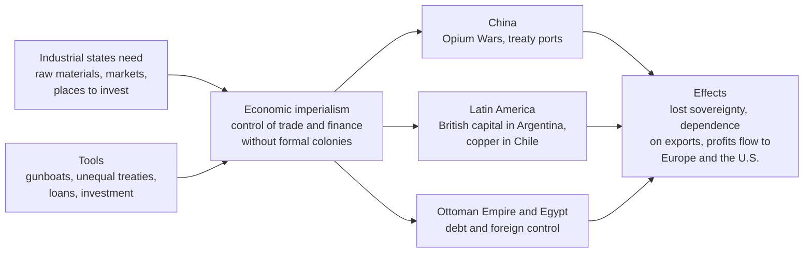
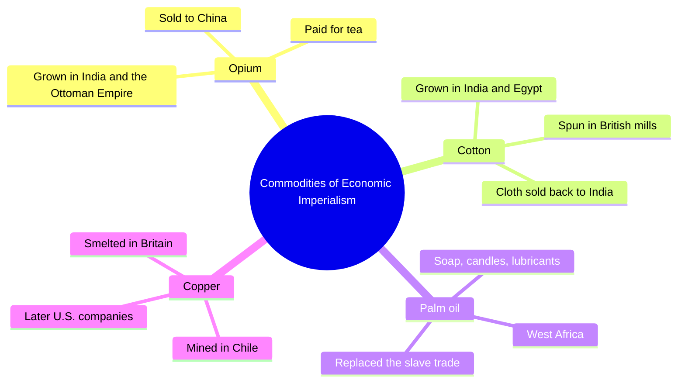
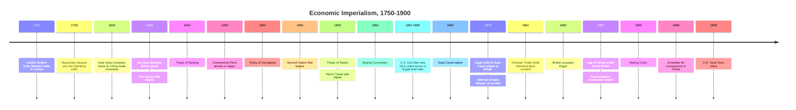
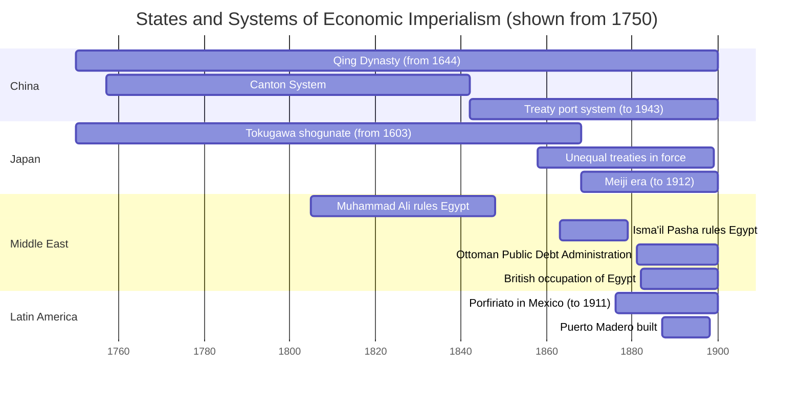
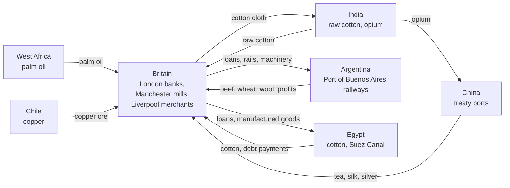

# AP World History: Modern — Topic 6.5 Economic Imperialism from 1750 to 1900

**Focus Question:** How did various economic factors contribute to the development of the global economy from 1750 to 1900?

> Source: Based on the College Board CED · Textbook not yet incorporated

**Unit 6: Consequences of Industrialization (c. 1750–1900)**

---

## Learning Objective

| Code | Learning Objective |
|---|---|
| 6.5 LO-E (ECN) | Explain how various economic factors contributed to the development of the global economy from 1750 to 1900. |

## Historical Developments (CED)

| # | Historical Development | Covered in |
|---|---|---|
| HD1 | KC-5.2.I.E: Industrialized states and businesses within those states practiced economic imperialism primarily in Asia and Latin America. | §1, §2, §3, §4, §6 |
| HD1 · Ex. | Illustrative example — *Industrialized states practicing economic imperialism:* Britain and France expanding their influence in China through the Opium Wars. | §2 |
| HD1 · Ex. | Illustrative example — *Industrialized states practicing economic imperialism:* The construction of the Port of Buenos Aires with the support of British firms. | §3 |
| HD2 | KC-5.1.II.C: Trade in some commodities was organized in a way that gave merchants and companies based in Europe and the U.S. a distinct economic advantage. | §5, §6 |
| HD2 · Ex. | Illustrative example — *Commodities that contributed to European and American economic advantage:* Opium produced in the Middle East or South Asia and exported to China. | §2, §5 |
| HD2 · Ex. | Illustrative example — *Commodities that contributed to European and American economic advantage:* Cotton grown in South Asia and Egypt and exported to Great Britain and other European countries. | §4, §5 |
| HD2 · Ex. | Illustrative example — *Commodities that contributed to European and American economic advantage:* Palm oil produced in sub-Saharan Africa and exported to European countries. | §5 |
| HD2 · Ex. | Illustrative example — *Commodities that contributed to European and American economic advantage:* Copper extracted in Chile. | §3, §5 |

---

## The Big Picture

> "Our Celestial Empire possesses all things in prolific abundance and lacks no product within its own borders. There was therefore no need to import the manufactures of outside barbarians in exchange for our own produce."
> — The Qianlong Emperor, edict to King George III of Britain, 1793 (trans. E. Backhouse and J. O. P. Bland, 1914)

> ⚠️ Needs verification: the quote is given from memory of the Backhouse and Bland translation. Check the exact wording against a printed source before quoting it in an essay.

Industrialization (Unit 5, 6.4) left Britain, France, the United States, and later Japan hungry for **raw materials**, **markets** for factory goods, and places to **invest** surplus capital. Instead of always conquering colonies, these states and their **businesses** often used **economic imperialism**: they gained control over another country's trade, finances, and infrastructure while that country kept its own government. The CED says this happened **primarily in Asia and Latin America**. In **China**, Britain and France fought the **Opium Wars** and forced **unequal treaties** that opened ports, fixed low tariffs, and gave foreigners **extraterritoriality**. In **Argentina**, **British firms** financed and built the **Port of Buenos Aires** and most of the railways, tying the economy to exports of beef and grain to Britain. **Egypt** and the **Ottoman Empire** fell into **foreign debt** and lost control of their revenues, and **Japan** was forced open by **Commodore Perry**. At the same time, trade in **opium, cotton, palm oil, and copper** was organized so that **European and U.S. merchants and companies** captured most of the profit.

---

## §1. Context: What Was Economic Imperialism?

- **Economic imperialism** is the use of economic power (trade, loans, investment, control of infrastructure) by a stronger state and its businesses to dominate a weaker country **without taking it over as a formal colony**.
- Historians often call this **informal empire** or the "**imperialism of free trade**." Britain was its leading practitioner because it was the first industrial nation and had the most capital to invest abroad.
- **Why it happened** (economic factors):
  - **Raw materials:** factories needed cotton, oils, metals, and other inputs (6.4).
  - **Markets:** factories produced more textiles and iron goods than home markets could buy.
  - **Capital:** banks and investors in London, Paris, and later New York looked for higher returns abroad in railways, ports, mines, and government loans.
  - **Technology gap:** steamships, gunboats, the telegraph, and modern rifles let small forces impose terms (see 6.2).
- **Main tools:** "gunboat diplomacy," **unequal treaties**, **foreign loans** and debt control, **foreign-owned infrastructure** (railways, ports, telegraphs), and control of **shipping, insurance, and banking**.
- **Where:** primarily **Asia** (China, the Ottoman Empire, Persia, Japan for a time) and **Latin America** (Argentina, Chile, Mexico, Peru). Many of these states had **formal independence**, so outside powers did not need to govern them directly to profit from them.

## §2. China: The Opium Wars and the Treaty System

### Background: the Canton System and the silver problem

- From **1757**, the Qing limited Western trade to **Canton (Guangzhou)**, where foreign merchants could deal only with licensed Chinese merchants called the **Cohong**.
- Britain bought huge amounts of Chinese **tea**, plus silk and porcelain, but China wanted few British goods (see the Big Picture quote). Britain had to pay in **silver**.
- To fix this imbalance, the **British East India Company** grew **opium** in **Bengal** (India) under a monopoly and sold it at auction to private traders, who smuggled it into China. Opium from western India (**Malwa**) and from the **Ottoman Empire** (carried mainly by **American** firms) also reached China.
- This created a **triangular trade**: Indian opium → China; Chinese tea → Britain; British cotton textiles → India.
- By the 1830s, silver was **flowing out of China** to pay for opium, addiction was spreading, and the Qing banned the trade. After **1834**, when the East India Company lost its monopoly on the China trade, private British traders pushed harder for "free trade."

### The First Opium War (1839–1842)

- In **1839**, the Qing official **Lin Zexu** confiscated and destroyed about **20,000 chests** of British opium at Canton and wrote to **Queen Victoria** asking Britain to stop the trade.
- Britain sent a naval force. Its **steam-powered warships**, such as the *Nemesis*, defeated Qing forces along the coast and the Yangzi River.
- **Treaty of Nanjing (1842)**, the first of the **unequal treaties**:
  - **Hong Kong** ceded to Britain.
  - **Five treaty ports** opened to British trade and residence: Canton, Xiamen (Amoy), Fuzhou, Ningbo, and Shanghai.
  - A large **indemnity** (21 million silver dollars) paid to Britain.
  - The **Cohong** monopoly abolished and **low, fixed tariffs** set, so China lost control of its own customs duties.
- The supplementary **Treaty of the Bogue (1843)** added **extraterritoriality** (British subjects tried in British, not Chinese, courts) and **most-favored-nation** status (any privilege given to another power automatically went to Britain).
- The **United States (Treaty of Wanghia, 1844)** and **France (Treaty of Whampoa, 1844)** quickly won the same rights.

### The Second Opium War (1856–1860)

- Also called the **Arrow War**. **Britain and France** fought together, using the seizure of the British-registered ship *Arrow* and the execution of a French missionary as reasons for war.
- **Treaty of Tianjin (1858)**: more treaty ports (including Yangzi River ports), foreign **diplomats in Beijing**, freedom for **Christian missionaries** and foreign travelers in the interior, and, through the tariff rules that followed, the **opium trade legalized**.
- When the Qing resisted ratifying the treaty, British and French troops captured **Beijing** and burned the **Old Summer Palace (Yuanmingyuan)** in **1860**.
- **Beijing Convention (1860)**: the Qing ratified the Tianjin treaty, ceded **Kowloon** to Britain, opened **Tianjin**, paid more indemnities, and allowed Chinese laborers to emigrate (link to 6.6). Russia used the moment to gain territory in the northeast.

### Spheres of influence and the Open Door

- After China's defeat by Japan in the **First Sino-Japanese War (1894–1895)**, the powers rushed to win **leases, railway rights, and mining rights** in 1898.
- **Spheres of influence** were regions where one foreign power had special economic rights: **Britain** (the Yangzi valley), **France** (the south, bordering Indochina), **Germany** (Shandong), **Russia** (Manchuria), and **Japan** (Fujian, plus the colony of Taiwan).
- The **United States**, which had no sphere, issued the **Open Door notes (1899)** written by Secretary of State **John Hay**. They asked the powers to give all nations **equal trading rights** in China and, in the second note (1900), to respect China's territorial integrity.
- **Result:** China was never fully colonized, but by 1900 it had lost control of its tariffs, many ports, and parts of its legal system. This is why historians describe it as **semi-colonial**. Resistance movements such as the Taiping and Boxer rebellions are covered in 6.3.

## §3. Latin America: British Capital in Argentina and Chile

### The Port of Buenos Aires (CED example)

- Buenos Aires sat on the shallow **Río de la Plata**, so large ships had to anchor far offshore, and goods were carried to shore in small boats and carts. This made exports slow and expensive.
- The Argentine government contracted a new harbor, **Puerto Madero** (named after the merchant **Eduardo Madero**, who proposed it). It was designed by **British engineers**, built by a **British contractor**, and financed largely through loans raised in **London** (the bank **Baring Brothers** was a key lender).
- The new docks let steamships load **beef, wheat, wool, and hides** directly for **Britain**, and unload British coal, machinery, textiles, and rails.

> ⚠️ Needs verification: Puerto Madero is usually dated to about 1887–1898, with the British firm Hawkshaw, Son & Hayter as designers and Thomas Walker & Co. as builder. Exact dates and firm names vary between accounts.

### Railways, exports, and dependence

- **British companies** built and owned most of Argentina's railways (for example, the **Buenos Aires Great Southern Railway**, founded in London in 1862). The lines ran from the **pampas** to the port, which suited exports rather than links between Argentine regions.
- **Refrigerated ships** (from the late 1870s) made frozen and chilled **beef** exports to Britain possible. British-owned meatpacking plants, shipping lines, insurers, and banks earned much of the profit.
- Argentina grew rich but **dependent**: it exported raw materials and food and imported manufactured goods and capital. When the **Baring Crisis (1890)** hit, after Argentine bonds failed and Baring Brothers nearly collapsed, Argentina fell into depression.
- Historians call this relationship part of Britain's **informal empire**: Argentina was fully independent, but British investors shaped its economy.

### Chile and other cases

- **Copper (CED example):** Chile was one of the world's leading **copper** producers in the mid-1800s. Much Chilean ore and copper was shipped to **British smelters** (especially in **Swansea**, Wales), and British merchant houses handled the financing, shipping, and sale. After 1900, **U.S. companies** took over the largest mines.
- **Nitrates:** after Chile won the **War of the Pacific (1879–1884)** against Peru and Bolivia, British investors (such as **John Thomas North**, the "Nitrate King") came to control much of the nitrate industry in the conquered northern desert.
- **Mexico:** under **Porfirio Díaz (1876–1911)**, U.S. and British investors built railways and owned mines and oil fields.
- **Central America:** U.S. fruit companies (the **United Fruit Company**, founded 1899) began to dominate banana exports.

## §4. Other Cases: The Ottoman Empire, Egypt, and Japan

### Ottoman Empire: debt and the Public Debt Administration

- The Ottomans first borrowed abroad during the **Crimean War (1854)**. Loans for war, reform, and the court piled up, and in **1875** the empire **defaulted**.
- In **1881**, the **Ottoman Public Debt Administration** was created. Run by representatives of **European bondholders**, it collected major state revenues (such as salt, tobacco, silk, and stamp taxes) to repay foreign creditors.
- Earlier, the **Treaty of Balta Liman (1838)** with Britain had set **low tariffs** and banned state monopolies, which opened Ottoman markets to British manufactured goods.

### Egypt: cotton, the Suez Canal, and occupation

- **Muhammad Ali** (r. 1805–1848) promoted **long-staple cotton** as an export crop in the 1820s.
- The **American Civil War (1861–1865)** cut off U.S. cotton, so Egyptian (and Indian) cotton exports boomed. Prices fell after the war.
- **Isma'il Pasha** (r. 1863–1879) borrowed heavily from European banks for modernization projects, including the **Suez Canal** (opened **1869**).
- In **1875**, Isma'il sold Egypt's shares in the Suez Canal Company to **Britain** (arranged by Prime Minister **Benjamin Disraeli**). In **1876**, Egypt went bankrupt, and an international debt commission and **Anglo-French financial control** followed.
- After the **'Urabi revolt** against foreign control, **Britain occupied Egypt in 1882**. Egypt remained formally Ottoman, but British officials controlled its finances and government. This shows how economic imperialism could turn into **formal control**.

### Japan: forced opening and recovery

- **Commodore Matthew Perry** of the U.S. Navy arrived with steam warships in **1853** and returned in **1854**, forcing the **Treaty of Kanagawa**, which opened two ports.
- The **Harris Treaty (1858)** and similar treaties with European powers were **unequal treaties**: more open ports, **extraterritoriality**, and **low fixed tariffs**.
- Unlike China, Japan responded with rapid state-led industrialization in the **Meiji era** (from **1868**; see 5.7). Britain agreed in **1894** to end extraterritoriality (effective **1899**), and Japan regained full tariff control in **1911**. Japan then became an imperial power itself (Taiwan, 1895).

## §5. Commodities That Gave Europe and the U.S. an Advantage (KC-5.1.II.C)

The key idea of KC-5.1.II.C is **who controlled the trade**. Producers in Asia, Africa, and Latin America grew or mined the goods, but **European and U.S. merchants and companies** controlled shipping, finance, processing, and prices, so most of the profit went to them.

| Commodity (CED example) | Where it was produced | Where it went | How the trade favored European and U.S. firms |
|---|---|---|---|
| **Opium** | **South Asia** (Bengal and Malwa in India) and the **Middle East** (Ottoman Anatolia, Persia) | **China** | The British East India Company held a monopoly on Bengal opium; British and American merchants smuggled it into China; the profits paid for Chinese tea and reversed the flow of silver |
| **Cotton** | **South Asia** (India) and **Egypt** | **Great Britain** and other European countries | Raw cotton went to British mills; finished cloth came back to India and other markets, hurting local hand weavers; British merchants and banks set terms |
| **Palm oil** | **Sub-Saharan Africa**, especially West Africa (the Niger Delta, or "Oil Rivers," and Lagos) | **European countries**, especially Britain (Liverpool) | Used for **soap, candles, and lubricating machines**; European firms controlled shipping and prices and pushed aside African middlemen; the trade grew after Britain banned the slave trade (1807) |
| **Copper** | **Chile** | Britain, then the U.S. | British smelters and merchant houses (later U.S. mining companies) controlled processing and sale; Chile depended on mineral exports |

- **Palm oil and African middlemen:** **Jaja of Opobo**, an African trader-king in the Niger Delta, built a strong position in the palm oil trade and tried to deal directly with Britain. In **1887** a British consul arrested and exiled him, and British firms (and the **Royal Niger Company**, chartered **1886**) gained more control.
- **Cotton and deindustrialization:** cheap machine-made British cloth flooded India, and India's role shifted from **exporting finished textiles** to **exporting raw cotton**. India was a formal British colony, but the trade pattern is a good example of commodity trade organized for British benefit.

## §6. Connecting 6.4 and 6.5

| | 6.4 Global Economic Development | 6.5 Economic Imperialism |
|---|---|---|
| Theme | **ENV** (environment and geography) | **ECN** (economics) |
| Main question | Which **environments and resources** produced export economies? | **Who controlled** the trade, finance, and profits? |
| Focus | Growth of **export economies** that specialized in extracting resources and growing food and industrial crops | **Industrial states and their businesses** dominating weaker states, and commodity trade organized for **European and U.S. advantage** |
| Example (cotton in Egypt) | Egypt's climate and the Nile let it grow long-staple cotton for export | European banks and British merchants profited, Egypt fell into debt, and Britain occupied it in 1882 |
| Example (Latin America) | Argentine beef, Chilean copper and nitrates as export products | British firms built the Buenos Aires port and railways and owned much of the profit |

- **Effects of economic imperialism (summary):** loss of **tariff control** and **legal sovereignty** (China, Japan, the Ottoman Empire); **foreign debt** leading to foreign control of revenues (Ottoman Empire, Egypt); economies **dependent** on one or two exports (Argentina, Chile, Egypt); infrastructure built for **export** rather than internal development; and profits flowing to **London, Paris, and New York**.
- **Responses:** reform and self-strengthening programs (China's Self-Strengthening Movement, the Ottoman Tanzimat, Japan's Meiji reforms), revolts against foreign control ('Urabi in Egypt; the Boxers in China, see 6.3), and, in Latin America, later economic nationalism (after 1900).

---

## Timeline

---

## Map: Flows of Capital, Goods, and Profits

---

## Comparison Table: Formal Colonial Rule vs. Economic Imperialism

| Feature | Formal colonial rule | Economic imperialism |
|---|---|---|
| Who governs | The imperial state rules directly or through appointed officials | The local government stays in place, at least formally |
| Main examples | British India (after 1858), French Indochina, most of Africa after 1884 | China, Argentina, Chile, the Ottoman Empire, Egypt before 1882, Japan before 1899 |
| Main tools | Armies, colonial administrators, colonial laws and taxes | Gunboats, unequal treaties, loans, foreign investment, control of ports, railways, and banks |
| Effect on sovereignty | Sovereignty lost completely | Sovereignty limited: tariffs, courts, revenues, or ports controlled by foreigners |
| Cost to the imperial power | High (armies and administration) | Lower (businesses and banks do much of the work) |
| Shared result | Raw materials and profits flow to the industrial powers | Raw materials and profits flow to the industrial powers |

## Comparison Table: China vs. Argentina

| Feature | China | Argentina |
|---|---|---|
| Main foreign powers | Britain, France, later the U.S., Russia, Germany, Japan | Britain |
| How influence was gained | War (the Opium Wars) and unequal treaties | Investment and loans that the Argentine government invited |
| Key commodities | Opium in; tea and silk out | British goods and capital in; beef, wheat, and wool out |
| Key infrastructure | Treaty ports such as Shanghai and Hong Kong | The Port of Buenos Aires and British-owned railways |
| Effect on sovereignty | Lost tariff control and legal jurisdiction over foreigners; spheres of influence | Kept full political independence, but the economy depended on British markets and capital |
| Similarity | Both stayed independent states while foreign businesses captured much of the profit from their trade | (same) |

---

## Key Terms

| Theme | Term | Definition |
|---|---|---|
| Economics | Economic imperialism | Control of a weaker country's economy by an industrial state and its businesses, without formal colonial rule |
| Economics | Informal empire | Influence over a formally independent country through trade, investment, and finance, as with Britain in Argentina |
| Economics | Canton System | The Qing policy (1757–1842) that limited Western trade to Canton through the licensed Cohong merchants |
| Economics | Opium | A drug grown in India and the Middle East and sold to China; the trade made silver flow out of China |
| Government | Opium Wars | Two wars (1839–1842, 1856–1860) in which Britain, and later Britain and France, forced China to open to trade |
| Government | Treaty of Nanjing | The 1842 treaty that ended the First Opium War: Hong Kong ceded, five treaty ports, an indemnity, fixed tariffs |
| Government | Unequal treaties | Treaties forced on China, Japan, and others that gave foreigners trading privileges without equal rights in return |
| Government | Treaty ports | Ports that a weaker state was forced to open to foreign trade and residence |
| Government | Extraterritoriality | The right of foreigners to be tried under their own country's laws and courts, not local ones |
| Government | Spheres of influence | Regions of China where one foreign power held special economic rights such as railway and mining rights |
| Government | Open Door notes | U.S. notes (1899–1900) asking for equal trading rights for all nations in China |
| Economics | Ottoman Public Debt Administration | A body run for European bondholders (1881) that collected Ottoman revenues to repay foreign debt |
| Economics | Suez Canal | A canal linking the Mediterranean and the Red Sea (opened 1869); Britain bought Egypt's shares in 1875 |
| Economics | Port of Buenos Aires | Argentina's main harbor (Puerto Madero), built with the support of British firms and London loans |
| Economics | Baring Crisis | The 1890 financial crisis caused by failed Argentine loans that nearly destroyed Baring Brothers |
| Economics | Palm oil | A West African oil used in Europe for soap, candles, and machine lubricants |
| Economics | Deindustrialization | The decline of local manufacturing, such as Indian hand weaving, under competition from machine-made imports |
| CED | Copper | A metal mined in Chile and processed and sold largely by British and later U.S. firms |
