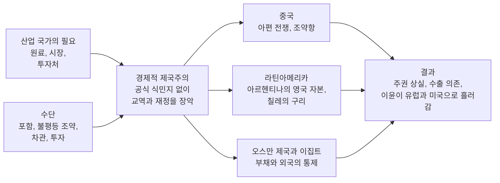
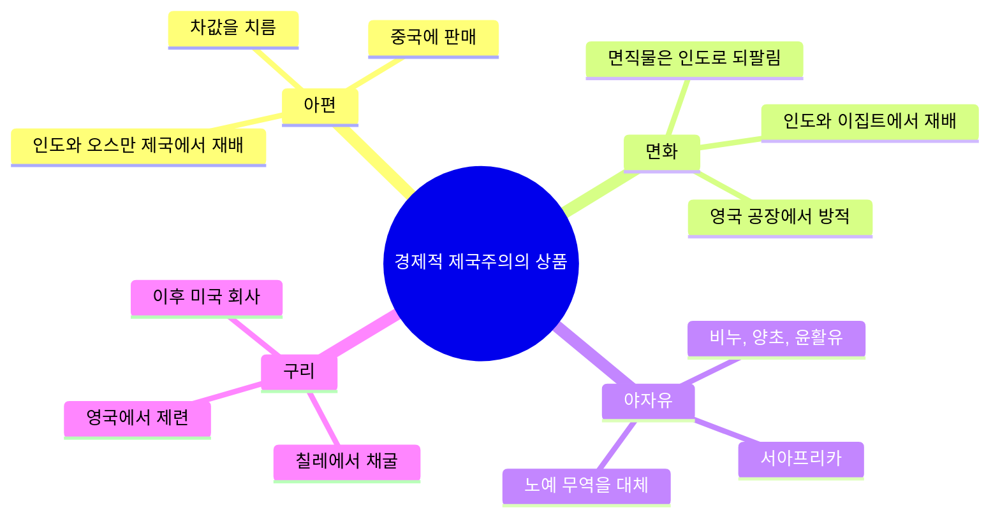
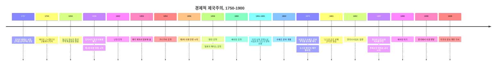
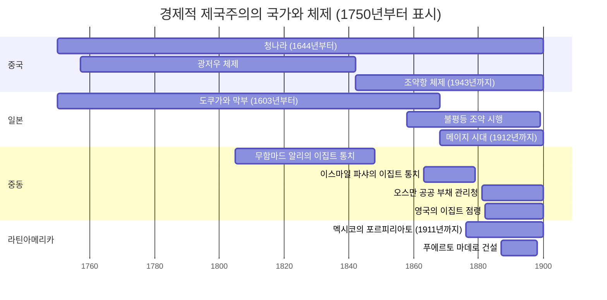
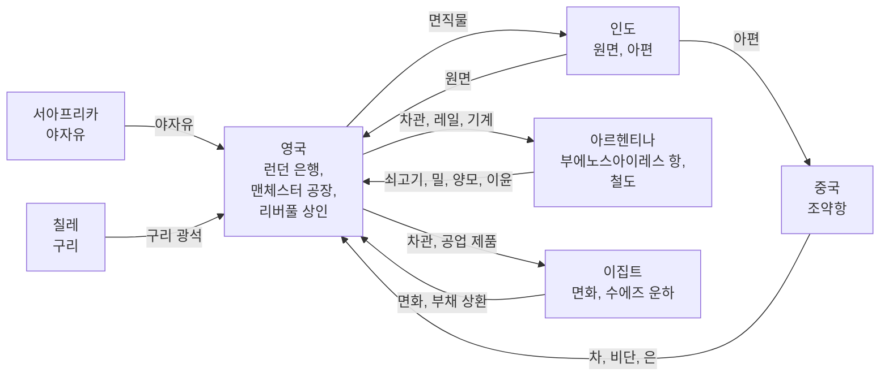

# AP 세계사: 모던 — 토픽 6.5 1750–1900년 경제적 제국주의 (Economic Imperialism from 1750 to 1900)

**Focus Question:** 1750년부터 1900년까지 여러 경제적 요인은 세계 경제의 발전에 어떻게 기여했는가?

> 출처: CED 기준 · 교재 반영 전

**Unit 6: 산업화의 결과 (Consequences of Industrialization, c. 1750–1900)**

---

## 학습 목표 (Learning Objective)

| 코드 | 학습 목표 |
|---|---|
| 6.5 LO-E (ECN) | 1750년부터 1900년까지 여러 경제적 요인이 세계 경제의 발전에 어떻게 기여했는지 설명한다. |

## 역사적 개념 (Historical Developments, CED)

| # | 역사적 개념 | 다루는 곳 |
|---|---|---|
| HD1 | KC-5.2.I.E: 산업화된 국가들과 그 국가들의 기업은 주로 아시아와 라틴아메리카에서 경제적 제국주의 (Economic imperialism)를 실행했다. | §1, §2, §3, §4, §6 |
| HD1 · 예시 | 예시 (Illustrative example) — *경제적 제국주의를 실행한 산업화된 국가 (Industrialized states practicing economic imperialism):* 아편 전쟁을 통해 중국에서 영향력을 넓힌 영국과 프랑스 (Britain and France expanding their influence in China through the Opium Wars). | §2 |
| HD1 · 예시 | 예시 — *경제적 제국주의를 실행한 산업화된 국가:* 영국 회사들의 지원을 받은 부에노스아이레스 항 건설 (The construction of the Port of Buenos Aires with the support of British firms). | §3 |
| HD2 | KC-5.1.II.C: 일부 상품의 교역은 유럽과 미국에 근거지를 둔 상인과 회사에 뚜렷한 경제적 이점을 주는 방식으로 조직되었다. | §5, §6 |
| HD2 · 예시 | 예시 — *유럽과 미국의 경제적 이점에 기여한 상품 (Commodities that contributed to European and American economic advantage):* 중동이나 남아시아에서 생산되어 중국으로 수출된 아편 (Opium produced in the Middle East or South Asia and exported to China). | §2, §5 |
| HD2 · 예시 | 예시 — *유럽과 미국의 경제적 이점에 기여한 상품:* 남아시아와 이집트에서 재배되어 영국과 다른 유럽 국가로 수출된 면화 (Cotton grown in South Asia and Egypt and exported to Great Britain and other European countries). | §4, §5 |
| HD2 · 예시 | 예시 — *유럽과 미국의 경제적 이점에 기여한 상품:* 사하라 이남 아프리카에서 생산되어 유럽 국가로 수출된 야자유 (Palm oil produced in sub-Saharan Africa and exported to European countries). | §5 |
| HD2 · 예시 | 예시 — *유럽과 미국의 경제적 이점에 기여한 상품:* 칠레에서 채굴된 구리 (Copper extracted in Chile). | §3, §5 |

---

## 큰 그림 요약

> "우리 천조(天朝)는 모든 것을 풍족하게 갖추고 있으며, 나라 안에 없는 물건이 없다. 그러므로 바깥 오랑캐의 제품을 들여와 우리 산물과 바꿀 필요가 없었다."
> — 건륭제 (Qianlong Emperor), 영국 국왕 조지 3세 (George III)에게 보낸 칙서, 1793년 (영역: E. 백하우스 (E. Backhouse)·J. O. P. 블랜드 (J. O. P. Bland), 1914년. 한국어는 영역본을 옮긴 것)

> ⚠️ 확인 필요: 이 인용문은 백하우스와 블랜드의 영역본을 기억에 의존해 옮긴 것이다. 서술형 답안에 인용하기 전에 인쇄된 자료와 대조해 정확한 문구를 확인해야 한다.

산업화 (Unit 5, 6.4)로 영국, 프랑스, 미국, 그리고 뒤이어 일본은 **원료**, 공장 제품을 팔 **시장**, 남는 자본을 **투자**할 곳을 간절히 원하게 되었다. 이 국가들과 그 **기업**은 언제나 식민지를 정복한 것이 아니라 **경제적 제국주의 (Economic imperialism)**를 자주 사용했다. 상대국이 자기 정부를 유지하는 동안 그 나라의 교역, 재정, 기반 시설을 장악한 것이다. CED는 이런 일이 **주로 아시아와 라틴아메리카**에서 일어났다고 본다. **중국**에서는 영국과 프랑스가 **아편 전쟁 (Opium Wars)**을 일으켜 **불평등 조약 (Unequal treaties)**을 강요했다. 이 조약으로 항구가 열렸고, 낮은 관세가 고정되었으며, 외국인은 **치외법권 (Extraterritoriality)**을 얻었다. **아르헨티나**에서는 **영국 회사**들이 **부에노스아이레스 항 (Port of Buenos Aires)**과 철도 대부분에 돈을 대고 건설했다. 그 결과 아르헨티나 경제는 영국으로 가는 쇠고기와 곡물 수출에 묶였다. **이집트**와 **오스만 제국**은 **외채**에 빠져 세입을 통제하지 못하게 되었고, **일본**은 **페리 제독 (Commodore Perry)**에 의해 강제로 개항했다. 같은 시기에 **아편, 면화, 야자유, 구리**의 교역은 **유럽과 미국의 상인과 회사**가 이윤 대부분을 차지하도록 조직되었다.

---

## §1. 배경: 경제적 제국주의란 무엇이었나?

- **경제적 제국주의 (Economic imperialism)**는 강한 국가와 그 기업이 교역, 차관, 투자, 기반 시설 통제 같은 경제적 힘을 이용해 약한 나라를 **공식 식민지로 삼지 않고** 지배하는 것이다.
- 역사가들은 이를 **비공식 제국 (Informal empire)** 또는 "**자유무역 제국주의 (Imperialism of free trade)**"라고 부르기도 한다. 영국은 최초의 산업 국가였고 해외에 투자할 자본이 가장 많았기 때문에 이 방식을 가장 많이 썼다.
- **일어난 이유** (경제적 요인):
  - **원료:** 공장에는 면화, 기름, 금속 같은 원료가 필요했다 (6.4).
  - **시장:** 공장은 국내 시장이 소화할 수 있는 것보다 더 많은 직물과 철제품을 생산했다.
  - **자본:** 런던, 파리, 그리고 뒤이어 뉴욕의 은행과 투자자들은 철도, 항구, 광산, 정부 차관 등 해외에서 더 높은 수익을 찾았다.
  - **기술 격차:** 증기선, 포함 (Gunboat), 전신, 근대식 소총 덕분에 적은 병력으로도 조건을 강요할 수 있었다 (6.2 참고).
- **주요 수단:** "**포함 외교 (Gunboat diplomacy)**", **불평등 조약**, **외국 차관**과 부채 통제, **외국인 소유 기반 시설**(철도, 항구, 전신), 그리고 **해운·보험·금융**의 장악이었다.
- **지역:** 주로 **아시아**(중국, 오스만 제국, 페르시아, 한동안의 일본)와 **라틴아메리카**(아르헨티나, 칠레, 멕시코, 페루)였다. 이 나라들 상당수는 **형식상 독립국**이었으므로, 외부 세력은 직접 통치하지 않고도 이익을 얻을 수 있었다.

## §2. 중국: 아편 전쟁과 조약 체제

### 배경: 광저우 체제와 은 문제

- **1757년**부터 청은 서양과의 교역을 **광저우 (Canton, Guangzhou)** 한 곳으로 제한했다. 외국 상인은 **공행 (Cohong)**이라는 허가받은 중국 상인하고만 거래할 수 있었다.
- 영국은 중국 **차 (Tea)**와 비단, 도자기를 대량으로 샀지만, 중국은 영국 상품을 별로 원하지 않았다 (큰 그림의 인용문 참고). 그래서 영국은 **은 (Silver)**으로 값을 치러야 했다.
- 이 불균형을 바로잡으려고 **영국 동인도 회사 (British East India Company)**는 인도 **벵골 (Bengal)**에서 독점적으로 **아편 (Opium)**을 재배해 민간 상인에게 경매로 팔았다. 민간 상인은 이를 중국에 밀수했다. 인도 서부 **말와 (Malwa)**의 아편과, 주로 **미국** 회사가 실어 나른 **오스만 제국**의 아편도 중국에 들어갔다.
- 이렇게 **삼각 무역 (Triangular trade)**이 만들어졌다. 인도의 아편은 중국으로, 중국의 차는 영국으로, 영국의 면직물은 인도로 갔다.
- 1830년대에는 아편값을 치르느라 **은이 중국 밖으로 빠져나갔고**, 중독이 퍼졌다. 청은 아편 무역을 금지했다. **1834년**에 동인도 회사가 중국 무역 독점권을 잃자, 영국 민간 상인들은 "자유무역"을 더 강하게 요구했다.

### 제1차 아편 전쟁 (First Opium War, 1839–1842)

- **1839년**에 청의 관리 **임칙서 (Lin Zexu)**는 광저우에서 영국 아편 약 **2만 상자**를 몰수해 폐기했고, **빅토리아 여왕 (Queen Victoria)**에게 아편 무역을 멈추라는 편지를 썼다.
- 영국은 해군을 보냈다. **네메시스호 (*Nemesis*)** 같은 **증기 군함**이 해안과 양쯔강 (Yangzi River)에서 청군을 격파했다.
- **난징 조약 (Treaty of Nanjing, 1842)**은 최초의 **불평등 조약**이었다.
  - **홍콩 (Hong Kong)**을 영국에 할양했다.
  - 광저우, 샤먼 (Xiamen, Amoy), 푸저우 (Fuzhou), 닝보 (Ningbo), 상하이 (Shanghai)의 **5개 조약항 (Treaty ports)**을 열어 영국인의 교역과 거주를 허용했다.
  - 영국에 막대한 **배상금 (Indemnity)**(은화 2,100만 달러)을 물었다.
  - **공행** 독점을 폐지하고 **낮은 고정 관세**를 정해, 중국은 스스로 관세를 정할 권리를 잃었다.
- 추가 조약인 **후먼 조약 (Treaty of the Bogue, 1843)**은 **치외법권 (Extraterritoriality)**(영국인은 중국 법정이 아니라 영국 법정에서 재판받음)과 **최혜국 대우 (Most-favored-nation)**(다른 나라에 준 특권은 자동으로 영국에도 적용됨)를 더했다.
- **미국 (왕샤 조약 (Treaty of Wanghia), 1844)**과 **프랑스 (황푸 조약 (Treaty of Whampoa), 1844)**도 곧 같은 권리를 얻었다.

### 제2차 아편 전쟁 (Second Opium War, 1856–1860)

- **애로호 전쟁 (Arrow War)**이라고도 한다. **영국과 프랑스**가 함께 싸웠다. 영국 선적의 *애로호 (Arrow)*가 나포된 일과 프랑스 선교사가 처형된 일이 전쟁의 구실이 되었다.
- **톈진 조약 (Treaty of Tianjin, 1858)**으로 양쯔강 연안 항구를 포함한 조약항이 더 늘었고, 외국 **외교관이 베이징에 상주**하게 되었으며, **기독교 선교사**와 외국인 여행자가 내륙을 자유롭게 다닐 수 있게 되었다. 뒤이은 관세 규정으로 **아편 무역도 합법화**되었다.
- 청이 조약 비준을 거부하자 영국군과 프랑스군은 **1860년** **베이징**을 점령하고 **원명원 (Old Summer Palace, Yuanmingyuan)**을 불태웠다.
- **베이징 조약 (Beijing Convention, 1860)**으로 청은 톈진 조약을 비준하고, **주룽 (Kowloon)**을 영국에 할양하고, **톈진**을 개항하고, 배상금을 더 물고, 중국인 노동자의 해외 이주를 허용했다 (6.6과 연결). 러시아는 이 틈을 타 동북 지역의 영토를 얻었다.

### 세력권과 문호 개방

- 중국이 **청일 전쟁 (First Sino-Japanese War, 1894–1895)**에서 일본에 패하자, 열강은 1898년에 앞다투어 **조차지, 철도 부설권, 광산 채굴권**을 얻어 냈다.
- **세력권 (Spheres of influence)**은 한 외국 세력이 특별한 경제적 권리를 가진 지역이었다. **영국**(양쯔강 유역), **프랑스**(인도차이나와 맞닿은 남부), **독일**(산둥 (Shandong)), **러시아**(만주 (Manchuria)), **일본**(푸젠 (Fujian), 그리고 식민지 타이완)이 세력권을 가졌다.
- 세력권이 없던 **미국**은 국무장관 **존 헤이 (John Hay)**가 쓴 **문호 개방 각서 (Open Door notes, 1899)**를 보냈다. 이 각서는 열강에게 중국에서 모든 나라에 **동등한 교역 권리**를 줄 것을 요구했고, 두 번째 각서 (1900)에서는 중국의 영토 보전을 존중할 것을 요구했다.
- **결과:** 중국은 끝내 완전한 식민지가 되지는 않았다. 그러나 1900년까지 관세 통제권, 많은 항구, 사법 체계의 일부를 잃었다. 그래서 역사가들은 중국을 **반식민지 (Semi-colonial)** 상태였다고 설명한다. 태평천국 운동과 의화단 운동 같은 저항은 6.3에서 다룬다.

## §3. 라틴아메리카: 아르헨티나와 칠레의 영국 자본

### 부에노스아이레스 항 (CED 예시)

- 부에노스아이레스는 수심이 얕은 **라플라타강 (Río de la Plata)**에 있었다. 그래서 큰 배는 먼 바다에 닻을 내려야 했고, 짐은 작은 배와 수레로 해안까지 옮겼다. 이 때문에 수출은 느리고 비용이 많이 들었다.
- 아르헨티나 정부는 새 항구인 **푸에르토 마데로 (Puerto Madero)**를 발주했다. 이름은 이 항구를 제안한 상인 **에두아르도 마데로 (Eduardo Madero)**에게서 따왔다. **영국 기술자**가 설계하고 **영국 건설업체**가 지었으며, 자금은 주로 **런던**에서 빌린 차관으로 마련했다 (은행 **베어링 브러더스 (Baring Brothers)**가 핵심 대부자였다).
- 새 부두 덕분에 증기선이 **영국**으로 갈 **쇠고기, 밀, 양모, 가죽**을 바로 싣고, 영국산 석탄, 기계, 직물, 레일을 내릴 수 있게 되었다.

> ⚠️ 확인 필요: 푸에르토 마데로는 보통 1887–1898년에 건설되었다고 하며, 영국 회사 호크쇼 선 앤 헤이터 (Hawkshaw, Son & Hayter)가 설계하고 토머스 워커 사 (Thomas Walker & Co.)가 시공했다고 한다. 정확한 연도와 회사 이름은 자료마다 조금씩 다르다.

### 철도, 수출, 의존

- **영국 회사**들이 아르헨티나 철도 대부분을 건설하고 소유했다 (예: 1862년 런던에서 설립된 **부에노스아이레스 그레이트 서던 철도 (Buenos Aires Great Southern Railway)**). 철도는 **팜파스 (Pampas)**에서 항구로 이어졌다. 이는 아르헨티나 지역끼리 잇기보다 수출에 맞춘 구조였다.
- 1870년대 말부터 **냉동선 (Refrigerated ships)**이 등장해 영국으로 냉동·냉장 **쇠고기**를 수출할 수 있게 되었다. 영국 소유의 육류 가공 공장, 해운 회사, 보험 회사, 은행이 이윤의 상당 부분을 가져갔다.
- 아르헨티나는 부유해졌지만 **의존적**이 되었다. 원료와 식량을 수출하고 공업 제품과 자본을 수입했다. 아르헨티나 채권이 부도나 베어링 브러더스가 거의 무너진 **베어링 위기 (Baring Crisis, 1890)**가 일어나자 아르헨티나는 불황에 빠졌다.
- 역사가들은 이 관계를 영국의 **비공식 제국 (Informal empire)**의 일부로 본다. 아르헨티나는 완전한 독립국이었지만, 영국 투자자들이 그 경제를 좌우했다.

### 칠레와 다른 사례

- **구리 (Copper, CED 예시):** 칠레는 1800년대 중반 세계 최대 수준의 **구리** 생산국 가운데 하나였다. 칠레의 광석과 구리 상당량은 **영국 제련소**(특히 웨일스의 **스완지 (Swansea)**)로 갔고, 영국 상사가 자금 조달, 운송, 판매를 맡았다. 1900년 이후에는 **미국 회사**들이 가장 큰 광산들을 차지했다.
- **질산염 (Nitrates):** 칠레가 페루와 볼리비아를 상대로 한 **태평양 전쟁 (War of the Pacific, 1879–1884)**에서 이긴 뒤, "질산염 왕 (Nitrate King)" **존 토머스 노스 (John Thomas North)** 같은 영국 투자자들이 새로 얻은 북부 사막의 질산염 산업 상당 부분을 장악했다.
- **멕시코:** **포르피리오 디아스 (Porfirio Díaz, 1876–1911)** 집권기에 미국과 영국 투자자들이 철도를 놓고 광산과 유전을 소유했다.
- **중앙아메리카:** 미국 과일 회사(**유나이티드 프루트 컴퍼니 (United Fruit Company)**, 1899년 설립)가 바나나 수출을 지배하기 시작했다.

## §4. 다른 사례: 오스만 제국, 이집트, 일본

### 오스만 제국: 부채와 공공 부채 관리청

- 오스만 제국은 **크림 전쟁 (Crimean War, 1854)** 때 처음으로 외국에서 돈을 빌렸다. 전쟁, 개혁, 궁정을 위한 차관이 쌓였고, **1875년**에 제국은 **채무 불이행 (Default)**을 선언했다.
- **1881년**에 **오스만 공공 부채 관리청 (Ottoman Public Debt Administration)**이 만들어졌다. **유럽 채권자**의 대표들이 운영한 이 기구는 소금, 담배, 비단, 인지세 같은 주요 국가 세입을 거두어 외국 채권자에게 갚았다.
- 그보다 앞서 영국과 맺은 **발타 리마니 조약 (Treaty of Balta Liman, 1838)**은 **낮은 관세**를 정하고 국가 독점을 금지했다. 이로써 오스만 시장이 영국 공업 제품에 열렸다.

### 이집트: 면화, 수에즈 운하, 점령

- **무함마드 알리 (Muhammad Ali, r. 1805–1848)**는 1820년대에 **장섬유 면화 (Long-staple cotton)**를 수출 작물로 키웠다.
- **미국 남북 전쟁 (American Civil War, 1861–1865)**으로 미국 면화 공급이 끊기자 이집트(와 인도)의 면화 수출이 급증했다. 전쟁이 끝나자 가격은 떨어졌다.
- **이스마일 파샤 (Isma'il Pasha, r. 1863–1879)**는 **수에즈 운하 (Suez Canal)**(**1869년** 개통) 등 근대화 사업을 위해 유럽 은행에서 막대한 돈을 빌렸다.
- **1875년**에 이스마일은 이집트가 가진 수에즈 운하 회사 주식을 **영국**에 팔았다 (총리 **벤저민 디즈레일리 (Benjamin Disraeli)**가 주도). **1876년**에 이집트는 파산했고, 국제 채무 위원회와 **영국·프랑스의 재정 통제**가 뒤따랐다.
- 외국의 통제에 맞선 **우라비 반란 ('Urabi revolt)** 이후 **영국은 1882년 이집트를 점령했다**. 이집트는 형식상 오스만 제국의 일부로 남았지만, 영국 관리들이 재정과 정부를 장악했다. 경제적 제국주의가 **공식 지배**로 바뀔 수 있음을 보여 주는 사례이다.

### 일본: 강제 개항과 회복

- 미국 해군의 **매슈 페리 제독 (Commodore Matthew Perry)**은 **1853년** 증기 군함을 이끌고 왔다가 **1854년**에 다시 와서 **가나가와 조약 (Treaty of Kanagawa)**을 강요했다. 이 조약으로 두 항구가 열렸다.
- **해리스 조약 (Harris Treaty, 1858)**과 유럽 열강과 맺은 비슷한 조약들은 **불평등 조약**이었다. 개항장이 늘고, **치외법권**과 **낮은 고정 관세**가 정해졌다.
- 중국과 달리 일본은 **메이지 시대 (Meiji era)**(**1868년**부터, 5.7 참고)에 국가 주도의 빠른 산업화로 대응했다. 영국은 **1894년** 치외법권 폐지에 동의했고(**1899년** 발효), 일본은 **1911년**에 관세 자주권을 완전히 되찾았다. 이후 일본 자신이 제국주의 국가가 되었다 (타이완, 1895).

## §5. 유럽과 미국에 이점을 준 상품 (KC-5.1.II.C)

KC-5.1.II.C의 핵심은 **누가 교역을 장악했는가**이다. 아시아, 아프리카, 라틴아메리카의 생산자들이 상품을 재배하거나 채굴했지만, 해운, 금융, 가공, 가격은 **유럽과 미국의 상인과 회사**가 장악했다. 그래서 이윤 대부분이 그들에게 돌아갔다.

| 상품 (CED 예시) | 생산지 | 수출지 | 유럽·미국 회사에 유리했던 점 |
|---|---|---|---|
| **아편 (Opium)** | **남아시아**(인도의 벵골과 말와)와 **중동**(오스만 제국의 아나톨리아, 페르시아) | **중국** | 영국 동인도 회사가 벵골 아편을 독점했고, 영국과 미국 상인이 이를 중국에 밀수했음. 이윤으로 중국 차값을 치렀고 은의 흐름이 뒤바뀜 |
| **면화 (Cotton)** | **남아시아**(인도)와 **이집트** | **영국**과 다른 유럽 국가 | 원면은 영국 공장으로 가고, 완성된 면직물은 인도와 다른 시장으로 되돌아와 현지 수직공에게 타격을 줌. 영국 상인과 은행이 조건을 정함 |
| **야자유 (Palm oil)** | **사하라 이남 아프리카**, 특히 서아프리카(니제르 삼각주, 곧 "오일 리버스 (Oil Rivers)"와 라고스 (Lagos)) | **유럽 국가**, 특히 영국(리버풀 (Liverpool)) | **비누, 양초, 기계 윤활유**에 쓰임. 유럽 회사가 해운과 가격을 장악하고 아프리카 중개상을 밀어냄. 영국이 노예 무역을 금지한 뒤(1807) 교역이 커짐 |
| **구리 (Copper)** | **칠레** | 영국, 이후 미국 | 영국 제련소와 상사(이후 미국 광산 회사)가 가공과 판매를 장악함. 칠레는 광물 수출에 의존하게 됨 |

- **야자유와 아프리카 중개상:** 니제르 삼각주의 아프리카 상인 왕 **오포보의 자자 (Jaja of Opobo)**는 야자유 무역에서 강한 지위를 쌓고 영국과 직접 거래하려 했다. **1887년**에 영국 영사가 그를 체포해 추방했고, 영국 회사들(그리고 **1886년** 특허를 받은 **왕립 니제르 회사 (Royal Niger Company)**)이 더 큰 통제권을 얻었다.
- **면화와 탈산업화 (Deindustrialization):** 값싼 영국 기계제 면직물이 인도에 쏟아져 들어오면서, 인도의 역할은 **완성된 직물을 수출**하는 쪽에서 **원면을 수출**하는 쪽으로 바뀌었다. 인도는 영국의 공식 식민지였지만, 이 교역 구조는 영국에 유리하게 조직된 상품 교역의 좋은 예이다.

## §6. 6.4와 6.5 연결하기

| | 6.4 세계 경제의 발전 | 6.5 경제적 제국주의 |
|---|---|---|
| 주제 | **ENV** (환경과 지리) | **ECN** (경제) |
| 핵심 질문 | 어떤 **환경과 자원**이 수출 경제 (Export economies)를 만들었는가? | 교역, 금융, 이윤을 **누가 장악했는가**? |
| 초점 | 자원 채취와 식량·공업용 작물 생산에 특화된 **수출 경제**의 성장 | 약한 나라를 지배한 **산업 국가와 그 기업**, 그리고 **유럽과 미국에 유리하게** 조직된 상품 교역 |
| 예시 (이집트의 면화) | 이집트의 기후와 나일강 덕분에 수출용 장섬유 면화를 재배할 수 있었음 | 유럽 은행과 영국 상인이 이익을 얻었고, 이집트는 빚에 빠졌으며, 영국이 1882년 이집트를 점령함 |
| 예시 (라틴아메리카) | 수출품으로서의 아르헨티나 쇠고기, 칠레의 구리와 질산염 | 영국 회사가 부에노스아이레스 항과 철도를 짓고 이윤의 상당 부분을 차지함 |

- **경제적 제국주의의 결과 (요약):** **관세 통제권**과 **사법 주권**을 잃었다(중국, 일본, 오스만 제국). **외채** 때문에 외국이 세입을 통제하게 되었다(오스만 제국, 이집트). 경제가 한두 가지 수출품에 **의존**하게 되었다(아르헨티나, 칠레, 이집트). 기반 시설은 국내 발전보다 **수출**에 맞춰 지어졌다. 이윤은 **런던, 파리, 뉴욕**으로 흘러갔다.
- **대응:** 개혁과 자강 정책(중국의 양무운동 (Self-Strengthening Movement), 오스만의 탄지마트 (Tanzimat), 일본의 메이지 개혁), 외국 통제에 맞선 반란(이집트의 우라비, 중국의 의화단, 6.3 참고), 그리고 라틴아메리카에서는 1900년 이후의 경제 민족주의가 나타났다.

---

## 연표

---

## 지도: 자본, 상품, 이윤의 흐름

---

## 비교표: 공식 식민 지배와 경제적 제국주의

| 항목 | 공식 식민 지배 (Formal colonial rule) | 경제적 제국주의 (Economic imperialism) |
|---|---|---|
| 통치 주체 | 제국 국가가 직접 또는 임명한 관리를 통해 통치함 | 적어도 형식상으로는 현지 정부가 그대로 남음 |
| 주요 사례 | 영국령 인도 (1858년 이후), 프랑스령 인도차이나, 1884년 이후 아프리카 대부분 | 중국, 아르헨티나, 칠레, 오스만 제국, 1882년 이전의 이집트, 1899년 이전의 일본 |
| 주요 수단 | 군대, 식민지 행정관, 식민지 법과 세금 | 포함, 불평등 조약, 차관, 외국인 투자, 항구·철도·은행 장악 |
| 주권에 미친 영향 | 주권을 완전히 잃음 | 주권이 제한됨. 관세, 법정, 세입, 항구를 외국인이 통제함 |
| 제국 측의 비용 | 높음 (군대와 행정) | 낮음 (기업과 은행이 많은 일을 맡음) |
| 공통 결과 | 원료와 이윤이 산업 강국으로 흘러감 | 원료와 이윤이 산업 강국으로 흘러감 |

## 비교표: 중국과 아르헨티나

| 항목 | 중국 | 아르헨티나 |
|---|---|---|
| 주요 외국 세력 | 영국, 프랑스, 이후 미국, 러시아, 독일, 일본 | 영국 |
| 영향력을 얻은 방식 | 전쟁(아편 전쟁)과 불평등 조약 | 아르헨티나 정부가 스스로 끌어들인 투자와 차관 |
| 핵심 상품 | 아편이 들어오고, 차와 비단이 나감 | 영국 상품과 자본이 들어오고, 쇠고기, 밀, 양모가 나감 |
| 핵심 기반 시설 | 상하이, 홍콩 같은 조약항 | 부에노스아이레스 항과 영국 소유 철도 |
| 주권에 미친 영향 | 관세 통제권과 외국인에 대한 사법권을 잃음. 세력권이 생김 | 완전한 정치적 독립을 유지했지만, 경제는 영국 시장과 자본에 의존함 |
| 공통점 | 둘 다 독립국으로 남았지만, 외국 기업이 교역 이윤의 상당 부분을 가져감 | (동일) |

---

## Key Terms (핵심 용어)

| 주제 | 용어 | 정의 |
|---|---|---|
| 경제 | 경제적 제국주의 (Economic imperialism) | 산업 국가와 그 기업이 공식 식민 지배 없이 약한 나라의 경제를 장악하는 것 |
| 경제 | 비공식 제국 (Informal empire) | 아르헨티나에 대한 영국처럼, 교역·투자·금융으로 형식상 독립국에 영향력을 행사하는 것 |
| 경제 | 광저우 체제 (Canton System) | 서양 교역을 광저우의 허가받은 공행 상인으로 한정한 청의 정책 (1757–1842) |
| 경제 | 아편 (Opium) | 인도와 중동에서 재배되어 중국에 팔린 마약. 이 무역으로 은이 중국 밖으로 빠져나감 |
| 정치 | 아편 전쟁 (Opium Wars) | 영국이, 뒤이어 영국과 프랑스가 중국에 개방을 강요한 두 전쟁 (1839–1842, 1856–1860) |
| 정치 | 난징 조약 (Treaty of Nanjing) | 제1차 아편 전쟁을 끝낸 1842년 조약. 홍콩 할양, 5개 조약항, 배상금, 고정 관세 |
| 정치 | 불평등 조약 (Unequal treaties) | 중국, 일본 등에 강요된 조약으로, 외국인에게 대등한 대가 없이 교역 특권을 줌 |
| 정치 | 조약항 (Treaty ports) | 약한 나라가 외국인의 교역과 거주를 위해 강제로 연 항구 |
| 정치 | 치외법권 (Extraterritoriality) | 외국인이 현지 법정이 아니라 자기 나라의 법과 법정에서 재판받을 권리 |
| 정치 | 세력권 (Spheres of influence) | 한 외국 세력이 철도 부설권, 광산 채굴권 같은 특별한 경제적 권리를 가진 중국의 지역 |
| 정치 | 문호 개방 각서 (Open Door notes) | 중국에서 모든 나라에 동등한 교역 권리를 요구한 미국의 각서 (1899–1900) |
| 경제 | 오스만 공공 부채 관리청 (Ottoman Public Debt Administration) | 유럽 채권자를 위해 오스만 세입을 거두어 외채를 갚게 한 기구 (1881) |
| 경제 | 수에즈 운하 (Suez Canal) | 지중해와 홍해를 잇는 운하 (1869년 개통). 영국이 1875년 이집트의 주식을 사들임 |
| 경제 | 부에노스아이레스 항 (Port of Buenos Aires) | 영국 회사의 지원과 런던 차관으로 지은 아르헨티나의 주요 항구 (푸에르토 마데로) |
| 경제 | 베어링 위기 (Baring Crisis) | 아르헨티나 차관이 부도나 베어링 브러더스를 거의 무너뜨린 1890년 금융 위기 |
| 경제 | 야자유 (Palm oil) | 유럽에서 비누, 양초, 기계 윤활유로 쓰인 서아프리카의 기름 |
| 경제 | 탈산업화 (Deindustrialization) | 인도의 수직물처럼, 수입 기계제품과의 경쟁으로 현지 제조업이 쇠퇴하는 것 |
| CED | 구리 (Copper) | 칠레에서 채굴되어 주로 영국, 이후 미국 회사가 가공하고 판매한 금속 |
