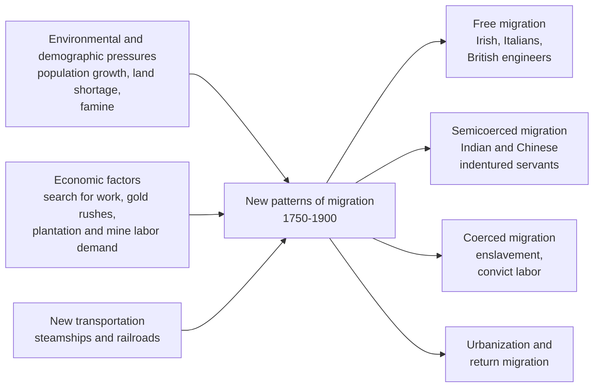
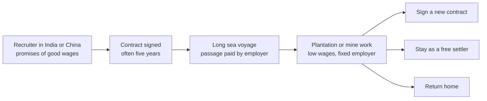
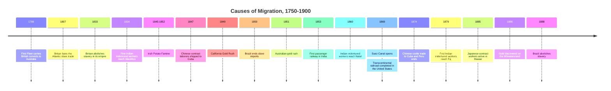
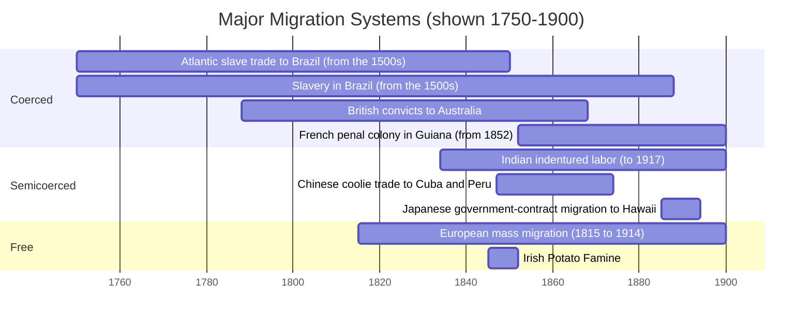
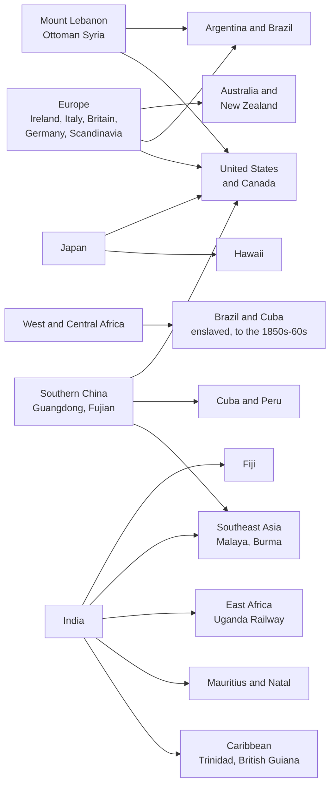
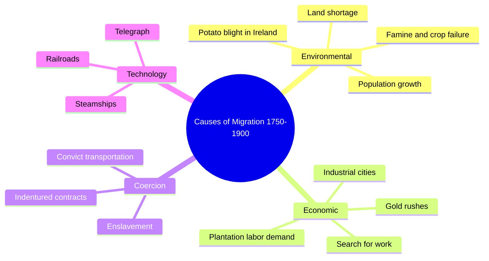

# AP World History: Modern — Topic 6.6 Causes of Migration in an Interconnected World

**Focus Question:** How did environmental and economic factors create new and varied patterns of migration from 1750 to 1900?

> Source: Based on the College Board CED · Textbook not yet incorporated

**Unit 6: Consequences of Industrialization (c. 1750–1900)**

---

## Learning Objectives

| Code | Learning Objective |
|---|---|
| 6.6 LO-F (ENV) | Explain how various environmental factors contributed to the development of varied patterns of migration from 1750 to 1900. |
| 6.6 LO-G (ECN) | Explain how various economic factors contributed to the development of varied patterns of migration from 1750 to 1900. |

## Historical Developments (CED)

| # | Historical Development | LO | Covered in |
|---|---|---|---|
| HD1 | KC-5.4.I: Migration in many cases was influenced by changes in demographics in both industrialized and unindustrialized societies that presented challenges to existing patterns of living. | F | §1, §2, §7 |
| HD2 | KC-5.4.I.B: Because of the nature of new modes of transportation, both internal and external migrants increasingly relocated to cities. This pattern contributed to the significant global urbanization of the 19th century. The new methods of transportation also allowed for many migrants to return, periodically or permanently, to their home societies. | F | §1 (steamships, railroads), §3 (urbanization), §4 (return migration) |
| HD2 · Ex. | Illustrative example — *Return of migrants:* Japanese agricultural workers in the Pacific | F | §2 (Japan), §4 |
| HD2 · Ex. | Illustrative example — *Return of migrants:* Lebanese merchants in the Americas | F | §2 (Mount Lebanon), §4 |
| HD2 · Ex. | Illustrative example — *Return of migrants:* Italian industrial workers in Argentina | F | §2 (southern Italy), §3 (Buenos Aires), §4 |
| HD3 | KC-5.4.II.A: Many individuals chose freely to relocate, often in search of work. | G | §5, §7 |
| HD3 · Ex. | Illustrative example — *Migrants:* Irish to the United States | G | §2 (Irish Potato Famine), §5 |
| HD3 · Ex. | Illustrative example — *Migrants:* British engineers and geologists to South Asia and Africa | G | §5 |
| HD4 | KC-5.4.II.B: The new global capitalist economy continued to rely on coerced and semicoerced labor migration, including enslavement Chinese and Indian indentured servitude, and convict labor. | G | §6 (enslavement, Indian and Chinese indentured servitude, convict labor) |

> HD4 is copied as the CED prints it, with no comma after "enslavement."

---

## The Big Picture

> "Give me your tired, your poor, / Your huddled masses yearning to breathe free"
> — Emma Lazarus, "The New Colossus" (1883), later placed on the Statue of Liberty

Between 1750 and 1900, more people moved farther than ever before. **Population growth** from the Agricultural Revolution and new crops put pressure on land in Europe, China, India, and Japan. **Famines** such as the **Irish Potato Famine (1845–1852)** pushed millions out. At the same time, the **new global capitalist economy** pulled people toward factories, mines, railroads, plantations, and **gold rushes**. **Steamships and railroads** made long journeys cheaper and faster, so migrants increasingly moved to **cities** and many could **return home**. Some migrants chose freely, such as the **Irish** who went to the United States and the **British engineers and geologists** who went to South Asia and Africa. Others moved under force or contract: **enslaved Africans** (until abolition), **Indian and Chinese indentured servants**, and **convicts** sent to Australia and French penal colonies.

---

## §1. Context: Why Migration Surged after 1750

- **Population growth:** The Agricultural Revolution and crops from the Columbian Exchange (potatoes, maize, sweet potatoes) improved the food supply. World population grew from about **1 billion around 1800** to about **1.6 billion by 1900**.
- **Industrialization:** Factories concentrated jobs in cities. Machines and cheap factory goods put many rural artisans, such as hand weavers, out of work. Enclosure of common land in Britain pushed small farmers off the land.
- **A global capitalist economy:** Industrial countries needed raw materials (cotton, sugar, rubber, guano, minerals) and food. Plantations, mines, and railroads around the world needed large numbers of workers.
- **A transportation revolution:** New technology made migration cheaper, faster, and safer.

| Technology | What changed | Effect on migration |
|---|---|---|
| **Steamship** | Crossings no longer depended on winds; an Atlantic voyage fell from over a month under sail to roughly one to two weeks | Tickets became cheaper, so poor migrants could go and could also afford to come back |
| **Railroad** | Moved people inland quickly and linked farms and villages to port cities | Rural people could reach factories and ports; railroads in the Americas carried settlers to new farmland |
| **Suez Canal (1869)** | Shortened the route between Europe and Asia | Faster travel for colonial officials, engineers, and migrants between Europe, South Asia, and East Africa |
| **Telegraph** | Sent news almost instantly | Migrants learned of jobs abroad faster, and companies could organize recruitment |

## §2. Environmental and Demographic Pressures (KC-5.4.I)

- Demographic change hit **both industrialized and unindustrialized societies**. More people than the land could support meant smaller farms, higher rents, and fewer jobs.
- **Environmental shocks** turned pressure into crisis. Crop disease, drought, and flood caused famines that forced people to leave.

| Region | Pressure | Migration result |
|---|---|---|
| **Ireland** | Heavy dependence on the potato; **potato blight** caused the **Irish Potato Famine (1845–1852)**; about 1 million died; British-owned estates and evictions | Over 1 million emigrated during the famine, mostly to the **United States**, Britain, Canada, and Australia |
| **German states and Scandinavia** | Population growth, farms divided into small plots, crop failures in the 1840s | Emigration to farmland in the **U.S. Midwest** |
| **Southern Italy** | Rural poverty, large estates owned by a few landlords, too little land for a growing population | Mass emigration to **Argentina**, Brazil, and the United States, especially after the 1870s |
| **Southern China (Guangdong and Fujian)** | Population roughly doubled in the 18th century; land shortage; the **Taiping Rebellion (1850–1864)** and famines | Emigration to **Southeast Asia**, Cuba, Peru, and the United States |
| **India** | Population pressure, the decline of hand weaving after British factory textiles arrived, and famines such as the **Great Famine of 1876–1878** | **Indentured** migration to the Caribbean, Mauritius, Natal, Fiji, and Southeast Asia |
| **Japan** | Meiji land tax reform (1873) and the economic slump of the 1880s left many farmers in debt | Contract labor migration to **Hawaii** from 1885 |
| **Mount Lebanon (Ottoman Syria)** | A growing population on limited mountain land; the decline of the local silk industry | Emigration to the **Americas** (United States, Brazil, Argentina, Mexico) |

> ⚠️ Needs verification: Famine and emigration figures are estimates and vary by source. The Irish figures here (about 1 million deaths, over 1 million emigrants during 1845–1852) are the most commonly cited.

## §3. Migration to Cities and Global Urbanization (KC-5.4.I.B)

- **Internal migrants** moved from the countryside to cities inside their own country. **External migrants** crossed borders and oceans, and most of them also ended up in cities.
- Railroads and steamship lines met in **port and rail cities**, so newcomers arrived there first and often stayed.
- By **1851**, more than half of Britain's people lived in towns and cities, the first large country where this was true. London grew from about **1 million (1800)** to over **6 million (1900)**.
- Urbanization was **global**. Port cities in unindustrialized societies grew as they shipped raw materials to industrial countries.

| City | Who came | Why they came |
|---|---|---|
| **Manchester** | Rural English migrants and Irish migrants | Textile factory jobs |
| **New York** | Irish, Germans, Italians, Eastern European Jews | Main port of entry to the United States; jobs in construction, docks, and workshops |
| **Chicago** | Germans, Scandinavians, Poles, Irish | Railroad hub; meatpacking, lumber, and grain trade |
| **Buenos Aires** | Italians and Spaniards | Port for Argentina's grain and beef exports; construction and workshops |
| **Singapore** | Chinese and Indians | British free port at the center of Southeast Asian trade |
| **Calcutta and Bombay** | Rural Indians | Ports and mills (jute in Calcutta, cotton in Bombay) |

## §4. Return Migration (KC-5.4.I.B Examples)

- Before steamships, most long-distance migration was **one-way**. Cheap and regular steamship service made it possible to **return periodically or permanently**.
- Many migrants never meant to stay. They worked abroad, sent money home (**remittances**), and went back to buy land, pay debts, or marry.

| Group | Destination | Work | Why they went | Return pattern |
|---|---|---|---|---|
| **Japanese agricultural workers in the Pacific** | Kingdom of Hawaii (U.S. territory after 1898) | Sugar plantations on three-year contracts | Rural debt and taxes in Meiji Japan; higher plantation wages | Many planned to return with savings, and many did; others stayed or moved on to the U.S. West Coast |
| **Lebanese merchants in the Americas** | United States, Brazil, Argentina, Mexico, the Caribbean | Peddlers, then shopkeepers and traders | Land pressure and the decline of silk on Mount Lebanon | Sent remittances; some returned to build houses in their home villages; families moved back and forth |
| **Italian industrial workers in Argentina** | Buenos Aires and the Pampas | Factory, port, and construction work in Buenos Aires; seasonal harvest work | Rural poverty in Italy; labor shortage in Argentina | Seasonal workers called **golondrinas** ("swallows") crossed each year, harvesting in the southern summer and returning for the Italian season |

- In Latin America, Lebanese and Syrian migrants were often called **"turcos"** because they traveled on Ottoman passports.
- Indentured workers could also return. Many Indian contracts promised a free passage home after a set period, often ten years in the colony.

> ⚠️ Needs verification: The CED calls this example "Italian industrial workers in Argentina." The seasonal golondrinas were mainly harvest workers, while other Italians worked in Buenos Aires factories, docks, and building trades. Check how your teacher presents this.

## §5. Free Migration in Search of Work (KC-5.4.II.A)

### Mass European Migration

- About **50 million Europeans** left Europe between 1815 and 1914, most of them for the **United States**, with others going to Canada, Argentina, Brazil, Australia, and New Zealand.
- Most migrants were **free**: they decided to go, often paid with savings or with money sent by relatives already abroad (**chain migration**).
- Pull factors included jobs in factories, mines, and railroads, and cheap land (for example, the U.S. **Homestead Act of 1862**). Argentina and Brazil actively recruited European immigrants.

### Irish to the United States (CED Example)

- Famine, poverty, and evictions pushed the Irish out; American jobs pulled them in.
- Irish men dug canals, built railroads, and worked on docks and in factories; many Irish women worked as **domestic servants**.
- They settled mainly in cities such as **Boston and New York**, where they faced anti-Catholic prejudice (see 6.7).

### British Engineers and Geologists to South Asia and Africa (CED Example)

- These were **skilled professionals**, not laborers. They went for well-paid work that the empire and private companies offered.
- In **India**, they built railways (the first passenger line ran from Bombay to Thane in **1853**), telegraph lines, and irrigation canals. The **Geological Survey of India (1851)** searched for coal and other minerals.
- In **Africa**, they worked in mining after the discovery of **diamonds at Kimberley (1867)** and **gold on the Witwatersrand (1886)** in South Africa, and on colonial railways.
- Many served for a fixed term and then returned to Britain.

### Gold Rushes

| Gold rush | Date | Who came | Result |
|---|---|---|---|
| **California** | Gold found 1848; rush from **1849** | Americans, Mexicans, Chileans, Chinese, Europeans | San Francisco boomed; California became a state (1850) |
| **Australia** (New South Wales and Victoria) | **1851** | British, Irish, Chinese, Americans | Victoria's population soared; Melbourne boomed |
| **South Africa** (Witwatersrand) | **1886** | British and other Europeans; African migrant workers | Johannesburg was founded; tensions helped cause the South African War (1899–1902) |

## §6. Coerced and Semicoerced Labor Migration (KC-5.4.II.B)

### Enslavement (Coerced)

- The Atlantic slave trade **continued into the 19th century** because sugar, coffee, and cotton were in high demand.
- **Britain** banned the slave trade in **1807** and abolished slavery in its empire in **1833** (in effect from 1834). The British navy patrolled the West African coast against slave ships.
- **Brazil** was the largest destination. It ended slave imports in **1850** but kept slavery until **1888**, the last country in the Americas to abolish it. Illegal shipments to **Cuba** continued into the 1860s.
- Slavery also expanded with industrialization. Cotton grown by enslaved people in the **U.S. South** fed British textile mills, and about 1 million enslaved people were forcibly moved from the Upper South to the Deep South.

### Indentured Servitude (Semicoerced)

- After abolition, plantation owners needed new workers. **Indentured servitude** filled the gap: a worker signed a contract to work for a fixed time (often **five years**) in exchange for passage, food, housing, and a small wage.
- It was **semicoerced**. Workers signed contracts, but recruiters often misled them, wages were low, workers could not change employers, and breaking the contract was a crime.

- **Indian indentured servants:** Organized by the British colonial government from **1834**. Destinations: **Mauritius** (1834), **British Guiana** (1838), **Trinidad** (1845), **Natal** (1860), **Fiji** (1879), and East Africa (the **Uganda Railway**, from 1896). More than 1 million Indians went before the system ended in **1917**. Others went to **Malaya** and **Burma** under related labor systems.
- **Chinese indentured servants ("coolies"):** Shipped from Macau, Xiamen (Amoy), and Hong Kong to **Cuba** (sugar) and **Peru** (guano and sugar) from **1847** until **1874**. Death rates on the ships and at work were so high that the trade was called a "second slave trade." Many more Chinese went to Southeast Asia to work in tin mines and on plantations.
- **Chinese in the United States:** Most were not formally indentured. Under the **credit-ticket system**, a broker paid the fare and the migrant repaid it from wages. Chinese workers mined gold in California and built much of the **Central Pacific Railroad** in the 1860s.

> ⚠️ Needs verification: Totals for indentured migration differ by source. The figures here (more than 1 million Indians, 1834–1917; about 125,000 Chinese to Cuba and about 100,000 to Peru) are common estimates.

### Convict Labor (Coerced)

- **Britain** used **penal transportation**: from **1788** (the First Fleet) to **1868**, about 160,000 convicts were shipped to **Australia**, where they built roads and public works.
- **France** sent convicts to penal colonies in **French Guiana** (from 1852, including Devil's Island) and **New Caledonia** (from 1864).
- **Russia** sent exiles and convicts to forced labor in **Siberia**.

## §7. Push and Pull Factors

| Factor | Push (reasons to leave) | Pull (reasons to go) |
|---|---|---|
| **Environmental and demographic** | Population growth, land shortage, famine (Ireland, India, China), crop failure | Available farmland in the Americas and Australia |
| **Economic** | Rural poverty, debt, loss of artisan jobs to factory goods | Factory, mine, railroad, and plantation jobs; gold rushes; higher wages |
| **Political** | War and rebellion (Taiping Rebellion), failed revolutions of 1848 in Europe, persecution | Political freedom; governments that recruited immigrants (Argentina, Brazil) |
| **Social** | Lack of opportunity, sectarian violence (Mount Lebanon, 1860) | Family and village networks already abroad (chain migration) |
| **Technological** | — | Cheaper, faster steamships and railroads; telegraph news of jobs |

- Push and pull usually worked together. **Coerced** migrants had no real choice, so push and pull explain free migration best.

---

## Timeline

---

## Map: Major Migration Streams, 1750–1900

- **Europe → the Americas and Australia:** mostly free migration, the largest stream by far.
- **India → the Caribbean, Indian Ocean, East Africa, Southeast Asia, and Fiji:** mostly indentured (semicoerced), inside the British Empire.
- **China → Southeast Asia and the Americas:** a mix of free, credit-ticket, and indentured migration.
- **Japan → Hawaii and the Americas:** contract labor, with high rates of return.

---

## Comparison Table: Free, Semicoerced, and Coerced Migration

| Feature | Free migration | Semicoerced migration | Coerced migration |
|---|---|---|---|
| Degree of choice | Migrant decided to go | Migrant signed a contract, often after being misled or under debt pressure | No choice |
| How the journey was paid | Own savings, family remittances | Employer or broker paid; repaid by labor | Slave traders or the state |
| Legal status at destination | Free (could change jobs) | Bound to one employer for the contract term | Enslaved for life, or a convict serving a sentence |
| Ability to return | Yes, often with steamship tickets | Sometimes promised after the contract | Rarely or never |
| Main examples | Irish, Italians, Germans, British engineers, Lebanese merchants | Indian and Chinese indentured servants; Japanese contract workers | Enslaved Africans; British and French convicts |
| Main destinations | United States, Argentina, Brazil, Australia, Canada | Caribbean, Mauritius, Natal, Fiji, Cuba, Peru, Hawaii | Brazil, Cuba, U.S. South; Australia, French Guiana, New Caledonia |
| Main cause | Search for work and land | Plantation labor shortage after abolition | Demand for cheap labor; punishment |

## Comparison Table: Indian vs. Chinese Indentured Labor

| Feature | Indian indentured servants | Chinese indentured servants ("coolies") |
|---|---|---|
| Main regions of origin | The Ganges plain (for example, Bihar) and southern India (Madras) | Southern China (Guangdong and Fujian) |
| Organized by | The British colonial government, with official regulation | Private brokers and foreign shippers, often with kidnapping and fraud |
| Destinations | Mauritius, Caribbean, Natal, Fiji, East Africa | Cuba, Peru, Southeast Asia |
| Main work | Sugar plantations; railway building | Sugar plantations, guano mining, tin mining |
| End of the system | 1917 | Trade to Cuba and Peru ended in 1874 after Chinese and international protests |
| Similarity | Both replaced enslaved labor after abolition and served the new global capitalist economy | (same) |

---

## Key Terms

| Theme | Term | Definition |
|---|---|---|
| CED | Migration | The movement of people from one place to another to live or work |
| CED | Internal migration | Movement within one country, such as from the countryside to a city |
| CED | External migration | Movement across national borders or oceans |
| CED | Push factor | A condition that drives people to leave home, such as famine or poverty |
| CED | Pull factor | A condition that attracts people to a new place, such as jobs or land |
| CED | Urbanization | The growth of cities as more people live in them |
| CED | Return migration | Migrants going back home, periodically or permanently |
| Economics | Remittances | Money migrants send home to their families |
| Society | Chain migration | Migration that follows family or village members who went earlier |
| Society | Golondrinas | "Swallows"; Italian seasonal workers who crossed to Argentina for the harvest every year |
| Society | Turcos | Latin American name for Lebanese and Syrian migrants, who carried Ottoman passports |
| Environment | Irish Potato Famine | Famine caused by potato blight (1845–1852); about 1 million died and over 1 million emigrated |
| Environment | Potato blight | A plant disease that destroyed Ireland's potato crop |
| Technology | Steamship | A ship powered by a steam engine; made ocean travel cheaper, faster, and regular |
| Economics | Gold rush | A sudden mass migration to a place where gold was found (California 1849, Australia 1851, South Africa 1886) |
| CED | Coerced labor migration | Forced movement of workers, such as enslavement and convict labor |
| CED | Semicoerced labor migration | Movement of workers under contracts that limited their freedom, such as indentured servitude |
| CED | Indentured servitude | A contract to work for a fixed number of years in return for passage and basic support |
| Society | Coolie | A term, now considered offensive, for Asian laborers, especially Chinese and Indian contract workers |
| Economics | Credit-ticket system | A broker paid a Chinese migrant's fare, which the migrant repaid from wages |
| CED | Convict labor | Forced work by prisoners, often after they were transported to a colony |
| Government | Penal transportation | Sending convicts to distant colonies (British to Australia, French to Guiana and New Caledonia) |
| CED | Global capitalist economy | The worldwide market system linking industrial countries to sources of raw materials and labor |
