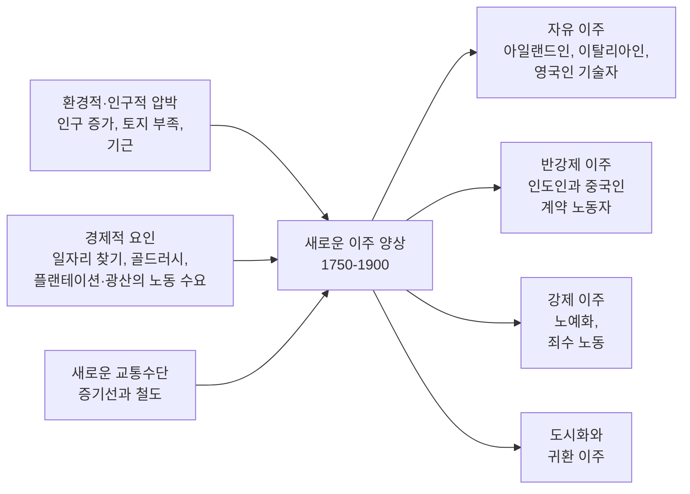
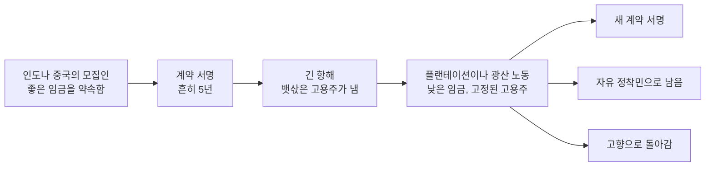
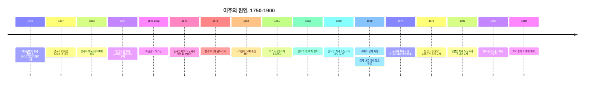
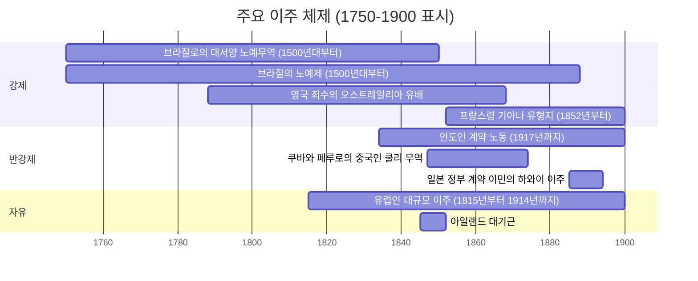
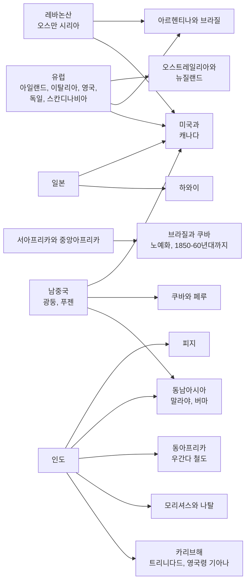
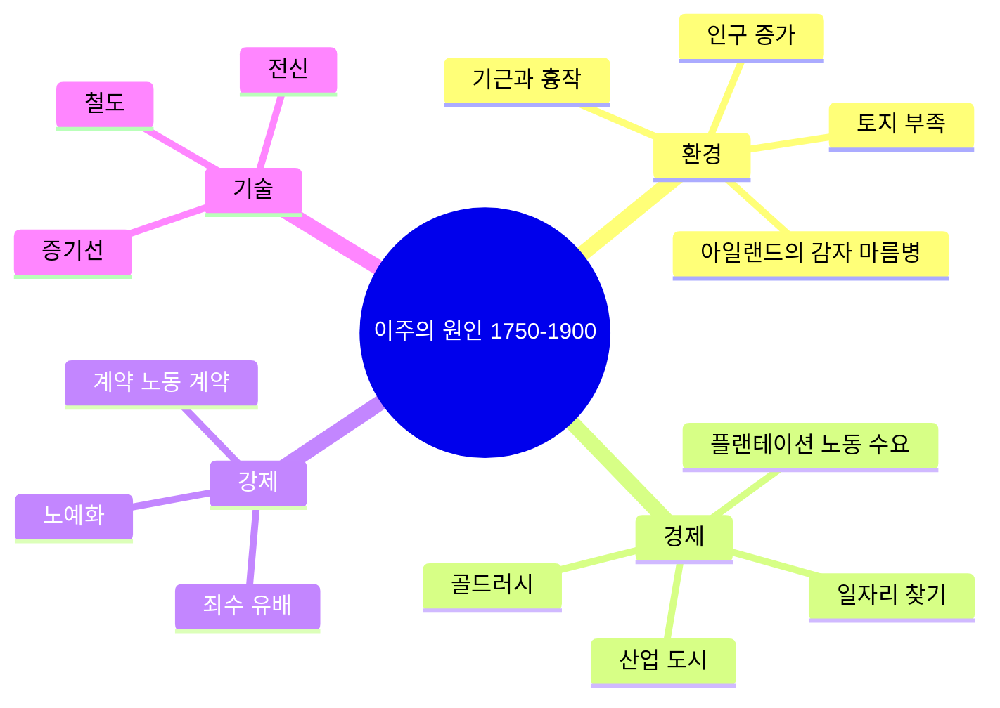

# AP 세계사: 모던 — 토픽 6.6 서로 연결된 세계에서 이주의 원인 (Causes of Migration in an Interconnected World)

**Focus Question:** 1750년부터 1900년까지 환경적 요인과 경제적 요인은 어떻게 새롭고 다양한 이주 양상을 만들어 냈는가?

> 출처: CED 기준 · 교재 반영 전

**Unit 6: 산업화의 결과 (Consequences of Industrialization, c. 1750–1900)**

---

## 학습 목표 (Learning Objectives)

| 코드 | 학습 목표 |
|---|---|
| 6.6 LO-F (ENV) | 1750년부터 1900년까지 여러 환경적 요인이 다양한 이주 양상의 전개에 어떻게 기여했는지 설명한다. |
| 6.6 LO-G (ECN) | 1750년부터 1900년까지 여러 경제적 요인이 다양한 이주 양상의 전개에 어떻게 기여했는지 설명한다. |

## 역사적 개념 (Historical Developments, CED)

| # | 역사적 개념 | LO | 다루는 곳 |
|---|---|---|---|
| HD1 | KC-5.4.I: 이주는 많은 경우 산업화된 사회와 산업화되지 않은 사회 모두에서 일어난 인구 변화의 영향을 받았으며, 이러한 변화는 기존의 생활 양식에 어려움을 안겼다. | F | §1, §2, §7 |
| HD2 | KC-5.4.I.B: 새로운 교통수단의 특성 때문에 국내 이주민과 해외 이주민 모두 점점 더 도시로 이주했다. 이 양상은 19세기의 대대적인 세계적 도시화 (Urbanization)에 기여했다. 새로운 교통수단은 또한 많은 이주민이 주기적으로 또는 영구적으로 고향 사회로 돌아갈 수 있게 했다. | F | §1 (증기선, 철도), §3 (도시화), §4 (귀환 이주) |
| HD2 · 예시 | 예시 (Illustrative example) — *이주민의 귀환 (Return of migrants):* 태평양 지역의 일본인 농업 노동자 (Japanese agricultural workers in the Pacific) | F | §2 (일본), §4 |
| HD2 · 예시 | 예시 (Illustrative example) — *이주민의 귀환 (Return of migrants):* 아메리카의 레바논 상인 (Lebanese merchants in the Americas) | F | §2 (레바논산), §4 |
| HD2 · 예시 | 예시 (Illustrative example) — *이주민의 귀환 (Return of migrants):* 아르헨티나의 이탈리아인 공업 노동자 (Italian industrial workers in Argentina) | F | §2 (남부 이탈리아), §3 (부에노스아이레스), §4 |
| HD3 | KC-5.4.II.A: 많은 사람이 흔히 일자리를 찾아 자유롭게 이주를 선택했다. | G | §5, §7 |
| HD3 · 예시 | 예시 (Illustrative example) — *이주민 (Migrants):* 미국으로 간 아일랜드인 (Irish to the United States) | G | §2 (아일랜드 대기근), §5 |
| HD3 · 예시 | 예시 (Illustrative example) — *이주민 (Migrants):* 남아시아와 아프리카로 간 영국인 기술자와 지질학자 (British engineers and geologists to South Asia and Africa) | G | §5 |
| HD4 | KC-5.4.II.B: 새로운 세계 자본주의 경제는 노예화, 중국인과 인도인의 계약 노동 (Indentured servitude), 죄수 노동 (Convict labor) 등 강제적이거나 반강제적인 노동 이주에 계속 의존했다. | G | §6 (노예화, 인도인과 중국인의 계약 노동, 죄수 노동) |

> HD4의 영어 원문은 CED에 인쇄된 그대로 "enslavement" 뒤에 쉼표가 없다 (The new global capitalist economy continued to rely on coerced and semicoerced labor migration, including enslavement Chinese and Indian indentured servitude, and convict labor.).

---

## 큰 그림 요약

> "지친 이들, 가난한 이들, 자유롭게 숨 쉬기를 갈망하는 무리 지은 군중을 내게 보내라" (Give me your tired, your poor, / Your huddled masses yearning to breathe free)
> — 에마 래저러스 (Emma Lazarus), 「새로운 거상 (The New Colossus)」 (1883). 나중에 자유의 여신상에 새겨졌다.

1750년부터 1900년 사이에 이전 어느 때보다 많은 사람이 더 멀리 이동했다. 농업 혁명과 새로운 작물이 가져온 **인구 증가 (Population growth)**는 유럽, 중국, 인도, 일본의 토지에 압박을 주었다. **아일랜드 대기근 (Irish Potato Famine, 1845–1852)** 같은 **기근 (Famine)**은 수백만 명을 밖으로 밀어냈다. 동시에 **새로운 세계 자본주의 경제 (Global capitalist economy)**는 사람들을 공장, 광산, 철도, 플랜테이션, **골드러시 (Gold rush)** 현장으로 끌어당겼다. **증기선과 철도 (Steamships and railroads)**는 먼 여행을 더 싸고 빠르게 만들었다. 그래서 이주민은 점점 더 **도시**로 갔고, 많은 사람이 **고향으로 돌아갈** 수 있었다. 어떤 이주민은 자유롭게 선택했다. 미국으로 간 **아일랜드인 (Irish)**, 남아시아와 아프리카로 간 **영국인 기술자와 지질학자 (British engineers and geologists)**가 그 예다. 다른 이주민은 강제나 계약에 따라 이동했다. 노예제 폐지 전까지의 **노예화된 아프리카인 (Enslaved Africans)**, **인도인과 중국인 계약 노동자 (Indian and Chinese indentured servants)**, 오스트레일리아와 프랑스 유형지로 보내진 **죄수 (Convicts)**가 그들이다.

---

## §1. 배경: 1750년 이후 이주가 급증한 이유

- **인구 증가:** 농업 혁명과 콜럼버스 교환 (Columbian Exchange)으로 들어온 작물(감자, 옥수수, 고구마)이 식량 공급을 늘렸다. 세계 인구는 **1800년 무렵 약 10억 명**에서 **1900년 약 16억 명**으로 늘었다.
- **산업화 (Industrialization):** 공장이 도시에 일자리를 모았다. 기계와 값싼 공장 제품 때문에 수직공 같은 많은 농촌 장인이 일자리를 잃었다. 영국에서는 공유지 인클로저 (Enclosure)가 소농을 땅에서 밀어냈다.
- **세계 자본주의 경제:** 산업 국가는 원료(면화, 설탕, 고무, 구아노, 광물)와 식량이 필요했다. 세계 곳곳의 플랜테이션, 광산, 철도는 많은 노동자를 필요로 했다.
- **교통 혁명:** 새로운 기술 덕분에 이주가 더 싸고, 빠르고, 안전해졌다.

| 기술 | 무엇이 달라졌나 | 이주에 미친 영향 |
|---|---|---|
| **증기선 (Steamship)** | 항해가 더는 바람에 좌우되지 않았다. 대서양 횡단이 범선으로 한 달 이상에서 대략 1–2주로 줄었다 | 표값이 싸져 가난한 이주민도 떠날 수 있었고, 돌아올 비용도 마련할 수 있었다 |
| **철도 (Railroad)** | 사람을 내륙으로 빠르게 실어 날랐고, 농촌 마을을 항구 도시와 이었다 | 농촌 사람이 공장과 항구에 닿을 수 있었다. 아메리카의 철도는 정착민을 새 농지로 실어 날랐다 |
| **수에즈 운하 (Suez Canal, 1869)** | 유럽과 아시아 사이의 항로를 줄였다 | 유럽, 남아시아, 동아프리카 사이를 오가는 식민지 관리, 기술자, 이주민의 이동이 빨라졌다 |
| **전신 (Telegraph)** | 소식을 거의 즉시 전했다 | 이주민은 해외 일자리 소식을 더 빨리 알았고, 회사는 노동자 모집을 조직할 수 있었다 |

## §2. 환경적·인구적 압박 (KC-5.4.I)

- 인구 변화는 **산업화된 사회와 산업화되지 않은 사회 모두**에 영향을 주었다. 땅이 감당할 수 있는 것보다 사람이 많아지자 농지는 작아지고, 지대는 오르고, 일자리는 줄었다.
- **환경적 충격**은 압박을 위기로 바꾸었다. 작물 병, 가뭄, 홍수가 기근을 일으켜 사람들을 떠나게 했다.

| 지역 | 압박 | 이주 결과 |
|---|---|---|
| **아일랜드 (Ireland)** | 감자에 크게 의존했다. **감자 마름병 (Potato blight)**이 **아일랜드 대기근 (Irish Potato Famine, 1845–1852)**을 일으켰고, 약 100만 명이 죽었다. 영국인 소유 영지와 강제 퇴거도 있었다 | 기근 동안 100만 명 이상이 이주했다. 대부분 **미국**으로 갔고, 영국, 캐나다, 오스트레일리아로도 갔다 |
| **독일 국가들과 스칸디나비아 (German states and Scandinavia)** | 인구 증가, 작은 땅으로 쪼개진 농지, 1840년대의 흉작 | **미국 중서부 (U.S. Midwest)**의 농지로 이주했다 |
| **남부 이탈리아 (Southern Italy)** | 농촌 빈곤, 소수 지주가 가진 대농장, 늘어나는 인구에 비해 부족한 땅 | **아르헨티나 (Argentina)**, 브라질, 미국으로 대규모 이주가 일어났다. 특히 1870년대 이후 많았다 |
| **남중국 (광둥과 푸젠, Guangdong and Fujian)** | 18세기에 인구가 대략 두 배로 늘었다. 토지 부족, **태평천국 운동 (Taiping Rebellion, 1850–1864)**, 기근 | **동남아시아**, 쿠바, 페루, 미국으로 이주했다 |
| **인도 (India)** | 인구 압박, 영국 공장 직물이 들어온 뒤 수직물 생산의 쇠퇴, **1876–1878년 대기근 (Great Famine of 1876–1878)** 같은 기근 | 카리브해, 모리셔스, 나탈, 피지, 동남아시아로 **계약 노동** 이주가 일어났다 |
| **일본 (Japan)** | 메이지 지조 개정 (Meiji land tax reform, 1873)과 1880년대 불황으로 많은 농민이 빚을 졌다 | 1885년부터 **하와이 (Hawaii)**로 계약 노동 이주가 일어났다 |
| **레바논산 (Mount Lebanon, 오스만 시리아)** | 좁은 산지에 늘어나는 인구, 지역 견직물 산업의 쇠퇴 | **아메리카**(미국, 브라질, 아르헨티나, 멕시코)로 이주했다 |

> ⚠️ 확인 필요: 기근과 이주 수치는 추정치이며 자료마다 다르다. 여기 쓴 아일랜드 수치(사망 약 100만 명, 1845–1852년 이주 100만 명 이상)는 가장 흔히 인용되는 값이다.

## §3. 도시로의 이주와 세계적 도시화 (KC-5.4.I.B)

- **국내 이주민 (Internal migrants)**은 같은 나라 안에서 농촌에서 도시로 옮겨 갔다. **해외 이주민 (External migrants)**은 국경과 바다를 건넜고, 이들 대부분도 결국 도시에 자리 잡았다.
- 철도와 증기선 항로는 **항구 도시와 철도 도시**에서 만났다. 그래서 새로 온 사람들은 먼저 그곳에 도착했고, 그대로 머무는 경우가 많았다.
- **1851년**에 영국 인구의 절반 이상이 도시에 살았다. 이런 일이 일어난 첫 대국이었다. 런던 인구는 약 **100만 명(1800)**에서 **600만 명 이상(1900)**으로 늘었다.
- 도시화는 **세계적**이었다. 산업화되지 않은 사회의 항구 도시도 산업 국가로 원료를 실어 보내면서 커졌다.

| 도시 | 누가 왔나 | 왜 왔나 |
|---|---|---|
| **맨체스터 (Manchester)** | 잉글랜드 농촌 이주민과 아일랜드 이주민 | 섬유 공장 일자리 |
| **뉴욕 (New York)** | 아일랜드인, 독일인, 이탈리아인, 동유럽 유대인 | 미국의 주요 입국 항구. 건설, 부두, 작업장 일자리 |
| **시카고 (Chicago)** | 독일인, 스칸디나비아인, 폴란드인, 아일랜드인 | 철도 중심지. 육류 가공, 목재, 곡물 교역 |
| **부에노스아이레스 (Buenos Aires)** | 이탈리아인과 에스파냐인 | 아르헨티나의 곡물·쇠고기 수출항. 건설과 작업장 |
| **싱가포르 (Singapore)** | 중국인과 인도인 | 동남아시아 교역의 중심에 있던 영국의 자유항 |
| **캘커타와 봄베이 (Calcutta and Bombay)** | 인도 농촌 사람들 | 항구와 공장(캘커타의 황마, 봄베이의 면직) |

## §4. 귀환 이주 (KC-5.4.I.B 예시)

- 증기선 이전에는 먼 거리 이주가 대부분 **한 방향**이었다. 싸고 정기적인 증기선 운항 덕분에 **주기적으로 또는 영구적으로 돌아오는 것**이 가능해졌다.
- 많은 이주민은 처음부터 머물 생각이 없었다. 해외에서 일하며 고향에 돈을 보냈고(**송금, Remittances**), 땅을 사거나 빚을 갚거나 결혼하려고 돌아갔다.

| 집단 | 목적지 | 일 | 떠난 이유 | 귀환 양상 |
|---|---|---|---|---|
| **태평양 지역의 일본인 농업 노동자 (Japanese agricultural workers in the Pacific)** | 하와이 왕국 (Kingdom of Hawaii, 1898년 이후 미국 영토) | 3년 계약으로 사탕수수 플랜테이션에서 일했다 | 메이지 일본의 농촌 부채와 세금. 플랜테이션의 더 높은 임금 | 많은 사람이 저축해서 돌아갈 계획이었고, 실제로 많이 돌아갔다. 다른 사람들은 남거나 미국 서해안으로 옮겨 갔다 |
| **아메리카의 레바논 상인 (Lebanese merchants in the Americas)** | 미국, 브라질, 아르헨티나, 멕시코, 카리브해 | 행상으로 시작해 상점 주인과 무역상이 되었다 | 레바논산의 토지 압박과 견직물 산업의 쇠퇴 | 송금을 보냈다. 일부는 돌아가 고향 마을에 집을 지었다. 가족이 양쪽을 오갔다 |
| **아르헨티나의 이탈리아인 공업 노동자 (Italian industrial workers in Argentina)** | 부에노스아이레스와 팜파스 (Pampas) | 부에노스아이레스의 공장, 항구, 건설 일. 계절별 수확 노동 | 이탈리아의 농촌 빈곤. 아르헨티나의 노동력 부족 | **골론드리나스 (Golondrinas, "제비")**라 불린 계절 노동자는 해마다 대서양을 건넜다. 남반구 여름에 수확하고 이탈리아의 농사철에 돌아갔다 |

- 라틴아메리카에서는 레바논인과 시리아인 이주민을 흔히 **"투르코 (Turcos)"**라고 불렀다. 오스만 여권을 가지고 다녔기 때문이다.
- 계약 노동자도 돌아갈 수 있었다. 많은 인도인 계약서는 식민지에서 정해진 기간(흔히 10년)을 보낸 뒤 무료 귀국 뱃삯을 약속했다.

> ⚠️ 확인 필요: CED는 이 예시를 "아르헨티나의 이탈리아인 공업 노동자 (Italian industrial workers in Argentina)"라고 부른다. 계절 노동자 골론드리나스는 주로 수확 노동자였고, 다른 이탈리아인들은 부에노스아이레스의 공장, 부두, 건설업에서 일했다. 선생님이 어떻게 가르치는지 확인이 필요하다.

## §5. 일자리를 찾아 나선 자유 이주 (KC-5.4.II.A)

### 유럽인의 대규모 이주

- 1815년부터 1914년 사이에 약 **5,000만 명의 유럽인**이 유럽을 떠났다. 대부분 **미국**으로 갔고, 캐나다, 아르헨티나, 브라질, 오스트레일리아, 뉴질랜드로도 갔다.
- 대부분의 이주민은 **자유로웠다.** 스스로 떠나기로 했고, 흔히 저축이나 먼저 떠난 친척이 보낸 돈으로 뱃삯을 냈다(**연쇄 이주, Chain migration**).
- 끌어당기는 요인에는 공장·광산·철도의 일자리와 값싼 땅(예: 미국의 **홈스테드법 (Homestead Act, 1862)**)이 있었다. 아르헨티나와 브라질은 유럽인 이민자를 적극적으로 모집했다.

### 미국으로 간 아일랜드인 (CED 예시)

- 기근, 가난, 강제 퇴거가 아일랜드인을 밀어냈고, 미국의 일자리가 그들을 끌어당겼다.
- 아일랜드 남성은 운하를 파고, 철도를 놓고, 부두와 공장에서 일했다. 많은 아일랜드 여성은 **가사 노동자 (Domestic servants)**로 일했다.
- 이들은 주로 **보스턴과 뉴욕 (Boston and New York)** 같은 도시에 정착했고, 그곳에서 반가톨릭 편견에 부딪혔다(6.7 참고).

### 남아시아와 아프리카로 간 영국인 기술자와 지질학자 (CED 예시)

- 이들은 노동자가 아니라 **숙련 전문가**였다. 제국과 민간 회사가 제공하는 보수가 좋은 일자리를 찾아 떠났다.
- **인도**에서는 철도(첫 여객 철도는 **1853년** 봄베이–타네 구간), 전신선, 관개 운하를 건설했다. **인도 지질 조사국 (Geological Survey of India, 1851)**은 석탄과 다른 광물을 찾았다.
- **아프리카**에서는 남아프리카의 **킴벌리 다이아몬드 (Kimberley, 1867)**와 **위트워터스랜드 금광 (Witwatersrand, 1886)**이 발견된 뒤 광산업과 식민지 철도에서 일했다.
- 많은 사람이 정해진 기간 동안 일한 뒤 영국으로 돌아갔다.

### 골드러시

| 골드러시 | 연도 | 누가 왔나 | 결과 |
|---|---|---|---|
| **캘리포니아 (California)** | 1848년 금 발견, **1849년**부터 러시 | 미국인, 멕시코인, 칠레인, 중국인, 유럽인 | 샌프란시스코가 급성장했다. 캘리포니아가 주가 되었다(1850) |
| **오스트레일리아 (Australia)** (뉴사우스웨일스와 빅토리아) | **1851년** | 영국인, 아일랜드인, 중국인, 미국인 | 빅토리아 인구가 급증했다. 멜버른이 급성장했다 |
| **남아프리카 (South Africa)** (위트워터스랜드) | **1886년** | 영국인과 다른 유럽인. 아프리카인 이주 노동자 | 요하네스버그가 세워졌다. 긴장이 남아프리카 전쟁 (South African War, 1899–1902)의 원인이 되었다 |

## §6. 강제적·반강제적 노동 이주 (KC-5.4.II.B)

### 노예화 (강제)

- 설탕, 커피, 면화의 수요가 높았기 때문에 대서양 노예무역 (Atlantic slave trade)은 **19세기까지 계속되었다.**
- **영국**은 **1807년**에 노예무역을 금지했고, **1833년**에 제국 전체에서 노예제를 폐지했다(1834년 시행). 영국 해군은 서아프리카 해안에서 노예선을 단속했다.
- **브라질**은 가장 큰 목적지였다. **1850년**에 노예 수입을 끝냈지만 노예제는 **1888년**까지 유지했다. 아메리카에서 노예제를 가장 늦게 폐지한 나라다. **쿠바**로의 불법 수송은 1860년대까지 이어졌다.
- 노예제는 산업화와 함께 커지기도 했다. **미국 남부 (U.S. South)**에서 노예가 재배한 면화가 영국 섬유 공장에 공급되었고, 약 100만 명의 노예가 남부의 북쪽 지역 (Upper South)에서 남부 깊숙한 지역 (Deep South)으로 강제로 옮겨졌다.

### 계약 노동 (반강제)

- 노예제가 폐지된 뒤 플랜테이션 주인들은 새 노동자가 필요했다. **계약 노동 (Indentured servitude)**이 그 빈자리를 채웠다. 노동자는 뱃삯, 식량, 숙소, 적은 임금을 받는 대가로 정해진 기간(흔히 **5년**) 일하기로 계약했다.
- 이것은 **반강제**였다. 노동자가 계약서에 서명하기는 했지만, 모집인은 흔히 이들을 속였다. 임금은 낮았고, 고용주를 바꿀 수 없었으며, 계약을 어기면 범죄가 되었다.

- **인도인 계약 노동자:** **1834년**부터 영국 식민지 정부가 조직했다. 목적지는 **모리셔스 (Mauritius, 1834)**, **영국령 기아나 (British Guiana, 1838)**, **트리니다드 (Trinidad, 1845)**, **나탈 (Natal, 1860)**, **피지 (Fiji, 1879)**, 그리고 동아프리카(**우간다 철도 (Uganda Railway)**, 1896년부터)였다. 이 제도가 **1917년**에 끝나기 전까지 100만 명 이상의 인도인이 떠났다. 다른 인도인들은 비슷한 노동 제도로 **말라야 (Malaya)**와 **버마 (Burma)**로 갔다.
- **중국인 계약 노동자 ("쿨리", Coolies):** **1847년**부터 **1874년**까지 마카오, 샤먼 (Xiamen, 아모이), 홍콩에서 **쿠바**(설탕)와 **페루**(구아노와 설탕)로 실려 갔다. 배 안과 일터의 사망률이 너무 높아 "제2의 노예무역"이라고 불렸다. 훨씬 더 많은 중국인이 동남아시아로 가서 주석 광산과 플랜테이션에서 일했다.
- **미국의 중국인:** 대부분은 정식 계약 노동자가 아니었다. **외상 운임 제도 (Credit-ticket system)**에서는 중개인이 뱃삯을 내고 이주민이 임금으로 갚았다. 중국인 노동자는 캘리포니아에서 금을 캤고, 1860년대에 **센트럴 퍼시픽 철도 (Central Pacific Railroad)**의 상당 부분을 건설했다.

> ⚠️ 확인 필요: 계약 노동 이주의 총수는 자료마다 다르다. 여기 쓴 수치(1834–1917년 인도인 100만 명 이상, 쿠바로 간 중국인 약 12만 5,000명, 페루로 간 중국인 약 10만 명)는 흔히 쓰이는 추정치다.

### 죄수 노동 (강제)

- **영국**은 **죄수 유배 (Penal transportation)**를 이용했다. **1788년**(제1함대, First Fleet)부터 **1868년**까지 약 16만 명의 죄수를 **오스트레일리아**로 보냈고, 이들은 도로와 공공시설을 건설했다.
- **프랑스**는 **프랑스령 기아나 (French Guiana)**(1852년부터, 악마의 섬 (Devil's Island) 포함)와 **뉴칼레도니아 (New Caledonia)**(1864년부터)의 유형지로 죄수를 보냈다.
- **러시아**는 유배자와 죄수를 **시베리아 (Siberia)**의 강제 노동에 보냈다.

## §7. 밀어내는 요인과 끌어당기는 요인

| 요인 | 밀어내는 요인 (떠나는 이유, Push) | 끌어당기는 요인 (가는 이유, Pull) |
|---|---|---|
| **환경·인구** | 인구 증가, 토지 부족, 기근(아일랜드, 인도, 중국), 흉작 | 아메리카와 오스트레일리아의 얻을 수 있는 농지 |
| **경제** | 농촌 빈곤, 빚, 공장 제품 때문에 사라진 장인 일자리 | 공장·광산·철도·플랜테이션 일자리. 골드러시. 더 높은 임금 |
| **정치** | 전쟁과 반란(태평천국 운동), 1848년 유럽 혁명의 실패, 박해 | 정치적 자유. 이민자를 모집한 정부(아르헨티나, 브라질) |
| **사회** | 기회 부족, 종파 간 폭력(레바논산, 1860) | 이미 해외에 있는 가족·마을 연결망(연쇄 이주) |
| **기술** | — | 더 싸고 빠른 증기선과 철도. 전신으로 전해진 일자리 소식 |

- 밀어내는 요인과 끌어당기는 요인은 대개 함께 작용했다. **강제** 이주민에게는 실제 선택권이 없었으므로, 이 틀은 자유 이주를 가장 잘 설명한다.

---

## 연표

---

## 지도: 주요 이주 흐름, 1750–1900

- **유럽 → 아메리카와 오스트레일리아:** 대부분 자유 이주였고, 단연 가장 큰 흐름이었다.
- **인도 → 카리브해, 인도양, 동아프리카, 동남아시아, 피지:** 대부분 영국 제국 안에서 이루어진 계약 노동(반강제) 이주였다.
- **중국 → 동남아시아와 아메리카:** 자유 이주, 외상 운임 이주, 계약 노동 이주가 섞여 있었다.
- **일본 → 하와이와 아메리카:** 계약 노동 이주였고, 귀환 비율이 높았다.

---

## 비교표: 자유 이주, 반강제 이주, 강제 이주

| 항목 | 자유 이주 (Free migration) | 반강제 이주 (Semicoerced migration) | 강제 이주 (Coerced migration) |
|---|---|---|---|
| 선택의 정도 | 이주민이 스스로 떠나기로 했다 | 이주민이 계약서에 서명했지만, 흔히 속았거나 빚에 쫓겼다 | 선택권이 없었다 |
| 여행 비용 | 자기 저축, 가족의 송금 | 고용주나 중개인이 내고 노동으로 갚았다 | 노예 상인이나 국가 |
| 도착지에서의 법적 지위 | 자유인(일자리를 바꿀 수 있었다) | 계약 기간 동안 한 고용주에게 묶였다 | 평생 노예, 또는 형기를 사는 죄수 |
| 귀환 가능성 | 있었다. 흔히 증기선 표로 돌아왔다 | 계약 뒤 약속되기도 했다 | 거의 또는 전혀 없었다 |
| 주요 예 | 아일랜드인, 이탈리아인, 독일인, 영국인 기술자, 레바논 상인 | 인도인과 중국인 계약 노동자, 일본인 계약 노동자 | 노예화된 아프리카인, 영국과 프랑스의 죄수 |
| 주요 목적지 | 미국, 아르헨티나, 브라질, 오스트레일리아, 캐나다 | 카리브해, 모리셔스, 나탈, 피지, 쿠바, 페루, 하와이 | 브라질, 쿠바, 미국 남부. 오스트레일리아, 프랑스령 기아나, 뉴칼레도니아 |
| 주요 원인 | 일자리와 땅을 찾음 | 노예제 폐지 뒤 플랜테이션의 노동력 부족 | 값싼 노동력 수요. 처벌 |

## 비교표: 인도인 계약 노동과 중국인 계약 노동

| 항목 | 인도인 계약 노동자 | 중국인 계약 노동자 ("쿨리") |
|---|---|---|
| 주요 출신 지역 | 갠지스 평원(예: 비하르 (Bihar))과 남인도(마드라스 (Madras)) | 남중국(광둥과 푸젠) |
| 조직한 주체 | 영국 식민지 정부. 공식 규제가 있었다 | 민간 중개인과 외국 선주. 납치와 사기가 흔했다 |
| 목적지 | 모리셔스, 카리브해, 나탈, 피지, 동아프리카 | 쿠바, 페루, 동남아시아 |
| 주요 일 | 사탕수수 플랜테이션. 철도 건설 | 사탕수수 플랜테이션, 구아노 채취, 주석 채굴 |
| 제도의 종말 | 1917년 | 중국과 국제 사회의 항의 끝에 쿠바·페루행 무역이 1874년에 끝났다 |
| 공통점 | 둘 다 노예제 폐지 뒤 노예 노동을 대신했고, 새로운 세계 자본주의 경제에 이바지했다 | (같음) |

---

## Key Terms (핵심 용어)

| 주제 | 용어 | 정의 |
|---|---|---|
| CED | 이주 (Migration) | 살거나 일하기 위해 사람이 한 곳에서 다른 곳으로 옮겨 가는 것 |
| CED | 국내 이주 (Internal migration) | 농촌에서 도시로 가는 것처럼 한 나라 안에서 이동하는 것 |
| CED | 해외 이주 (External migration) | 국경이나 바다를 건너 이동하는 것 |
| CED | 밀어내는 요인 (Push factor) | 기근이나 가난처럼 사람들을 고향에서 떠나게 만드는 조건 |
| CED | 끌어당기는 요인 (Pull factor) | 일자리나 땅처럼 사람들을 새로운 곳으로 끌어들이는 조건 |
| CED | 도시화 (Urbanization) | 더 많은 사람이 도시에 살게 되면서 도시가 성장하는 것 |
| CED | 귀환 이주 (Return migration) | 이주민이 주기적으로 또는 영구적으로 고향에 돌아가는 것 |
| 경제 | 송금 (Remittances) | 이주민이 고향의 가족에게 보내는 돈 |
| 사회 | 연쇄 이주 (Chain migration) | 먼저 떠난 가족이나 같은 마을 사람을 뒤따라가는 이주 |
| 사회 | 골론드리나스 (Golondrinas) | "제비"라는 뜻. 해마다 수확철에 아르헨티나로 건너간 이탈리아인 계절 노동자 |
| 사회 | 투르코 (Turcos) | 오스만 여권을 가지고 다닌 레바논인과 시리아인 이주민을 라틴아메리카에서 부른 이름 |
| 환경 | 아일랜드 대기근 (Irish Potato Famine) | 감자 마름병이 일으킨 기근(1845–1852). 약 100만 명이 죽고 100만 명 이상이 이주했다 |
| 환경 | 감자 마름병 (Potato blight) | 아일랜드의 감자 농사를 망친 식물 병 |
| 기술 | 증기선 (Steamship) | 증기 기관으로 움직이는 배. 바다 여행을 더 싸고, 빠르고, 정기적으로 만들었다 |
| 경제 | 골드러시 (Gold rush) | 금이 발견된 곳으로 갑자기 많은 사람이 몰려간 이주(캘리포니아 1849, 오스트레일리아 1851, 남아프리카 1886) |
| CED | 강제 노동 이주 (Coerced labor migration) | 노예화나 죄수 노동처럼 노동자를 강제로 옮기는 것 |
| CED | 반강제 노동 이주 (Semicoerced labor migration) | 계약 노동처럼 자유를 제한하는 계약에 따라 노동자가 옮겨 가는 것 |
| CED | 계약 노동 (Indentured servitude) | 뱃삯과 기본 생활을 받는 대가로 정해진 햇수 동안 일하기로 한 계약 |
| 사회 | 쿨리 (Coolie) | 아시아인 노동자, 특히 중국인과 인도인 계약 노동자를 부르던 말. 지금은 모욕적인 말로 여겨진다 |
| 경제 | 외상 운임 제도 (Credit-ticket system) | 중개인이 중국인 이주민의 뱃삯을 내고, 이주민이 임금으로 갚는 제도 |
| CED | 죄수 노동 (Convict labor) | 죄수가 하는 강제 노동. 흔히 식민지로 보내진 뒤에 했다 |
| 정치 | 죄수 유배 (Penal transportation) | 죄수를 먼 식민지로 보내는 것(영국은 오스트레일리아로, 프랑스는 기아나와 뉴칼레도니아로) |
| CED | 세계 자본주의 경제 (Global capitalist economy) | 산업 국가를 원료와 노동력의 공급지와 잇는 세계 시장 체제 |
