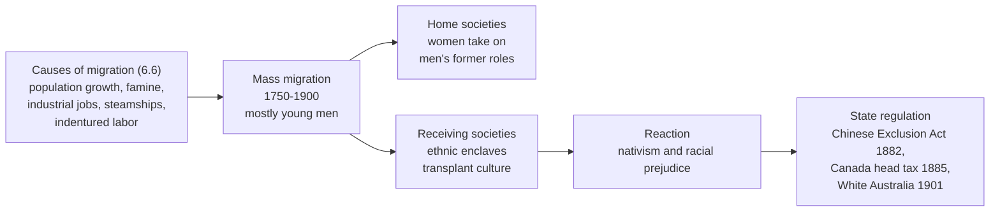
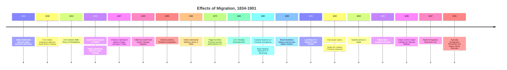
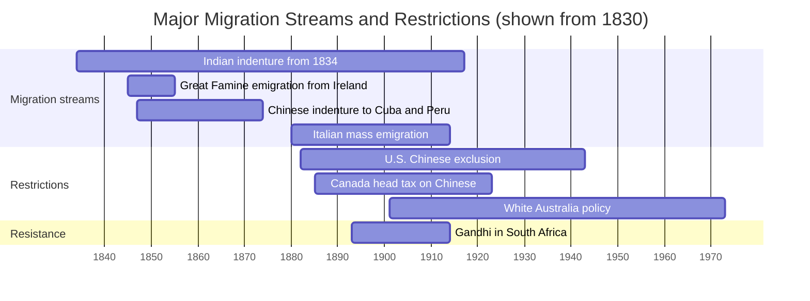
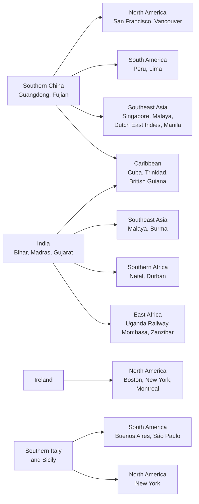
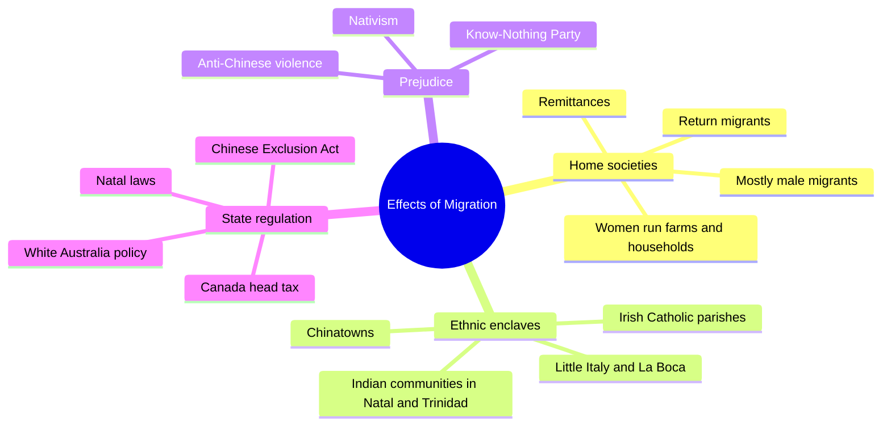

# AP World History: Modern — Topic 6.7 Effects of Migration

**Focus Question:** How and why did new patterns of migration affect society from 1750 to 1900?

> Source: Based on the College Board CED · Textbook not yet incorporated

**Unit 6: Consequences of Industrialization (c. 1750–1900)**

---

## Learning Objective

| Code | Learning Objective |
|---|---|
| 6.7 LO-H (SIO) | Explain how and why new patterns of migration affected society from 1750 to 1900. |

## Historical Developments (CED)

| # | Historical Development | Covered in |
|---|---|---|
| HD1 | KC-5.4.III.A: Migrants tended to be male, leaving women to take on new roles in the home society that had been formerly occupied by men. | §2 |
| HD2 | KC-5.4.III.B: Migrants often created ethnic enclaves in different parts of the world that helped transplant their culture into new environments. | §3, Map, Comparison Table |
| HD2 · Ex. | Illustrative example — *Migrant ethnic enclaves:* Chinese in Southeast Asia, the Caribbean, South America, and North America | §3 (Chinese diaspora), Map |
| HD2 · Ex. | Illustrative example — *Migrant ethnic enclaves:* Indians in East and Southern Africa, the Caribbean, and Southeast Asia | §3 (Indian diaspora), §5 (Natal), Map |
| HD2 · Ex. | Illustrative example — *Migrant ethnic enclaves:* Irish in North America | §3 (Irish in Boston and New York), §4 |
| HD2 · Ex. | Illustrative example — *Migrant ethnic enclaves:* Italians in North and South America | §3 (Italians in New York, Buenos Aires, São Paulo), §4 |
| HD3 | KC-5.4.III.C: Receiving societies did not always embrace immigrants, as seen in the various degrees of ethnic and racial prejudice and the ways states attempted to regulate the increased flow of people across their borders. | §4, §5, §6 |
| HD3 · Ex. | Illustrative example — *Regulation of immigrants:* Chinese Exclusion Act | §5 (Chinese Exclusion Act, 1882) |
| HD3 · Ex. | Illustrative example — *Regulation of immigrants:* White Australia policy | §5 (Immigration Restriction Act, 1901) |

---

## The Big Picture

> "Give me your tired, your poor, Your huddled masses yearning to breathe free"
> — Emma Lazarus, "The New Colossus" (1883), later placed on the pedestal of the Statue of Liberty

Topic 6.6 explained **why** tens of millions of people moved between 1750 and 1900: population growth, famine, industrial jobs, cheap steamships and railroads, and coerced or semicoerced labor systems such as **indentured servitude**. Topic 6.7 asks **what that movement did to societies** at both ends. In **home societies**, most migrants were **young men**, so the women who stayed behind took over farms, households, money, and wage work that men had done. In **receiving societies**, migrants built **ethnic enclaves** (Chinatowns, Little Italys, Irish parishes, Indian merchant quarters) where their language, religion, food, and mutual-aid groups helped them survive and **transplanted their culture**. But receiving societies did **not always welcome** them. Nativism and racial prejudice grew, and states began to **regulate borders**: the U.S. **Chinese Exclusion Act** (1882), Canada's **head tax** on Chinese immigrants (1885), restrictions on Indians in **Natal**, and the **White Australia policy** (1901). Lazarus wrote her welcoming poem in 1883, one year after the Chinese Exclusion Act, which shows both sides of the story.

---

## §1. Context: The Migration Streams of 6.6

- Between 1750 and 1900, **new transportation** (steamships, railroads) made long-distance migration cheaper and faster, and also made **return migration** possible (see 6.6).
- **Free migrants** left Europe for the Americas and Australia in search of land and work: the **Irish** after the Great Famine (1845–1852), and **Italians**, especially from the south, after about 1880.
- **Semicoerced migrants** left Asia under **indentured** contracts after the abolition of slavery created a labor shortage on plantations: **Indians** to the Caribbean, Mauritius, Natal, Fiji, and Malaya; **Chinese** to Cuba, Peru, and Southeast Asia.
- Many **Chinese** also migrated freely or on credit (the "credit-ticket" system) to the gold fields and railroads of California, Canada, and Australia.
- The **result**: by 1900, migrants had created large communities on every inhabited continent. This topic is about the **social effects** of that movement.

| Group | Main push factors (6.6) | Main pull factors (6.6) | Type of migration |
|---|---|---|---|
| **Chinese** | Population pressure, poverty, Taiping Rebellion (1850–1864) in southern China | Gold rushes, railroads, plantations, mines | Free, credit-ticket, and indentured ("coolie") labor |
| **Indians** | Poverty, famine, land loss under British rule | Plantation labor after slavery's abolition; trade | Mostly indentured; also free merchants |
| **Irish** | Great Famine (potato blight), landlessness | Jobs in U.S. and Canadian cities and canals | Free |
| **Italians** | Rural poverty and small farms in southern Italy | Jobs in U.S. cities; farms and cities of Argentina and Brazil | Free; many seasonal or returning |

## §2. Gender Effects in Home Societies (KC-5.4.III.A)

### Why most migrants were men

- Employers wanted **young male laborers** for mines, railroads, plantations, and docks.
- Families often sent **one son or husband** abroad to earn wages and send money home (**remittances**), planning for him to return.
- Many receiving states **discouraged women** from coming. The U.S. **Page Act (1875)** made it very hard for Chinese women to enter, so Chinatowns became largely male "**bachelor societies**."
- Indian indenture recruited far more men than women. From the 1860s, British colonial rules set a **minimum quota of women** (about 40 for every 100 men), which shows how unbalanced the flow was.

### New roles for women who stayed behind

| Home society | Who left | New roles for women at home |
|---|---|---|
| **Southern Italy** | Husbands and sons who went to the U.S. or Argentina, often for years | Women farmed the family land, hired workers, managed remittances, bought land, and dealt with officials. They were called "**white widows**" (*vedove bianche*). |
| **Southern China** (Guangdong, Fujian) | Husbands who went to Southeast Asia or "**Gold Mountain**" (California, later Canada and Australia) | Wives ran households alongside their in-laws, managed remittance money sent with letters (*qiaopi*), raised children alone, and oversaw farming. Many marriages were "**split households**" that lasted decades. |
| **India** (Bihar, eastern Uttar Pradesh, Madras) | Men recruited as indentured laborers | Women worked the fields, managed household money, and took on wage labor. Families depended on remittances and returning migrants. |

- These changes gave some women **more economic responsibility** and a voice in family decisions.
- They did **not** usually change women's legal status. The changes were often **temporary** and ended when the men returned.

> **Exception to remember:** Irish migration was unusual. **Irish women** emigrated in numbers close to (and in some decades above) Irish men, many of them single women who worked as **domestic servants** in U.S. cities.

## §3. Ethnic Enclaves: Transplanting Culture (KC-5.4.III.B)

An **ethnic enclave** is a neighborhood or community where people of one migrant group live together and keep their own language, religion, food, and institutions. Enclaves gave newcomers housing, jobs, loans, and protection in a strange and often hostile place.

### Chinese in Southeast Asia, the Caribbean, South America, and North America

- **Southeast Asia:** Chinese communities in **Singapore, Penang, and Malaya** (tin mining, trade), the **Dutch East Indies**, **Siam**, and **Manila** grew rapidly. By the late 1800s, Chinese were the **majority in Singapore**. Many Chinese merchants worked as middlemen in colonial economies.
- **Caribbean:** about 125,000 Chinese indentured laborers went to **Cuba** (1847–1874) to work on **sugar plantations**; smaller numbers went to **Trinidad** and **British Guiana**.
- **South America:** about 100,000 Chinese laborers went to **Peru** (1849–1874) to work on **guano islands**, cotton and sugar estates, and railroads. Lima's **Barrio Chino** grew, and Chinese-Peruvian food (**chifa**) became part of Peruvian cuisine.
- **North America:** Chinese came to **California** in the **Gold Rush (1849)** and built the **Central Pacific Railroad** (1860s) and later the **Canadian Pacific Railway** (1880s). **San Francisco's Chinatown** became the largest in North America, with temples, Chinese-language newspapers, and district associations (huiguan) united in the **Chinese Six Companies**, which gave aid and defended Chinese interests in court.

> ⚠️ Needs verification: the numbers of Chinese laborers sent to Cuba (about 125,000) and Peru (about 90,000–100,000) are estimates, and sources give different figures.

### Indians in East and Southern Africa, the Caribbean, and Southeast Asia

- **Southern Africa:** from **1860**, Indian indentured laborers arrived in **Natal** (Durban) to work on **sugar plantations**. "**Passenger Indians**," mostly Gujarati merchants, followed at their own expense and opened shops. Durban became the center of the largest Indian community in Africa.
- **East Africa:** Gujarati merchants had long traded in **Zanzibar** and **Mombasa**. From **1896**, about 32,000 indentured Indian workers built the **Uganda Railway**; several thousand stayed and became shopkeepers (*dukawallas*) in Kenya and Uganda.
- **Caribbean:** Indian indentured laborers went to **British Guiana** (from 1838), **Trinidad** (from 1845), **Jamaica**, and Dutch **Suriname** to replace freed slaves on sugar estates. Hindu temples, mosques, the festival of **Diwali**, and the **Hosay** (Muharram) procession took root in Trinidad and Guyana.
- **Southeast Asia:** Tamil workers went to plantations and public works in **Malaya**, and Indian laborers, merchants, and **Chettiar** moneylenders went to **Burma**, where they financed rice farming.
- **Indian Ocean islands:** **Mauritius** received Indian indentured laborers from **1834** and became majority Indian.

### Irish in North America

- About **one million** Irish emigrated during and just after the Great Famine, most to the **United States** and **Canada**.
- They settled in port and industrial cities such as **Boston, New York, Philadelphia,** and **Montreal**, and took low-paid jobs: Irish men dug canals, built railroads, and worked on docks, and Irish women worked as domestic servants.
- The **Catholic Church** was the center of Irish enclaves: parishes, parochial schools, hospitals, and charities.
- The Irish built **political machines** (such as **Tammany Hall** in New York) and joined fire and police departments, which gave the community power and jobs.

> ⚠️ Needs verification: estimates of famine-era Irish emigration range from about 1 million (1845–1852) to about 2 million (1845–1855), depending on the years counted.

### Italians in North and South America

- From about **1880**, millions of Italians, most from **southern Italy and Sicily**, emigrated. Many intended to return, and many did.
- **North America:** they settled in "**Little Italys**" such as **Mulberry Street in New York**, working in construction, factories, and the garment trade. Italian-language newspapers such as **Il Progresso Italo-Americano** (1880) and Catholic parishes with Italian saints' festivals kept their culture alive.
- **South America:** **Argentina** actively recruited Europeans. Italians became a large share of **Buenos Aires**, especially the port district of **La Boca**, and influenced Argentine Spanish, food, and the **tango**. Seasonal workers called **golondrinas** ("swallows") crossed the Atlantic each year for the harvest.
- **Brazil** paid passages for Italians to replace enslaved workers on **coffee plantations** around **São Paulo**, especially after slavery was abolished in **1888**.
- Italian enclaves set up **mutual-aid societies** (*società di mutuo soccorso*) that gave members sickness, unemployment, and burial help.

### How Enclaves Transplanted Culture

| Cultural element | Examples |
|---|---|
| **Language** | Chinese, Italian, Tamil, Bhojpuri, and Gujarati spoken in shops and homes; Irish Gaelic in some early Irish communities; Italian words in Argentine Spanish |
| **Religion** | Chinese temples; Hindu temples and mosques in Trinidad, Guyana, and Natal; Irish Catholic parishes; Italian saints' festivals |
| **Food** | Chifa in Peru; Chinese restaurants in San Francisco; Indian curries and roti in the Caribbean; pizza and pasta in New York and Buenos Aires |
| **Mutual-aid societies** | Chinese Six Companies and huiguan; Italian *società di mutuo soccorso*; Irish benevolent and Catholic charities |
| **Newspapers and media** | Chinese-language papers in San Francisco; Il Progresso Italo-Americano in New York; Italian papers in Buenos Aires |
| **Festivals** | Chinese New Year; Diwali and Hosay; St. Patrick's Day parades; Italian feast days |

- Enclaves were not sealed off. Over time, migrants' foods, words, and festivals became part of the receiving society's culture, and the migrants' children often blended both cultures.

## §4. Receiving Societies: Prejudice and Nativism (KC-5.4.III.C)

**Nativism** is hostility toward immigrants by people who see themselves as the "native" population. In the 1800s it took two main forms: **religious and ethnic prejudice** against European Catholics, and **racial prejudice** against Asians.

| Target group | Where | Forms of prejudice |
|---|---|---|
| **Irish Catholics** | United States | Anti-Catholic riots such as the **Philadelphia Bible Riots (1844)**; the **Know-Nothing (American) Party** of the 1850s, which wanted to limit immigrants' political power; cartoons showing the Irish as drunk and violent; discrimination in hiring |
| **Italians** | United States, also Argentina | Seen as racially "inferior" and linked to crime; the **lynching of 11 Italians in New Orleans (1891)** |
| **Chinese** | United States, Canada, Australia | Violence such as the **Rock Springs Massacre (1885)** in Wyoming; Denis Kearney's **Workingmen's Party** in California ("The Chinese must go!"); foreign-miners' taxes; riots in the Australian gold fields, such as **Lambing Flat (1860–1861)** |
| **Indians** | Natal, East Africa | White settlers resented Indian merchants as competitors; Indians were denied the vote and faced trading and travel restrictions |

- **Why prejudice grew:** competition for jobs and wages (migrants were blamed for lowering wages), religious differences (Protestant vs. Catholic), and **scientific racism** and **Social Darwinism** (see 6.1), which ranked peoples into a racial hierarchy.
- Prejudice came in **degrees**. Irish and Italian immigrants faced discrimination but could become citizens and vote. Chinese and Indian migrants faced laws that **barred them by race**.

> ⚠️ Needs verification: how common "No Irish Need Apply" job signs actually were is debated by historians. Some argue they were rare; others have found many such newspaper ads.

## §5. States Regulate Migration (KC-5.4.III.C examples)

### Chinese Exclusion Act (United States, 1882)

- Signed by President **Chester A. Arthur** in **1882**.
- It **banned Chinese laborers** from entering the United States for **10 years** and barred Chinese immigrants from becoming **naturalized citizens**.
- It was the **first major U.S. law to ban immigration by a specific ethnic or national group**.
- It was renewed by the **Geary Act (1892)**, made permanent in **1902**, and not repealed until **1943**.
- Background: the **Page Act (1875)** had already limited Chinese women; workers' groups blamed Chinese labor for falling wages after the railroads were finished.

### White Australia policy (Australia, 1901)

- Australian colonies had restricted Chinese immigration since the gold rushes: **Victoria (1855)** and **New South Wales (1861)** taxed Chinese arrivals and limited how many each ship could carry.
- When the colonies federated, one of the new Commonwealth's first laws was the **Immigration Restriction Act (1901)**, the core of the "**White Australia policy**."
- It used a **dictation test**: an officer could make an immigrant write out 50 words in **any European language** the officer chose. The test was designed so that officials could exclude non-Europeans without naming race.
- The **Pacific Island Labourers Act (1901)** also led to the deportation of most Pacific Islander plantation workers.
- The policy was dismantled step by step between the **1950s and 1973**.

### Other examples of regulation

| State | Law or policy | What it did |
|---|---|---|
| **Canada** | **Chinese Immigration Act (1885)** | A **$50 head tax** on each Chinese immigrant, raised to $100 (1900) and $500 (1903); passed just as the Canadian Pacific Railway, built partly by Chinese workers, was finished |
| **Natal** (British colony in southern Africa) | Laws of 1895–1897 | A **£3 annual tax** on formerly indentured Indians who stayed; a franchise law (1896) that kept most Indians from voting; the **Immigration Restriction Act (1897)** with a **European-language test**, which became a model for Australia |
| **United States** | **Ellis Island (1892)** | A federal station in New York harbor that inspected European immigrants for disease, poverty, and criminal records |
| **Argentina** | **Constitution of 1853** | The opposite approach: the state **encouraged European immigration** ("to govern is to populate") to develop the country |

> **Pattern:** states welcomed or recruited **European** workers (Argentina, Brazil, the U.S. before 1890s restrictions) but **restricted Asian** workers by race. Regulation reflected the racial hierarchy of the age of imperialism.

## §6. Migrant Responses and Resistance

- **Mohandas Gandhi** arrived in **Natal in 1893** as a young lawyer. After being thrown off a first-class train compartment at Pietermaritzburg because he was Indian, he organized the Indian community. In **1894** he helped found the **Natal Indian Congress**, which petitioned against the voting and tax laws. His later campaigns of **satyagraha** (nonviolent resistance) in South Africa (from 1906) shaped his leadership of the Indian independence movement.
- **Chinese Americans** fought discrimination in court. In **Yick Wo v. Hopkins (1886)**, the U.S. Supreme Court struck down a San Francisco law that was enforced only against Chinese laundries. In **United States v. Wong Kim Ark (1898)**, it ruled that a child born in the U.S. to Chinese parents was a citizen by birth.
- **The Chinese Six Companies** hired lawyers and lobbied against anti-Chinese laws.
- **The Irish** used the vote and political machines to gain power in cities such as Boston and New York, turning numbers into influence.
- These responses show that migrants were **not passive**. Enclaves gave them the organization to defend their rights.

## §7. Connections

- **Back to 6.6:** the causes of migration (industrialization, population change, indentured servitude) produced these effects.
- **6.1 (Rationales for Imperialism):** Social Darwinism and scientific racism justified both empire abroad and immigration restriction at home.
- **5.9 (Society and the Industrial Age):** migrants supplied cheap labor for industrial cities and faced the same harsh working conditions as other workers.
- **Continuity and change:** Chinese merchant communities in Southeast Asia (see 2.3) were centuries old, but the scale of migration after 1850 was new.
- **Into Unit 7 and later:** immigration restrictions tightened in the early 1900s (for example, U.S. quotas in the 1920s), and the White Australia policy lasted until 1973.

---

## Timeline

---

## Map: Where the CED Enclave Groups Settled

---

## Comparison Table: The Four CED Enclave Groups

| Feature | Chinese | Indians | Irish | Italians |
|---|---|---|---|---|
| **Destinations** | Southeast Asia, Caribbean (Cuba), South America (Peru), North America (California, Canada) | East Africa, Natal, Caribbean (Trinidad, Guyana), Southeast Asia (Malaya, Burma), Mauritius | United States and Canada (Boston, New York) | United States (New York), Argentina (Buenos Aires), Brazil (São Paulo) |
| **Type of migration** | Free, credit-ticket, and indentured | Mostly indentured; free merchants | Free | Free, often seasonal or returning |
| **Work** | Mines, railroads, plantations, laundries, trade | Sugar plantations, railroads, shops, moneylending | Canals, railroads, docks, domestic service | Construction, factories, coffee and wheat farms |
| **Cultural institutions** | Temples, huiguan, Six Companies, Chinese newspapers | Hindu temples, mosques, Diwali, Hosay, merchant networks | Catholic parishes and schools, political machines | Catholic parishes, saints' festivals, mutual-aid societies, Italian newspapers |
| **Reception** | Harsh racial exclusion (Chinese Exclusion Act, Canada head tax, White Australia) | Taxes, loss of the vote, and entry tests in Natal; resentment of merchants | Anti-Catholic nativism (Know-Nothings), job discrimination | Prejudice and violence in the U.S.; recruited and welcomed in Argentina and Brazil |

## Comparison Table: Two CED Examples of Regulation

| Feature | Chinese Exclusion Act | White Australia policy |
|---|---|---|
| **State** | United States | Commonwealth of Australia |
| **Date** | 1882 | 1901 (Immigration Restriction Act) |
| **Target** | Chinese laborers | All non-European immigrants, especially Asians and Pacific Islanders |
| **Method** | Openly named the Chinese and banned them | A dictation test in a European language, so race was not named in the law |
| **Background** | Gold Rush and railroad labor; Page Act (1875); anti-Chinese violence | Gold-rush colonial laws (1855 onward); fear of cheap Asian labor; federation |
| **End** | Repealed 1943 | Dismantled between the 1950s and 1973 |
| **Similarity** | Both restricted immigration by race, reflected Social Darwinist ideas, and responded to white workers' fears of competition | (same) |

---

## Key Terms

| Theme | Term | Definition |
|---|---|---|
| Society | Ethnic enclave | A neighborhood or community where one migrant group lives together and keeps its culture |
| Society | Remittances | Money that migrants send back to their families in the home society |
| Society | White widows | Wives in southern Italy whose husbands had emigrated and who ran the family land and money |
| Society | Bachelor society | A mostly male migrant community, such as early Chinatowns, caused by unbalanced migration and laws against women |
| Society | Chinatown | A Chinese ethnic enclave, such as the one in San Francisco |
| Society | Little Italy | An Italian ethnic enclave, such as Mulberry Street in New York |
| Society | Passenger Indians | Indian merchants, mostly Gujarati, who paid their own way to Natal and East Africa |
| Culture | Mutual-aid society | A migrant organization that gave members help with sickness, unemployment, burial, and legal problems |
| Culture | Chinese Six Companies | An alliance of Chinese district associations in San Francisco that aided and defended Chinese immigrants |
| Economics | Indentured servitude | Labor under a contract for a set number of years in exchange for passage, food, and wages (see 6.6) |
| Economics | Golondrinas | Italian seasonal workers who crossed the Atlantic each year to harvest in Argentina |
| Government | Nativism | Hostility toward immigrants by people who see themselves as the native population |
| Government | Know-Nothing Party | An anti-Catholic, anti-immigrant U.S. party of the 1850s |
| Government | Chinese Exclusion Act | U.S. law (1882) that banned Chinese laborers and barred Chinese from citizenship |
| Government | Head tax | A fee charged to each immigrant of a group, such as Canada's tax on Chinese (1885) |
| Government | White Australia policy | Australian policy, based on the Immigration Restriction Act (1901), that kept out non-Europeans |
| Government | Dictation test | An Australian entry test in any European language, used to exclude non-Europeans without naming race |
| Government | Natal Indian Congress | Organization founded in 1894 with Gandhi's help to defend Indians' rights in Natal |
| CED | Receiving society | The society where migrants settle |
| CED | Home society | The society migrants leave, and often send money back to |
