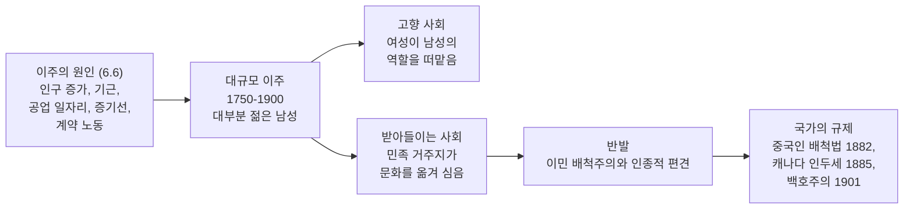
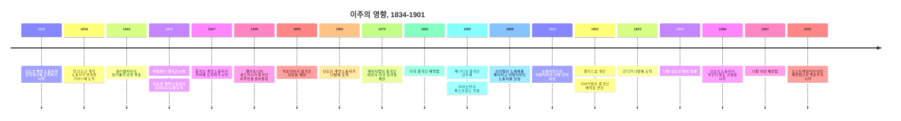
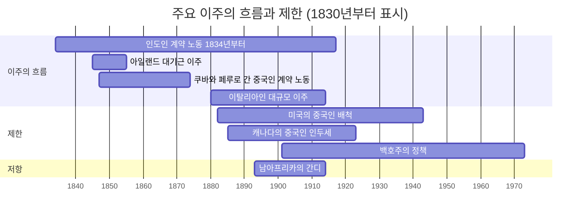
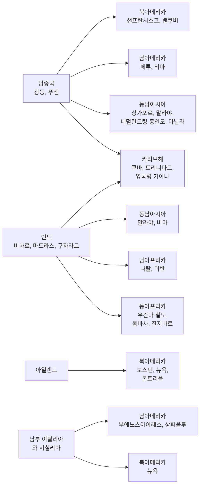
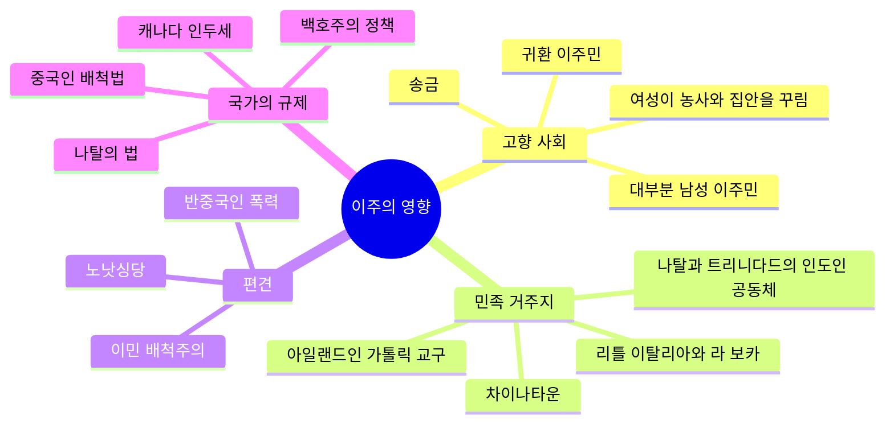

# AP 세계사: 모던 — 토픽 6.7 이주의 영향 (Effects of Migration)

**Focus Question:** 1750년부터 1900년까지 새로운 이주 양상은 사회에 어떻게, 그리고 왜 영향을 미쳤는가?

> 출처: CED 기준 · 교재 반영 전

**Unit 6: 산업화의 결과 (Consequences of Industrialization, c. 1750–1900)**

---

## 학습 목표 (Learning Objective)

| 코드 | 학습 목표 |
|---|---|
| 6.7 LO-H (SIO) | 1750년부터 1900년까지 새로운 이주 양상이 사회에 어떻게, 그리고 왜 영향을 미쳤는지 설명한다. |

## 역사적 개념 (Historical Developments, CED)

| # | 역사적 개념 | 다루는 곳 |
|---|---|---|
| HD1 | KC-5.4.III.A: 이주민은 남성인 경우가 많았기 때문에, 고향 사회에 남은 여성들은 이전에 남성이 맡던 새로운 역할을 떠맡게 되었다. | §2 |
| HD2 | KC-5.4.III.B: 이주민들은 흔히 세계 여러 지역에 민족 거주지 (Ethnic enclave)를 만들었고, 이는 그들의 문화를 새로운 환경에 옮겨 심는 데 도움이 되었다. | §3, 지도, 비교표 |
| HD2 · 예시 | 예시 (Illustrative example) — *이주민의 민족 거주지 (Migrant ethnic enclaves):* 동남아시아, 카리브해, 남아메리카, 북아메리카의 중국인 (Chinese in Southeast Asia, the Caribbean, South America, and North America) | §3 (중국인 디아스포라), 지도 |
| HD2 · 예시 | 예시 — *이주민의 민족 거주지:* 동아프리카와 남아프리카, 카리브해, 동남아시아의 인도인 (Indians in East and Southern Africa, the Caribbean, and Southeast Asia) | §3 (인도인 디아스포라), §5 (나탈), 지도 |
| HD2 · 예시 | 예시 — *이주민의 민족 거주지:* 북아메리카의 아일랜드인 (Irish in North America) | §3 (보스턴과 뉴욕의 아일랜드인), §4 |
| HD2 · 예시 | 예시 — *이주민의 민족 거주지:* 북아메리카와 남아메리카의 이탈리아인 (Italians in North and South America) | §3 (뉴욕, 부에노스아이레스, 상파울루의 이탈리아인), §4 |
| HD3 | KC-5.4.III.C: 여러 수준의 민족적·인종적 편견과, 국경을 넘는 사람들의 늘어난 흐름을 국가가 규제하려 한 방식에서 보이듯, 이민을 받아들이는 사회가 늘 이민자를 환영한 것은 아니었다. | §4, §5, §6 |
| HD3 · 예시 | 예시 — *이민자 규제 (Regulation of immigrants):* 중국인 배척법 (Chinese Exclusion Act) | §5 (중국인 배척법, 1882) |
| HD3 · 예시 | 예시 — *이민자 규제:* 백호주의 정책 (White Australia policy) | §5 (이민 제한법, 1901) |

---

## 큰 그림 요약

> "지치고 가난한 이들을 내게 주오, 자유롭게 숨 쉬기를 갈망하며 웅크린 무리를"
> — 에마 래저러스 (Emma Lazarus), 「새로운 거상 (The New Colossus)」 (1883). 이 시는 나중에 자유의 여신상 받침대에 새겨졌다.

토픽 6.6은 1750년부터 1900년 사이에 수천만 명이 **왜** 이동했는지를 설명했다. 인구 증가, 기근, 공업 일자리, 값싼 증기선과 철도, 그리고 **계약 노동 (Indentured servitude)** 같은 강제적·반강제적 노동 제도가 그 원인이었다. 토픽 6.7은 그 이동이 **출발지와 도착지 양쪽 사회에 무엇을 남겼는지**를 묻는다. **고향 사회 (Home society)**에서는 이주민 대부분이 **젊은 남성**이었기 때문에, 남은 여성들이 남성이 하던 농사, 집안 관리, 돈 관리, 임금 노동을 떠맡았다. **이민을 받아들이는 사회 (Receiving society)**에서는 이주민들이 **민족 거주지 (Ethnic enclave)**를 만들었다. 차이나타운, 리틀 이탈리아, 아일랜드인 가톨릭 교구, 인도인 상인 구역이 그 예이다. 이곳에서 언어, 종교, 음식, 상호 부조 단체가 이주민의 생존을 돕고 **문화를 옮겨 심었다**. 그러나 받아들이는 사회가 **늘 환영한 것은 아니었다**. 이민 배척주의와 인종적 편견이 커졌고, 국가들은 **국경을 규제**하기 시작했다. 미국의 **중국인 배척법 (Chinese Exclusion Act)** (1882), 캐나다의 중국인 **인두세 (Head tax)** (1885), **나탈 (Natal)**의 인도인 제한, **백호주의 정책 (White Australia policy)** (1901)이 그 예이다. 래저러스가 환영의 시를 쓴 1883년은 중국인 배척법이 통과된 바로 다음 해였다. 이 사실은 이야기의 두 측면을 함께 보여 준다.

---

## §1. 배경: 6.6에서 본 이주의 흐름

- 1750년부터 1900년 사이에 **새로운 교통수단**(증기선, 철도)이 장거리 이주를 더 싸고 빠르게 만들었고, **귀환 이주**도 가능하게 했다 (6.6 참고).
- **자유 이주민**은 땅과 일자리를 찾아 유럽에서 아메리카와 오스트레일리아로 떠났다. 대기근 (Great Famine, 1845–1852) 이후의 **아일랜드인**, 그리고 1880년경부터 특히 남부 출신이 많았던 **이탈리아인**이 대표적이다.
- **반강제적 이주민**은 노예제 폐지로 플랜테이션의 노동력이 부족해지자 **계약 노동** 계약을 맺고 아시아를 떠났다. **인도인**은 카리브해, 모리셔스, 나탈, 피지, 말라야로, **중국인**은 쿠바, 페루, 동남아시아로 갔다.
- 많은 **중국인**은 자유 이주나 외상 운임 제도 (Credit-ticket system)를 통해 캘리포니아, 캐나다, 오스트레일리아의 금광과 철도로도 갔다.
- **결과:** 1900년이 되자 이주민들은 사람이 사는 모든 대륙에 큰 공동체를 이루었다. 이 토픽은 그 이동이 낳은 **사회적 영향**을 다룬다.

| 집단 | 주요 배출 요인 (6.6) | 주요 흡인 요인 (6.6) | 이주 유형 |
|---|---|---|---|
| **중국인 (Chinese)** | 인구 압력, 빈곤, 남중국의 태평천국 운동 (Taiping Rebellion, 1850–1864) | 골드러시, 철도, 플랜테이션, 광산 | 자유 이주, 외상 운임, 계약 노동("쿨리 (Coolie)" 노동) |
| **인도인 (Indians)** | 빈곤, 기근, 영국 지배 아래의 토지 상실 | 노예제 폐지 이후의 플랜테이션 노동, 교역 | 대부분 계약 노동, 자유 상인도 있음 |
| **아일랜드인 (Irish)** | 대기근(감자 마름병), 토지 부족 | 미국과 캐나다 도시와 운하의 일자리 | 자유 이주 |
| **이탈리아인 (Italians)** | 남부 이탈리아의 농촌 빈곤과 영세 농지 | 미국 도시의 일자리, 아르헨티나와 브라질의 농장과 도시 | 자유 이주, 계절 이주나 귀환이 많음 |

## §2. 고향 사회에서 일어난 성별 역할의 변화 (KC-5.4.III.A)

### 이주민 대부분이 남성이었던 이유

- 고용주들은 광산, 철도, 플랜테이션, 부두에서 일할 **젊은 남성 노동자**를 원했다.
- 가족들은 흔히 **아들이나 남편 한 명**을 해외로 보내 임금을 벌어 집으로 돈을 부치게 했다. 이 돈이 **송금 (Remittances)**이다. 그가 언젠가 돌아오는 것이 계획이었다.
- 많은 수용국이 **여성의 입국을 막았다**. 미국의 **페이지법 (Page Act, 1875)**은 중국인 여성의 입국을 매우 어렵게 만들었다. 그래서 차이나타운은 대부분 남성으로 이루어진 "**독신 남성 사회 (Bachelor society)**"가 되었다.
- 인도인 계약 노동은 여성보다 남성을 훨씬 많이 모집했다. 1860년대부터 영국 식민 당국은 **여성의 최소 비율**(남성 100명당 약 40명)을 정했다. 이는 이주의 흐름이 얼마나 불균형했는지를 보여 준다.

### 고향에 남은 여성의 새로운 역할

| 고향 사회 | 떠난 사람 | 고향 여성의 새로운 역할 |
|---|---|---|
| **남부 이탈리아 (Southern Italy)** | 미국이나 아르헨티나로 떠나 흔히 여러 해 동안 돌아오지 않은 남편과 아들 | 여성들이 집안 땅을 경작하고, 일꾼을 고용하고, 송금을 관리하고, 땅을 사고, 관리들을 상대했다. 이들을 "**하얀 과부 (White widows)**" (*vedove bianche*)라고 불렀다. |
| **남중국 (Southern China)** (광둥, 푸젠) | 동남아시아나 "**금산 (Gold Mountain)**"(캘리포니아, 이후 캐나다와 오스트레일리아)으로 떠난 남편 | 아내들은 시부모와 함께 집안을 꾸리고, 편지와 함께 온 송금(*qiaopi*, 차오피)을 관리하고, 홀로 아이를 키우고, 농사를 감독했다. 많은 부부가 수십 년 동안 떨어져 사는 "**분리 가구 (Split household)**"였다. |
| **인도 (India)** (비하르, 우타르프라데시 동부, 마드라스) | 계약 노동자로 모집된 남성 | 여성들이 밭을 갈고, 집안 돈을 관리하고, 임금 노동을 했다. 가족은 송금과 돌아오는 이주민에게 의존했다. |

- 이런 변화로 일부 여성은 **더 큰 경제적 책임**을 지고 집안의 결정에 목소리를 내게 되었다.
- 그러나 여성의 법적 지위는 대개 **바뀌지 않았다**. 변화는 **일시적**인 경우가 많았고, 남성이 돌아오면 끝났다.

> **기억할 예외:** 아일랜드인의 이주는 특이했다. **아일랜드 여성**은 남성과 비슷한 수만큼(어떤 시기에는 더 많이) 이주했다. 그중 많은 수가 미혼 여성이었고, 미국 도시에서 **가사 노동자 (Domestic servant)**로 일했다.

## §3. 민족 거주지: 문화를 옮겨 심다 (KC-5.4.III.B)

**민족 거주지 (Ethnic enclave)**란 한 이주민 집단이 모여 살면서 자신들의 언어, 종교, 음식, 제도를 지키는 동네나 공동체를 말한다. 민족 거주지는 낯설고 흔히 적대적인 곳에서 새로 온 사람들에게 집, 일자리, 대출, 보호를 제공했다.

### 동남아시아, 카리브해, 남아메리카, 북아메리카의 중국인

- **동남아시아:** **싱가포르, 페낭, 말라야**(주석 광업, 교역), **네덜란드령 동인도**, **시암**, **마닐라**의 중국인 공동체가 빠르게 커졌다. 1800년대 후반 **싱가포르에서는 중국인이 다수**였다. 많은 중국인 상인이 식민지 경제에서 중개인 역할을 했다.
- **카리브해:** 약 12만 5천 명의 중국인 계약 노동자가 **쿠바**(1847–1874)로 가서 **사탕수수 플랜테이션**에서 일했다. 그보다 적은 수가 **트리니다드**와 **영국령 기아나**로 갔다.
- **남아메리카:** 약 10만 명의 중국인 노동자가 **페루**(1849–1874)로 가서 **구아노 (Guano) 섬**, 면화·사탕수수 농장, 철도에서 일했다. 리마의 **바리오 치노 (Barrio Chino)**가 커졌고, 중국-페루 요리인 **치파 (Chifa)**가 페루 음식의 일부가 되었다.
- **북아메리카:** 중국인은 **캘리포니아 골드러시 (Gold Rush, 1849)** 때 캘리포니아로 왔고, **센트럴 퍼시픽 철도 (Central Pacific Railroad)**(1860년대)와 이후 **캐나다 태평양 철도 (Canadian Pacific Railway)**(1880년대)를 건설했다. **샌프란시스코 차이나타운 (Chinatown)**은 북아메리카에서 가장 큰 차이나타운이 되었다. 이곳에는 사원, 중국어 신문, 지역 동향 단체(회관 (Huiguan))가 있었고, 이 단체들은 **중화회관 (Chinese Six Companies)**으로 연합해 이주민을 돕고 법정에서 중국인의 이익을 지켰다.

> ⚠️ 확인 필요: 쿠바(약 12만 5천 명)와 페루(약 9만–10만 명)로 간 중국인 노동자의 수는 추정치이며, 자료마다 수치가 다르다.

### 동아프리카와 남아프리카, 카리브해, 동남아시아의 인도인

- **남아프리카:** **1860년**부터 인도인 계약 노동자들이 **나탈 (Natal)**(더반)에 도착해 **사탕수수 플랜테이션**에서 일했다. 이어 주로 구자라트 출신 상인인 "**승객 인도인 (Passenger Indians)**"이 자비로 건너와 상점을 열었다. 더반은 아프리카에서 가장 큰 인도인 공동체의 중심지가 되었다.
- **동아프리카:** 구자라트 상인들은 오래전부터 **잔지바르**와 **몸바사**에서 교역했다. **1896년**부터 약 3만 2천 명의 인도인 계약 노동자가 **우간다 철도 (Uganda Railway)**를 건설했다. 그중 수천 명이 남아 케냐와 우간다에서 상점 주인(*dukawalla*, 두카왈라)이 되었다.
- **카리브해:** 인도인 계약 노동자들은 해방된 노예를 대신해 사탕수수 농장에서 일하려고 **영국령 기아나**(1838년부터), **트리니다드**(1845년부터), **자메이카**, 네덜란드령 **수리남**으로 갔다. 트리니다드와 가이아나에는 힌두교 사원, 모스크, **디왈리 (Diwali)** 축제, **호사이 (Hosay)**(무하람) 행렬이 뿌리내렸다.
- **동남아시아:** 타밀 노동자들은 **말라야**의 플랜테이션과 공공사업장으로 갔다. 인도인 노동자, 상인, **체티아르 (Chettiar)** 대금업자들은 **버마**로 가서 벼농사에 자금을 댔다.
- **인도양의 섬:** **모리셔스 (Mauritius)**는 **1834년**부터 인도인 계약 노동자를 받아들였고, 인도계가 다수인 사회가 되었다.

### 북아메리카의 아일랜드인

- 대기근 동안과 직후에 약 **100만 명**의 아일랜드인이 이주했다. 대부분 **미국**과 **캐나다**로 갔다.
- 이들은 **보스턴, 뉴욕, 필라델피아, 몬트리올** 같은 항구·공업 도시에 정착해 임금이 낮은 일을 했다. 아일랜드 남성은 운하를 파고 철도를 놓고 부두에서 일했으며, 아일랜드 여성은 가사 노동자로 일했다.
- **가톨릭교회**가 아일랜드인 거주지의 중심이었다. 교구, 교구 학교, 병원, 자선 단체가 그 역할을 했다.
- 아일랜드인은 뉴욕의 **태머니 홀 (Tammany Hall)** 같은 **정치 머신 (Political machine)**을 만들고 소방서와 경찰에 들어갔다. 이를 통해 공동체가 권력과 일자리를 얻었다.

> ⚠️ 확인 필요: 대기근 시기 아일랜드인 이주민 수는 어느 기간을 세느냐에 따라 약 100만 명(1845–1852)에서 약 200만 명(1845–1855)까지 추정치가 다르다.

### 북아메리카와 남아메리카의 이탈리아인

- **1880년**경부터 수백만 명의 이탈리아인이 이주했다. 대부분 **남부 이탈리아와 시칠리아** 출신이었다. 많은 이가 돌아갈 생각이었고, 실제로 많이 돌아갔다.
- **북아메리카:** 이들은 **뉴욕의 멀베리 스트리트 (Mulberry Street)** 같은 "**리틀 이탈리아 (Little Italy)**"에 정착해 건설업, 공장, 의류업에서 일했다. **일 프로그레소 이탈로-아메리카노 (Il Progresso Italo-Americano)**(1880) 같은 이탈리아어 신문과, 이탈리아 성인 축일을 지내는 가톨릭 교구가 문화를 이어 갔다.
- **남아메리카:** **아르헨티나**는 유럽인을 적극적으로 모집했다. 이탈리아인은 **부에노스아이레스**, 특히 항구 지역인 **라 보카 (La Boca)** 인구의 큰 몫을 차지했고, 아르헨티나 스페인어, 음식, **탱고**에 영향을 주었다. **골론드리나스 (Golondrinas)**("제비")라고 불린 계절 노동자들은 해마다 수확철에 대서양을 건넜다.
- **브라질**은 특히 **1888년** 노예제가 폐지된 뒤 **상파울루** 일대의 **커피 플랜테이션**에서 노예 노동자를 대신할 이탈리아인의 뱃삯을 대 주었다.
- 이탈리아인 거주지는 회원에게 질병, 실업, 장례 지원을 해 주는 **상호 부조 단체 (Mutual-aid society)**(*società di mutuo soccorso*)를 세웠다.

### 민족 거주지가 문화를 옮겨 심은 방법

| 문화 요소 | 예 |
|---|---|
| **언어** | 가게와 집에서 쓰는 중국어, 이탈리아어, 타밀어, 보지푸리어, 구자라트어. 초기 일부 아일랜드인 공동체의 아일랜드 게일어. 아르헨티나 스페인어 속의 이탈리아어 단어 |
| **종교** | 중국 사원. 트리니다드, 가이아나, 나탈의 힌두교 사원과 모스크. 아일랜드인 가톨릭 교구. 이탈리아 성인 축일 |
| **음식** | 페루의 치파. 샌프란시스코의 중국 음식점. 카리브해의 인도 커리와 로티. 뉴욕과 부에노스아이레스의 피자와 파스타 |
| **상호 부조 단체** | 중화회관과 회관. 이탈리아의 *società di mutuo soccorso*. 아일랜드인 공제회와 가톨릭 자선 단체 |
| **신문과 매체** | 샌프란시스코의 중국어 신문. 뉴욕의 일 프로그레소 이탈로-아메리카노. 부에노스아이레스의 이탈리아어 신문 |
| **축제** | 춘절. 디왈리와 호사이. 성 패트릭의 날 (St. Patrick's Day) 행진. 이탈리아 성인 축일 |

- 민족 거주지는 닫혀 있지 않았다. 시간이 지나면서 이주민의 음식, 말, 축제가 받아들이는 사회의 문화 일부가 되었고, 이주민의 자녀들은 흔히 두 문화를 섞었다.

## §4. 받아들이는 사회: 편견과 이민 배척주의 (KC-5.4.III.C)

**이민 배척주의 (Nativism)**란 스스로를 "토박이" 주민으로 여기는 사람들이 이민자에게 보이는 적대감이다. 1800년대에 이민 배척주의는 크게 두 가지 형태로 나타났다. 유럽 가톨릭교도에 대한 **종교적·민족적 편견**, 그리고 아시아인에 대한 **인종적 편견**이다.

| 대상 집단 | 장소 | 편견의 형태 |
|---|---|---|
| **아일랜드 가톨릭교도 (Irish Catholics)** | 미국 | **필라델피아 성경 폭동 (Philadelphia Bible Riots, 1844)** 같은 반가톨릭 폭동. 이민자의 정치적 힘을 제한하려 한 1850년대의 **노낫싱당 (Know-Nothing Party, American Party)**. 아일랜드인을 술꾼이자 난폭한 사람으로 그린 풍자화. 고용 차별 |
| **이탈리아인 (Italians)** | 미국, 아르헨티나 | 인종적으로 "열등"하다고 여겨지고 범죄와 연결됨. **뉴올리언스의 이탈리아인 11명 린치 사건 (1891)** |
| **중국인 (Chinese)** | 미국, 캐나다, 오스트레일리아 | 와이오밍의 **록스프링스 학살 (Rock Springs Massacre, 1885)** 같은 폭력. 캘리포니아에서 데니스 커니 (Denis Kearney)가 이끈 **노동자당 (Workingmen's Party)**("중국인은 나가라!"). 외국인 광부세. **램빙 플랫 (Lambing Flat, 1860–1861)** 같은 오스트레일리아 금광 지대의 폭동 |
| **인도인 (Indians)** | 나탈, 동아프리카 | 백인 정착민들이 인도인 상인을 경쟁자로 여겨 반감을 품음. 인도인은 투표권을 빼앗기고 교역과 이동에 제한을 받음 |

- **편견이 커진 이유:** 일자리와 임금을 둘러싼 경쟁(이주민이 임금을 낮춘다는 비난), 종교 차이(개신교 대 가톨릭), 그리고 민족들을 인종 위계로 줄 세운 **과학적 인종주의 (Scientific racism)**와 **사회 진화론 (Social Darwinism)** (6.1 참고)이었다.
- 편견에는 **정도의 차이**가 있었다. 아일랜드인과 이탈리아인 이민자는 차별을 받았지만 시민이 되어 투표할 수 있었다. 중국인과 인도인 이주민은 **인종을 이유로 막는** 법에 부딪혔다.

> ⚠️ 확인 필요: "아일랜드인은 지원하지 마시오 (No Irish Need Apply)"라는 구인 문구가 실제로 얼마나 흔했는지는 역사가들 사이에 논쟁이 있다. 드물었다는 주장도 있고, 그런 신문 광고를 많이 찾아낸 연구도 있다.

## §5. 국가가 이주를 규제하다 (KC-5.4.III.C 예시)

### 중국인 배척법 (Chinese Exclusion Act, 미국, 1882)

- **1882년** **체스터 A. 아서 (Chester A. Arthur)** 대통령이 서명했다.
- **중국인 노동자**의 미국 입국을 **10년간 금지**하고, 중국인 이민자가 **귀화 시민**이 되는 것을 막았다.
- **특정 민족이나 국적 집단의 이민을 금지한 미국 최초의 주요 법**이었다.
- **기어리법 (Geary Act, 1892)**으로 연장되었고, **1902년**에 영구화되었으며, **1943년**에야 폐지되었다.
- 배경: **페이지법 (1875)**이 이미 중국인 여성을 제한하고 있었다. 철도가 완공된 뒤 노동자 단체들은 임금 하락을 중국인 노동자 탓으로 돌렸다.

### 백호주의 정책 (White Australia policy, 오스트레일리아, 1901)

- 오스트레일리아 식민지들은 골드러시 때부터 중국인 이민을 제한했다. **빅토리아 (1855)**와 **뉴사우스웨일스 (1861)**는 중국인 입국자에게 세금을 매기고 배 한 척이 태울 수 있는 인원을 제한했다.
- 식민지들이 연방을 이루자, 새 연방이 처음 만든 법 가운데 하나가 **이민 제한법 (Immigration Restriction Act, 1901)**이었다. 이 법이 "**백호주의 정책**"의 핵심이다.
- 이 법은 **받아쓰기 시험 (Dictation test)**을 사용했다. 관리는 이민자에게 자신이 고른 **아무 유럽 언어**로 50단어를 받아쓰게 할 수 있었다. 이 시험은 인종을 명시하지 않고도 비유럽인을 배제할 수 있도록 고안되었다.
- **태평양 섬 노동자법 (Pacific Island Labourers Act, 1901)**으로 태평양 섬 출신 플랜테이션 노동자 대부분이 추방되었다.
- 이 정책은 **1950년대부터 1973년**까지 단계적으로 폐지되었다.

### 다른 규제의 예

| 국가 | 법이나 정책 | 내용 |
|---|---|---|
| **캐나다 (Canada)** | **중국인 이민법 (Chinese Immigration Act, 1885)** | 중국인 이민자 한 명당 **50달러의 인두세 (Head tax)**를 부과했고, 이를 100달러(1900), 500달러(1903)로 올렸다. 중국인 노동자가 일부 건설한 캐나다 태평양 철도가 완공될 무렵 통과되었다 |
| **나탈 (Natal)** (남아프리카의 영국 식민지) | 1895–1897년의 법들 | 계약이 끝난 뒤에도 남은 인도인에게 **연 3파운드의 세금**을 매겼다. 1896년 선거법으로 대부분의 인도인이 투표하지 못하게 했다. **유럽 언어 시험**을 둔 **이민 제한법 (Immigration Restriction Act, 1897)**은 오스트레일리아의 본보기가 되었다 |
| **미국 (United States)** | **엘리스섬 (Ellis Island, 1892)** | 뉴욕항에 세운 연방 시설로, 유럽 이민자의 질병, 빈곤, 범죄 기록을 검사했다 |
| **아르헨티나 (Argentina)** | **1853년 헌법** | 반대 방식이었다. 국가가 나라를 발전시키려고 **유럽인의 이민을 장려**했다("통치하는 것은 인구를 채우는 것이다") |

> **양상:** 국가들은 **유럽인** 노동자는 환영하거나 모집했지만(아르헨티나, 브라질, 1890년대 규제 이전의 미국), **아시아인** 노동자는 인종을 이유로 제한했다. 규제는 제국주의 시대의 인종 위계를 반영했다.

## §6. 이주민의 대응과 저항

- **모한다스 간디 (Mohandas Gandhi)**는 **1893년** 젊은 변호사로 **나탈**에 왔다. 인도인이라는 이유로 피터마리츠버그에서 기차 1등칸에서 쫓겨난 뒤, 그는 인도인 공동체를 조직했다. **1894년**에는 **나탈 인도인 회의 (Natal Indian Congress)**를 세우는 데 앞장섰고, 이 단체는 투표권과 세금 관련 법에 반대하는 청원을 냈다. 이후 남아프리카에서 벌인 **사티아그라하 (Satyagraha)**(비폭력 저항) 운동(1906년부터)은 그가 인도 독립운동을 이끄는 바탕이 되었다.
- **중국계 미국인**은 법정에서 차별에 맞섰다. **이크 우 대 홉킨스 (Yick Wo v. Hopkins, 1886)** 판결에서 미국 연방 대법원은 중국인 세탁소에만 적용된 샌프란시스코 조례를 무효로 했다. **미국 대 웡킴아크 (United States v. Wong Kim Ark, 1898)** 판결에서는 미국에서 중국인 부모에게서 태어난 아이가 출생에 따라 시민이라고 판결했다.
- **중화회관**은 변호사를 고용하고 반중국인 법에 맞서 로비를 벌였다.
- **아일랜드인**은 투표와 정치 머신을 이용해 보스턴과 뉴욕 같은 도시에서 권력을 얻었다. 숫자를 영향력으로 바꾼 것이다.
- 이런 대응은 이주민이 **수동적이지 않았음**을 보여 준다. 민족 거주지가 그들에게 권리를 지킬 조직을 제공했다.

## §7. 연결

- **6.6으로:** 이주의 원인(산업화, 인구 변화, 계약 노동)이 이런 영향을 낳았다.
- **6.1 (제국주의의 정당화 논리):** 사회 진화론과 과학적 인종주의는 해외 제국과 국내 이민 제한을 모두 정당화했다.
- **5.9 (산업 시대의 사회):** 이주민은 공업 도시에 값싼 노동력을 공급했고, 다른 노동자와 같은 혹독한 노동 조건을 겪었다.
- **연속성과 변화:** 동남아시아의 중국인 상인 공동체(2.3 참고)는 수백 년 된 것이었지만, 1850년 이후 이주의 규모는 새로웠다.
- **Unit 7 이후로:** 이민 제한은 1900년대 초에 더 엄격해졌고(예: 1920년대 미국의 할당제), 백호주의 정책은 1973년까지 이어졌다.

---

## 연표

---

## 지도: CED 민족 거주지 집단의 정착지

---

## 비교표: CED의 네 민족 거주지 집단

| 항목 | 중국인 (Chinese) | 인도인 (Indians) | 아일랜드인 (Irish) | 이탈리아인 (Italians) |
|---|---|---|---|---|
| **목적지** | 동남아시아, 카리브해(쿠바), 남아메리카(페루), 북아메리카(캘리포니아, 캐나다) | 동아프리카, 나탈, 카리브해(트리니다드, 가이아나), 동남아시아(말라야, 버마), 모리셔스 | 미국과 캐나다(보스턴, 뉴욕) | 미국(뉴욕), 아르헨티나(부에노스아이레스), 브라질(상파울루) |
| **이주 유형** | 자유 이주, 외상 운임, 계약 노동 | 대부분 계약 노동, 자유 상인 | 자유 이주 | 자유 이주, 계절 이주나 귀환이 많음 |
| **일** | 광산, 철도, 플랜테이션, 세탁소, 교역 | 사탕수수 플랜테이션, 철도, 상점, 대금업 | 운하, 철도, 부두, 가사 노동 | 건설, 공장, 커피·밀 농장 |
| **문화 기관** | 사원, 회관 (Huiguan), 중화회관 (Chinese Six Companies), 중국어 신문 | 힌두교 사원, 모스크, 디왈리, 호사이, 상인 네트워크 | 가톨릭 교구와 학교, 정치 머신 (Political machine) | 가톨릭 교구, 성인 축일, 상호 부조 단체 (Mutual-aid society), 이탈리아어 신문 |
| **수용 사회의 반응** | 가혹한 인종적 배제(중국인 배척법, 캐나다 인두세, 백호주의) | 나탈의 세금, 투표권 박탈, 입국 시험. 상인에 대한 반감 | 반가톨릭 이민 배척주의(노낫싱당), 고용 차별 | 미국에서는 편견과 폭력, 아르헨티나와 브라질에서는 모집과 환영 |

## 비교표: CED의 두 가지 규제 예시

| 항목 | 중국인 배척법 (Chinese Exclusion Act) | 백호주의 정책 (White Australia policy) |
|---|---|---|
| **국가** | 미국 | 오스트레일리아 연방 |
| **연도** | 1882 | 1901 (이민 제한법) |
| **대상** | 중국인 노동자 | 모든 비유럽 이민자, 특히 아시아인과 태평양 섬 주민 |
| **방법** | 중국인을 법에 명시해 금지함 | 유럽 언어 받아쓰기 시험 (Dictation test). 법에 인종을 명시하지 않음 |
| **배경** | 골드러시와 철도 노동, 페이지법 (Page Act, 1875), 반중국인 폭력 | 골드러시 시기 식민지 법(1855년부터), 값싼 아시아 노동력에 대한 두려움, 연방 결성 |
| **종료** | 1943년 폐지 | 1950년대부터 1973년까지 폐지 |
| **공통점** | 둘 다 인종을 기준으로 이민을 제한했고, 사회 진화론의 사고를 반영했으며, 경쟁을 두려워한 백인 노동자들에게 응답한 것이었음 | (동일) |

---

## Key Terms (핵심 용어)

| 주제 | 용어 | 정의 |
|---|---|---|
| 사회 | 민족 거주지 (Ethnic enclave) | 한 이주민 집단이 모여 살며 자신들의 문화를 지키는 동네나 공동체 |
| 사회 | 송금 (Remittances) | 이주민이 고향 사회의 가족에게 부치는 돈 |
| 사회 | 하얀 과부 (White widows) | 남편이 이주한 뒤 집안의 땅과 돈을 관리한 남부 이탈리아의 아내들 |
| 사회 | 독신 남성 사회 (Bachelor society) | 불균형한 이주와 여성 입국을 막은 법 때문에 생긴, 초기 차이나타운 같은 남성 중심의 이주민 공동체 |
| 사회 | 차이나타운 (Chinatown) | 샌프란시스코의 차이나타운 같은 중국인 민족 거주지 |
| 사회 | 리틀 이탈리아 (Little Italy) | 뉴욕의 멀베리 스트리트 같은 이탈리아인 민족 거주지 |
| 사회 | 승객 인도인 (Passenger Indians) | 자비로 나탈과 동아프리카에 건너간, 주로 구자라트 출신의 인도인 상인 |
| 문화 | 상호 부조 단체 (Mutual-aid society) | 회원에게 질병, 실업, 장례, 법률 문제를 도와준 이주민 조직 |
| 문화 | 중화회관 (Chinese Six Companies) | 중국인 이민자를 돕고 지킨 샌프란시스코 중국인 동향 단체들의 연합 |
| 경제 | 계약 노동 (Indentured servitude) | 뱃삯, 식량, 임금을 받는 대가로 정해진 햇수 동안 계약에 따라 일하는 노동 (6.6 참고) |
| 경제 | 골론드리나스 (Golondrinas) | 해마다 대서양을 건너 아르헨티나에서 수확 일을 한 이탈리아인 계절 노동자 |
| 정치 | 이민 배척주의 (Nativism) | 스스로를 토박이 주민으로 여기는 사람들이 이민자에게 보이는 적대감 |
| 정치 | 노낫싱당 (Know-Nothing Party) | 1850년대 미국의 반가톨릭·반이민 정당 |
| 정치 | 중국인 배척법 (Chinese Exclusion Act) | 중국인 노동자의 입국을 금지하고 중국인의 시민권 취득을 막은 미국 법 (1882) |
| 정치 | 인두세 (Head tax) | 캐나다의 중국인 인두세(1885)처럼 특정 집단의 이민자 한 명마다 매긴 요금 |
| 정치 | 백호주의 정책 (White Australia policy) | 이민 제한법(1901)을 바탕으로 비유럽인을 막은 오스트레일리아의 정책 |
| 정치 | 받아쓰기 시험 (Dictation test) | 인종을 명시하지 않고 비유럽인을 배제하는 데 쓴, 아무 유럽 언어로 치르는 오스트레일리아의 입국 시험 |
| 정치 | 나탈 인도인 회의 (Natal Indian Congress) | 나탈에서 인도인의 권리를 지키려고 1894년 간디의 도움으로 세운 단체 |
| CED | 받아들이는 사회 (Receiving society) | 이주민이 정착하는 사회 |
| CED | 고향 사회 (Home society) | 이주민이 떠나 온 사회로, 흔히 이주민이 돈을 부치는 곳 |
