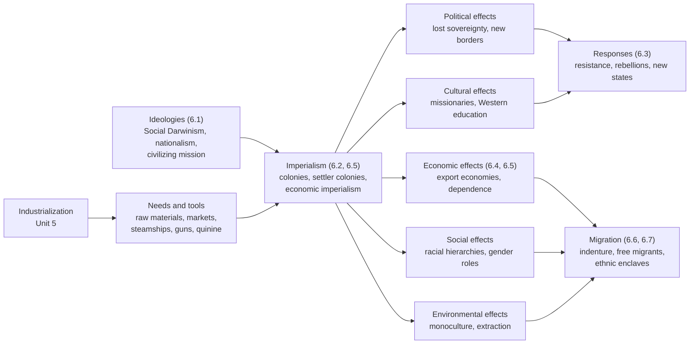
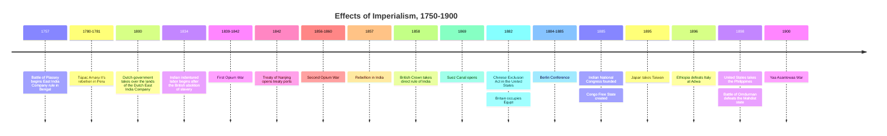
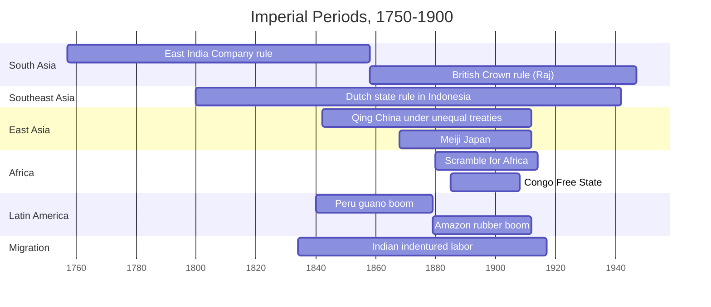
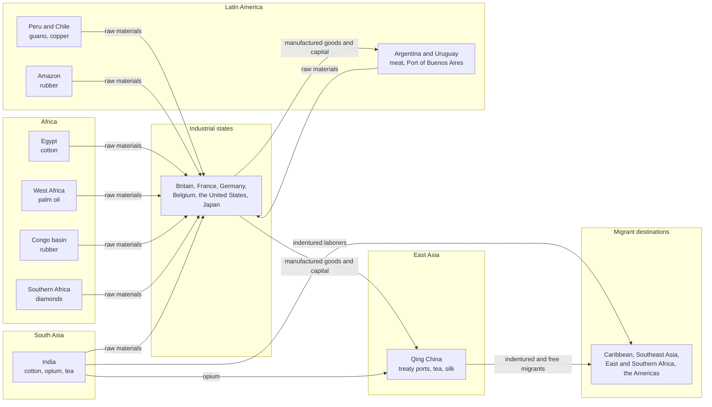
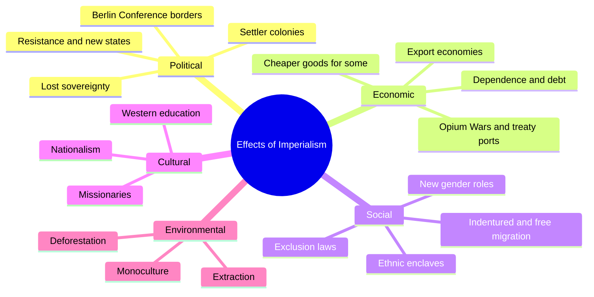

# AP World History: Modern — Topic 6.8 Causation in the Imperial Age

**Focus Question:** Which effects of imperialism from 1750 to 1900 were the most significant, and for whom?

> Source: Based on the College Board CED · Textbook not yet incorporated

**Unit 6: Consequences of Industrialization (c. 1750–1900)**

---

## Learning Objective

| Code | Learning Objective |
|---|---|
| 6.8 LO-I | Explain the relative significance of the effects of imperialism from 1750 to 1900. |

> The CED lists no thematic focus for 6.8, so the code has no theme. The suggested skill is **6.D Argumentation**: corroborate, qualify, or modify an argument using diverse and alternative evidence in order to develop a complex argument (see §9).

## Historical Developments (CED)

> 6.8 is the unit's review topic. The CED adds no new Historical Developments. Under "Review: Unit 6 Key Concepts," it lists the four key concepts below (KC-5.1 to KC-5.4) and asks you to use the content of 6.1–6.7 to **weigh the effects of imperialism** using the reasoning process of **Causation**.

| # | Review: Unit 6 Key Concepts (CED) | Source topic | Covered in |
|---|---|---|---|
| R1 | KC-5.1: The development of industrial capitalism led to increased standards of living for some, and to continued improvement in manufacturing methods that increased the availability, affordability, and variety of consumer goods. | 6.4, 6.5 (and Unit 5) | Big Picture, §3, §7 (industrial states), Comparison Tables |
| R2 | KC-5.2: As states industrialized, they also expanded existing overseas empires and established new colonies and transoceanic relationships. | 6.1, 6.2, 6.3, 6.5 | §2, §3, §5, §7 |
| R3 | KC-5.3: The 18th century marked the beginning of an intense period of revolution and rebellion against existing governments, leading to the establishment of new nation-states around the world. | 6.3 | §2 (resistance and new states), §5 (nationalism and anticolonial thought), §8 |
| R4 | KC-5.4: As a result of the emergence of transoceanic empires and a global capitalist economy, migration patterns changed dramatically, and the numbers of migrants increased significantly. | 6.6, 6.7 | §4, §6 (environmental push factors), §8 |

> Illustrative examples: the CED gives **none** for this LO. Every example in these notes is drawn from 6.1–6.7 or from standard scholarship, and none of them is a CED example for 6.8.

---

## The Big Picture

From 1750 to 1900, **industrialization** gave a small group of states both the **motive** and the **means** for empire. Factories needed **raw materials** and **markets**, investors wanted **profits**, and steamships, railways, telegraphs, quinine, and new guns made conquest cheaper. Ideologies such as **Social Darwinism**, **nationalism**, and the **civilizing mission** justified it (6.1). Imperialism took several forms: **direct colonial rule** (India after 1858, most of Africa after the Berlin Conference of 1884–1885), **settler colonies** (New Zealand, Australia, South Africa, Algeria), and **economic imperialism** in states that stayed formally independent (Qing China, Latin America). Its effects were **political** (lost sovereignty, new borders), **economic** (export economies and dependence), **social** (migration, racial hierarchies, new gender roles), **cultural** (missionaries, Western education, nationalism), and **environmental** (monoculture, extraction). These effects in turn produced **responses**, such as resistance, rebellions, and new states (6.3), and **migration** on a new scale (6.6–6.7). Topic 6.8 does not ask you to list these effects. It asks you to **weigh** them: which mattered most, for whom, in which region, and over what time span.

---

## §1. What 6.8 Asks: Weighing Effects

- **Relative significance** means ranking or weighing effects against each other. An answer that only lists effects does not meet the LO.
- **Causes are not effects.** The rationales of 6.1 (Social Darwinism, the civilizing mission) are causes. In 6.8 they matter only when you explain what they led to, such as racial hierarchies or mission schools.
- The answer **depends on who and where.** The same process (for example, a cotton export economy) meant cheaper cloth for British consumers and dependence on world prices for Egyptian farmers.

| Criterion | Question to ask | Unit 6 example |
|---|---|---|
| **Scale** | How many people did it affect? | Tens of millions of people migrated; by 1914 all of Africa except Ethiopia and Liberia was under European rule |
| **Depth** | How much did daily life change? | Farmers who grew only cotton or rubber for export depended on world prices and foreign buyers |
| **Duration** | How long did it last? | Borders drawn for African colonies became the borders of most later African states |
| **Reach** | How many regions did it touch? | Export economies grew in Africa, South Asia, Southeast Asia, and Latin America |
| **Who gained, who lost** | Did it help some groups and hurt others? | Higher standards of living for some in industrial states; loss of land and self-rule for many colonized peoples |

## §2. Political Effects

| Effect | Evidence (topic) | Region |
|---|---|---|
| **Loss of sovereignty and direct rule** | After the **1857 rebellion**, the British Crown took over India from the East India Company (1858). The Dutch government took over the lands of the **Dutch East India Company** (1800). Belgium took the **Congo** from **King Leopold II** (1908) (6.2) | South Asia, Southeast Asia, Africa |
| **Partition and new borders** | The **Berlin Conference** (1884–1885) set rules for European claims in Africa. Colonial borders often split some peoples and grouped rival peoples together (6.2) | Africa |
| **Settler colonies** | Europeans settled **New Zealand**, Australia, South Africa, and Algeria and took land from Māori, Aboriginal Australians, and African peoples (6.2) | Pacific, Africa |
| **Land-based expansion** | The **United States**, **Russia**, and **Japan** conquered and settled neighboring lands, for example the removal of the Cherokee, Russian expansion into Central Asia, and Japan's colonization of Hokkaido and annexation of the Ryukyu Islands in 1879 (6.2) | North America, Eurasia, East Asia |
| **Informal control** | After the **Opium Wars**, China kept its emperor but lost control of tariffs, ports, and the legal treatment of foreigners (6.5) | East Asia |
| **Resistance and new states** | Direct resistance: **Túpac Amaru II**, the **1857 rebellion**, **Samory Touré**, the **Yaa Asantewaa War**. New states: the **Zulu Kingdom**, the **Sokoto Caliphate**, the **Cherokee Nation**, the **Balkan states**. Rebellions: the **Ghost Dance**, the **Xhosa Cattle-Killing Movement**, the **Mahdist wars** (6.3) | Every region |

- **Short-term:** conquest, treaties, and the loss of self-rule.
- **Long-term:** colonial borders, Western-trained armies and bureaucracies, and the growth of **nationalism**, which led to independence movements in the 20th century (Unit 8).
- **Exceptions:** **Ethiopia** defeated Italy at **Adwa** (1896) and stayed independent. Japan avoided colonization and became an imperial power itself.

## §3. Economic Effects

| Effect | Evidence (topic) | Who gained | Who lost |
|---|---|---|---|
| **Export economies** | Cotton in **Egypt**, palm oil in **West Africa**, rubber in the **Amazon and Congo basin**, guano in **Peru and Chile**, meat from **Argentina and Uruguay**, diamonds from **Africa** (6.4) | Factory owners, merchants, and consumers in industrial states; some local elites | Workers forced or pushed into export production; farmers exposed to price swings |
| **Economic imperialism** | **Britain and France** expanded their influence in China through the **Opium Wars**; the **Port of Buenos Aires** was built with the support of British firms (6.5) | British and French merchants; British investors | Qing government; local producers who faced foreign competition |
| **Trade organized for European and U.S. advantage** | **Opium** from South Asia sold to China; **cotton** from South Asia and Egypt sent to Britain; **palm oil** from sub-Saharan Africa; **copper** from Chile (6.5) | Merchants and companies based in Europe and the U.S. | Producing regions that sold raw materials cheaply and bought finished goods |
| **Dependence and debt** | Profits from raw materials were used to buy finished goods (6.4). Egypt borrowed heavily from European banks, and Britain occupied Egypt in 1882 | Foreign lenders and bondholders | Governments that lost control of their own finances |
| **Higher standards of living for some** | Cheaper cloth, tea, sugar, and other consumer goods for the middle and working classes of industrial states (KC-5.1) | Consumers in industrial states | Not shared by most colonized peoples |

- **Economic imperialism** did not need formal colonies. Argentina, Peru, and Chile were independent states, but foreign firms owned many of their railways, ports, and mines.
- **Deindustrialization:** cheap British machine-made cloth undercut hand-spinning and hand-weaving in India, which shifted toward exporting raw cotton.

> ⚠️ Needs verification: historians debate how much India's handicraft textile industry declined because of British imports and colonial policy, and how much because of other factors. Check how your teacher presents this.

## §4. Social Effects

| Effect | Evidence (topic) | Region |
|---|---|---|
| **Coerced and semicoerced labor migration** | **Chinese and Indian indentured servants** went to plantations and mines after the abolition of slavery in the British Empire; **convict labor** was sent to Australia; enslavement continued in Brazil and Cuba until the 1880s (6.6) | Caribbean, Southeast Asia, Africa, Pacific |
| **Free migration** | The **Irish to the United States**, **British engineers and geologists to South Asia and Africa**, Italians to Argentina; many migrants returned home, such as **Japanese agricultural workers in the Pacific**, **Lebanese merchants in the Americas**, and **Italian industrial workers in Argentina** (6.6) | Americas, Pacific, Africa, South Asia |
| **Urbanization** | Internal and external migrants moved to cities by steamship and railroad (6.6) | Worldwide |
| **New gender roles** | Most migrants were men, so women at home took on roles men had held (6.7) | Southern Europe, South Asia, China |
| **Ethnic enclaves** | **Chinese** in Southeast Asia, the Caribbean, and the Americas; **Indians** in East and Southern Africa, the Caribbean, and Southeast Asia; **Irish** in North America; **Italians** in North and South America (6.7) | Worldwide |
| **Racial hierarchies and exclusion** | Social Darwinism ranked peoples by race. The **Chinese Exclusion Act** (1882) and the **White Australia policy** restricted Asian immigrants (6.1, 6.7) | United States, Australia |
| **Violence and population loss** | Forced rubber collection in the **Congo Free State** led to mass killing, mutilation, and death | Central Africa |

> ⚠️ Needs verification: estimates of the number of deaths in the Congo Free State vary widely, from about one million to ten million. The lack of a census makes exact figures impossible. Check how your teacher presents this.

- The White Australia policy became law with the **Immigration Restriction Act of 1901**, just after this period, but it grew out of 19th-century restrictions on Chinese migrants.

## §5. Cultural Effects

| Effect | Evidence (topic) | Region |
|---|---|---|
| **Missionaries** | Christian missions spread in sub-Saharan Africa and the Pacific, often with **mission schools** (6.1) | Africa, Pacific, East Asia |
| **Western education** | Colonial and mission schools trained clerks, teachers, and lawyers. Some of them founded the **Indian National Congress** (1885) | South Asia, West Africa |
| **Nationalism and anticolonial thought** | Growing **nationalism** and questions about political authority contributed to **anticolonial movements** (6.3) | South Asia, Africa, Latin America |
| **Religious responses** | The **Ghost Dance**, the **Xhosa Cattle-Killing Movement**, and the **Mahdist wars** drew on religious ideas to resist imperial rule (6.3) | North America, Southern Africa, Sudan |
| **Racial ideas** | Social Darwinism and the civilizing mission spread the idea that colonized cultures were "backward" (6.1) | Every colonized region |

- **Unintended effect:** Western schools taught ideas such as **liberty** and **national self-determination**. Western-educated elites later used those ideas against the empires that had taught them.
- **Selective borrowing:** some states, such as Japan, adopted Western technology and institutions to resist foreign control.

## §6. Environmental Effects

| Effect | Evidence (topic) | Region |
|---|---|---|
| **Monoculture** | Large areas grew a single export crop, such as cotton in Egypt and India, or sugar in the Caribbean (6.4) | Africa, South Asia, Caribbean |
| **Extraction** | Guano was dug from islands off Peru and Chile until deposits ran low; rubber was tapped in the Amazon and Congo basins; diamonds and copper were mined in Africa and Chile (6.4, 6.5) | Latin America, Africa |
| **Deforestation** | Forests were cleared for tea, coffee, and rubber plantations | South Asia, Southeast Asia |
| **Famine and migration** | Cash crops replaced some food crops. Some historians argue this made famines worse in late-19th-century India; famine and land pressure also pushed people to migrate (6.6) | South Asia, China, Ireland |

- **Link to migration (6.6):** environmental and demographic pressures, such as the Irish Famine (1845–1852), pushed millions of people to leave home.

## §7. Effects by Region, and for Colonizers and Colonized

| Region | Main form of imperialism | A strong case for the most significant effect | Evidence |
|---|---|---|---|
| **Sub-Saharan Africa** | Formal colonial rule after the Berlin Conference | **Political**: loss of sovereignty and new borders | Berlin Conference, the Congo Free State, Samory Touré, the Yaa Asantewaa War; Ethiopia as the exception |
| **South Asia** | East India Company rule, then Crown rule from 1858 | **Economic**: raw cotton exports and a market for British cloth | The 1857 rebellion, Crown rule, cotton and opium exports, indentured migration |
| **East Asia** | Economic imperialism in China; Japan became an imperial power | **Economic and political**: unequal treaties and lost control of trade | The Opium Wars, the Treaty of Nanjing (1842), Japan's annexation of Taiwan (1895) |
| **Latin America** | Economic imperialism in independent states | **Economic**: dependence on exports and foreign investment | The Port of Buenos Aires, guano, copper, meat |
| **Southeast Asia and the Pacific** | Dutch, British, French, and U.S. colonies; settler colonies | **Social**: plantations and mixed migrant societies | Dutch rule in Indonesia, New Zealand, the U.S. in the Philippines (1898), Chinese and Indian enclaves |
| **Industrial states (colonizers)** | Ruled or influenced the regions above | **Economic**: raw materials, markets, and higher standards of living for some | Cheaper consumer goods, investment profits, national prestige; rivalry among empires (a cause of World War I, Unit 7) |

- **Colonizers** mostly gained economically, although empire also cost them wars and growing rivalries with each other.
- **Colonized peoples** mostly lost self-rule, land, and control of their economies. But some groups, such as local elites, merchants, and Western-educated professionals, gained new wealth or influence.

## §8. Causation Reasoning: Short-Term vs. Long-Term, Intended vs. Unintended

| Effect | Short- or long-term | Intended or unintended | Why it matters |
|---|---|---|---|
| **Treaty ports in China** | Short-term, with long-term results | Intended by Britain and France | Opened China's markets and weakened the Qing |
| **African colonial borders** | Long-term | Intended by Europeans; the later ethnic tensions were unintended | Most borders survived independence |
| **Western-educated nationalists** | Long-term | Unintended | Led to the Indian National Congress and later independence movements |
| **Indian and Chinese ethnic enclaves** | Long-term | Partly unintended | Created multiethnic societies in the Caribbean, East Africa, and Southeast Asia |
| **Monoculture and dependence** | Long-term | Production was intended; dependence and environmental damage were unintended | Economies stayed tied to a few exports |
| **Exclusion laws** | Short-term reaction | Intended by receiving states | Showed that receiving societies did not always welcome migrants |

- **Arguing for economic effects as most significant:** they reached every region, including independent states such as China and Argentina, and they shaped the global division between industrial and raw-material economies.
- **Arguing for political effects as most significant:** loss of sovereignty made the economic changes possible, and colonial borders and states lasted into the 20th and 21st centuries.
- **Arguing for social effects as most significant:** migration moved tens of millions of people and created lasting diasporas and racial laws.
- There is no single correct answer. What earns credit is a **clear criterion** (scale, duration, depth) and **specific evidence**.

## §9. How to Build a Complex Argument (AP Skill 6.D)

- **Corroborate:** add evidence that supports your claim.
- **Qualify:** limit your claim, for example "in most regions" or "except in Ethiopia and Japan."
- **Modify:** change your claim in light of evidence that does not fit.

| CED move | What it means | Unit 6 example |
|---|---|---|
| **1. Analyze multiple variables** | Show that the effect depended on several factors | The effects of imperialism depended on the form of rule (colony, settler colony, economic imperialism), the region, and the group (elites, peasants, migrants) |
| **2. Make connections within and across periods** | Link the topic to other topics or eras | Indentured labor continued the coerced labor of Atlantic slavery (Unit 4); colonial borders shaped decolonization (Unit 8) |
| **3. Explain the significance of a source's credibility and limitations** | Explain how a source's point of view helps and limits it | Kipling's "The White Man's Burden" (1899) shows how imperialists justified empire, but it cannot show what colonized people experienced; Lin Zexu's letter to Queen Victoria (1839) shows the Qing view of the opium trade |
| **4. Explain how or why a claim is or is not effective** | Test a claim against the evidence | The claim "railways modernized India" is weakened by evidence that railways were built mainly to move raw materials to ports and to move troops |

### Model LEQ Theses

> **Economic emphasis:** "From 1750 to 1900, the most significant effect of imperialism was economic, because industrial states turned Africa, Asia, and Latin America into export economies that sold raw materials such as Egyptian cotton, Congolese rubber, and Peruvian guano and bought finished goods; this dependence reached even formally independent states such as Qing China and Argentina, although political effects such as lost sovereignty were more important in Africa."

> **Political emphasis:** "From 1750 to 1900, the most significant effect of imperialism was the loss of political sovereignty, because conquest and treaties, such as the Berlin Conference in Africa and British Crown rule in India after 1857, gave Europeans the power to reorganize colonial economies and societies; while economic dependence was widespread, it was built on this political control, and the borders it created outlasted the empires."

- Each thesis makes a **claim of relative significance**, gives a **reason**, and **qualifies** the claim (the last clause). That qualification is what makes the argument complex.

### Model SAQ Answers

- **Africa:** The Berlin Conference (1884–1885) led to the partition of Africa. European states drew borders without regard to African political or ethnic boundaries, so many African peoples lost self-rule. Resistance such as the Yaa Asantewaa War shows how deeply Africans felt this loss.
- **Asia:** The Opium Wars forced the Qing to open treaty ports and accept unequal treaties. British and French merchants gained access to Chinese markets, while the Qing lost control of its tariffs and trade, which weakened the dynasty.

---

## Timeline

---

## Map: Flows of Goods, Capital, and People

---

## Comparison Tables

### Effects of Imperialism by Type and Region

| Effect type | Africa | South Asia | East Asia | Latin America | Scale | Significance |
|---|---|---|---|---|---|---|
| **Political** | Berlin Conference, partition, new borders | Crown rule after 1857 | Unequal treaties in China; Japan's own empire | Formal independence kept | Nearly all of Africa and South Asia | Very high in Africa and South Asia; borders lasted |
| **Economic** | Palm oil, rubber, diamonds, Egyptian cotton | Raw cotton, opium, tea; decline of hand-weaving | Opium trade, treaty ports | Guano, copper, meat, Port of Buenos Aires | Every region outside the industrial core | Very high everywhere; reached independent states too |
| **Social** | Racial hierarchies; Indian enclaves in East and Southern Africa | Indentured migrants sent abroad; women's new roles | Chinese migrants and enclaves abroad; exclusion laws | Italian and other European migrants | Tens of millions of migrants | High; created lasting diasporas |
| **Cultural** | Missionaries and mission schools | Western education; Indian National Congress | Selective borrowing in Japan | European migrant cultures | Mostly elites at first | Medium in the short term; high in the long term through nationalism |
| **Environmental** | Rubber and diamond extraction | Monoculture, deforestation, famine | Less direct | Guano and copper extraction | Regional | Medium; often linked to migration and famine |

### Colonizers vs. Colonized

| Area | Colonizers (industrial states) | Colonized and dominated peoples |
|---|---|---|
| **Politics** | Gained territory, prestige, and strategic ports | Lost sovereignty, or kept it only in name |
| **Economy** | Raw materials, markets, profits; cheaper consumer goods | Export dependence, debt, foreign ownership |
| **Society** | Emigration as a safety valve; racial ideas at home | Racial hierarchies, forced labor, migration |
| **Culture** | Belief in a civilizing mission | Missions and schools; new nationalist thought |

### Mind Map: Effects of Imperialism

---

## Key Terms

| Theme | Term | Definition |
|---|---|---|
| Skills | Relative significance | How much one effect mattered compared with others, judged by scale, depth, duration, or reach |
| Skills | Complex argument (6.D) | An argument that corroborates, qualifies, or modifies a claim using diverse and alternative evidence |
| Skills | Qualify | To limit a claim so that it fits the evidence, for example by naming exceptions |
| Governance | Sovereignty | A state's full control over its own territory and affairs |
| Governance | Settler colony | A colony where many Europeans settled permanently and took land from indigenous peoples |
| Governance | Berlin Conference | The 1884–1885 meeting where European states set rules for claiming African territory |
| Governance | Anticolonial movements | Movements against colonial rule, fed by nationalism and questions about political authority |
| Economics | Economic imperialism | Control of another region's economy through trade, investment, or treaties, without full colonial rule |
| Economics | Export economy | An economy that specializes in extracting natural resources or growing food and industrial crops for export |
| Economics | Unequal treaty | A treaty forced on a weaker state, such as the Treaty of Nanjing (1842), that favored the foreign power |
| Economics | Industrial capitalism | An economic system based on privately owned factories and wage labor that raised standards of living for some |
| Society | Indentured servitude | Labor under a contract for a fixed number of years, often in exchange for passage abroad |
| Society | Ethnic enclave | A community of migrants that keeps its culture in a new place |
| Society | Chinese Exclusion Act | The 1882 U.S. law that banned Chinese laborers from immigrating |
| Culture | Civilizing mission | The belief that Europeans had a duty to spread their culture and religion to colonized peoples |
| Environment | Monoculture | Growing a single crop over a large area, usually for export |
