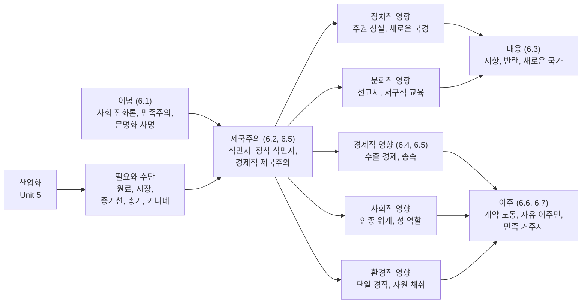
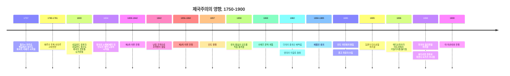
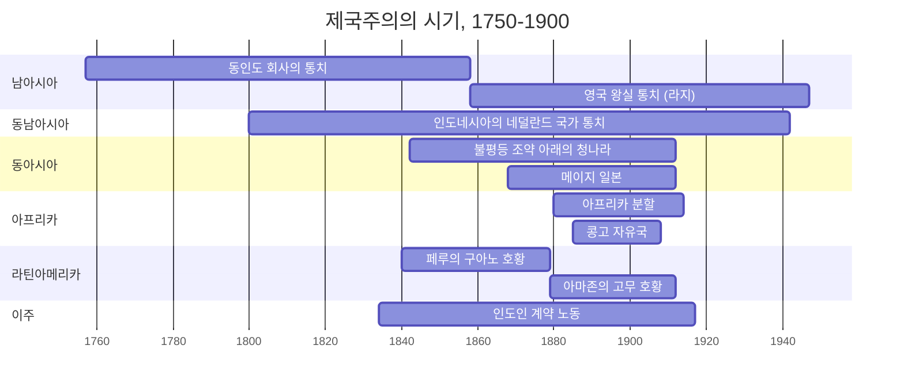
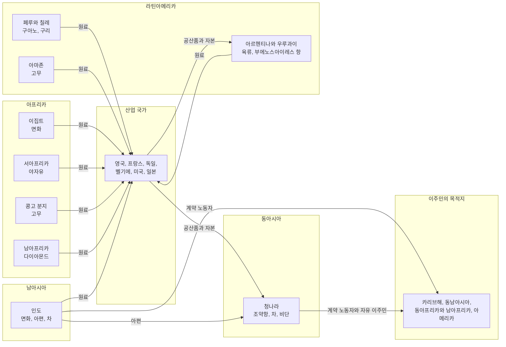
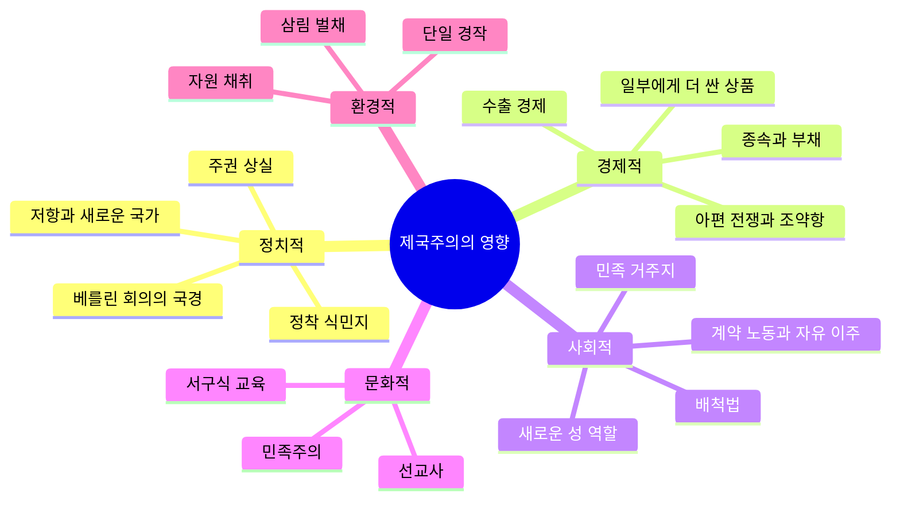

# AP 세계사: 모던 — 토픽 6.8 제국주의 시대의 인과관계 (Causation in the Imperial Age)

**Focus Question:** 1750–1900년 제국주의가 낳은 영향 가운데 가장 중요한 것은 무엇이었으며, 누구에게 그러했는가?

> 출처: CED 기준 · 교재 반영 전

**Unit 6: 산업화의 결과 (Consequences of Industrialization, c. 1750–1900)**

---

## 학습 목표 (Learning Objective)

| 코드 | 학습 목표 |
|---|---|
| 6.8 LO-I | 1750년부터 1900년까지 제국주의가 낳은 여러 영향의 상대적 중요성을 설명한다. |

> CED는 6.8에 주제 초점 (Thematic focus)을 두지 않으므로 코드에 주제를 붙이지 않았다. 권장 스킬은 **6.D 논증 (Argumentation)**이다. 다양한 대안적 근거를 사용해 논증을 입증하거나 한정하거나 수정하여 복합적인 논증을 전개하는 것이다 (§9 참고).

## 역사적 개념 (Historical Developments, CED)

> 6.8은 이 단원의 복습 토픽이다. CED는 새로운 역사적 개념을 더하지 않는다. 대신 "Review: Unit 6 Key Concepts"에서 아래 핵심 개념 (Key concepts) 네 개(KC-5.1–KC-5.4)를 제시하고, 6.1–6.7의 내용을 사용해 **인과관계 (Causation)**의 추론 과정으로 **제국주의의 영향을 저울질하게** 한다.

| # | 복습: Unit 6 핵심 개념 (Review: Unit 6 Key Concepts, CED) | 출처 토픽 | 다루는 곳 |
|---|---|---|---|
| R1 | KC-5.1: 산업 자본주의 (Industrial capitalism)의 발전은 일부 사람들의 생활 수준을 높였고, 제조 방식을 계속 개선하여 소비재를 더 쉽게, 더 싸게, 더 다양하게 구할 수 있게 했다. | 6.4, 6.5 (그리고 Unit 5) | 큰 그림 요약, §3, §7 (산업 국가), 비교표 |
| R2 | KC-5.2: 국가들은 산업화하면서 기존의 해외 제국을 확장하고 새로운 식민지와 대양을 넘는 관계를 구축했다. | 6.1, 6.2, 6.3, 6.5 | §2, §3, §5, §7 |
| R3 | KC-5.3: 18세기는 기존 정부에 맞선 혁명과 반란이 격렬하게 일어난 시기의 시작이었으며, 그 결과 세계 곳곳에 새로운 국민 국가 (Nation-state)가 세워졌다. | 6.3 | §2 (저항과 새로운 국가), §5 (민족주의와 반식민주의 사상), §8 |
| R4 | KC-5.4: 대양을 넘는 제국과 세계 자본주의 경제가 등장한 결과, 이주 양상이 극적으로 바뀌었고 이주민의 수가 크게 늘어났다. | 6.6, 6.7 | §4, §6 (환경적 배출 요인), §8 |

> 예시 (Illustrative examples): CED는 이 학습 목표에 예시를 **하나도** 제시하지 않는다. 이 노트의 모든 사례는 6.1–6.7이나 일반적인 학계 설명에서 가져온 것이며, 어느 것도 6.8의 CED 예시가 아니다.

---

## 큰 그림 요약

1750년부터 1900년까지 **산업화 (Industrialization)**는 소수의 국가에 제국을 세울 **동기**와 **수단**을 함께 주었다. 공장에는 **원료**와 **시장**이 필요했고, 투자자는 **이윤**을 원했다. 증기선, 철도, 전신, 키니네 (Quinine), 새로운 총기는 정복 비용을 낮추었다. **사회 진화론 (Social Darwinism)**, **민족주의 (Nationalism)**, **문명화 사명 (Civilizing mission)** 같은 이념이 이를 정당화했다 (6.1). 제국주의 (Imperialism)는 여러 형태를 띠었다. **직접 식민 통치**(1858년 이후의 인도, 1884–1885년 베를린 회의 이후 아프리카 대부분), **정착 식민지 (Settler colony)**(뉴질랜드, 오스트레일리아, 남아프리카, 알제리), 그리고 형식상 독립을 유지한 국가에 대한 **경제적 제국주의 (Economic imperialism)**(청나라, 라틴아메리카)가 그것이다. 그 영향은 **정치적**(주권 상실, 새로운 국경), **경제적**(수출 경제와 종속), **사회적**(이주, 인종 위계, 새로운 성 역할), **문화적**(선교사, 서구식 교육, 민족주의), **환경적**(단일 경작, 자원 채취) 영향으로 나뉜다. 이 영향들은 다시 저항, 반란, 새로운 국가 같은 **대응**(6.3)과 전례 없는 규모의 **이주**(6.6–6.7)를 낳았다. 토픽 6.8은 이 영향들을 나열하라고 하지 않는다. 어떤 영향이 누구에게, 어느 지역에서, 어느 기간에 걸쳐 가장 중요했는지 **저울질하라고** 한다.

---

## §1. 6.8이 묻는 것: 영향의 저울질

- **상대적 중요성 (Relative significance)**은 여러 영향을 서로 비교해 순위를 매기거나 무게를 다는 것이다. 영향을 나열하기만 하는 답은 학습 목표를 충족하지 못한다.
- **원인은 영향이 아니다.** 6.1의 정당화 논리(사회 진화론, 문명화 사명)는 원인이다. 6.8에서는 그것이 인종 위계나 선교 학교처럼 무엇으로 이어졌는지 설명할 때만 의미가 있다.
- 답은 **누구이고 어디인지에 따라 달라진다.** 같은 과정(예를 들어 면화 수출 경제)이 영국 소비자에게는 더 싼 옷감을, 이집트 농민에게는 세계 시장 가격에 대한 종속을 뜻했다.

| 기준 | 던질 질문 | Unit 6 사례 |
|---|---|---|
| **규모 (Scale)** | 얼마나 많은 사람에게 영향을 주었는가? | 수천만 명이 이주했다. 1914년에는 에티오피아와 라이베리아를 뺀 아프리카 전체가 유럽의 지배를 받았다 |
| **깊이 (Depth)** | 일상생활이 얼마나 바뀌었는가? | 수출용 면화나 고무만 기르는 농민은 세계 시장 가격과 외국 구매자에게 의존했다 |
| **지속 기간 (Duration)** | 얼마나 오래 지속되었는가? | 아프리카 식민지에 그어진 국경이 이후 대부분의 아프리카 국가의 국경이 되었다 |
| **범위 (Reach)** | 얼마나 많은 지역에 미쳤는가? | 수출 경제가 아프리카, 남아시아, 동남아시아, 라틴아메리카에서 성장했다 |
| **누가 얻고 누가 잃었는가** | 어떤 집단에는 도움이 되고 다른 집단에는 해가 되었는가? | 산업 국가의 일부 사람들은 생활 수준이 높아졌다. 많은 피식민 민족은 땅과 자치를 잃었다 |

## §2. 정치적 영향

| 영향 | 근거 (토픽) | 지역 |
|---|---|---|
| **주권 상실과 직접 통치** | **1857년 인도 항쟁 (1857 rebellion in India)** 이후 영국 왕실이 동인도 회사 (East India Company)로부터 인도 통치를 넘겨받았다(1858). 네덜란드 정부는 **네덜란드 동인도 회사 (Dutch East India Company)**의 영토를 넘겨받았다(1800). 벨기에는 **레오폴드 2세 (King Leopold II)**로부터 **콩고 (Congo)**를 넘겨받았다(1908) (6.2) | 남아시아, 동남아시아, 아프리카 |
| **분할과 새로운 국경** | **베를린 회의 (Berlin Conference)**(1884–1885)가 아프리카에 대한 유럽의 영유권 주장 규칙을 정했다. 식민지 국경은 흔히 한 민족을 갈라놓고 서로 경쟁하던 민족들을 한데 묶었다 (6.2) | 아프리카 |
| **정착 식민지** | 유럽인들이 **뉴질랜드 (New Zealand)**, 오스트레일리아, 남아프리카, 알제리에 정착하고 마오리족 (Māori), 오스트레일리아 원주민 (Aboriginal Australians), 아프리카 여러 민족의 땅을 빼앗았다 (6.2) | 태평양, 아프리카 |
| **육상 팽창** | **미국**, **러시아**, **일본**이 인접 지역을 정복하고 그곳에 정착했다. 체로키족 (Cherokee)의 강제 이주, 러시아의 중앙아시아 진출, 일본의 홋카이도 (Hokkaido) 개척과 1879년 류큐 제도 (Ryukyu Islands) 병합이 그 예이다 (6.2) | 북아메리카, 유라시아, 동아시아 |
| **비공식적 지배** | **아편 전쟁 (Opium Wars)** 이후 중국은 황제를 유지했지만 관세, 항구, 외국인에 대한 법적 처리에 대한 통제권을 잃었다 (6.5) | 동아시아 |
| **저항과 새로운 국가** | 직접적 저항: **투팍 아마루 2세 (Túpac Amaru II)**, **1857년 인도 항쟁**, **사모리 투레 (Samory Touré)**, **야 아산테와 전쟁 (Yaa Asantewaa War)**. 새로운 국가: **줄루 왕국 (Zulu Kingdom)**, **소코토 칼리프국 (Sokoto Caliphate)**, **체로키 네이션 (Cherokee Nation)**, **발칸반도의 독립 국가**. 반란: **유령의 춤 (Ghost Dance)**, **코사족 가축 도살 운동 (Xhosa Cattle-Killing Movement)**, **마흐디 전쟁 (Mahdist wars)** (6.3) | 모든 지역 |

- **단기적 영향:** 정복, 조약, 자치의 상실.
- **장기적 영향:** 식민지 국경, 서구식으로 훈련된 군대와 관료제, 그리고 20세기 독립운동으로 이어진 **민족주의**의 성장(Unit 8).
- **예외:** **에티오피아 (Ethiopia)**는 **아도와 (Adwa)**에서 이탈리아를 물리치고(1896) 독립을 지켰다. 일본은 식민지가 되지 않았고, 오히려 스스로 제국주의 국가가 되었다.

## §3. 경제적 영향

| 영향 | 근거 (토픽) | 얻은 쪽 | 잃은 쪽 |
|---|---|---|---|
| **수출 경제 (Export economies)** | **이집트**의 면화, **서아프리카**의 야자유, **아마존과 콩고 분지**의 고무, **페루와 칠레**의 구아노 (Guano), **아르헨티나와 우루과이**의 육류, **아프리카**의 다이아몬드 (6.4) | 산업 국가의 공장주, 상인, 소비자. 일부 현지 엘리트 | 수출 생산에 강제로 동원되거나 내몰린 노동자. 가격 변동에 노출된 농민 |
| **경제적 제국주의** | **영국과 프랑스**가 **아편 전쟁**을 통해 중국에서 영향력을 넓혔다. **부에노스아이레스 항 (Port of Buenos Aires)**이 영국 회사들의 지원을 받아 건설되었다 (6.5) | 영국과 프랑스 상인. 영국 투자자 | 청나라 정부. 외국과의 경쟁에 부딪힌 현지 생산자 |
| **유럽과 미국에 유리하게 조직된 교역** | 남아시아의 **아편**이 중국에 팔렸다. 남아시아와 이집트의 **면화**가 영국으로 갔다. 사하라 이남 아프리카의 **야자유**, 칠레의 **구리**도 그러했다 (6.5) | 유럽과 미국에 근거지를 둔 상인과 회사 | 원료를 싸게 팔고 완제품을 사들인 생산 지역 |
| **종속과 부채** | 원료에서 얻은 이윤은 완제품을 사는 데 쓰였다 (6.4). 이집트는 유럽 은행에서 많은 돈을 빌렸고, 영국은 1882년 이집트를 점령했다 | 외국 채권자와 채권 보유자 | 자국 재정에 대한 통제권을 잃은 정부 |
| **일부의 생활 수준 향상** | 산업 국가의 중간 계급과 노동 계급은 더 싼 옷감, 차, 설탕 등 여러 소비재를 얻었다 (KC-5.1) | 산업 국가의 소비자 | 대부분의 피식민 민족은 누리지 못함 |

- **경제적 제국주의**에는 공식적인 식민지가 필요하지 않았다. 아르헨티나, 페루, 칠레는 독립국이었지만 철도, 항구, 광산 상당수를 외국 회사가 소유했다.
- **탈산업화 (Deindustrialization):** 값싼 영국산 기계 직물이 인도의 손 방적과 손 직조를 밀어냈고, 인도는 원면을 수출하는 쪽으로 바뀌었다.

> ⚠️ 확인 필요: 인도의 수공업 직물 산업이 쇠퇴한 원인이 영국산 수입품과 식민 정책에 얼마나 있었고, 다른 요인에 얼마나 있었는지는 역사가들 사이에서 논쟁이 있다. 선생님이 어떻게 가르치는지 확인이 필요하다.

## §4. 사회적 영향

| 영향 | 근거 (토픽) | 지역 |
|---|---|---|
| **강제적·반강제적 노동 이주** | 영국 제국에서 노예제가 폐지된 뒤 **중국인과 인도인 계약 노동자 (Indentured servants)**가 플랜테이션과 광산으로 갔다. **죄수 노동 (Convict labor)**이 오스트레일리아로 보내졌다. 브라질과 쿠바에서는 1880년대까지 노예제가 이어졌다 (6.6) | 카리브해, 동남아시아, 아프리카, 태평양 |
| **자유 이주** | **미국으로 간 아일랜드인**, **남아시아와 아프리카로 간 영국인 기술자와 지질학자**, 아르헨티나로 간 이탈리아인. 많은 이주민이 고향으로 돌아갔다. **태평양 지역의 일본인 농업 노동자**, **아메리카의 레바논 상인**, **아르헨티나의 이탈리아인 공업 노동자**가 그 예이다 (6.6) | 아메리카, 태평양, 아프리카, 남아시아 |
| **도시화 (Urbanization)** | 국내 이주민과 해외 이주민이 증기선과 철도를 타고 도시로 옮겨 갔다 (6.6) | 세계 곳곳 |
| **새로운 성 역할** | 이주민은 대부분 남성이어서 고향에 남은 여성들이 남성이 맡던 역할을 떠맡았다 (6.7) | 남유럽, 남아시아, 중국 |
| **민족 거주지 (Ethnic enclave)** | 동남아시아, 카리브해, 아메리카의 **중국인**. 동아프리카와 남아프리카, 카리브해, 동남아시아의 **인도인**. 북아메리카의 **아일랜드인**. 북아메리카와 남아메리카의 **이탈리아인** (6.7) | 세계 곳곳 |
| **인종 위계와 배척** | 사회 진화론은 인종에 따라 민족의 순위를 매겼다. **중국인 배척법 (Chinese Exclusion Act)**(1882)과 **백호주의 정책 (White Australia policy)**이 아시아계 이민자를 제한했다 (6.1, 6.7) | 미국, 오스트레일리아 |
| **폭력과 인구 손실** | **콩고 자유국 (Congo Free State)**의 강제 고무 채집은 대량 학살, 신체 절단, 죽음으로 이어졌다 | 중앙아프리카 |

> ⚠️ 확인 필요: 콩고 자유국의 사망자 수 추정치는 약 100만 명에서 1,000만 명까지 크게 차이 난다. 인구 조사가 없어서 정확한 수치를 알 수 없다. 선생님이 어떻게 가르치는지 확인이 필요하다.

- 백호주의 정책은 이 시기 직후인 **1901년 이민 제한법 (Immigration Restriction Act)**으로 법이 되었다. 그러나 이 정책은 19세기에 중국인 이주민을 제한한 조치에서 자라났다.

## §5. 문화적 영향

| 영향 | 근거 (토픽) | 지역 |
|---|---|---|
| **선교사 (Missionaries)** | 사하라 이남 아프리카와 태평양에 기독교 선교가 퍼졌고, 흔히 **선교 학교 (Mission schools)**가 함께 세워졌다 (6.1) | 아프리카, 태평양, 동아시아 |
| **서구식 교육 (Western education)** | 식민지 학교와 선교 학교가 사무원, 교사, 변호사를 길러 냈다. 그 가운데 일부가 **인도 국민회의 (Indian National Congress)**(1885)를 세웠다 | 남아시아, 서아프리카 |
| **민족주의와 반식민주의 사상** | 정치 권위에 대한 의문이 커지고 **민족주의**가 성장하면서 **반식민주의 운동 (Anticolonial movements)**이 일어나는 데 기여했다 (6.3) | 남아시아, 아프리카, 라틴아메리카 |
| **종교적 대응** | **유령의 춤**, **코사족 가축 도살 운동**, **마흐디 전쟁**은 종교 사상에 기대어 제국의 지배에 저항했다 (6.3) | 북아메리카, 남아프리카, 수단 |
| **인종 관념** | 사회 진화론과 문명화 사명은 피식민 문화가 "뒤떨어졌다"는 생각을 퍼뜨렸다 (6.1) | 모든 피식민 지역 |

- **의도하지 않은 영향:** 서구식 학교는 **자유**와 **민족 자결** 같은 사상을 가르쳤다. 서구식 교육을 받은 엘리트들은 뒤에 그 사상을 자신들을 가르친 제국에 맞서는 데 썼다.
- **선택적 수용:** 일본 같은 일부 국가는 외국의 지배에 맞서기 위해 서구의 기술과 제도를 받아들였다.

## §6. 환경적 영향

| 영향 | 근거 (토픽) | 지역 |
|---|---|---|
| **단일 경작 (Monoculture)** | 넓은 지역에서 이집트와 인도의 면화, 카리브해의 설탕처럼 한 가지 수출 작물만 길렀다 (6.4) | 아프리카, 남아시아, 카리브해 |
| **자원 채취 (Extraction)** | 페루와 칠레 앞바다의 섬에서 매장량이 줄어들 때까지 구아노를 파냈다. 아마존과 콩고 분지에서 고무를 채취했다. 아프리카와 칠레에서 다이아몬드와 구리를 캤다 (6.4, 6.5) | 라틴아메리카, 아프리카 |
| **삼림 벌채 (Deforestation)** | 차, 커피, 고무 플랜테이션을 만들려고 숲을 베어 냈다 | 남아시아, 동남아시아 |
| **기근과 이주** | 환금 작물이 일부 식량 작물을 대신했다. 일부 역사가는 이것이 19세기 후반 인도의 기근을 악화시켰다고 본다. 기근과 토지 부족은 사람들을 이주로 내몰기도 했다 (6.6) | 남아시아, 중국, 아일랜드 |

- **이주와의 연관 (6.6):** 아일랜드 대기근 (Irish Famine)(1845–1852) 같은 환경적·인구적 압력이 수백만 명을 고향 밖으로 내몰았다.

## §7. 지역별 영향, 그리고 식민 지배자와 피식민자에 대한 영향

| 지역 | 제국주의의 주된 형태 | 가장 중요한 영향으로 내세울 만한 것 | 근거 |
|---|---|---|---|
| **사하라 이남 아프리카** | 베를린 회의 이후의 공식 식민 통치 | **정치적**: 주권 상실과 새로운 국경 | 베를린 회의, 콩고 자유국, 사모리 투레, 야 아산테와 전쟁. 예외인 에티오피아 |
| **남아시아** | 동인도 회사의 통치, 1858년부터는 왕실 통치 | **경제적**: 원면 수출과 영국산 옷감 시장 | 1857년 인도 항쟁, 왕실 통치, 면화와 아편 수출, 계약 노동 이주 |
| **동아시아** | 중국에 대한 경제적 제국주의. 일본은 제국주의 국가가 됨 | **경제적·정치적**: 불평등 조약과 교역 통제권 상실 | 아편 전쟁, 난징 조약 (Treaty of Nanjing)(1842), 일본의 타이완 병합(1895) |
| **라틴아메리카** | 독립국에 대한 경제적 제국주의 | **경제적**: 수출과 외국 투자에 대한 종속 | 부에노스아이레스 항, 구아노, 구리, 육류 |
| **동남아시아와 태평양** | 네덜란드, 영국, 프랑스, 미국의 식민지. 정착 식민지 | **사회적**: 플랜테이션과 이주민이 섞인 사회 | 인도네시아의 네덜란드 통치, 뉴질랜드, 필리핀의 미국(1898), 중국인과 인도인 거주지 |
| **산업 국가 (식민 지배자)** | 위 지역들을 지배하거나 영향력을 행사함 | **경제적**: 원료, 시장, 일부의 생활 수준 향상 | 더 싼 소비재, 투자 이윤, 국가의 위신. 제국 사이의 경쟁(제1차 세계 대전의 한 원인, Unit 7) |

- **식민 지배자**는 대체로 경제적 이익을 얻었다. 그러나 제국은 전쟁과 열강 사이의 경쟁 심화라는 대가도 치르게 했다.
- **피식민 민족**은 대체로 자치, 땅, 경제에 대한 통제권을 잃었다. 그러나 현지 엘리트, 상인, 서구식 교육을 받은 전문직 같은 일부 집단은 새로운 부나 영향력을 얻었다.

## §8. 인과관계 추론: 단기와 장기, 의도와 비의도

| 영향 | 단기 또는 장기 | 의도 또는 비의도 | 중요한 이유 |
|---|---|---|---|
| **중국의 조약항 (Treaty ports)** | 단기적이지만 장기적 결과를 낳음 | 영국과 프랑스가 의도함 | 중국 시장을 열고 청나라를 약하게 만들었다 |
| **아프리카의 식민지 국경** | 장기 | 유럽인이 의도함. 뒤따른 민족 간 긴장은 의도하지 않음 | 대부분의 국경이 독립 이후에도 남았다 |
| **서구식 교육을 받은 민족주의자** | 장기 | 의도하지 않음 | 인도 국민회의와 이후의 독립운동으로 이어졌다 |
| **인도인과 중국인의 민족 거주지** | 장기 | 부분적으로 의도하지 않음 | 카리브해, 동아프리카, 동남아시아에 다민족 사회를 만들었다 |
| **단일 경작과 종속** | 장기 | 생산은 의도함. 종속과 환경 피해는 의도하지 않음 | 경제가 몇 가지 수출품에 묶인 채로 남았다 |
| **배척법** | 단기적 반응 | 이민을 받는 국가가 의도함 | 이민을 받는 사회가 늘 이주민을 환영한 것은 아님을 보여 주었다 |

- **경제적 영향이 가장 중요하다는 주장:** 중국과 아르헨티나 같은 독립국을 포함해 모든 지역에 미쳤고, 산업 경제와 원료 경제라는 세계적 분업을 만들었다.
- **정치적 영향이 가장 중요하다는 주장:** 주권 상실이 경제적 변화를 가능하게 했고, 식민지 국경과 국가 체제가 20세기와 21세기까지 이어졌다.
- **사회적 영향이 가장 중요하다는 주장:** 이주가 수천만 명을 옮겼고, 오래 지속되는 디아스포라 (Diaspora)와 인종 차별법을 만들었다.
- 정답은 하나가 아니다. 점수를 얻는 것은 **분명한 기준**(규모, 지속 기간, 깊이)과 **구체적인 근거**이다.

## §9. 복합적인 논증 세우기 (AP 스킬 6.D)

- **입증하기 (Corroborate):** 주장을 뒷받침하는 근거를 더한다.
- **한정하기 (Qualify):** "대부분의 지역에서"나 "에티오피아와 일본을 제외하면"처럼 주장의 범위를 좁힌다.
- **수정하기 (Modify):** 들어맞지 않는 근거를 보고 주장을 고친다.

| CED의 방법 | 뜻 | Unit 6 사례 |
|---|---|---|
| **1. 여러 변수 분석하기** | 영향이 여러 요인에 따라 달라졌음을 보인다 | 제국주의의 영향은 지배 형태(식민지, 정착 식민지, 경제적 제국주의), 지역, 집단(엘리트, 농민, 이주민)에 따라 달랐다 |
| **2. 한 시대 안팎의 연관 짓기** | 토픽을 다른 토픽이나 시대와 연결한다 | 계약 노동은 대서양 노예제의 강제 노동을 이어 갔다(Unit 4). 식민지 국경은 탈식민화를 형성했다(Unit 8) |
| **3. 사료의 신뢰성과 한계가 갖는 의미 설명하기** | 사료의 관점이 어떻게 도움이 되고 어떻게 한계가 되는지 설명한다 | 키플링 (Rudyard Kipling)의 「백인의 짐 (The White Man's Burden)」(1899)은 제국주의자들이 제국을 어떻게 정당화했는지 보여 주지만, 피식민 민족이 겪은 일은 보여 주지 못한다. 임칙서 (Lin Zexu)가 빅토리아 여왕에게 보낸 편지(1839)는 아편 무역에 대한 청나라의 관점을 보여 준다 |
| **4. 주장이 어떻게 또는 왜 효과적인지, 혹은 효과적이지 않은지 설명하기** | 주장을 근거에 비추어 검증한다 | "철도가 인도를 근대화했다"는 주장은, 철도가 주로 원료를 항구로 옮기고 군대를 이동시키려고 건설되었다는 근거 앞에서 약해진다 |

### LEQ 모범 논지

> **경제 강조:** "1750–1900년 제국주의의 가장 중요한 영향은 경제적인 것이었다. 산업 국가들이 아프리카, 아시아, 라틴아메리카를 이집트의 면화, 콩고의 고무, 페루의 구아노 같은 원료를 팔고 완제품을 사들이는 수출 경제로 바꾸었기 때문이다. 이 종속은 청나라와 아르헨티나처럼 형식상 독립국인 나라에까지 미쳤다. 다만 아프리카에서는 주권 상실 같은 정치적 영향이 더 중요했다."

> **정치 강조:** "1750–1900년 제국주의의 가장 중요한 영향은 정치적 주권의 상실이었다. 아프리카의 베를린 회의와 1857년 이후 인도의 영국 왕실 통치 같은 정복과 조약이 유럽인에게 식민지의 경제와 사회를 재편할 힘을 주었기 때문이다. 경제적 종속도 널리 퍼졌지만 그것은 이러한 정치적 지배 위에 세워졌고, 이때 만들어진 국경은 제국보다 오래 남았다."

- 두 논지 모두 **상대적 중요성에 대한 주장**을 하고, **이유**를 대며, 마지막 부분에서 주장을 **한정한다**. 이 한정이 논증을 복합적으로 만든다.

### SAQ 모범 답안

- **아프리카:** 베를린 회의(1884–1885)는 아프리카 분할로 이어졌다. 유럽 국가들은 아프리카의 정치적·민족적 경계를 무시하고 국경을 그었고, 그래서 많은 아프리카 민족이 자치를 잃었다. 야 아산테와 전쟁 같은 저항은 아프리카인들이 이 상실을 얼마나 깊이 느꼈는지 보여 준다.
- **아시아:** 아편 전쟁은 청나라가 조약항을 열고 불평등 조약을 받아들이게 만들었다. 영국과 프랑스 상인은 중국 시장에 진출했고, 청나라는 관세와 교역에 대한 통제권을 잃어 약해졌다.

---

## 연표

---

## 지도: 상품, 자본, 사람의 흐름

---

## 비교표

### 유형과 지역에 따른 제국주의의 영향

| 영향의 유형 | 아프리카 | 남아시아 | 동아시아 | 라틴아메리카 | 규모 | 중요성 |
|---|---|---|---|---|---|---|
| **정치적** | 베를린 회의, 분할, 새로운 국경 | 1857년 이후 왕실 통치 | 중국의 불평등 조약. 일본 자신의 제국 | 형식상 독립 유지 | 아프리카와 남아시아 거의 전역 | 아프리카와 남아시아에서 매우 높음. 국경이 남음 |
| **경제적** | 야자유, 고무, 다이아몬드, 이집트 면화 | 원면, 아편, 차. 손 직조의 쇠퇴 | 아편 무역, 조약항 | 구아노, 구리, 육류, 부에노스아이레스 항 | 산업 중심부 밖의 모든 지역 | 어디서나 매우 높음. 독립국에도 미침 |
| **사회적** | 인종 위계. 동아프리카와 남아프리카의 인도인 거주지 | 해외로 보내진 계약 노동자. 여성의 새로운 역할 | 해외의 중국인 이주민과 거주지. 배척법 | 이탈리아인 등 유럽 이주민 | 수천만 명의 이주민 | 높음. 오래 지속되는 디아스포라를 만듦 |
| **문화적** | 선교사와 선교 학교 | 서구식 교육. 인도 국민회의 | 일본의 선택적 수용 | 유럽 이주민의 문화 | 처음에는 주로 엘리트 | 단기적으로는 중간. 민족주의를 통해 장기적으로는 높음 |
| **환경적** | 고무와 다이아몬드 채취 | 단일 경작, 삼림 벌채, 기근 | 덜 직접적 | 구아노와 구리 채취 | 지역적 | 중간. 흔히 이주, 기근과 연결됨 |

### 식민 지배자와 피식민자

| 영역 | 식민 지배자 (산업 국가) | 식민 지배나 지배를 받은 민족 |
|---|---|---|
| **정치** | 영토, 위신, 전략적 항구를 얻음 | 주권을 잃거나 이름뿐인 주권만 유지함 |
| **경제** | 원료, 시장, 이윤. 더 싼 소비재 | 수출 종속, 부채, 외국인 소유 |
| **사회** | 해외 이주가 사회적 압력을 덜어 줌. 본국에서의 인종 관념 | 인종 위계, 강제 노동, 이주 |
| **문화** | 문명화 사명에 대한 믿음 | 선교와 학교. 새로운 민족주의 사상 |

### 마인드맵: 제국주의의 영향

---

## Key Terms (핵심 용어)

| 주제 | 용어 | 정의 |
|---|---|---|
| 스킬 | 상대적 중요성 (Relative significance) | 한 영향이 다른 영향에 비해 얼마나 중요했는지를 규모, 깊이, 지속 기간, 범위로 판단한 것 |
| 스킬 | 복합적인 논증 (Complex argument, 6.D) | 다양한 대안적 근거를 사용해 주장을 입증하거나 한정하거나 수정하는 논증 |
| 스킬 | 한정하기 (Qualify) | 예외를 밝히는 식으로 주장이 근거에 맞도록 범위를 좁히는 것 |
| 정치 | 주권 (Sovereignty) | 한 국가가 자기 영토와 일을 온전히 통제하는 권리 |
| 정치 | 정착 식민지 (Settler colony) | 많은 유럽인이 영구히 정착하고 토착민의 땅을 빼앗은 식민지 |
| 정치 | 베를린 회의 (Berlin Conference) | 1884–1885년 유럽 국가들이 아프리카 영유권 주장 규칙을 정한 회의 |
| 정치 | 반식민주의 운동 (Anticolonial movements) | 민족주의와 정치 권위에 대한 의문을 바탕으로 식민 지배에 맞선 운동 |
| 경제 | 경제적 제국주의 (Economic imperialism) | 완전한 식민 통치 없이 교역, 투자, 조약을 통해 다른 지역의 경제를 지배하는 것 |
| 경제 | 수출 경제 (Export economy) | 천연자원 채취나 식량·공업용 작물 재배를 수출용으로 특화한 경제 |
| 경제 | 불평등 조약 (Unequal treaty) | 난징 조약(1842)처럼 약한 국가에 강요되어 외국 열강에 유리했던 조약 |
| 경제 | 산업 자본주의 (Industrial capitalism) | 사유 공장과 임금 노동에 바탕을 두고 일부 사람들의 생활 수준을 높인 경제 체제 |
| 사회 | 계약 노동 (Indentured servitude) | 흔히 해외 뱃삯을 대가로, 정해진 햇수 동안 계약에 따라 일하는 노동 |
| 사회 | 민족 거주지 (Ethnic enclave) | 새로운 곳에서 자기 문화를 지키며 사는 이주민 공동체 |
| 사회 | 중국인 배척법 (Chinese Exclusion Act) | 중국인 노동자의 이민을 금지한 1882년 미국 법 |
| 문화 | 문명화 사명 (Civilizing mission) | 유럽인이 피식민 민족에게 자기 문화와 종교를 퍼뜨릴 의무가 있다는 믿음 |
| 환경 | 단일 경작 (Monoculture) | 넓은 지역에서 한 가지 작물만, 주로 수출용으로 기르는 것 |
